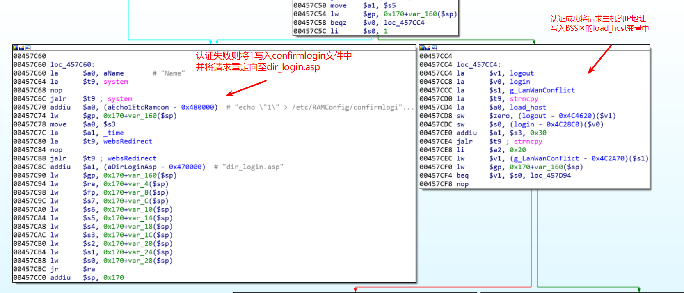
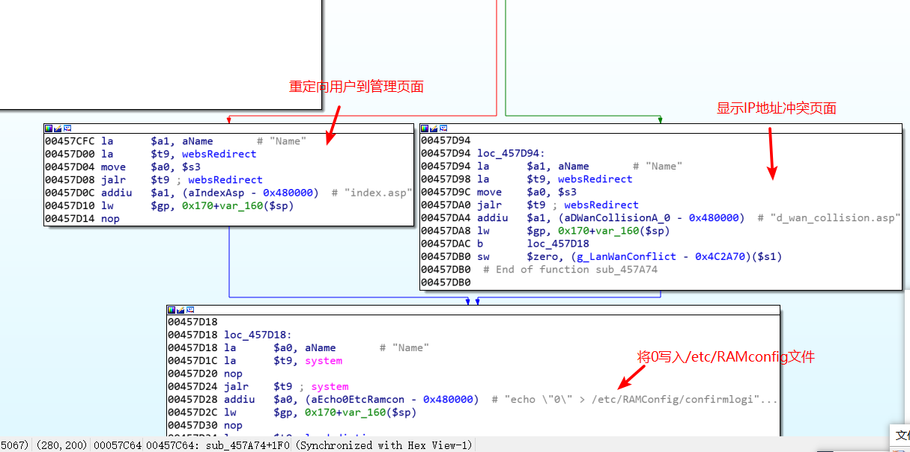
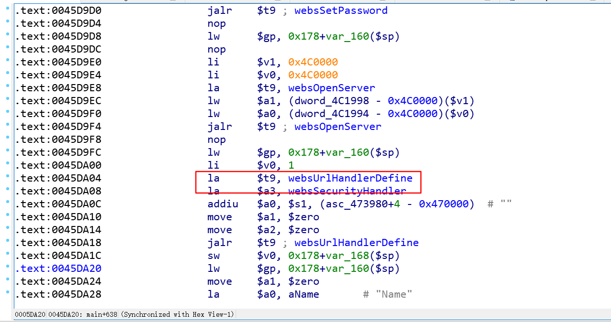
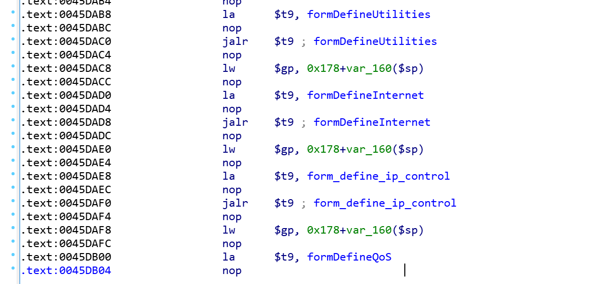

群晖的路由器好难分析，最后还是只能复现一下D-LINK的相关漏洞。

## DIR-816历史漏洞

-   [CVE-2018-17066](https://cve.mitre.org/cgi-bin/cvename.cgi?name=CVE-2018-17066): [Command injection](https://github.com/PAGalaxyLab/VulInfo/blob/master/D-Link/DIR-816/cmd_injection_0). Credit: nabla
-   [CVE-2018-17068](https://cve.mitre.org/cgi-bin/cvename.cgi?name=CVE-2018-17068): [Command injection](https://github.com/PAGalaxyLab/VulInfo/blob/master/D-Link/DIR-816/cmd_injection_1). Credit: nabla
-   [CVE-2018-17064](https://cve.mitre.org/cgi-bin/cvename.cgi?name=CVE-2018-17064): [Command injection](https://github.com/PAGalaxyLab/VulInfo/blob/master/D-Link/DIR-816/cmd_injection_2). Credit: nabla
-   [CVE-2018-17063](https://cve.mitre.org/cgi-bin/cvename.cgi?name=CVE-2018-17063): [Command injection](https://github.com/PAGalaxyLab/VulInfo/blob/master/D-Link/DIR-816/cmd_injection_3). Credit: nabla
-   [CVE-2018-17067](https://cve.mitre.org/cgi-bin/cvename.cgi?name=CVE-2018-17067): [Stack overflow](https://github.com/PAGalaxyLab/VulInfo/blob/master/D-Link/DIR-816/stack_overflow_0). Credit: nabla
-   [CVE-2018-17065](https://cve.mitre.org/cgi-bin/cvename.cgi?name=CVE-2018-17065): [Stack overflow](https://github.com/PAGalaxyLab/VulInfo/blob/master/D-Link/DIR-816/stack_overflow_1). Credit: nabla
-   [CVE-2019-10041](https://cve.mitre.org/cgi-bin/cvename.cgi?name=CVE-2019-10041): [Edit System Account Without Authentication](https://github.com/PAGalaxyLab/VulInfo/blob/master/D-Link/DIR-816/edit_sys_account/README.md). Credit: lbp
-   [CVE-2019-10039](https://cve.mitre.org/cgi-bin/cvename.cgi?name=CVE-2019-10039): [Edit Web And System Account Without Authentication](https://github.com/PAGalaxyLab/VulInfo/blob/master/D-Link/DIR-816/edit_web_and_sys_account/README.md). Credit: lbp
-   [CVE-2019-10040](https://cve.mitre.org/cgi-bin/cvename.cgi?name=CVE-2019-10040): [Remote Command Execute](https://github.com/PAGalaxyLab/VulInfo/blob/master/D-Link/DIR-816/remote_cmd_exec_0/README.md). Credit: lbp
-   [CVE-2019-10042](https://cve.mitre.org/cgi-bin/cvename.cgi?name=CVE-2019-10042): [Reset Router Without Authentication](https://github.com/PAGalaxyLab/VulInfo/blob/master/D-Link/DIR-816/reset_router/README.md). Credit: lbp

## DIR-816管理页面分析

主程序位于 `./bin/goahead`

输入账号密码后，将会向goform/formLogin接口发送如下图所示的数据包进行验证。从数据包中可以看到关键的参数有username，password以及tokenid，其中username使用了base64进行编码，password则进行了某种加密

`ghidra`中查看函数 `FUN_00457a74`的源码

```c
....
....
username = websGetVar(iParm1,"username",&DAT_00473984);
  password = (char *)websGetVar(iParm1,"password",&DAT_00473984);
  tokenid = (char *)websGetVar(iParm1,"tokenid",&DAT_00473984);
  strcpy((char *)&local_158,tokenid);
                    /* tokenid 进行拼接 */
  strcat((char *)&local_158,"B05CC245BFB8A28A83B4F80000000000");
  websDecode64(acStack296,username,0x80);
  if (*password != 0) {
    decrypt_aes(&local_158,password,acStack168);
  }
  compareResult = strcmp(__s1,acStack296);
  if (compareResult == 0) {
    iVar2 = strcmp(__s1_00,acStack168);
    if (iVar2 == 0) {
      logout = 0;
                    /* 如果密码正确记录login为1 */
      login = 1;
      strncpy(load_host,(char *)(iParm1 + 0x30),0x20);
      if (g_LanWanConflict == 1) {
        websRedirect(iParm1,"d_wan_collision.asp");
        g_LanWanConflict = 0;
      }
      else {
        websRedirect(iParm1,"index.asp");
      }
                    /* 同时向这个文件写入0 */
      system("echo \"0\" > /etc/RAMConfig/confirmlogin");
      load_dictionary(uVar1,dictionary);
      return;
    }
  }
  system("echo \"1\" > /etc/RAMConfig/confirmlogin"); //登陆失败就写入1
  websRedirect(iParm1,"dir_login.asp");
  return;
```

> 在更新BSS区的变量load\_host后则会检测lan口和wan口的状态并返回对应的登录页面，随后将0写入/etc/RAMConfig/confirmlogin文件中

通过上述的分析，实际上D-Link路由器在认证成功后仅仅记录了成功登录的用户IP地址，随后将是否需要验证登录的Flag文件内容设置为了0。

如下图所示，



在更新BSS区的变量load\_host后则会检测`lan`口和`wan`口的状态并返回对应的登录页面，随后将0写入/etc/RAMConfig/confirmlogin文件中。



### 相关的handler

对于cgi程序是如何处理路由还不是很熟悉，不过感觉`handler`就是一个类似处理路由的函数



根据不同的url路径**goahead**进程将使用不同的Handler进行处理。看到有两个全局Handler,**websSecurityHandler**和**websDefaultHandler。**


**websDefaultHandler**会调用**websValidateUrl**函数对请求的url地址进行检测，主要的功能是对转义符号进行处理并避免’**../‘**路径穿越的问题。

相关代码如下：

```c
    while (__s_01 != (char *)0x0) {
      *__s_01 = '/';
      __s_01 = strchr(__s_01,0x5c);
    }
    __s_01 = strtok(__s_00,"/");
    if (__s_01 != (char *)0x0) {
      do {
        while( true ) {
          if (0x3f < iVar4) goto LAB_004088bc;
          iVar2 = strcmp(__s_01,".."); //查找到相关的字符，防止目录穿越
          if (iVar2 != 0) break;
          if (0 < iVar4) {
            iVar4 = iVar4 + -1;
          }
LAB_004086e8:
          __s_01 = strtok((char *)0x0,"/");
          if (__s_01 == (char *)0x0) goto LAB_00408788;
        }
        iVar2 = strcmp(__s_01,".");
```

### form越权漏洞利用

通过对main函数分析，可以找到相关的`form`函数



重点关注`sub_458D7C`这个函数


可以执行任意命令了

写的比较仓促，路由器的模拟也没有成功，还是需要用qemu单独调试
