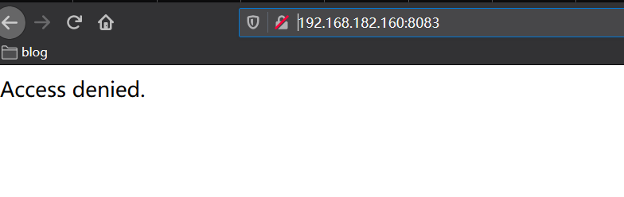
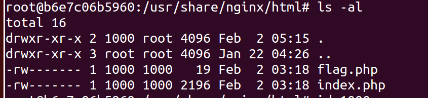
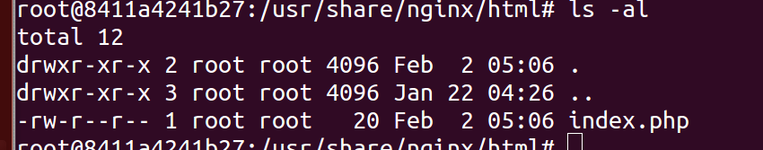
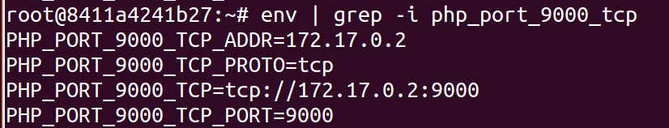
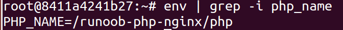
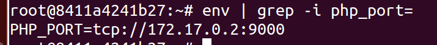
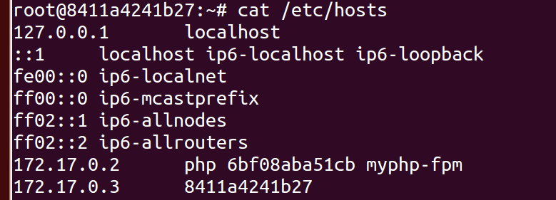
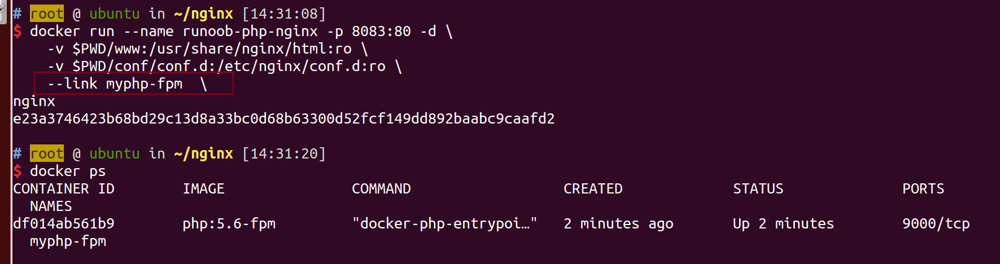

## docker 遇到的坑

运行的时候不能直接用 `./` 指定当前的文件，需要 `$PWD`

一次性清理所有的已经关闭的容器  
`docker ps -a | grep Exit | cut -d ' ' -f 1 | xargs docker rm`

`:ro` 表示只读

访问受到限制



此时目录下的文件权限



重新运行了一下



看来是文件权限的问题，也就是说docker会默认将文件权限直接复制过来，由于我之前的那个用户是pxy，而docker环境中并没有这个用户，导致就变成了1000

## 移除镜像

```
docker image rm xxxx
```

## –link 参数

自动添加了环境变量





还有这个



`/etc/hosts` 也会更新



神奇。。  
运行nginx和php-fpm  
`docker run --name myphp-fpm -v $PWD/www:/www -d php:5.6-fpm`

```
$ docker run --name runoob-php-nginx -p 8083:80 -d \           
    -v $PWD/www:/usr/share/nginx/html:ro \
    -v $PWD/conf/conf.d:/etc/nginx/conf.d:ro \
    --link myphp-fpm:php \ ----> 注意需要取别名
nginx
```

如果不取别名的话直接闪退，别名可以理解成对应的主机地址



然后开始折腾docker-compose.yml

```yaml
version: '2'
services:
  nginx:
    image: nginx:latest
    volumes:
      - ./conf/conf.d:/etc/nginx/conf.d
      - ./www:/usr/share/nginx/html
    depends_on:
      - myphp-fpm
    links:
      - myphp-fpm:php
    ports:
      - "8083:80"
  myphp-fpm:
    image: php:5.6-fpm
    volumes:
      - ./www:/www
```

试了多次，`links` 需要取别名

同时文件的权限也很重要，不然会出现无法读取flag的情况

## Dockerfile 编写

`WORKDIR` 指定工作目录，这样就能够在执行一些shell命令的时候不需要指明路径了

## docker无法运行 mysql容器

这是由于我偷懒只在本机安装了 mysql 得客户端，没有安装服务端，这也是很神奇了

## docker运行phpmyadmin

我发现并不需要 nginx ,当然如果有nginx的情况下可以做到反向代理比较好一点

```yaml
version: "3"
services:
  phpmyadmin:
    image: phpmyadmin/phpmyadmin
    ports: 
      - 8081:80
    links:
      - mysql:db
  mysql:
    image: mysql:5.6
    environment: 
      - MYSQL_ROOT_PASSWORD=123456
```

## nginx结合mysql

```yaml
version: '2'
services:
  nginx:
    image: nginx:latest
    volumes:
      - ./conf/conf.d:/etc/nginx/conf.d
      - ./www:/usr/share/nginx/html
    depends_on:
      - myphp-fpm
    links:
      - myphp-fpm:php
    ports:
      - "8083:80"
  myphp-fpm:
    image: php/kuozhan
    volumes:
      - ./www:/www
    links:
      - mysql:db
  mysql:
    image: mysql:5.6
    restart: always
    environment:
      - MYSQL_ROOT_PASSWORD=123456
```

## nginx配置学习

nginx的配置文件以后再单独写，这里先学一点

怎么理解 nginx和php-fpm的关系呢

我在配置docker环境的时候意识到nginx和php两个镜像是相互独立的，首先运行php-fpm镜像，将其内部的 `/www` 映射到我外部的 `./www` 目录中，然后再运行 nginx 镜像，将其 `/usr/share/nginx/html` 映射到 `./www` 目录，同时还需要做两件事

1.  配置nginx，指定解析的脚本目在 `/www` 目录中
2.  连接php-fpm容器，需要将解析到 php 这个域名才行
