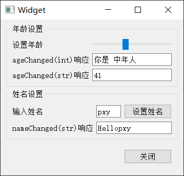
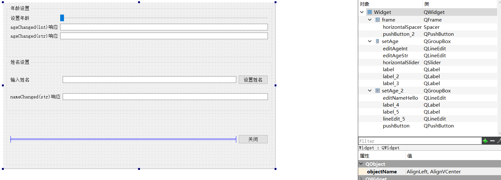

编写一个简单地GUI应用如下



拖动进度条，下面两个框框会显示不同的数据

输入姓名，点击设置姓名，下面的框框回回显数据

点击关闭按钮关闭窗口

## GUI设计

妥妥拽拽即可



两个 `groupbox` 布局可以通过


进行设置

## 信号和槽

关闭按钮的信号直接通过拖动即可关联

### 自定义信号

```python
import sys

from PyQt5.QtCore import QObject,pyqtSlot,pyqtSignal

class human(QObject):
    nameChanged = pyqtSignal(str)
    ageChanged = pyqtSignal([int], [str])
    
    def __init__(self, name="Mike", age=10,parent=None):
        super().__init__(parent)
        
    def setAge(self, age):
        self._age = age
        self.ageChanged.emit(self._age)
        if age<=18:
            ageInfo="你是 少年"
        elif (18< age <=35):
            ageInfo="你是 年轻人"
        elif (35< age <=55):
            ageInfo="你是 中年人"
        elif (55< age <=80):
            ageInfo="您是 老人"
        else:
            ageInfo="您是 寿星啊"
        self.ageChanged[str].emit(ageInfo)
        
    def setName(self, name):
        self._name = name
        self.nameChanged.emit(self._name)
```

自定义两个信号 `nameChanged` 和 `ageChanged`

自定义槽函数

```python
class MyWidget(QWidget):
    def __init__(self,parent=None):
        super().__init__(parent=parent)
        
        self._ui = Ui_Widget()
        self._ui.setupUi(self)
        self.body = human("Mike", 20)
        
        self.body.nameChanged.connect(self.do_nameChanged)
        self.body.ageChanged.connect(self.do_ageChanged_int)
        self.body.ageChanged[str].connect(self.do_ageChanged_str)
    def on_horizontalSlider_valueChanged(self,value):
        self.body.setAge(value)
        pass
    
    def on_pushButton_clicked(self):
        '''
        当按钮点击时候自动触发该槽函数
        从输入框中获取到输入的姓名，接着调用body的setName方法，setName方法会放出一个信号，由于之前设置的连接，直接触发do_nameChanged槽函数
        '''    
        hisName = self._ui.lineEdit_5.text()
        self.body.setName(hisName)
        pass
    # 自定义的槽函数
    def do_nameChanged(self,name):
        self._ui.editNameHello.setText("Hello"+name)
        pass
    
    def do_ageChanged_int(self,age):
        self._ui.editAgeStr.setText(str(age))
        pass
    
    @pyqtSlot(str)
    def do_ageChanged_str(self,ageInfo):
        self._ui.editAgeInt.setText(ageInfo)
        pass
```
