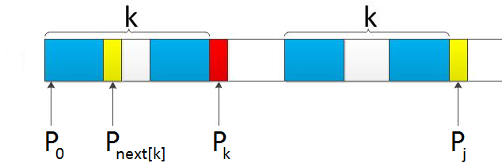

学习完KMP算法才发现编程如此的奇妙

## 求next数组

```python
def getNext(s):
    '''
    计算字符串的next数组
    '''
    length = len(s)
    next = [0 for i in range(length)]
    next[0] = -1
    k = -1
    j = 0
    while j < length-1:
        # 这个 or 逻辑写的np
        if k == -1 or s[j] == s[k]:
            j += 1
            k += 1
            next[j] = k
        else:
            k = next[k]
    return next
```

从这张图可以看到整个的匹配过程，如果 $p\_{k}$ 和 $p\_{j}$ 匹配不上，那么就去看 $p\_{next\[k\]}$ 和 $p\_{j}$



比如

```
p = "ABCDABD"
```

得到的结果就是

```
[-1, 0, 0, 0, 0, 1, 2]
```

细节感觉还是要靠自己体会

## KMP算法

```python
def KMP(s,p):
    next = getNext(p)

    m,n = 0,0
    while m < len(s) and n < len(p):
        if n == -1 or p[n] == s[m]:
            n += 1
            m += 1

        else:
            n = next[n]
    if n == len(p):
        return True
    else:
        return False
```

从头开始匹配即可，遇到匹配不上的情况就返回到 `next[k]`

## 参考

[https://blog.csdn.net/v\_JULY\_v/article/details/7041827](https://blog.csdn.net/v_JULY_v/article/details/7041827)
