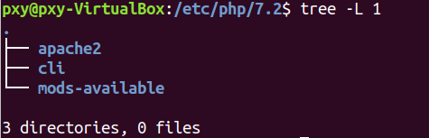
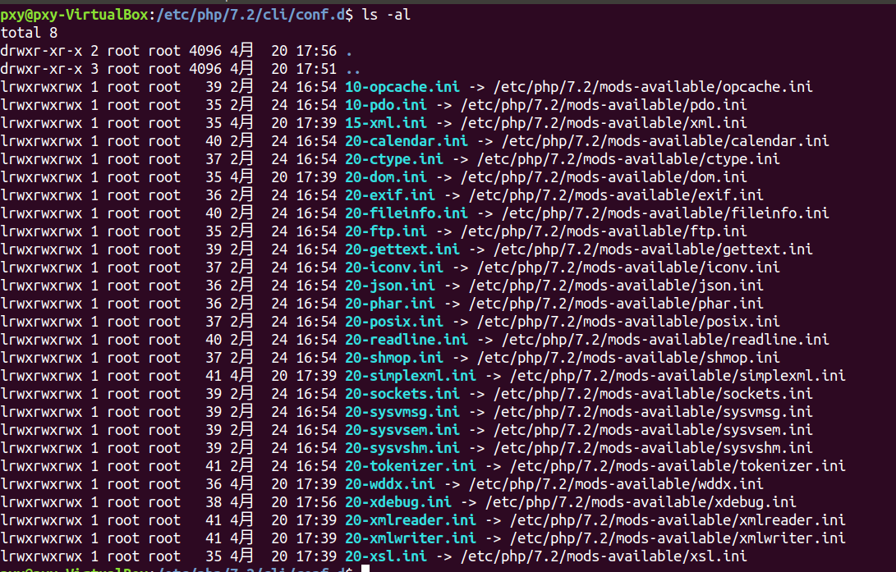
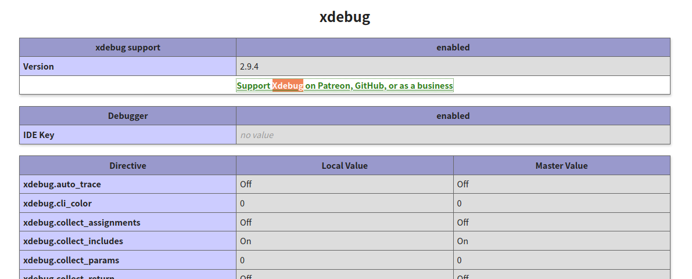

## vscode安装

直接去官网下载deb包，然后双击即可完成安装

加两个配置选项

```
"editor.mouseWheelZoom": true,
"php.validate.executablePath": "/usr/bin/php"
```

第一个是直接用滚轮缩放大小，并且图标的大小不变，第二个是配置php的路径

之后安装一些插件就不说了

## apache环境

直接安装

```
sudo apt install apache2
```

然后安装php模块

```
sudo apt-get install libapache2-mod-php
```

之后，修改一下html目录的用户和组

```
chown pxy html/ -R
chgrp pxy html/ -R
```

## xdebug

```
php -i > a.txt
```

然后将 a.txt 的内容拷贝到

[https://xdebug.org/wizard](https://xdebug.org/wizard)

自动帮你分析phpinfo的内容(不过现在只支持php7了)

1.  Download [xdebug-2.9.4.tgz](http://xdebug.org/files/xdebug-2.9.4.tgz)
    
2.  Install the pre-requisites for compiling PHP extensions.  
    On your Ubuntu system, install them with: `apt-get install php-dev autoconf automake`
    
3.  Unpack the downloaded file with `tar -xvzf xdebug-2.9.4.tgz`
    
4.  Run: `cd xdebug-2.9.4`
    
5.  Run: `phpize` (See the [FAQ](https://xdebug.org/docs/faq#phpize) if you don’t have `phpize`).
    
    As part of its output it should show:
    
    ```
    Configuring for:
    ...
    Zend Module Api No:      20170718
    Zend Extension Api No:   320170718
    ```
    

If it does not, you are using the wrong `phpize`. Please follow [this FAQ entry](https://xdebug.org/docs/faq#custom-phpize) and skip the next step.

6.  Run: `./configure`
    
7.  Run: `make`
    
8.  Run: `cp modules/xdebug.so /usr/lib/php/20170718`
    
9.  Update `/etc/php/7.2/cli/php.ini` and change the line  
    `zend_extension = /usr/lib/php/20170718/xdebug.so`
    
10.  Please also update `php.ini` files in adjacent directories, as your system seems to be configured with a separate `php.ini` file for the web server and command line.
     

重点是后面几个步骤：

1.  `cp modules/xdebug.so /usr/lib/php/20170718`
    
2.  修改 `/etc/php/7.2/cli/php.ini` 文件内容，加上
    
    ```
    zend_extension = /usr/lib/php/20170718/xdebug.so
    ```
    
3.  然后还需要修改 `/etc/php/7.2/apache2` 目录下的 php.ini 这个才是web的
    

如图， `cli` 目录是命令行， `apache2` 才是web的



4.  之后还需要修改 `mods-available` 目录下的文件

```
pxy@pxy-VirtualBox:/etc/php/7.2/mods-available$ cat xdebug.ini 
;zend_extension=xdebug.so
xdebug.remote_enable = 1
xdebug.remote_port = 9000
;xdebug.idekey = PHPSTORM
xdebug.remote_host=localhost
xdebug.remote_autostart = 1
xdebug.show_error_trace = 1
```

5.  最后需要在web和cli下的 `conf.d` 中做一次软链接



至此xdebug+vscode就配置好了


