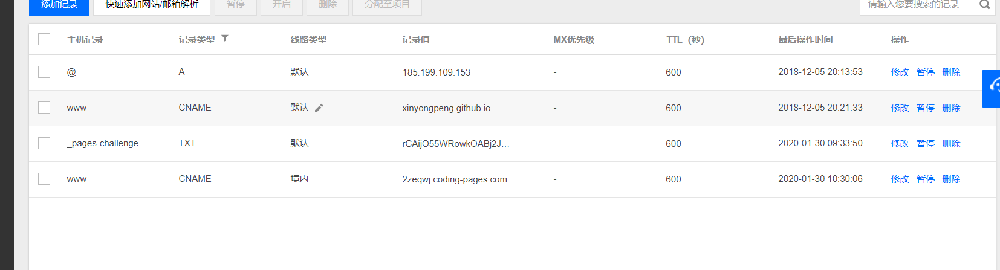
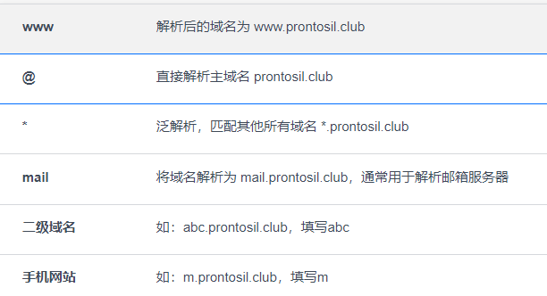
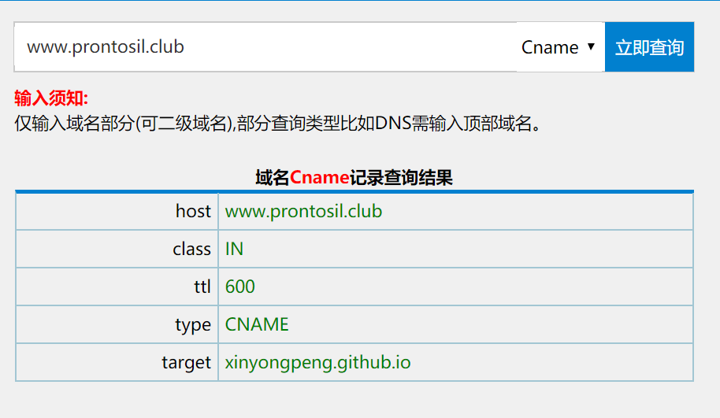
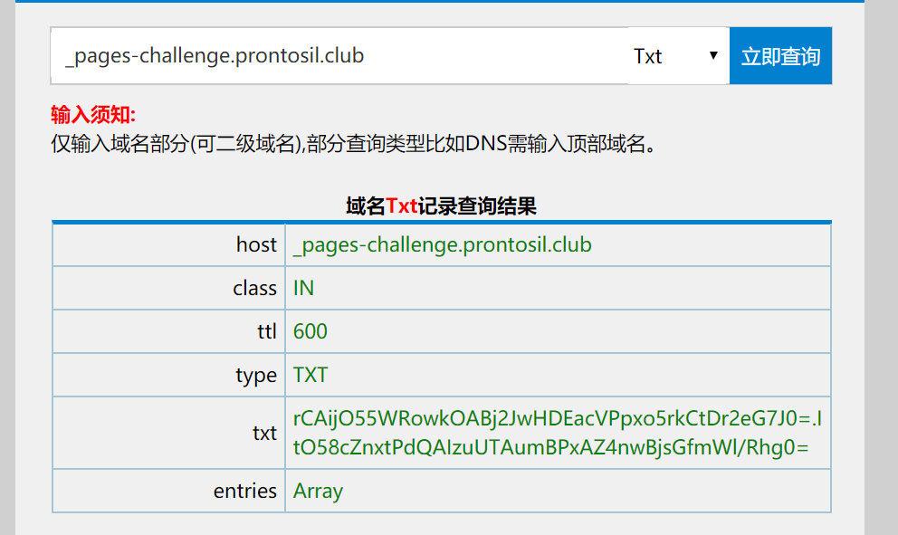

## 博客域名解析

如下是我在腾讯云后台的设置

按照腾讯云的解释

可以查询到 [www.prontosil.club](http://www.prontosil.club) 的解析记录为

经过多次的折腾发现，`@` 解析记录只能有一个默认，只能有一个记录类型，比如我这里是A记录设置为 `@`，那么CNAME记录就不能设置为 `@`

同时我终于发现`www` 和裸域的区别了，之前还一直以为是同一个

## 裸域

不加 www 的裸域名好处主要是域名更加简短、容易记忆。坏处就多了，讲几个主要的技术原因：  
裸域名只能绑定 DNS 的 A 记录，不能绑定 CNAME 记录。也就是说你不能把裸域设定为另外域名的别名。很多时候这对管理不是很方便，特别是使用第三方托管服务的时候。如果第三方迁移服务器导致 IP 地址变更，你必须自己去更改 DNS 的 A 记录。

## TXT记录

这种可以用来出题
