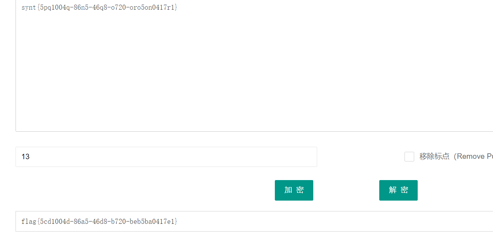
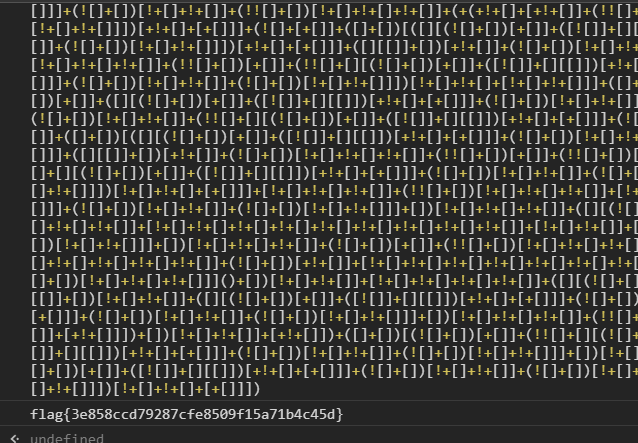
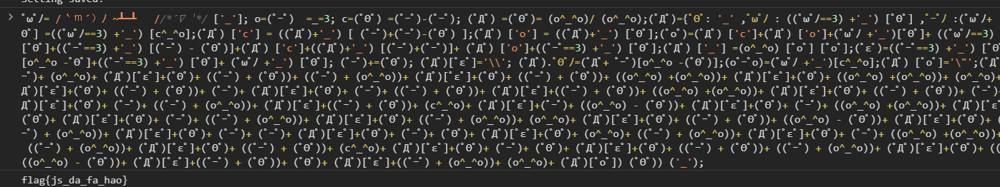
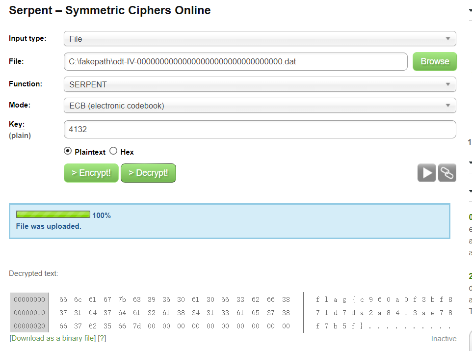

记录一下ctf.show平台

[https://ctf.show/challenges](https://ctf.show/challenges)

## crypto0

凯撒密码



## crypto2

jsfuck



## crypto3

还是jsfuck编码



## crypto4

p=447685307 q=2037 e=17

提交flag{d}即可

```python
import gmpy2

'''
给出p,q,e 求d
'''
# p = 3487583947589437589237958723892346254777
# q = 8767867843568934765983476584376578389
# e = 65537
p=18443
q=49891
e=19
phin = (p - 1) * (q - 1)
print gmpy2.invert(e, phin)
```

## crypto5

p=447685307 q=2037 e=17 c=704796792

提交flag{m}

```python
import gmpy2

'''
给出p,q,e,c 求d和m
'''
p=447685307
q=2037
e=17
c=704796792
phin = (p - 1) * (q - 1)
d = gmpy2.invert(e, phin)
print pow(c,d,p*q)
```

## crypto7

ook解密

[https://www.splitbrain.org/services/ook](https://www.splitbrain.org/services/ook)

```
flag{b615c4b79a1aede83b9ae67104ff4eb5}
```

## crypto8

brainfuck解密

```
flag{99754106633f94d350db34d548d6091a}
```

## crypto9

密码是4132

[http://serpent.online-domain-tools.com/](http://serpent.online-domain-tools.com/)



## crypto10

邮件编码

## crypto11

解密后就是ctf

## crypto13

混合加密

```python
import base64
def base(s):
    try:
        s = base64.b32decode(s)
        s = base(s)
    except:
        try:
            s = base64.b64decode(s)
            s = base(s)
        except:
            return s
    return s
f = open('base.txt')

text = f.read()

print(base(text))
```

flag{b4Se\_Fami1y\_Is\_FUn}
