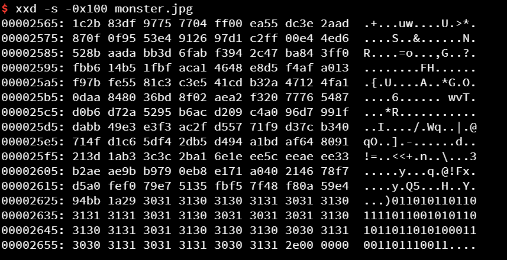
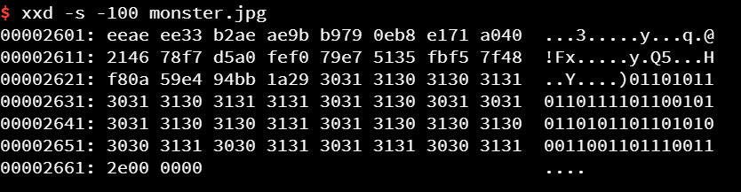

## xxd

基本选项

-   \-a : 它的作用是自动跳过空白内容，默认是关闭的
-   \-c : 它的后面加上数字表示每行显示多少字节的十六进制数，默认是16字节。
-   \-g : 设定以几个字节为一块，默认为2字节。
-   \-l : 显示多少字节的内容。
-   \-s : 后面接【+-】和address.加号表示从地址处开始的内容，减号表示距末尾address开始的内容。
-   \-ps: output in postscript plain hexdump style

xxd 是有单位的，如



和



很显然其中一个 0x100 是 256个字节，也就是16行咯

### \-g 选项的含义

默认是两个字节一组

```bash
$ xxd -s -100 -l 0x20 monster.jpg
00002601: eeae ee33 b2ae ae9b b979 0eb8 e171 a040  ...3.....y...q.@
00002611: 2146 78f7 d5a0 fef0 79e7 5135 fbf5 7f48  !Fx.....y.Q5...H
```

通过 -g 变为一个字节一组

```bash
$ xxd -s -100 -l 0x20  -g 1 monster.jpg 
00002601: ee ae ee 33 b2 ae ae 9b b9 79 0e b8 e1 71 a0 40  ...3.....y...q.@
00002611: 21 46 78 f7 d5 a0 fe f0 79 e7 51 35 fb f5 7f 48  !Fx.....y.Q5...H
```

## 其他用法

如果我只想要十六进制,加上 -ps 选项

```bash
$ xxd -s -100 -l 0x20  -g 1  -ps monster.jpg 
eeaeee33b2aeae9bb9790eb8e171a040214678f7d5a0fef079e75135fbf5
7f48
```

​ 可以输出C语言数组形式

```bash
$ xxd -s -100 -l 0x20  -g 1 -i  monster.jpg 
unsigned char monster_jpg[] = {
  0xee, 0xae, 0xee, 0x33, 0xb2, 0xae, 0xae, 0x9b, 0xb9, 0x79, 0x0e, 0xb8,
  0xe1, 0x71, 0xa0, 0x40, 0x21, 0x46, 0x78, 0xf7, 0xd5, 0xa0, 0xfe, 0xf0,
  0x79, 0xe7, 0x51, 0x35, 0xfb, 0xf5, 0x7f, 0x48
};
unsigned int monster_jpg_len = 32;
```

## 与vim结合

`vim 文件名 -b` 以二进制方式打开文件

然后输入命令 `%!xxd`

就可以进入到十六进制编辑模式

编辑完之后需要用 `%!xxd -r` 保存，退回到原来的vim模式

## 反向dump

```bash
# pxy @ LAPTOP-UBIEP4K5
$ xxd monster.jpg file.dump

# pxy @ LAPTOP-UBIEP4K5
$ head -n 4 file.dump 
00000000: ffd8 ffe0 0010 4a46 4946 0001 0100 0001  ......JFIF......
00000010: 0001 0000 ffdb 0043 0008 0606 0706 0508  .......C........
00000020: 0707 0709 0908 0a0c 140d 0c0b 0b0c 1912  ................
00000030: 130f 141d 1a1f 1e1d 1a1c 1c20 242e 2720  ........... $.'

# pxy @ LAPTOP-UBIEP4K5 
$ xxd -r file.dump > a.jpg

# pxy @ LAPTOP-UBIEP4K5 
$ file a.jpg 
a.jpg: JPEG image data, JFIF standard 1.01, aspect ratio, density 1x1, segment length 16, baseline, precision 8, 160x247, components 3
```

这样比较方便，可以转成其他文件，进行编辑之后再转回来，本质上和vim一起用的效果一样

​
