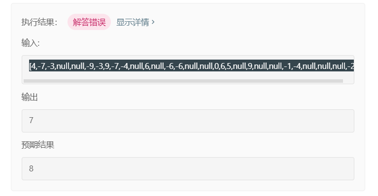

## 题目

给定一棵二叉树，你需要计算它的直径长度。一棵二叉树的直径长度是任意两个结点路径长度中的最大值。这条路径可能穿过根结点。

示例 :  
给定二叉树

```
    1
   / \
  2   3
 / \     
4   5    
```

返回 3, 它的长度是路径 \[4,2,1,3\] 或者 \[5,2,1,3\]。

## 思路

找到左子树的节点个数，右子树的节点个数，剩下的就好做了

我写了的lj代码

```java
package March;

/**
 * @description: 二叉树的直径
 * @author: Pxy
 * @create: 2020-03-10 20:02
 **/

/**
 * [4,-7,-3,null,null,-9,-3,9,-7,-4,null,6,null,-6,-6,null,null,0,6,5,null,9,null,null,-1,-4,null,null,null,-2]
 * 上面这个结果过不了
 */
public class diameterOfBinaryTree {
    class TreeNode{
        int val;
        TreeNode left;
        TreeNode right;
        TreeNode(int x){
            val = x;}
    }
    public int diameterOfBinaryTree(TreeNode root) {
        if (root == null) {
            return 0;
        }
        if (root.right == null) {
            return helper(root.left);
        } else if (root.left == null) {
            return helper(root.right);
        } else {
            int leftLength = helper(root.left);
            int rightLength = helper(root.right);
            return leftLength + rightLength;
        }

    }

    public static int helper(TreeNode root) {
        if (root != null) {
            return Math.max(helper(root.left), helper(root.right)) + 1;
        } else {
            return 0;
        }
    }
}
```

但是leetcode提交的时候给了一个奇葩的测试样例

```
[4,-7,-3,null,null,-9,-3,9,-7,-4,null,6,null,-6,-6,null,null,0,6,5,null,9,null,null,-1,-4,null,null,null,-2]
```

这。。



算了我暂时也看不出哪里有问题

## 官方

```java
class Solution {
    int ans;
    public int diameterOfBinaryTree(TreeNode root) {
        ans = 1;
        depth(root);
        return ans - 1;
    }
    public int depth(TreeNode node) {
        if (node == null) return 0; // 访问到空节点了，返回0
        int L = depth(node.left); // 左儿子为根的子树的深度
        int R = depth(node.right); // 右儿子为根的子树的深度
        ans = Math.max(ans, L+R+1); // 计算d_node即L+R+1 并更新ans
        return Math.max(L, R) + 1; // 返回该节点为根的子树的深度
    }
}
```

思路也是比较简单的，不过这个用法很神奇，`depth` 函数有返回值，这个返回值只在递归的时候用到

java写OJ的时候如果要用全局变量，只需要在外面写一个就行了。

## 参考

[https://leetcode-cn.com/problems/diameter-of-binary-tree/solution/liang-chong-si-lu-shi-yong-quan-ju-bian-liang-yu-b/](https://leetcode-cn.com/problems/diameter-of-binary-tree/solution/liang-chong-si-lu-shi-yong-quan-ju-bian-liang-yu-b/)
