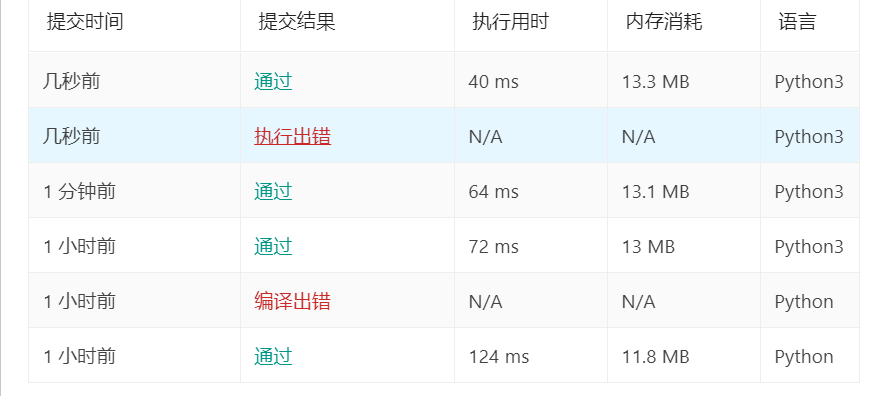
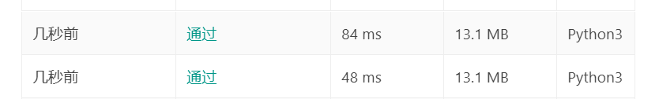

## 整数转罗马数字

题目虽然不难，但是也整了好久，后来才明白转成罗马数字就是不断地做除法和模

但是我这里遇到了一个问题，python中的字典本来是无序的，所以我就拆成了两个list来存放

```python
class Solution(object):
    def intToRoman(self, num):
        """
        :type num: int
        :rtype: str
        """
        result = ''
        nums = [1000,900,500,400,100,90,50,40,10,9,5,4,1]
        chars = ['M','CM','D','CD','C','XC','L','XL','X','IX','V','IV','I']
        for i in nums:
            x = num // i
            num = num % i
            result += x*chars[nums.index(i)]
        return result
```

这样当然是没问题得，但是我看到评论区居然有人用python的字典也成功了

这就很疑惑了，于是我修改了代码：

```python
class Solution(object):
    def intToRoman(self, num):
        """
        :type num: int
        :rtype: str
        """
        result = ""
        roman = {1000:'M',900:'CM', 500:'D', 400:'CD', 100:'C',90:'XC', 50:'L', 40: 'XL',10:'X',9:'IX', 5:'V',4:'IV', 1:'I'}
        for i in roman:
            x = num // i
            num = num % i
            result += x*roman[i]
        return result
```

居然也过了！！！

难道leetcode的python解释器不一样？



## 罗马数字转整数

这个题目就更妙了，秒就妙在对于哈希表的处理上

如果是我想的话，只需要将上个题的哈希表倒过来就行了，但是实际上我们可以这样做：

```python
d = {'I':1, 'IV':3, 'V':5, 'IX':8, 'X':10, 'XL':30, 'L':50, 'XC':80, 'C':100, 'CD':300, 'D':500, 'CM':800, 'M':1000}
```

本来 `IV` 是代表4的，但是在这里却减去了1，其余的9，40，90都是类似的

```python
class Solution:
    def romanToInt(self, s: str) -> int:
        d = {'I':1, 'IV':3, 'V':5, 'IX':8, 'X':10, 'XL':30, 'L':50, 'XC':80, 'C':100, 'CD':300, 'D':500, 'CM':800, 'M':1000}
        result = 0
        for i,n in enumerate(s):
            a = max(i-1,0)
            b = d.get(s[a:i+1], d[n]) # 每次取两个元素，如果有就说明是4，9这类，如果没有就采取默认的 d[n]
            result += b
        return result
```

不得不说这种方法确实很巧妙，甚至可以浓缩为一句话

```python
return sum(d.get(s[max(i-1, 0):i+1], d[n]) for i, n in enumerate(s))
```

不过效率对比上来看，浓缩之后的速度反而变慢了


