## 第一、二章

### 基础知识

一个存储单元一般存储 1个字节，也就是8个二进制位

一个字为两个字节

地址总线：用来寻址，由于一根地址总线只能表示2个状态，所以一个CPU有N根地址线，则可以说这个CPU的地址总线宽度为N，这样的CPU最多可以寻找 $2^{N}$ 个内存单元

数据总线：数据总线的宽度意味着CPU一次能传输多少位数据

控制总线：控制总线的宽度决定了CPU对外部器件的控制能力

### 寄存器

通用寄存器中，AX可以拆分为 AH和AL，如果单独使用AH或者AL，则应该看成一个独立的8位寄存器来使用，AH和AL此时是不相关的

如何寻址？  
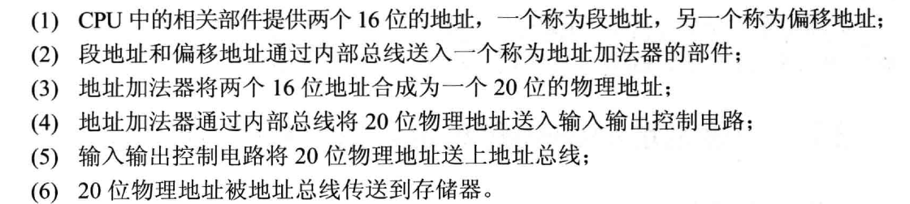

注意此时并不是操作系统中学到的分段，只是这么用罢了

一个 ‘段’ 的偏移占16位，那么一个段的长度最大为64KB

不同的段地址和偏移地址可以形成同一个物理地址

CS:IP 指向的内容就是将要执行的指令(但是CPU是怎么知道指令的长度的呢，x86是变长的，而MIPS是等长的，这个坑之后说)

基础指令 mov,add,jmp

mov指令设置寄存器的内容值，add执行加法，jmp设置cs和ip的值

四条指令完成计算2的4次方

```asm
mov ax,2
add ax,ax
add ax,ax
add ax,ax
```

当然也可以使用jmp指令，但是你无法判定程序什么时候退出(因为指令不够hhhh)

## dosbox使用

dosbox可以用来模拟dos环境，然后我们下载一个MASM工具包，里面包含了 `debug` 这些程序

注意设置dosbox

```
[autoexec]
# Lines in this section will be run at startup.
# You can put your MOUNT lines here.

mount C: G:\MASM
C:
```

因为我的 MASM 工具包位于 G盘目录下，所以设置挂载命令  
这样打开dosbox之后自动挂载

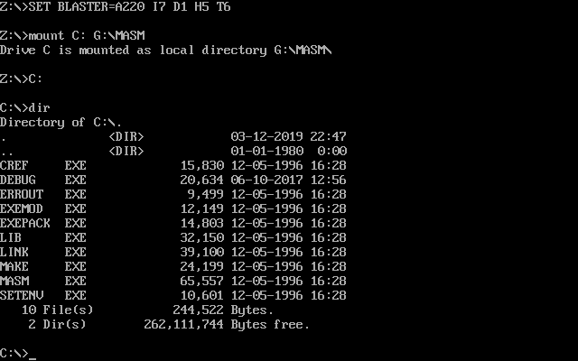

## 实验一

debug.exe 使用  
r 命令可以查看寄存器内容，以及当前的 cs:ip 指向，还有ds指向的内容

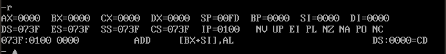

还可以修改寄存器的内容

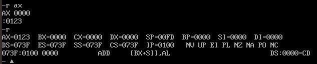

使用d命令查看内存

`d1000:9`

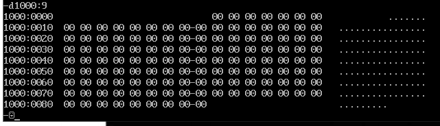

查看某一个范围内的内存

`d1000:9 20`

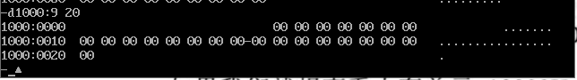

e 命令可以修改内存的数据

`e1000:0 0 1 2 3 4 5 7 8`

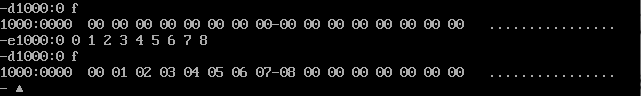

当然也可以换一种方式修改

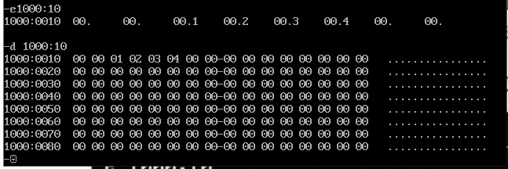

也可以向其中写入字符串

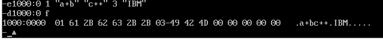

尝试写入一段汇编指令

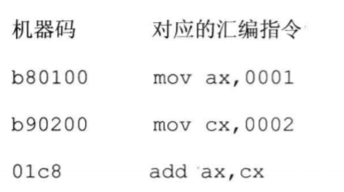

使用 e命令编辑内存，然后使用 u 命令反汇编

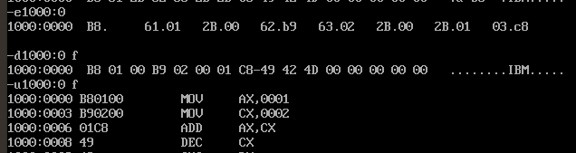

那么如何执行汇编指令呢？

首先用 r 设置 cs 和 ip的值，然后使用 t 就可以执行汇编指令了，可以看到执行了三条汇编指令后的结果， ax 存储了 0x03 cx 存储了 0x02

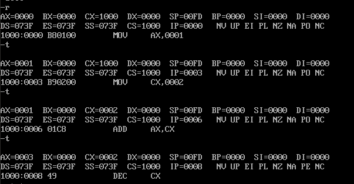

直接使用 e 命令编辑当然不方便，于是可以用 a 命令直接书写汇编指令，然后自动的给转化成对应的机器码

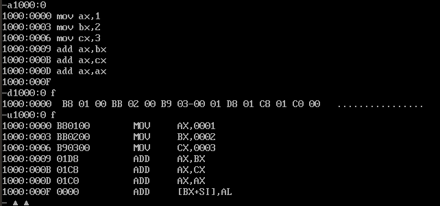

## 实验任务

1.  使用debug将下面的程序写入内存，逐条执行

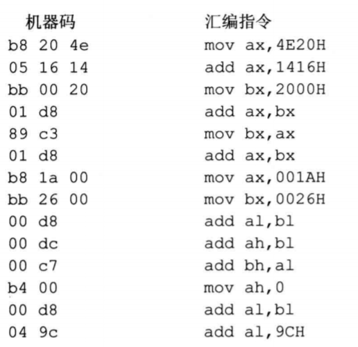

汇编指令输入到内存中

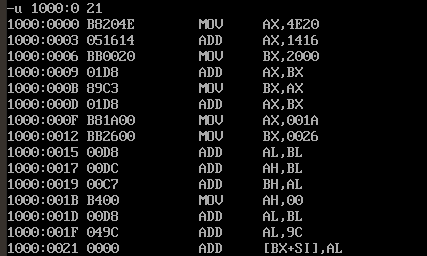

然后运行就是的了

2.  将下面3条指令写入到 2000:0 开始的内存单元中，计算2的次方

```asm
mov ax,1
add ax,ax
jmp 2000:0003
```

运行过程截图

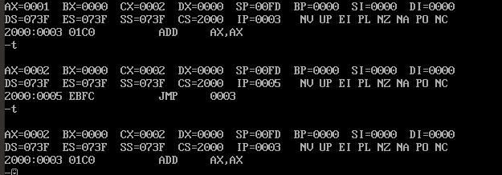

3.  PC 机主板上的ROM有一个生产日期，在内存 FFF00H~FFFFFH 的某几个单元中，请找到这个生产日期并试图改变它

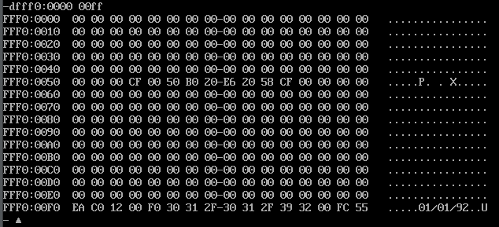

很显然我是改不了的

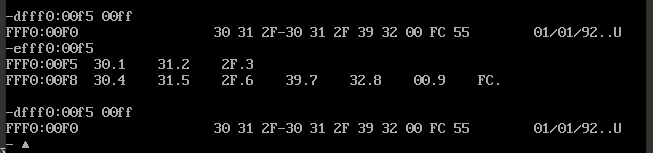
