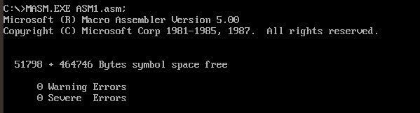
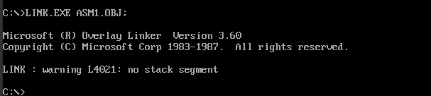
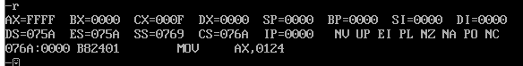
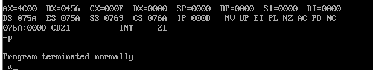
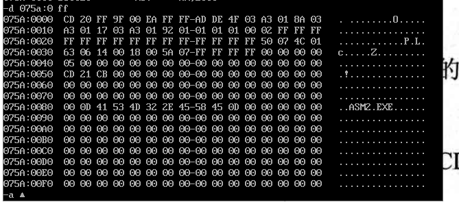

## 从汇编程序开始

```asm
assume cs:codesg

codesg segment
	mov ax,0123H
	mov bx,0456H
	add ax,bx
	add ax,ax
	
	mov ax,4c00H
	int 21H
codesg ends
end
```

伪指令

```
段名 segment
段名 ends
```

`end` 和 `ends` 不一样， end标记整个程序的结束  
`assume` 将有特定用途的段和相关的段寄存器关联起来

程序返回

```
mov ax,4c00H
int 21H
```

编写代码，使用 MASM.exe 编译，然后使用 LINK.exe 进行链接





运行当然是没有结果的，我们需要使用 `debug` 调试

## 可执行文件的加载过程

程序加载的时候，找到一个段地址 `SA:0000`,程序从 `SA+10H:0000` 处开始运行，`SA` 存放在 ds寄存器中

刚加载进内存中时，



此时看到 ds 寄存器的内容为 `075AH` ,所以程序的物理地址就是 ds+10h ,正好符合  
在int21 时需要使用 p命令执行



## 实验3 编译链接跟踪

```asm
assume cs:codesg
codesg segment
	mov ax,2000H  ; AX=2000H
	mov ss,ax     ; SS=2000H
	mov sp,0      ; SP=0
	add sp,10     ; SP=10
	pop ax        ; SP=000CH, AX=076AH
	pop bx        ; SP=000EH, BX=7206H
	push ax       ; SP=000CH
	push bx       ; SP=000AH 
	pop ax        ; AX=7c06H
	pop bx        ; BX=076AH
	mov ax,4c00H
	int 21H
codesg ends
end
```

PSP 的头两个字节是CD20,用debug加载，查看PSP的内容


