## 内存

intel的CPU是采用的小端法来存储数据

在查看内存的时候，我更愿意按照这样的方式，我认为0号应该代表第一根横线，也就是认为是第一个存储单元的开始，也就是说我觉得 0~1 这个单元存放着 20H，因为这样在后续分析栈的时候比较有用

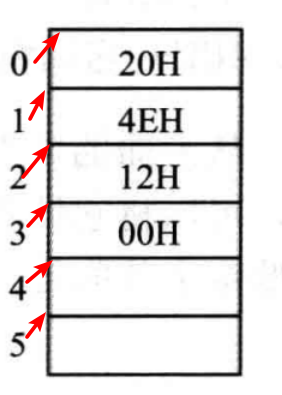

字单元：存放一个字节型数据的内存单元，也就是两个字节16位，高位放高地址，低位放低地址

## 数据段

数据段寄存器默认为 ds

所以我们要操作内存数据的时候只需要指定偏移即可

CPU不支持直接将数据送入到段寄存器，需要有寄存器作为中转

```asm
mov bx,1000H
mov ds,bx
mov [0],al
```

上述代码的含义：先设置ds寄存器为1000H，然后将al中的数据送往这个内存单元(所以我们要移动数据到内存的时候是需要先设置数据段的基地址的)

## mov指令

mov 段寄存器，寄存器  
mov 寄存器，段寄存器  
mov 内存单元，寄存器  
mov 寄存器，内存单元  
mov 段寄存器，内存单元  
mov 内存单元，段寄存器

但是 add 指令不能直接操作段寄存器和寄存器

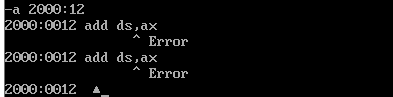

## 数据段

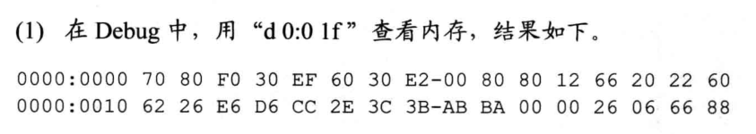

AX=0，BX=0

```
mov ax,1
mov ds,ax
mov ax,[0000] ;AX = 2662H
mov bx,[0001] ;BX = E626H
mov ax,bx     ;AX = 2662H
mov ax,[0000] ;AX = 2662H
mov bx,[0002] ;BX = D6E6H
add ax,bx     ;AX = FD48H
add ax,[0004] ;AX = 2ECC+FD48 = 2C14
mov ax,0      ;AX = 0
mov al,[0002] ;AX = E6H
mov bx,0      ;BX = 0
mov bl,[000c] ;BX = 00H
add al,bl     ;AX = E6H
```

## 栈

任意时刻 `SS:SP` 指向栈顶元素

PUSH 操作的过程

1.  SP = SP -2
2.  SS:SP 指向新的地址
3.  然后将数据送入到 `SS:SP` 指向的地址中

然后就涉及到怎么计算 `SP` 的问题了

> 只需要记住初始状态栈中没有元素，并且 SP+2 是栈中的第一个存储单元

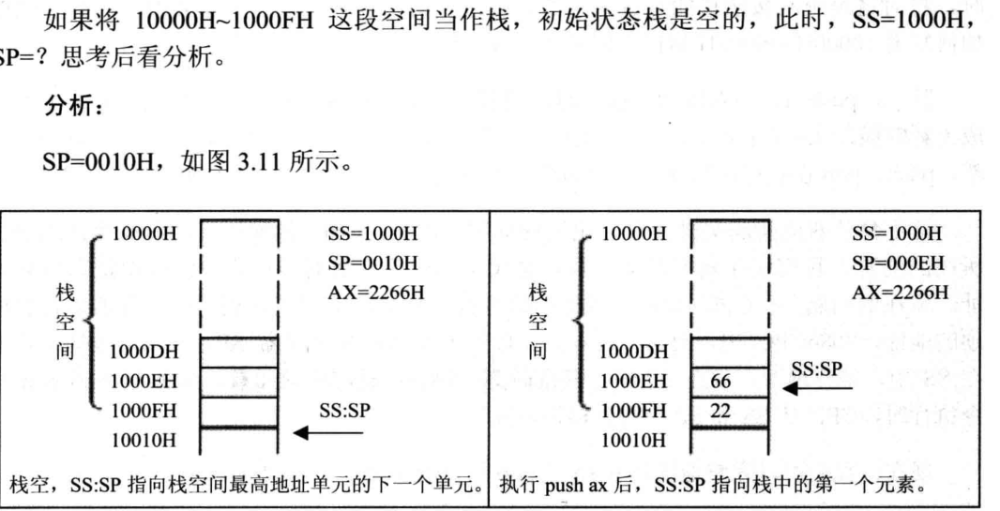

POP 指令

1.  将SS:SP 指向的内存单元数据送入到寄存器中，或者是某个内存单元中
2.  SP = SP + 2

PUSH和POP的指令形式

```
push 寄存器
pop 寄存器

push 段寄存器
pop 段寄存器

push 内存单元
pop 内存单元
```

利用栈可以达到交换数据的目的

```
mov ax,1000H
mov ss,ax
mov sp,0010H
mov ax,001AH
mov bx,001BH

push ax
push bx

pop ax
pop bx
```

## 习题

### 第一题

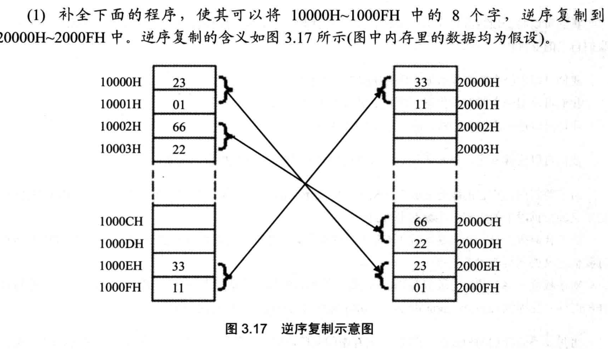

```asm
mov ax,1000H
mov ds,ax
mov ax,2000
mov ss,ax
mov sp,0010H
push[0]
push[2]
push[4]
push[6]
push[8]
push[A]
push[C]
push[E]
```

现在 1000H~100FH 的内存内容为：

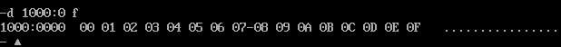

本着节约内存的想法

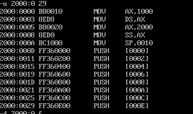

然而执行完之后的结果

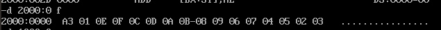

看来节约内存不是件好事，于是我重新把 3000:0 作为代码段

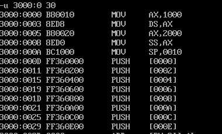

这回成功了

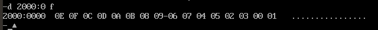

### 第二题

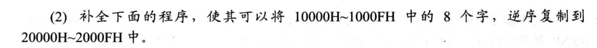

```asm
mov ax,2000H
mov ds,ax
mov ax,1000H
mov ss,ax
mov sp,0
pop [E]
pop [C]
pop [A]
pop [8]
pop [6]
pop [4]
pop [2]
pop [0]
```

同样的，我先设置 1000:0 处的值

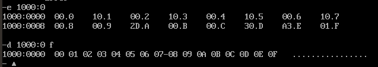

将指令书写到内存中，也就是设置 3000:0 为代码段

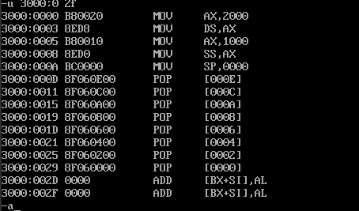

在实验的时候，前面一部分数据是可以正常复制的，但是后面就出问题了

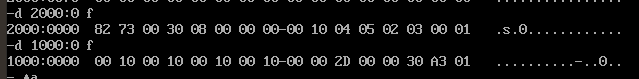

暂时没想清楚

## 实验三

遇到的问题

输入指令：

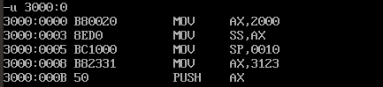

但是在执行的时候：

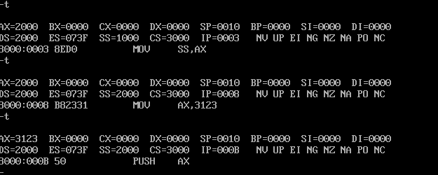

这是之后要研究的内容；中断机制  
Debug的T命令在修改寄存器SS的指令时，下一条指令也会紧接着执行

```asm
mov ax,ffff
mov ds,ax
mov ax,2200
mov ss,ax
mov sp,0100
mov ax,[0]     ;ax=C0EAH
add ax,[2]     ;ax=C0FCH
mov bx,[4]     ;bx=30F
add bx,[6]     ;bx=6021H
push ax        ;sp=FEH,修改的内存单元地址是220FEH,内容为C0FCH
push bx        ;sp=FCH,修改的内存单元地址是220FCH,内容为6021H
pop ax		   ;sp=FEH,ax=6021H
pop bx		   ;sp=100H,bx=C0FCH
push [4]       ;sp=FEH,修改的内存单元是220FEH,内容为30F0
push [6]	   ;sp=FCH,修改的内存单元是220FCH,内容为2F31
```

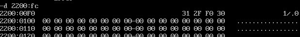

为什么2000:0 ~2000:f 的内容会发生变化？

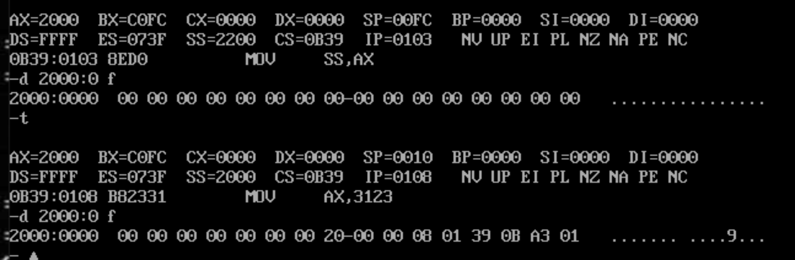

仔细观察发现  
01A3 不知道是什么，但是0b39和0108确实当前指令的地址，也就是执行完 `mov ss,ax mov sp,10H` 之后的下一条指令的地址，结合这是在设置栈，不禁想到了函数的压栈，保存了返回地址，但是还有一个 0020 的数据不知道是哪里的
