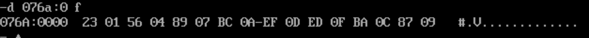
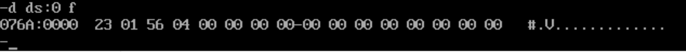
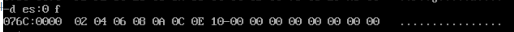
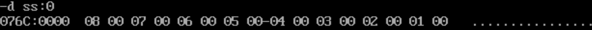

## 课后实验

### 实验一

```
assume cs:code,ds:data,ss:stack

data segment
	dw 0123h,0456h,0789h,0abch,0defh,0fedh,0cbah,0987h
data ends

stack segment
	dw 0,0,0,0,0,0,0,0
stack ends

code segment

start:
	mov ax,stack
	mov ss,ax
	mov sp,16
	
	mov ax,data
	mov ds,ax
	
	push ds:[0]
	push ds:[2]
	
	pop ds:[2]
	pop ds:[0]
	
	mov ax,4c00h
	int 21h
	
code ends
end start
```

1.  程序返回前,data段中的数据如下：



2.  程序返回前，cs = 076C, ss=076B,ds=076A
3.  code段地址如果为X，data段地址为 X-32, stack段地址为X-16

### 实验二

```
assume cs:code,ds:data,ss:stack

data segment
	dw 0123h,0456h
data ends

stack segment
	dw 0,0
stack ends

code segment

start:
	mov ax,stack
	mov ss,ax
	mov sp,16
	
	mov ax,data
	mov ds,ax
	
	push ds:[0]
	push ds:[2]
	
	pop ds:[2]
	pop ds:[0]
	
	mov ax,4c00h
	int 21h
code ends
end start
```

1.  执行程序，返回前，data段中的数据为多少



2.  程序返回前，cs=076C,ss=076B,ds=076A
3.  code段地址为X，data段地址为 X-32, stack段地址为 X- 16

### 实验五

```
assume cs:code

a segment
	db 1,2,3,4,5,6,7,8
a ends

b segment
	db 1,2,3,4,5,6,7,8
b ends

c segment
	db 0,0,0,0,0,0,0,0
c ends

code segment

start:
	mov ax,a
	mov ds,ax
	
	mov ax,b
	mov ss,ax
	
	mov ax,c
	mov es,ax
	
	mov cx,8
	mov bx,0
	mov dl,0
s:
	add dl,ds:[bx]
	add dl,ss:[bx]
	mov es:[bx], dl
	mov dl,0
	inc bx
	loop s
	
	mov ax,4c00h
	int 21h
code ends
end start
```

将a和b中的数据求和，放到c里面

执行完成后放在 es 中



### 实验六

```
assume cs:code

a segment 	
	dw 1,2,3,4,5,6,7,8,9,0ah,0bh,0ch,0dh,0eh,0fh,0ffh
a ends

b segment
	dw 0,0,0,0,0,0,0,0
b ends
code segment

start:
	mov ax,b
	mov ss,ax
	mov sp,10h
	
	mov ax,a
	mov ds,ax
	
	mov cx,8
	mov bx,0
s:
	mov dx,ds:[bx]
	push dx
	inc bx
	inc bx
	loop s
	mov ax,4c00h
	int 21h
code ends

end start
```

将a中的前8个字型数据逆序压入到b中，(注意字型数据是小端存储的)


