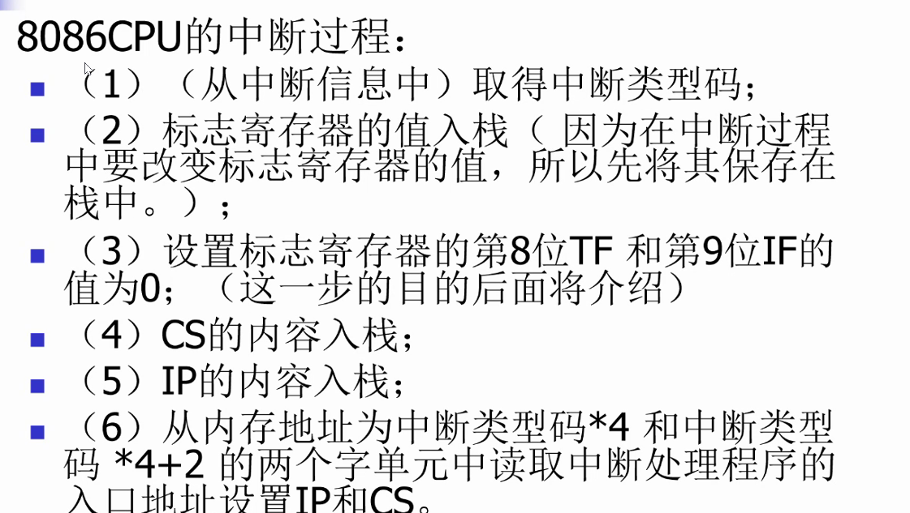
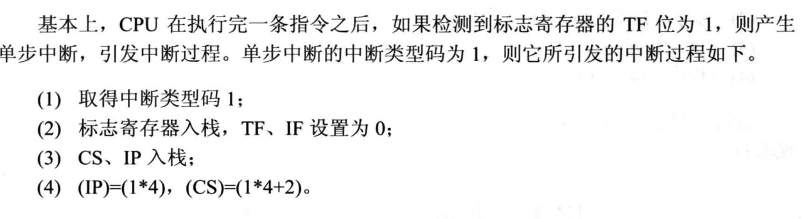
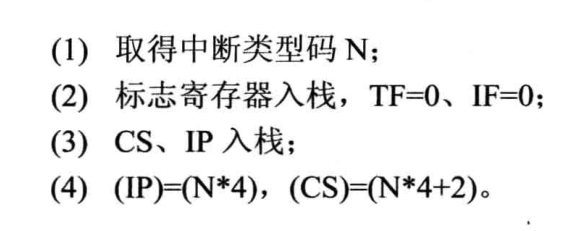
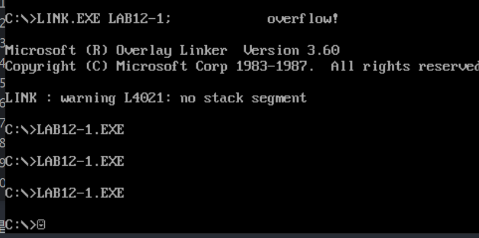

## 中断处理的流程(牢记)



关于第三步

为什么要设置第8位 TF？

这就涉及到debug程序的原理：

> debug的原理，通过设置 TF 为1，引发单步中断去执行debug准备好的中断代码
> 
> 

但是这样会有问题，在处理中断的时候是不能去触发单步中断的，所以CPU要提前设置TF为0

中断过程具体的操作



## lab12

代码如下：

```
assume cs:code
code segment
start:
    mov ax,cs
    mov ds,ax
    mov si,offset do0
    
    mov ax,0
    mov es,ax
    mov di,200H
    
    mov cx,offset do0end-offset do0
    
    rep movsb
    
    mov ax,0
    mov es,ax
    mov word ptr es:[0],200H
    mov word ptr es:[2],0

    mov ax, 1000h
    mov bh, 1
    div bh
    mov ax,4C00H
    int 21H
		
do0:
    jmp short do0start
    db "divide error!"
do0start:
    mov ax,cs
    mov ds,ax
    mov si,202H
    mov ax,0B800H
    mov es,ax
    mov di,12*160+33*2;这里要注意一下，不能因为字符串长度为13，为了居中输出就设置成12*160+67，会出现意想不到的情况
    mov cx,13
    s:
    mov al,[si]
    mov es:[di],al
    inc si
    add di,2
    loop s
    mov ax,4C00H
    int 21H
do0end:nop
code ends
end start
```

通过 `offset` 获得偏移地址

通过 `rep movsb` 来拷贝 do0 程序

> 这里特别注意，do0 要使用的字符串必须存储在 do0 子程序中，并且需要手动计算一下字符串的位置

当然最后还需要来触发这个中断

```
mov ax, 1000h
mov bh, 1
div bh
```

如果直接存放原来data中的位置

```
assume cs:code

data segment
db "overflow!"
data ends

code segment
start:
    mov ax,cs
    mov ds,ax
    mov si,offset do0
    
    mov ax,0
    mov es,ax
    mov di,200H
    
    mov cx,offset do0end-offset do0
    
    rep movsb
    
    mov ax,0
    mov es,ax
    mov word ptr es:[0],200H
    mov word ptr es:[2],0

    mov ax, 1000h
    mov bh, 1
    div bh
    mov ax,4C00H
    int 21H
		
do0:
    mov ax,data
    mov ds,ax
    mov si,0
    mov ax,0B800H
    mov es,ax
    mov di,12*160+33*2
    mov cx,13
    s:
    mov al,[si]
    mov es:[di],al
    inc si
    add di,2
    loop s
    mov ax,4C00H
    int 21H
do0end:nop
code ends
end start
```

也是可以执行的


