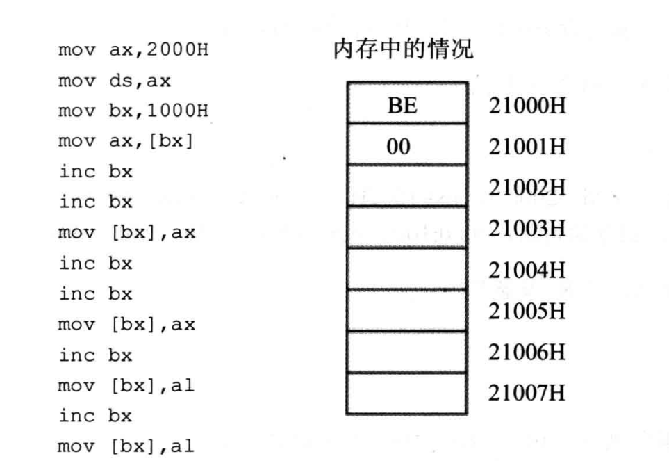
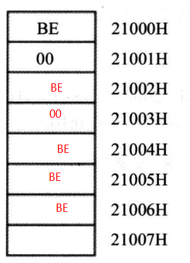
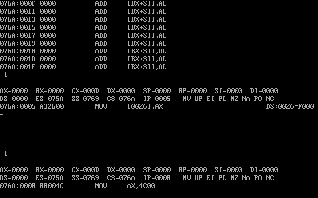
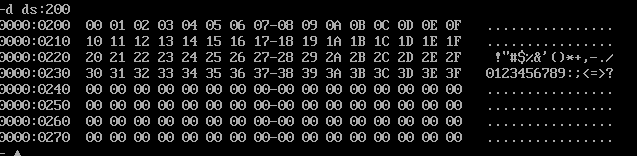
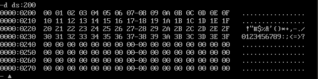
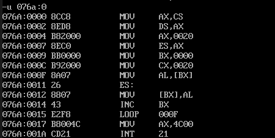
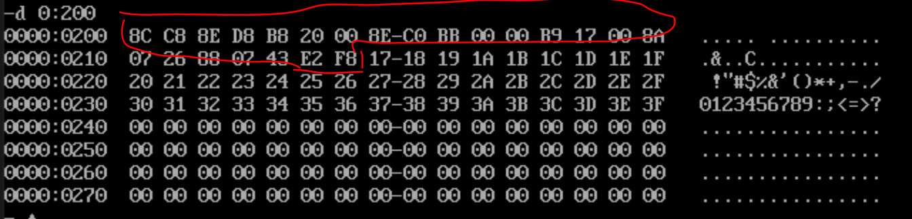

BX 寄存器在内存寻址的作用



```
mov ax, 2000H
mov ds,ax
mov bx,1000H
mov ax,[bx]  ; AX=00BEH
inc bx
inc bx
mov [bx],ax  ; BX=1002
inc bx
inc bx
mov [bx],ax  ; BX=1004
inc bx
mov [bx],al  ; BX=1005
inc bx       
mov [bx],al  ; BX=1006
```

最后得到的内存分布



## loop指令的使用

```
assume cs:code
code segment
	mov ax,2
	mov cx,11
s:  add ax,ax
	loop s
```

cx 作为循环的计数器

计算乘法，123\*236

```
assume cs:code
code segment
	mov ax,0
	mov cx,236
s:  add ax,123
	loop s
	mov ax,4c00h
	int 21h
code ends
end
```

> 注意：在汇编程序中，数据不能以字母开头

`g` 指令可以直接执行到指定的位置

`p` 会自动重复直到 `cx == 0` 为止

## Debug和masm对指令的不同处理

在汇编源程序中，我们需要这么写

```
mov ax, 2000h
mov ds, ax
mov al, ds:[0]
```

如果没有指定段寄存器

```
mov al,[0]
```

则 `masm` 理解成

```
mov al, 0
```

当然如果是寄存器的话

```
mov al, [bx]
```

则段寄存器默认存在是 ds

## 问题

计算 `ffff:0 ~ ffff:b` 单元中的数据的和，结果存储在 dx 中

由于每一个数据都是字节的，不能直接加到16位的寄存器dx中，那么我们是不是可以用dh和dl呢，但是这样可能导致进位丢失

所以我们需要将8位的数据赋值到16位寄存器然后再与dx相加

```asm
assume cs:code
code segment
    mov ax,0ffffh ; 注意数字不能以字母开头
    mov ds,ax
    mov bx,0 ;首先让 ds:bx 指向 ffff:0

    mov dx,0
    mov cx,12 ;进行12次循环

s:  mov al,[bx]
    mov ah,0  ;不要忘记给ah置0！
    add dx,ax
    inc bx
    loop s

    mov ax,4c00h
    int 21h
code ends
end
```

## 如何使用内存空间

```
assume cs:code
code segment
	mov ax,0
	mov ds,ax
	mov ds:[26h], ax
	mov ax,4c00h
	int 21h
code ends
end
```

程序出问题了，无法继续运行



DOS方式下，一般情况，`0:200 ~ 0:2ff` 空间中没有系统或其他程序的数据或代码

## 问题

将内存 ffff:0 ~ ffff:b 单元中的数据复制到 0:200 ~ 0:20b 单元中

可以将两个段的地址保存到两个寄存器中

```
assume cs:code
code segment
	mov ax,0ffffh
	mov ds,ax 
	
	mov ax,0020h
	mov es,ax
	
	mov bx,0
	
	mov cx,12

s:  mov dl,[bx]
	mov es:[bx],dl
	inc bx
	loop s

	mov ax,4c00h
	int 21h
code ends
end
```

## 实验

1.  编程，向内存 0:200 ~0:23F 依次传送数据 0 ~63(3FH)

代码

```
assume cs:code

code segment
	mov ax,0
	mov ds,ax
	mov bx,200h
	mov cx,40h
	mov ax,0
s:  mov [bx],ax
	inc ax
	inc bx
	loop s
	mov ax, 4c00h
	int 21h
code ends

end
```

运行结果



2.  编程，向内存 0:200~0:23F 一次传递数据 0~63(3FH),程序中只能使用9条指令  
    如果只能用9条指令，那么可以这么改
    
    ```
    assume cs:code
    code segment
    	mov ax,0
    	mov ds,ax
    	mov bx,0
    	mov cx,40h
    s:  mov [bx+200h],bx ;去掉了 ax，只用bx一个寄存器就可以做到
    	inc bx
    	loop s
    	mov ax, 4c00h
    	int 21h
    code ends
    end
    ```
    
    运行结果



3.  ```
    assume cs:code
    code segment
    	mov ax,cs
    	mov ds,ax
    	mov ax,0020h
    	mov es,ax
    	mov bx,0
    	mov cx,20h
    s:  mov al,[bx]
    	mov es:[bx],al
    	inc bx
    	loop s
    	mov ax,4c00h
    	int 21h
    code ends
    end
    ```
    



于是可以推测出 CX=17h

完整代码如下

```
assume cs:code
code segment	
	mov ax,cs
	mov ds,ax
	mov ax,0020h
	mov es,ax
	mov bx,0
	mov cx,17h
s:  mov al,[bx]
	mov es:[bx],al
	inc bx
	loop s
	mov ax,4c00h
	int 21h
code ends
end
```



可以看到成功复制了
